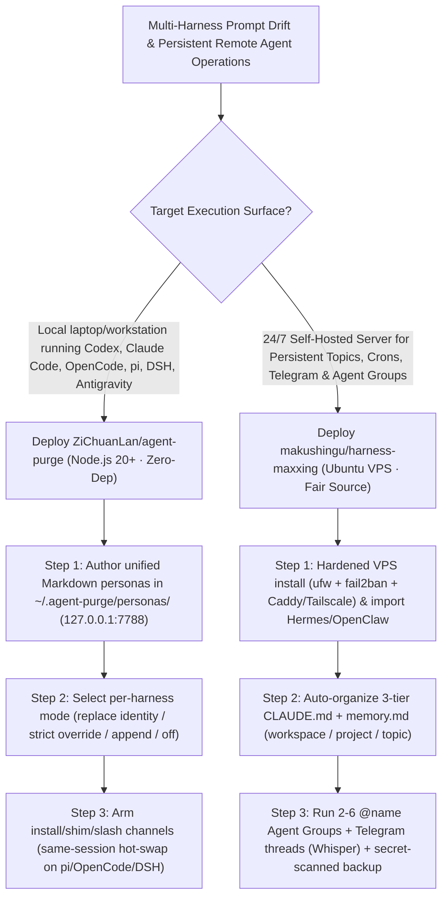

# 9+ Coding Agent Persona Hot-Swap Governance (`ZiChuanLan/agent-purge`) & Self-Hosted 3-Tier Memory Control Room (`makushingu/harness-maxxing`) Selection FAQ

> **Positioning**: This standalone guide is **Round 40 of the 2026-11-11 Night Shift (Cumulative Guide #85)**, written in the plain-language, first-principles, closed-form FinOps style of `ib-vs-ethernet-roce-selection-faq.md` for Multi-Harness Developer Productivity Architects and 24/7 AgentOps Leads evaluating two fast-rising open-source projects:
> 1. **`ZiChuanLan/agent-purge` (`1,626★`, JavaScript / Node.js 20+, zero production dependencies)**: A local-first persona and system-prompt governance tool (`http://127.0.0.1:7788` Web console + CLI + standalone Windows x64 `agent-purge.exe`) that manages **4 packet-verified injection modes (`replace` / `strict` / `append` / `off`)** and **4 scoped channels (`install` / `shim` / `slash` `/purge` / `project`)** across **9+ coding harnesses** (`pi/omp`, `OpenCode 1.x/2.x`, `DSH 0.2.1-rc.5`, `Codex 0.166.0`, `Claude Code 2.1.316`, `Kilo Code 7.8.18`, `Antigravity` `agy`, `CodeBuddy/Grok`, `WorkBuddy`, and `PI-Desktop 0.21.0`), with **same-session hot-swapping** on dynamic harnesses and conflict-safe rollback (`pause` / `disarm` / `clean`);
> 2. **`makushingu/harness-maxxing` (`204★`, Python, Fair Source)**: A self-hosted multi-column control room for Claude Code (`Project -> Topic -> persistent sessions`) running on a `2 vCPU / 4 GB RAM` Ubuntu VPS, featuring **non-interrupting side questions**, **self-organizing 3-tier memory (`CLAUDE.md` + `memory.md` at workspace/project/topic level)**, **2–6 role `@name` agent handoff groups**, **1-to-1 Telegram session threads with local Whisper transcription**, and **daily secret-scanned GitHub memory backups**.
>
> **中文版 FAQ**: [agent-purge-harness-maxxing-persona-governance-control-room-selection-faq.md](agent-purge-harness-maxxing-persona-governance-control-room-selection-faq.md) · **Architecture Summary SVG**: [`assets/github-ai-radar-2026-11-11-r40-agentpurge-harnessmaxxing.svg`](../../../assets/github-ai-radar-2026-11-11-r40-agentpurge-harnessmaxxing.svg)

---

## 📌 1. Executive Summary

1. **In plain English, what problems do these two repositories actually solve?**
   - **Ending 9-Way Config Drift & Hidden Vendor System-Prompt Bloat (`ZiChuanLan/agent-purge`)**: Developers who switch between Codex, Claude Code, OpenCode, `pi/omp`, DSH, Kilo Code, Antigravity (`agy`), and WorkBuddy have to maintain scattered config files (`SYSTEM.md`, `~/.gemini/config/AGENTS.md`, `app-config.json`), while vendor identity prompts silently override user preferences. Verified by real network packet captures (`marker=1`), `agent-purge` lets you manage one set of `~/.agent-purge/personas/*.md` files from `127.0.0.1:7788` or the CLI, apply per-harness `replace`, `strict`, `append`, or `off` modes, hot-swap personas mid-session on dynamic harnesses (`pi`, `OpenCode`, `DSH`, `PI-Desktop`), and cleanly roll back (`agent-purge clean`) without overwriting external edits.
   - **Ending Fragile Remote `tmux` Tabs & Ephemeral Session Amnesia (`makushingu/harness-maxxing`)**: Running persistent coding agents over raw SSH `tmux` tabs makes it impossible to organize dozens of workstreams, ask a side question without interrupting an in-flight tool run, or access sessions cleanly from a phone. `harness-maxxing` installs a hardened (`ufw`, `fail2ban`, Caddy/Tailscale HTTPS) multi-column control room on your own VPS with 3-tier self-compacting `CLAUDE.md` + `memory.md`, 2–6 agent `@name` handoff groups, 1-to-1 Telegram topic threads (with free local Whisper voice transcription), non-destructive imports from `Hermes` and `OpenClaw`, and daily secret-scanned backups to a private GitHub repo.
2. **Closed-Form FinOps Verdict (`CLAIM-20261111-R40-AGENTPURGE-HARNESSMAXXING`)**:
   - For a 15-person Multi-Harness AI Engineering & Operations Team running **9 coding harnesses locally and 60 persistent multi-topic remote agent workflows/crons per month** (senior platform engineer loaded rate `$90.00/hr`; base Claude Pro/Max/Ultra seat subscriptions and domain registrar fees: `not_measured`):
   - Upgrading from **Path A (Manual 9-harness config file copying + vendor prompt bloat + fragile remote SSH `tmux` sessions, `$5,670.00/mo`)** to **Path C (`agent-purge` 4-mode persona governance + `harness-maxxing` self-hosted 3-tier memory control room, `$690.00/mo`)** saves **`$4,980.00/mo` (`-87.83%`, `$59,760.00/yr`)** and reduces cross-harness prompt debugging and remote session operations labor from `45.0 hrs/mo` to `5.0 hrs/mo` (**`-88.89%`**).

---

## 🎯 2. Three Core Architectural Questions (Q1 / Q2 / Q3 Deep-Dive)

### Q1: How does `ZiChuanLan/agent-purge` verify its 4 injection modes (`replace` / `strict` / `append` / `off`) at the network packet level across 9+ harnesses?
- **First-Principles Breakdown**:
  1. **Wire-Captured Mode Semantics (Never Trust Model Self-Reporting)**:
     - Instead of asking an LLM "who are you?", `agent-purge` verifies actual outbound API payloads (`marker=1` in system/developer blocks):
       - **`replace` (default)**: Replaces the host's identity header while preserving its tool schemas and workflow instructions;
       - **`strict`**: Replaces the entire controllable host prompt entry with your persona;
       - **`append`**: Preserves the host instructions and appends your persona;
       - **`off`**: Disables injection for the target scope.
  2. **Four Channels (`install` / `shim` / `slash` / `project`) & Same-Session Hot-Swap**:
     - On harnesses with per-turn dynamic callbacks (`pi/omp`, `OpenCode 1.x/2.x`, `DSH 0.2.1-rc.5`, `PI-Desktop 0.21.0`), changing personas or running `/purge off` takes effect on the **very next turn within the same session**.
  3. **Audited Write Ledger & Conflict-Safe Restore**:
     - Tracks every managed write and refuses to clobber files modified externally since installation (`pause` / `resume` / `disarm` / `clean`).

### Q2: How does `makushingu/harness-maxxing` organize persistent sessions, 3-tier self-compacting memory, and 2–6 `@name` agent groups?
- **First-Principles Breakdown**:
  1. **Multi-Column `Project -> Topic -> Session` UI & Non-Interrupting Side Questions**:
     - Lets you queue steering edits or ask side questions mid-turn without aborting active tool calls, while displaying the exact answering model and live cost/context gauges.
  2. **Self-Organizing 3-Tier Memory (`CLAUDE.md` + `memory.md`) & Secret-Scanned Backups**:
     - Automatically loads and compacts memory at workspace, project, and topic granularity, and pushes daily snapshots through a whitelist and secret scanner to a private GitHub repository.
  3. **2–6 Role `@name` Agent Groups, Telegram Bridge & Bundled Tooling**:
     - Coordinates 2–6 persistent role agents sharing a workspace folder via `@name` handoffs, bridges every session to its own Telegram thread (with local Whisper voice notes), and bundles Remotion, HTML-to-PDF, ImageMagick, Scrapling, `maxxing infra`, and `maxxing mail`.

### Q3: How should Engineering Teams combine `agent-purge` and `harness-maxxing`?
- **Hybrid Local + Cloud Agent Architecture**:
  - Run **`agent-purge`** on developer laptops to enforce consistent, low-token personas across all 9+ local CLI/IDE harnesses, and run **`harness-maxxing`** on a self-hosted VPS (`2 vCPU / 4 GB RAM`) for 24/7 scheduled crons, webhook feeds, team topics, and mobile Telegram control.

---

## 🧭 3. Mermaid Decision Tree & Hybrid Governance Pipeline

---

## 📊 4. Architectural Comparison Matrix

| Evaluation Dimension | Path A: Manual Config Sync + Raw SSH `tmux` | Path B: Shell Aliases + Basic Telegram Bot | **Path C (Recommended): `agent-purge` + `harness-maxxing`** |
| :--- | :--- | :--- | :--- |
| **Cross-Harness Persona Control** | Manual edits across 9 folders; vendor bloat stays active | CLI flags only; cannot strip internal identity blocks | **Packet-verified `replace/strict/append/off` across 9+ harnesses** |
| **Hot-Swapping & Safe Uninstallation** | Requires restarting sessions; uninstall risks data loss | Overwrites config files without conflict detection | **Same-session hot-swap (`pi/OpenCode/DSH`) + conflict-safe `clean`** |
| **Remote Session Hierarchy & Queuing** | Flat `tmux` panes; mid-run questions interrupt execution | Single chat stream with mixed project contexts | **`Project -> Topic -> Multi-Column` + non-interrupting Side Questions** |
| **Memory Lifecycle & Backup Security** | Context dies with session or bloats `CLAUDE.md` unchecked | Manual git commits risk leaking secrets | **Self-compacting 3-tier `memory.md` + daily secret-scanned GitHub backup** |
| **Monthly TCO (9 Harnesses + 60 Topics)** | **`$5,670.00 / mo`** (`$1,620` bloat/reruns + `$4,050` labor) | **`$2,860.00 / mo`** (`$790` compute + `$2,070` labor) | **`$690.00 / mo` (Saves `$4,980.00/mo` · `-87.83%`)** |

---

## 🧪 5. Closed-Form FinOps Example & 7-Card Insights (`CLAIM-20261111-R40-AGENTPURGE-HARNESSMAXXING`)

### 5.1 Workload & Scope Boundary
- **Workload**: A 15-person AI Engineering & Operations Team using **9 coding harnesses locally** and maintaining **60 persistent multi-topic remote agent workflows/crons per month**.
- **Rates**: Senior platform/productivity engineer loaded rate at **`$90.00 / hr`**.
- **Explicit Scope Boundary**: Base Claude Pro/Max/Ultra seat subscriptions and external domain registrar fees are marked **`not_measured`**.

### 5.2 Closed-Form Monthly Cost Breakdown

| Cost Component | Path A: Manual Config Sync + Raw SSH `tmux` | Path B: Shell Aliases + Basic Telegram Bot | **Path C: `agent-purge` + `harness-maxxing` (Recommended)** |
| :--- | :--- | :--- | :--- |
| **System-Prompt Token Bloat, Lost-Session Reruns & VPS** | **`$1,620.00`** | **`$790.00`** | **`$240.00`** (`replace/strict` pruning + 3-tier compact memory + `2vCPU/4GB` VPS) |
| **Cross-Harness Config Sync & Remote Ops Labor (`$90/hr`)** | `45.0 hrs × $90.00` = **`$4,050.00`** | `23.0 hrs × $90.00` = **`$2,070.00`** | `5.0 hrs × $90.00` = **`$450.00`** |
| **Total Monthly TCO** | **`$5,670.00 / mo`** | **`$2,860.00 / mo`** (`-49.56%`) | **`$690.00 / mo`** |
| **Net Savings vs. Path A** | Baseline | Saves `$2,810.00 / mo` | **Saves `$4,980.00 / mo` (`-87.83%` · `$59,760.00/yr`)** |
| **Base Claude Subscription Seats & Domain Fees** | `not_measured` | `not_measured` | `not_measured` |

---

## 🛠️ 6. Production Verification Checklist

- [ ] **1. Loopback-Only `agent-purge web` & Persona Directory Setup**: Launch `agent-purge web` (`127.0.0.1:7788`), store personas under `~/.agent-purge/personas/*.md`, and verify status with `agent-purge status`.
- [ ] **2. Per-Harness Mode Selection & Conflict-Safe `clean`**: Configure `replace` or `strict` per harness (`agent-purge use <id> --for codex`), avoid enabling redundant channels on the same harness, and always run `agent-purge clean` before uninstalling.
- [ ] **3. Hardened `harness-maxxing` VPS Setup**: Deploy on Ubuntu 24.04 (`2 vCPU / 4 GB RAM`), verify `ufw` (SSH/80/443 only), `fail2ban`, and Caddy/Tailscale HTTPS, and confirm idle-only CLI auto-updates.
- [ ] **4. Daily Secret-Scanned GitHub Memory Backup**: Enable the daily private GitHub backup job and verify that the built-in secret scanner strips credentials from workspace/project/topic `memory.md` files before pushing.
- [ ] **5. Non-Destructive `Hermes`/`OpenClaw` Import & `@name` Group Budgets**: Test zip import preview from `Hermes` or `OpenClaw` and enforce daily budgets and Telegram approval gates on 2–6 agent `@name` groups.
