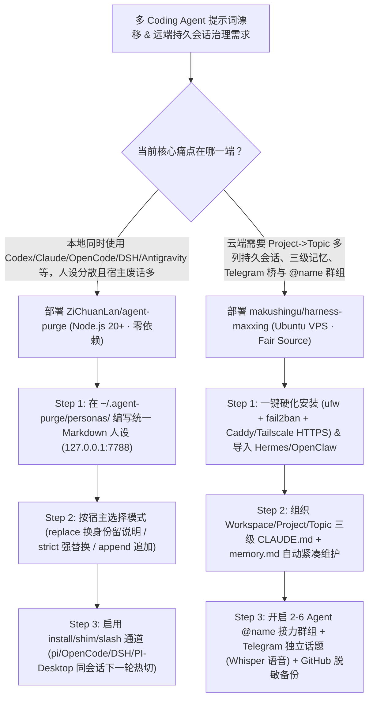

# 9+ Coding Agent 统一提示词人设热切治理（`ZiChuanLan/agent-purge`）与自托管三级记忆多列控制室（`makushingu/harness-maxxing`）深度选型 FAQ

> **文档定位**：本专题是 **2026-11-11 夜班第 40 轮（累计第 85 篇）独立六段式选型指南**，严格对标 `ib-vs-ethernet-roce-selection-faq.md` 的通俗第一性原理与闭式 FinOps 核算规范，面向多 Harness 研发效能架构师与全天候 Agent 运营（AgentOps）团队，深度拆解今日在本地跨执行器人设治理与自托管多会话控制室赛道爆发的两大热门开源仓：
> 1. **`ZiChuanLan/agent-purge`（`1,626★`，JavaScript / Node.js 20+，零生产依赖）**：解决“一台电脑装了 Codex、Claude Code、OpenCode、pi/omp、DSH、Kilo Code、Antigravity (`agy`)、CodeBuddy、Grok、WorkBuddy、PI-Desktop 等十几种 Agent，每家系统提示词位置不同、甚至内置冗长身份废话互相打架”的痛点——提供**四模式真实抓包验证（`replace` / `strict` / `append` / `off`）**、**四级通道（`install` / `shim` / `slash` `/purge` / `project`）**、**动态执行器同会话下一轮热切**与带外部修改冲突保护的一键回滚（`pause` / `disarm` / `clean`）；
> 2. **`makushingu/harness-maxxing`（`204★`，Python，Fair Source）**：部署在自有 `2 vCPU / 4 GB RAM` Ubuntu VPS 上的 **Claude Code 全功能自托管控制室**——按 `Project -> Topic -> 多列并排持久会话` 组织工作，内置**不打断当前执行的旁路提问队列（Side Questions）**、**三级自整理记忆（Workspace / Project / Topic 级 `CLAUDE.md` + `memory.md`）**、**2–6 角色 `@name` 接力群聊（Agent Groups）**、**每会话独立 Telegram 话题线程（含本地 Whisper 免费语音转写）**、以及**每日经密钥扫描（Secret Scanner）推送到私有 GitHub 仓的记忆备份**！
>
> **English Version**: [agent-purge-harness-maxxing-persona-governance-control-room-selection-faq.en.md](agent-purge-harness-maxxing-persona-governance-control-room-selection-faq.en.md) · **架构总结图**: [`assets/github-ai-radar-2026-11-11-r40-agentpurge-harnessmaxxing.svg`](../../../assets/github-ai-radar-2026-11-11-r40-agentpurge-harnessmaxxing.svg)

---

## 📌 一、核心结论速览（Executive Summary）

1. **一句话大白话讲透这两个项目到底解决了什么痛点？**
   - **终结“10 个 Coding Agent 维护 10 套提示词、且无法精准剔除宿主废话或随时回滚”的痛点（`ZiChuanLan/agent-purge`）**：不同 Coding Agent 把系统提示词藏在千奇百怪的地方（比如 Antigravity 写 `~/.gemini/config/AGENTS.md` 落在 `<user_rules>`、PI-Desktop 写 `~/.pi/agent/SYSTEM.md`、WorkBuddy 写 `app-config.json`），而且只看模型口头回答“我是谁”根本不准。`agent-purge` 通过真实请求级抓包（`marker=1`）验证了 **9+ 主流执行器**的注入边界，让你在本地 `127.0.0.1:7788` Web 面板或 CLI 里维护一份 `~/.agent-purge/personas/*.md` 人设，按执行器独立选择 `replace`（替换身份保留工具说明）、`strict`（替换可控入口全文）、`append`（追加）或 `off`；在 `pi/omp`、`OpenCode`、`DSH`、`PI-Desktop` 上甚至支持**同一会话内 `/purge` 下一轮直接热切人设**，卸载时 `agent-purge clean` 还能检测外部改动防止误删用户配置！
   - **终结“远端跑 Claude Code 只能开一堆杂乱 SSH `tmux` 窗口、记忆随会话丢失、手机没法分话题操控”的痛点（`makushingu/harness-maxxing`）**：`harness-maxxing` 用一条安装命令把你的 Linux VPS 变成带防火墙硬化（`ufw` + `fail2ban` + Caddy/Tailscale HTTPS）的多列 Web 控制室：支持在长任务运行中途插入**不打断主流程的旁路提问（Side Questions）**，自动维护 Workspace / Project / Topic 三级 `CLAUDE.md` + `memory.md`，让 2–6 个常驻角色 Agent 在同一对话里通过 `@name` 轮流接力，并将每个会话双向映射为 Telegram 独立 Thread（自带本地免费 Whisper 语音转写与每日带脱敏扫描的 GitHub 私有仓自动备份）！
2. **闭式 FinOps 投资回报结论（`CLAIM-20261111-R40-AGENTPURGE-HARNESSMAXXING`）**：
   - 以 15 人多 Harness 全栈 AI 研发与自动化运营团队每月在本地使用 **9 种 Coding Agent 执行器**、并在云端维护 **60 个持久项目话题与定时巡检任务** 为基准（高级平台/研发效能工程师含税费率 `$90.00/hr`；底层 Claude Pro/Max/Ultra 订阅席位费与外部域名年费：`not_measured`）：
   - 从 **Path A（手工在 9 套目录间复制粘贴规则文件 + 宿主冗余提示词消耗 + 远端裸跑 `tmux` 会话断连重跑，月均 `$5,670.00`）** 升级至 **Path C（`agent-purge` 四模式人设治理 + `harness-maxxing` 三级自整理记忆与多列控制室，月均 `$690.00`）**，每月净省 **`$4,980.00/mo`（降幅 `-87.83%`，年省 `$59,760.00/yr`）**，并将跨工具提示词排障与远端会话运维工时从 `45.0 hrs/mo` 压缩至 `5.0 hrs/mo`（节省 **`-88.89%`**）。

---

## 🎯 二、三大灵魂拷问（Q1 / Q2 / Q3 深度原理解析）

### Q1：`ZiChuanLan/agent-purge` 的四种处理模式（`replace` / `strict` / `append` / `off`）与四条通道在真实抓包层面有什么本质区别？
- **第一性原理拆解**：
  1. **不信模型自称、只信真实网络抓包（Packet-Verified Injection）**：
     - 很多工具以为改了配置文件就完全接管了 System Prompt，但实际上不同宿主的请求结构大相径庭（例えば Antigravity `agy` 写入 `~/.gemini/config/AGENTS.md` 会进入 system 层的 `<user_rules>`，但宿主内置 `<identity>` 段仍在，需靠规则优先级压制）。`agent-purge` 对 `Kilo Code`、`Antigravity`、`DSH`、`OpenCode` 等逐一执行四模式真实请求抓包验收：
       - **`replace`（默认）**：精准替换宿主的身份定义行，完整保留工具调用规范与环境说明；
       - **`strict`**：用自定义人设完全替换可控入口中的宿主文本（适合极致精简 Token 与消除宿主语气干扰）；
       - **`append`**：完整保留宿主原有说明，在末尾追加自定义人设；
       - **`off`**：立即关闭对应入口注入。
  2. **四级作用通道与同会话热切边界**：
     - 提供 `install`（托管配置/插件）、`shim`（PATH 同名命令转发）、`slash`（会话内 `/purge` 扩展）与 `project`（项目目录级规则）四条通道；
     - 在具备每轮动态回调的执行器（`pi/omp`、`OpenCode 1.x/2.x`、`DSH 0.2.1-rc.5`、`PI-Desktop 0.21.0` imported 插件）上，修改人设或执行 `/purge off` **无需重开会话，下一轮对话立即生效**！
  3. **零生产依赖与冲突安全撤销账本**：
     - 记录每次托管写入的原始快照与恢复依据；当用户手工修改过外部配置文件时，恢复操作会保留现场并明确报出冲突，绝不盲目覆盖用户心血。

### Q2：`makushingu/harness-maxxing` 是如何通过三级自整理记忆、旁路提问队列与 `@name` Agent 群组把单个 CLI 变成全天候运营中枢的？
- **第一性原理拆解**：
  1. **不打断执行流的消队列（Steer & Non-Interrupting Side Questions）与真实模型溯源**：
     - 在多列并排会话界面中，当 Agent 正在执行耗时重构或爬虫任务时，你可以随时发送**旁路提问（Side Question）**查询上下文而不中断主任务循环；界面实时显示**真正回答该轮请求的底层模型名称**及精确成本/上下文仪表盘。
  2. **三级自演进记忆（Workspace / Project / Topic）与密钥扫描 GitHub 备份**：
     - 自动加载并由内置技能持续压缩更新 Workspace、Project、Topic 三级 `CLAUDE.md` 与 `memory.md`；每天定时经白名单与**密钥扫描器（Secret Scanner）**脱敏后推送到你的私有 GitHub 仓库，换服务器时支持一键恢复，且支持从 `Hermes`、`Claude Code` 或 `OpenClaw` 导入历史工作区压缩包（带预览与回收站，绝不覆盖现有文件）。
  3. **2–6 角色 `@name` 接力群组与全栈生产力工具箱**：
     - 支持在同一 Topic 内配置 2–6 个拥有独立职责、记忆与每日预算上限的常驻 Agent，共享工作目录并通过 `@name` 自动交接任务；开箱预装 Node.js + Remotion（动效视频）、HTML→PDF、ImageMagick、Scrapling（含 JS 渲染网页抓取）、`maxxing infra`（VPS/Cloudflare/数据库编排）与 `maxxing mail`（IMAP/SMTP 邮件分拣与草稿生成）。

### Q3：AI 架构师如何将 `agent-purge` 与 `harness-maxxing` 协同部署？
- **黄金组合落地范式**：
  - 在**本地开发机（Windows / macOS / WSL）**上运行 **`ZiChuanLan/agent-purge`**（`http://127.0.0.1:7788`），用统一精简的架构师人设（如“中文结论先行、修改前必读源码、严禁臆造坐标”）统管本地 `Codex`、`Claude Code`、`OpenCode`、`Antigravity` 与 `DSH`；
  - 在**团队/个人云端 VPS** 上运行 **`makushingu/harness-maxxing`**，承载 7×24 定时 Cron、Webhook 事件流（Stripe/GitHub）、Telegram 移动语音协同与三级持久记忆库！

---

## 🧭 三、Mermaid 选型决策树与本地-云端协同治理流水线

---

## 📊 四、同类方案核心能力对比矩阵（Selection Matrix）

| 评估维度 | Path A：手工维护各家规则文件 + 远端裸跑 `tmux` | Path B：简单 Shell 别名脚本 + 单通道 Telegram 机器人 | **Path C（推荐）：`agent-purge` + `harness-maxxing`** |
| :--- | :--- | :--- | :--- |
| **跨 Harness 人设注入深度与验证** | 手工改 9 个目录极易遗漏；不知宿主隐藏了多少系统废话 | 仅能传命令行启动参数，无法改写宿主内部身份段 | **9+ 执行器真实抓包验证，`replace/strict/append/off` 四模式精准控制** |
| **同会话动态热切与冲突回滚** | 改完配置必须杀进程重开会话；卸载易误删手工改动 | 无状态备份账本，直接覆盖原配置文件 | **`pi/OpenCode/DSH/PI-Desktop` 同会话热切 + 冲突检测安全回滚 (`clean`)** |
| **远端持久会话组织与旁路提问** | `tmux` 窗口一多完全找不到上下文；插话会打断当前执行 | 只有一个扁平聊天框，多项目上下文混杂串台 | **`Project -> Topic -> 多列会话` + 不打断主流程的 Side Questions** |
| **多级记忆演进与安全备份** | 会话结束即失忆，或 `CLAUDE.md` 越攒越长撑爆窗口 | 手工 git commit，极易把 API Key 误传到仓库 | **三级自整理 `memory.md` + 每日带 Secret Scanner 的私有 GitHub 备份** |
| **月度总拥有成本（9 执行器 + 60 话题）** | **`$5,670.00 / mo`**（`$1,620` Token 浪费 + `$4,050` 人工） | **`$2,860.00 / mo`**（`$790` 算力 + `$2,070` 人工） | **`$690.00 / mo`（净省 `$4,980.00/mo` · `-87.83%`）** |

---

## 🧪 五、定量 FinOps 算例与 7-Card 洞察（`CLAIM-20261111-R40-AGENTPURGE-HARNESSMAXXING`）

### 5.1 测算基准与显式边界（Scope & Boundaries）
- **场景设定**：15 人全栈 AI 研发与自动化运营团队，本地使用 **9 种 Coding Agent 执行器**，并在云端维护 **60 个持久业务话题、定时 Cron 与多角色协作流水线**。
- **费率假设**：高级平台/研发效能工程师全包时薪 **`$90.00 / hr`**。
- **显式边界声明（Explicit Not-Measured Boundary）**：底层 Claude Pro/Max/Ultra 账号基础订阅月费与外部商业域名注册年费标记为 **`not_measured`**，本表核算冗余系统提示词/断连重跑 Token 损耗、VPS 托管成本与工程师配置同步/会话运维工时。

### 5.2 三路径月度成本闭式对照表

| 成本分项 | Path A：手工同步 9 套配置 + 远端裸跑 `tmux` | Path B：简单 Shell 脚本 + 单线程 Telegram 桥 | **Path C：`agent-purge` + `harness-maxxing`（推荐）** |
| :--- | :--- | :--- | :--- |
| **冗余系统提示词损耗、断连重跑 Token 与 VPS 费用** | **`$1,620.00`**（宿主冗长提示词 + 会话丢失重跑） | **`$790.00`** | **`$240.00`**（`replace/strict` 精简注入 + 三级紧凑记忆 + `2vCPU/4GB` VPS） |
| **跨执行器规则同步、配置冲突恢复与远端巡检工时（`$90/hr`）** | `45.0 hrs × $90.00` = **`$4,050.00`** | `23.0 hrs × $90.00` = **`$2,070.00`** | `5.0 hrs × $90.00` = **`$450.00`** |
| **月度总成本（Monthly TCO）** | **`$5,670.00 / mo`** | **`$2,860.00 / mo`**（`-49.56%`） | **`$690.00 / mo`** |
| **相对 Path A 净节省** | 基准线（Baseline） | 净省 `$2,810.00 / mo` | **净省 `$4,980.00 / mo`（`-87.83%` · 年省 `$59,760.00/yr`）** |
| **底层 Claude 订阅席位费与外部域名年费** | `not_measured` | `not_measured` | `not_measured` |

---

## 🛠️ 六、生产级落地核验 Checklist

- [ ] **1. `agent-purge` 本机安全监听与人设目录隔离**：通过 `npm install -g agent-purge` 或独立 `agent-purge.exe` 启动 `agent-purge web`（确认仅监听 `127.0.0.1:7788`），并将自定义人设保存在 `~/.agent-purge/personas/*.md`。
- [ ] **2. 按执行器分拣注入模式与通道防重**：使用 `agent-purge status` 检查各执行器状态，对同一执行器避免同时开启多个重复注入通道；在 `pi`、`OpenCode`、`DSH`、`PI-Desktop` 上验证 `/purge` 同会话热切，在卸载前务必先执行 `agent-purge clean`。
- [ ] **3. `harness-maxxing` 网络硬化与空闲自动升级验证**：在 Ubuntu 24.04 VPS（`2 vCPU / 4 GB RAM`）上完成安装后，核验 `ufw`（仅开放 SSH/80/443）、`fail2ban` 与 Caddy/Tailscale HTTPS 生效，并确认 Claude Code CLI 仅在无运行任务时自动更新。
- [ ] **4. 三级 `memory.md` 与私有 GitHub 密钥扫描备份**：配置每日自动推送到私有 GitHub 仓库的记忆备份任务，触发一次包含模拟 API Key 的测试记忆，确认内置 Secret Scanner 成功拦截或脱敏后再入库。
- [ ] **5. `Hermes` / `OpenClaw` 零覆盖迁移与 `@name` 群组预算上限**：使用内置导入向导预览并迁入历史 `Hermes` 或 `OpenClaw` 压缩包，并为每个 Topic 内的 2–6 角色 `@name` Agent 群组设置每日调用预算上限（Daily Budget）与 Telegram 审批门禁。
