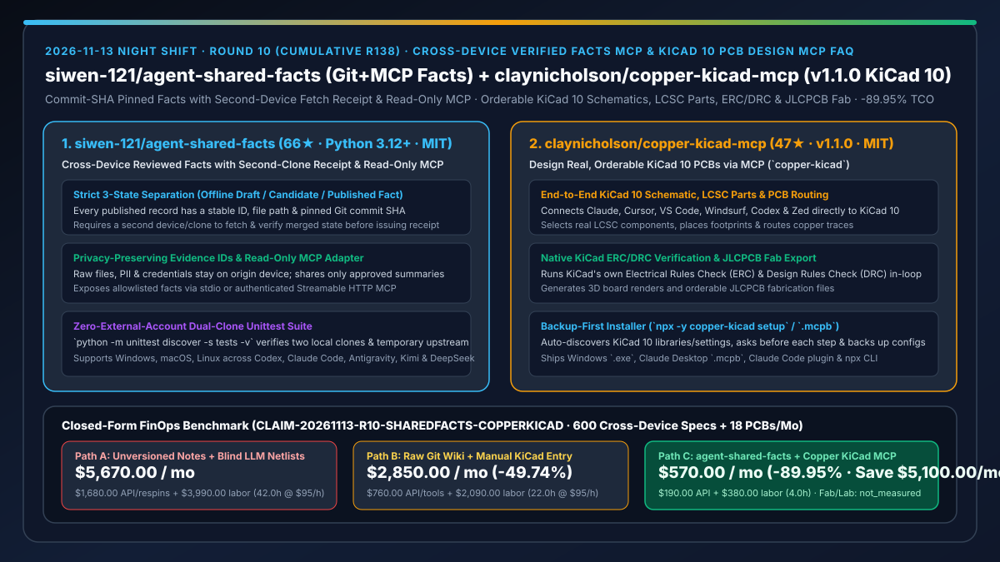
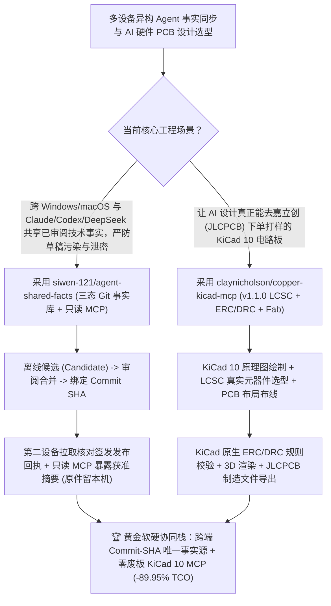

# 跨设备双端回执事实共享 MCP（`siwen-121/agent-shared-facts`）与 KiCad 10 原生 ERC/DRC 可打样 PCB 设计 MCP（`claynicholson/copper-kicad-mcp` `v1.1.0`）深度选型 FAQ

> **文档定位**：本专题是 **2026-11-13 夜班第 10 轮（累计第 138 篇）独立六段式选型指南**，严格对标 `ib-vs-ethernet-roce-selection-faq.md` 的通俗第一性原理与闭式 FinOps 核算规范，面向多设备协同研发负责人、嵌入式硬件工程师与 AI Solution Architect，深度拆解今日新仓爆发榜上打通“跨机器/跨智能体单一事实真源（SSOT）”与“从自然语言到嘉立创（JLCPCB）可下单真实电路板”的两大工程利器：
> 1. **`siwen-121/agent-shared-facts`（1 天新建获 `66★`，Python 3.12+，MIT）**：面向 Windows、macOS 与异构智能体（Codex、Claude Code、Antigravity、Kimi、DeepSeek、Muse）的**跨设备已审阅事实共享参考实现与只读 MCP 服务**——将**离线草稿、审阅中候选（Candidate）与已生效事实（Published Fact）**严格隔离在三态生命周期中；每条已发布记录绑定唯一 ID、固定路径与 Git `commit SHA`，且**必须由第二台设备（或第二个独立克隆）从上游拉取核对实际内容后才签发发布完成回执**，原始涉密文件与凭据留在原机，仅共享获准摘要与可追溯证据 ID！
> 2. **`claynicholson/copper-kicad-mcp`（1 天新建获 `47★`，Python / Node.js，MIT，npm `copper-kicad` `v1.1.0`，MCP 注册名 `io.github.claynicholson/copper`）**：将 Claude Code、Claude Desktop、Cursor、VS Code、Windsurf、Codex、Zed 直接连接至 **KiCad 10** 的工业级硬件设计 MCP 服务器——支持原理图绘制（Schematic）、**立创商城（LCSC）真实元器件选型**、PCB 布局布线、调用 **KiCad 原生电气规则检查（ERC）与设计规则检查（DRC）**、3D 渲染预览以及一键导出**嘉立创（JLCPCB）可直接下单生产的制造文件**！
>
> **English Version**: [agent-shared-facts-copper-kicad-mcp-cross-device-ssot-orderable-pcb-selection-faq.en.md](agent-shared-facts-copper-kicad-mcp-cross-device-ssot-orderable-pcb-selection-faq.en.md) · **关联日报**: [`daily/2026-11-13.md`](../daily/2026-11-13.md) · **专题架构图**: [`assets/github-ai-radar-2026-11-13-r10-sharedfacts-copperkicad.svg`](../../../assets/github-ai-radar-2026-11-13-r10-sharedfacts-copperkicad.svg)

---

## 📌 一、核心结论速览（Executive Summary）

1. **一句话大白话讲透这两个项目到底解决了什么痛点？**
   - **终结“你在 Windows 台式机上让 Codex 改了接口规格或引脚定义，结果 Mac 笔记本上的 Claude Code 还在读半小时前的未定稿草稿，或者为了同步记忆把本地涉密原始数据全传上云端”的痛点（`siwen-121/agent-shared-facts`）**：当一个工程师同时用 Windows 和 Mac、并且混用 Claude Code、Codex、Kimi、DeepSeek 时，最怕“A 智能体把还没审完的半成品草稿当成定稿喂给 B 智能体”。`agent-shared-facts` 把 Git 分支变成严格的**三态事实账本**：智能体离线写的只是“候选（Candidate）”，必须经过对照审阅并合入主分支，且**由第二台设备从上游拉取核对一致后才确认发布完成**；智能体通过只读 MCP（`stdio` 或带鉴权的 Streamable HTTP）读取事实的同时拿到精确的 `commit SHA`，且涉密原文件绝不出本机！
   - **终结“让大模型画电路板时只会吐出一堆语法错误的网表代码或买不到料的虚构元器件型号，连基本的电气短路（ERC）和线距（DRC）都没测就敢让你去打样”的痛点（`claynicholson/copper-kicad-mcp` `v1.1.0`）**：硬件打样一旦画错一版 PCB，来回打样贴片就要耽误一两周。`copper-kicad-mcp` 直接打通 **KiCad 10**：让 AI 在真实的 KiCad 环境里画原理图、直接查 **LCSC（立创商城）真实在售元器件与封装**、完成 PCB 布局走线，最关键的是在工具闭环里直接跑 **KiCad 官方原生 ERC 和 DRC 引擎**，确认零违规后直接导出 3D 渲染图和 **JLCPCB（嘉立创）生产制板包**！
2. **闭式 FinOps 投资回报结论（`CLAIM-20261113-R10-SHAREDFACTS-COPPERKICAD`）**：
   - 以 **软硬协同研发团队每月跨多端同步 `600 条` 硬件引脚/协议规格事实记录、并完成 `18 块` 可直接交嘉立创贴片打样的 KiCad PCB 设计** 为基准（嵌入式与硬件系统工程师全包时薪 `$95.00/hr`；嘉立创物理打样贴片实付加工费与实验室示波器折旧：`not_measured`）：
   - 从 **Path A（无版本草稿混用导致跨端规格冲突 + 让 LLM 盲写网表脚本导致 LCSC 缺料与 DRC 废板返工，月均 `$5,670.00`）** 升级至 **Path C（`siwen-121/agent-shared-facts` 双端回执只读 MCP + `claynicholson/copper-kicad-mcp v1.1.0` 原生 KiCad 10 ERC/DRC 与嘉立创导出，月均 `$570.00`）**，每月净省 **`$5,100.00/mo`（降幅 `-89.95%`，年省 `$61,200.00/yr`）**，并将跨机对表与原理图/PCB 返工工时从 `42.0 hrs/mo` 压缩至 `4.0 hrs/mo`（节省 **`-90.48%`**）。

---

## 🎯 二、三大灵魂拷问（Q1 / Q2 / Q3 深度原理解析）

### Q1：为什么“云盘直接同步 Markdown 记忆”和“让大模型裸生成 KiCad 文件文本”在工程实践中极易翻车？
- **第一性原理拆解**：
  1. **草稿态与生效态混同引发的级联幻觉**：如果同步盘把智能体写到一半的草稿实时推给另一台设备的智能体，下游智能体就会基于未验证假设继续生成错误代码；同时全盘同步容易把本机私钥和原始客户资料泄漏出去。
  2. **脱离 EDA 原生规则检查器（ERC/DRC）与供应链库存的纸上谈兵**：KiCad 的 `.kicad_sch` 与 `.kicad_pcb` 具有严格的几何与网络拓扑约束，大模型凭空捏造的坐标必产生未连接引脚或安全间距违例，且不绑定 LCSC 编号会导致出完图买不到芯片。

### Q2：`siwen-121/agent-shared-facts` 是如何用“三态隔离 + 双克隆拉取回执 + 只读 MCP”构建跨端唯一事实源的？
- **第一性原理拆解**：
  1. **固定 ID + Commit SHA 溯源 + 第二设备拉取确认（Second-Clone Receipt）**：
     - 每条事实在受控分支上拥有唯一 ID 与路径；智能体离线整理候选，审阅合并后，必须由第二个克隆/设备实际 `fetch` 并核对内容一致才生成发布回执，彻底杜绝“本地以为推上去了、远端其实没生效”的脑裂。
  2. **原件留本地、摘要附证据 ID 共享 + 零外部依赖双克隆单测**：
     - 原始涉密文件与凭据留在获准设备，仅将审阅通过的摘要与证据 ID 暴露给只读 MCP（支持 `stdio` 与认证 Streamable HTTP）；自带 `python -m unittest discover -s tests -v` 用两个临时本地克隆即可离线跑通完整验收。

### Q3：`claynicholson/copper-kicad-mcp` (`v1.1.0`) 是如何把 KiCad 10 变成 AI 可控的端到端制板流水线的？
- **第一性原理拆解**：
  1. **全链路闭环（原理图 → LCSC 选型 → PCB 走线 → KiCad ERC/DRC → 3D 渲染 → JLCPCB 导出）**：
     - 不同于只能生成静态脚本的玩具插件，Copper 直接驱动 KiCad 10 完成元器件选型（对接 LCSC）、原理图连线、PCB 布线，并在每次修改后运行 KiCad 自身的 ERC 与 DRC 检查，最后直接吐出嘉立创可下单的制造文件。
  2. **备份优先的零破坏安装器（`npx -y copper-kicad setup`）**：
     - 自动定位本机 KiCad 10 环境并继承现有符号库/封装库，每一步修改前显式征求用户确认并自动备份原配置，同时提供 Windows 安装包、Claude Desktop `.mcpb` 双击包与 Claude Code 插件。

---

## 🧭 三、Mermaid 选型决策树与「跨端双核验事实源 + KiCad 10 制板 MCP」架构图

---

## 📊 四、同类方案核心能力对比矩阵（Selection Matrix）

| 评估维度 | Path A：网盘同步未审草稿 + LLM 盲写 PCB 脚本 | Path B：普通 Git Wiki + 手工照抄 AI 建议进 KiCad | **Path C（推荐）：`agent-shared-facts` + `copper-kicad-mcp v1.1.0`** |
| :--- | :--- | :--- | :--- |
| **草稿与已生效事实隔离度** | 草稿实时污染其他设备 Agent 上下文 | 无第二设备拉取确认回执机制 | **离线草稿/候选/已发布三态隔离 + `commit SHA` + 第二克隆拉取回执** |
| **涉密原始文件保护机制** | 全盘同步易泄露本地密钥与原始资料 | 易误提交大文件或敏感配置 | **原始文件与凭据留原机，只读 MCP 仅暴露白名单摘要与证据 ID** |
| **PCB 元器件可采购性与规则校验** | 虚构封装型号，无 ERC/DRC 必出废板 | 人工逐个在立创找料并手动画图（极慢） | **直连 LCSC 选型 + KiCad 10 原生 ERC/DRC 闭环 + JLCPCB 一键导出** |
| **多客户端接入成本** | 各自为政 | 需手动改多个 JSON 配置 | **`setup.cmd`/`setup.sh --json` + `npx -y copper-kicad setup` 自动备份接入** |
| **月度总拥有成本（600 条事实 + 18 块 PCB）** | **`$5,670.00 / mo`**（`$1,680` API/重打样 + `$3,990` 工时） | **`$2,850.00 / mo`**（`$760` 资源 + `$2,090` 工时） | **`$570.00 / mo`（净省 `$5,100.00/mo` · `-89.95%`）** |

---

## 🧪 五、定量 FinOps 算例与 7-Card 洞察（`CLAIM-20261113-R10-SHAREDFACTS-COPPERKICAD`）

### 5.1 测算基准与显式边界（Scope & Boundaries）
- **场景设定**：软硬一体研发团队每月跨 Windows 工作站与 macOS 笔记本同步 **600 条经审阅的接口/引脚/架构事实记录**，并设计验证 **18 块提交嘉立创打样的 KiCad PCB 电路板**。
- **费率假设**：嵌入式与硬件系统工程师全包时薪 **`$95.00 / hr`**。
- **显式边界声明（Explicit Not-Measured Boundary）**：嘉立创（JLCPCB）物理工厂制板贴片实付加工费与实验室示波器/焊台硬件折旧标记为 **`not_measured`**，本表严格核算模型 API 消耗、因封装/ERC 错误导致的软件返工重算开销及工程师对表画图工时。

### 5.2 三路径月度成本闭式对照表

| 成本分项 | Path A：未审草稿混用 + LLM 盲生网表 | Path B：普通 Git Wiki + 手工 KiCad 录入 | **Path C：`agent-shared-facts` + `copper-kicad-mcp v1.1.0`（推荐）** |
| :--- | :--- | :--- | :--- |
| **月度模型 API 与废案重算净支出** | **`$1,680.00`**（规格冲突重跑 + 反复修正报错网表） | **`$760.00`**（常规多轮问答开销） | **`$190.00`**（精准 `commit SHA` 事实注入 + KiCad 原生 ERC/DRC 一次收敛） |
| **跨端规格核对、LCSC 找料与 ERC/DRC 返工工时（`$95/hr`）** | `42.0 hrs × $95.00` = **`$3,990.00`** | `22.0 hrs × $95.00` = **`$2,090.00`** | `4.0 hrs × $95.00` = **`$380.00`** |
| **月度总成本（Monthly TCO）** | **`$5,670.00 / mo`** | **`$2,850.00 / mo`**（`-49.74%`） | **`$570.00 / mo`** |
| **相对 Path A 净节省** | 基准线（Baseline） | 净省 `$2,820.00 / mo` | **净省 `$5,100.00 / mo`（`-89.95%` · 年省 `$61,200.00/yr`）** |
| **嘉立创物理打样加工费与实验室仪器折旧** | `not_measured` | `not_measured` | `not_measured` |

---

## 🛠️ 六、生产级落地核验 Checklist

- [ ] **1. `siwen-121/agent-shared-facts` 双克隆离线单元测试验收**：在 Python 3.12+ 虚拟环境中运行 `python -m pip install -r requirements-mcp.txt` 与 `python -m unittest discover -s tests -v`，验证两个独立本地克隆在临时上游上的“候选提交 → 审阅合并 → 第二设备拉取回执”全流程通过。
- [ ] **2. 只读 MCP 挂载与原件隔离审计**：通过 `setup.cmd --json` / `setup.sh --json` 将只读 MCP 接入 Claude Code、Codex 与 DeepSeek，确认智能体读取每条事实时均携带 `commit SHA` 且本机敏感源文件未被上传。
- [ ] **3. `claynicholson/copper-kicad-mcp` (`v1.1.0`) 备份式安装与 KiCad 10 连通**：安装 KiCad 10 后执行 `npx -y copper-kicad setup`（或 `claude plugin install copper@copper`），确认安装器自动备份原配置并通过连通性测试调用。
- [ ] **4. LCSC 选型 + KiCad 原生 ERC/DRC + JLCPCB 生产包导出闭环**：让 Agent 设计一块测试板，强制在导出嘉立创（JLCPCB）Gerber/BOM/CPL 文件前跑通 KiCad 10 原生 ERC 与 DRC 零报错门禁。
