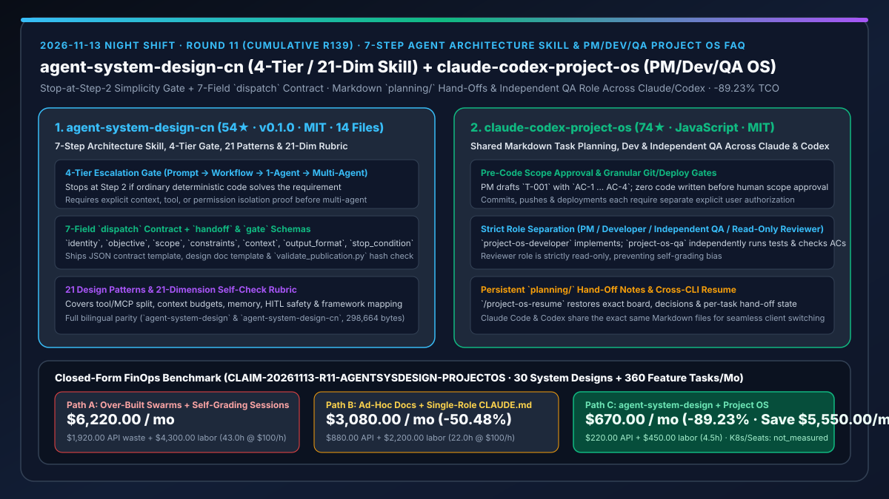
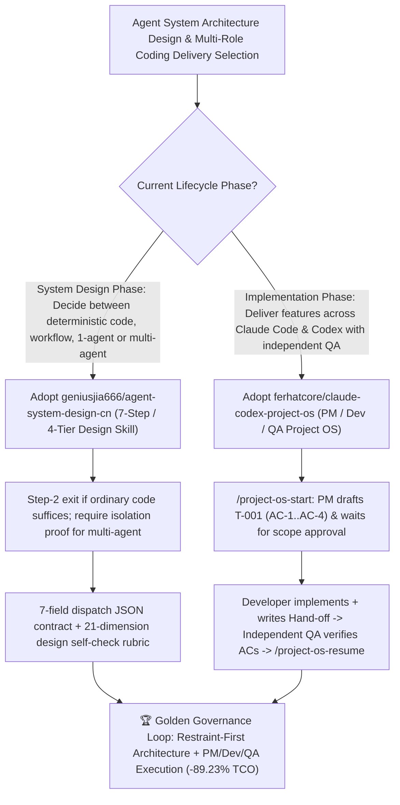

# 7-Step 4-Tier Agent Architecture Design Skill (`geniusjia666/agent-system-design-cn`) & Cross-CLI PM/Dev/QA Project OS (`ferhatcore/claude-codex-project-os`) Selection FAQ

> **Document Scope**: This is the **2026-11-13 Night Shift Round 11 (Cumulative #139) standalone 6-part selection guide**, modeled strictly after `ib-vs-ethernet-roce-selection-faq.md` with first-principles explanations and closed-form FinOps math. It is written for AI Solution Architects and Engineering Productivity Leads evaluating two methodological governance frameworks for agent design and multi-role code delivery:
> 1. **`geniusjia666/agent-system-design-cn` (`54★` in 3 days, Python / Markdown, MIT, `v0.1.0`, paired with English `geniusjia666/agent-system-design`, 14 files / `298,664` bytes hash-verified via `scripts/validate_publication.py`)**: An architecture design and review Skill built on the rule *"First decide whether you need multi-agent at all, then design how they collaborate; stop at Step 2 if ordinary code suffices"* — featuring a **7-step workflow, 4 complexity tiers (`Prompt → Workflow → Single-Agent → Multi-Agent`), 21 patterns, a 21-dimension self-check rubric**, and a **7-field `dispatch` contract** (`identity`, `objective`, `scope`, `constraints`, `context`, `output_format`, `stop_condition`, plus `handoff` and `gate`)!
> 2. **`ferhatcore/claude-codex-project-os` (`74★` in 2 days, JavaScript, MIT, zero-dependency `node scripts/init.mjs`)**: A Markdown-backed multi-role **Project OS for Claude Code and Codex** (`/project-os-start` & `/project-os-resume`) where a **PM role** drafts tasks (`T-001`) with explicit acceptance criteria (`AC-1 … AC-4`) in `planning/`, requires **human scope approval before any code is written**, delegates coding to `project-os-developer`, and assigns an independent **`project-os-qa` role** (plus read-only Reviewer) to verify every criterion with evidence!
>
> **中文版本**: [agent-system-design-cn-claude-codex-project-os-architecture-gate-pm-dev-qa-selection-faq.md](agent-system-design-cn-claude-codex-project-os-architecture-gate-pm-dev-qa-selection-faq.md) · **Daily Digest**: [`daily/2026-11-13.en.md`](../daily/2026-11-13.en.md) · **Topic SVG**: [`assets/github-ai-radar-2026-11-13-r11-agentsysdesign-projectos.svg`](../../../assets/github-ai-radar-2026-11-13-r11-agentsysdesign-projectos.svg)

---

## 📌 1. Executive Summary

1. **In plain English, what core pain points do these two repositories solve?**
   - **Ending "premature multi-agent swarm over-engineering where a deterministic script or single agent would suffice, and unbounded subagent loops lacking `stop_condition` contracts" (`geniusjia666/agent-system-design-cn`)**: Teams frequently jump straight to multi-agent graphs without proving why a single agent or deterministic workflow isn't enough. This 14-file (`298,664`-byte) bilingual Skill enforces a **7-step design pipeline and 4-tier escalation gate (`Prompt → Workflow → Single-Agent → Multi-Agent`)**: if ordinary code suffices, design stops at Step 2; multi-agent is permitted only when justified by explicit context, tool, or permission isolation, and every delegation must populate a 7-field `dispatch` JSON contract audited against a 21-dimension rubric!
   - **Ending "lost session context, unapproved scope creep across a dozen files, and coding agents grading their own homework without independent QA" (`ferhatcore/claude-codex-project-os`)**: `Project OS` stores boards, task specs, decisions, and per-task Hand-off notes in `planning/` Markdown files shared between Claude Code and Codex. In `/project-os-start`, the **PM** drafts `T-001` with `AC-1 … AC-4` and waits for human scope approval before any code is written; **`project-os-developer`** implements the change; **`project-os-qa`** independently runs the test suite and verifies each acceptance criterion; commits, pushes, and deployments each require separate approval, and `/project-os-resume` picks up seamlessly in either Claude Code or Codex!
2. **Closed-Form FinOps Conclusion (`CLAIM-20261113-R11-AGENTSYSDESIGN-PROJECTOS`)**:
   - Modeled for an **AI architecture and engineering delivery team reviewing `30 automation/agent system designs per month` and executing `360 feature tasks per month`** (fully loaded architect/lead engineer rate `$100.00/hr`; production K8s hosting and enterprise GitHub seat licenses: `not_measured`):
   - Upgrading from **Path A (over-engineered multi-agent swarms + unapproved scope creep & self-grading sessions, `$6,220.00/mo`)** to **Path C (`agent-system-design-cn` 4-tier gate & 7-field `dispatch` contract + `claude-codex-project-os` PM/Dev/QA separation, `$670.00/mo`)** saves **`$5,550.00/mo` (`-89.23%`, or `$66,600.00/yr`)** and cuts architecture rework and QA debugging labor from `43.0 hrs/mo` to `4.5 hrs/mo` (**`-89.53%`**).

---

## 🎯 2. Three First-Principles Deep-Dive Questions (Q1 / Q2 / Q3)

### Q1: Why do "default-to-multi-agent" architectures and single-session self-grading cause runaway token burn and brittle releases?
- **First-Principles Breakdown**:
  1. **Multi-Agent Coordination Tax & Missing Stop Conditions**: Every inter-agent hop multiplies token overhead and failure surfaces; without formal `scope` and `stop_condition` contracts, subagents loop or overwrite each other's work.
  2. **Self-Grading Confirmation Bias**: When the same session that wrote the code also evaluates completion without separate QA role isolation or persisted hand-off notes, edge cases go untested and context vanishes when the terminal closes.

### Q2: How does `geniusjia666/agent-system-design-cn` enforce architectural restraint via its 4-tier gate and 7-field `dispatch` contract?
- **First-Principles Breakdown**:
  1. **Step-2 Deterministic Exit & 4-Tier Isolation Proof**:
     - Stops at Step 2 whenever ordinary code solves the problem; escalates across `Prompt → Workflow → Single-Agent → Multi-Agent` only when context capacity, tool access, or permission boundaries require isolation.
  2. **7-Field `dispatch` Contract & 21-Dimension Self-Check**:
     - Enforces `identity`, `objective`, `scope`, `constraints`, `context`, `output_format`, and `stop_condition` alongside `handoff` and `gate` schemas, backed by 10 reference manuals and a 21-dimension design rubric.

### Q3: How does `ferhatcore/claude-codex-project-os` coordinate PM, Developer, and QA roles across Claude Code and Codex?
- **First-Principles Breakdown**:
  1. **Pre-Code Scope Approval & Explicit Git/Deploy Gates**:
     - Requires human approval on `T-001` (`AC-1 … AC-4`) before `project-os-developer` writes code, and separate approvals for commits, pushes, and deployments.
  2. **Independent `project-os-qa` Role & Cross-CLI `planning/` Persistence**:
     - `project-os-qa` verifies every acceptance criterion independently while the Reviewer role remains strictly read-only; all state lives in `planning/` Markdown files so `/project-os-resume` works across both Claude Code and Codex.

---

## 🧭 3. Mermaid Decision Tree & 4-Tier Architecture Gate + PM/Dev/QA Project OS Flow

---

## 📊 4. Head-to-Head Selection Matrix

| Dimension | Path A: Over-Engineered Swarms + Self-Grading Sessions | Path B: Ad-Hoc Docs + Single-Role `CLAUDE.md` | **Path C (Recommended): `agent-system-design-cn` + `claude-codex-project-os`** |
| :--- | :--- | :--- | :--- |
| **Over-Engineering Prevention** | Defaults to multi-agent graphs for trivial tasks | Informal reviewer judgment | **Step-2 deterministic exit + 4-tier escalation gate** |
| **Subagent Handoff Contract** | Unstructured natural-language prompts | Ad-hoc markdown notes | **7-field `dispatch` JSON contract + `handoff` & `gate` schemas** |
| **Scope Control & QA Independence** | Unchecked multi-file edits; self-certified tests | Manual post-hoc diff review | **Pre-code scope approval + separate `Developer`, `QA` & read-only `Reviewer`** |
| **Cross-Session / Cross-CLI Continuity** | Context lost on terminal close | Manual summary copy-paste | **Shared `planning/` Hand-off files + `/project-os-resume` across Claude & Codex** |
| **Monthly TCO (30 Designs + 360 Tasks)** | **`$6,220.00 / mo`** (`$1,920` API + `$4,300` labor) | **`$3,080.00 / mo`** (`$880` API + `$2,200` labor) | **`$670.00 / mo` (Saves `$5,550.00/mo` · `-89.23%`)** |

---

## 🧪 5. Closed-Form FinOps Worked Example & 7-Card Insights (`CLAIM-20261113-R11-AGENTSYSDESIGN-PROJECTOS`)

### 5.1 Baseline Parameters & Explicit Scope Boundaries
- **Scenario**: An AI architecture and delivery team designing **30 automation/agent systems per month** and executing **360 feature implementation tasks per month** across Claude Code and Codex.
- **Labor Rate**: Fully loaded AI solution architect / lead engineer rate of **`$100.00 / hr`**.
- **Explicit Not-Measured Boundary**: Production Kubernetes cluster hosting and enterprise GitHub seat licenses are marked **`not_measured`**. This model strictly accounts for LLM API spend and engineering hours spent debugging over-engineered swarms, reconstructing lost session state, and reworking self-graded code.

### 5.2 Three-Path Monthly Cost Comparison

| Cost Component | Path A: Over-Built Swarms + Self-Grading Sessions | Path B: Ad-Hoc Docs + Single-Role `CLAUDE.md` | **Path C: `agent-system-design-cn` + `Project OS` (Recommended)** |
| :--- | :--- | :--- | :--- |
| **Monthly Model API Spend** | **`$1,920.00`** (unnecessary multi-agent chatter + scope-creep reruns) | **`$880.00`** (repeated long-context reloads) | **`$220.00`** (Step-2 simplicity gate + compact `planning/` hand-offs) |
| **Architecture Rework, Context Recovery & QA Labor (`$100/hr`)** | `43.0 hrs × $100.00` = **`$4,300.00`** | `22.0 hrs × $100.00` = **`$2,200.00`** | `4.5 hrs × $100.00` = **`$450.00`** |
| **Total Monthly TCO** | **`$6,220.00 / mo`** | **`$3,080.00 / mo`** (`-50.48%`) | **`$670.00 / mo`** |
| **Net Savings vs. Path A** | Baseline | Saves `$3,140.00 / mo` | **Saves `$5,550.00 / mo` (`-89.23%` · `$66,600.00/yr`)** |
| **Production K8s Hosting & Enterprise GitHub Seats** | `not_measured` | `not_measured` | `not_measured` |

---

## 🛠️ 6. Production Adoption Checklist

- [ ] **1. `geniusjia666/agent-system-design-cn` Publication Integrity Check**: Run `python scripts/validate_publication.py` to verify all 14 skill files (`298,664` bytes) and install the `skills/agent-system-design-cn/` directory with its `references/` and `assets/`.
- [ ] **2. 4-Tier Gate & 7-Field `dispatch` Contract Review**: Apply the 7-step workflow to new agent proposals, stopping at Step 2 when deterministic code suffices and requiring completed `dispatch` JSON contracts and 21-dimension self-check scores for multi-agent designs.
- [ ] **3. `ferhatcore/claude-codex-project-os` Initialization**: Run `node scripts/init.mjs --target ../my-project --name "My Project" --example` on Node 22+ and test `/project-os-start` on the sample Trailboard project.
- [ ] **4. PM Scope Gate + Independent QA + Cross-CLI `/project-os-resume`**: Verify that `project-os-developer` cannot write code before scope approval, `project-os-qa` independently verifies `AC-1 … AC-4`, and `/project-os-resume` restores full state when switching between Claude Code and Codex.
