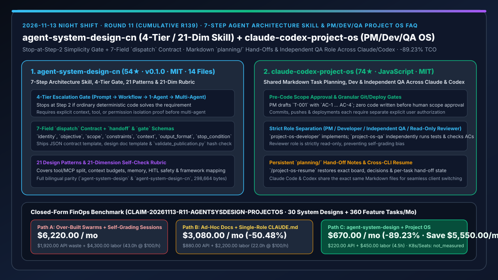
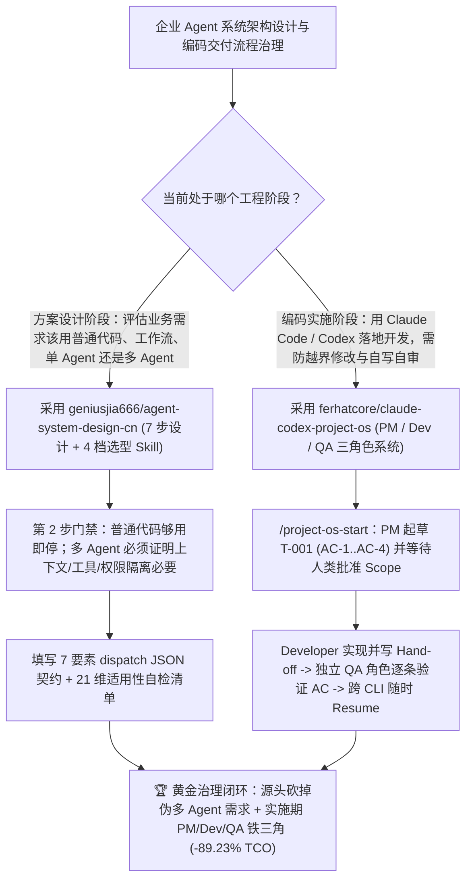

# 7 步四档智能体架构设计审查技能（`geniusjia666/agent-system-design-cn`）与跨 Claude/Codex 三角色工程项目操作系统（`ferhatcore/claude-codex-project-os`）深度选型 FAQ

> **文档定位**：本专题是 **2026-11-13 夜班第 11 轮（累计第 139 篇）独立六段式选型指南**，严格对标 `ib-vs-ethernet-roce-selection-faq.md` 的通俗第一性原理与闭式 FinOps 核算规范，面向研发架构委员会、AI 工程效能负责人与 AI Solution Architect，深度拆解今日新仓爆发榜上专门治理由“盲目上多 Agent 导致过度设计”和“单会话既当运动员又当裁判员”引发的工程乱象的两大方法论底座：
> 1. **`geniusjia666/agent-system-design-cn`（3 天新建获 `54★`，Python / Markdown，MIT，`v0.1.0`，配套英文版 `geniusjia666/agent-system-design`，全仓 14 文件 `298,664` 字节经 `validate_publication.py` 哈希锁死）**：遵循**“先判断需不需要多 Agent，再设计它们如何协作；普通代码够用时在第 2 步直接停止”**第一性原理的系统设计與评审 Skill——内置 **7 步设计流程、4 档复杂度阶梯（提示词 → 工作流 → 单 Agent → 多 Agent）、21 种检索模式、21 维适用性自检清单**，以及包含 7 大必填要素（`identity`、`objective`、`scope`、`constraints`、`context`、`output_format`、`stop_condition`）的 **`dispatch` / `handoff` / `gate` 交接契约模板**！
> 2. **`ferhatcore/claude-codex-project-os`（2 天新建获 `74★`，JavaScript，MIT，零外部依赖 `node scripts/init.mjs`）**：让 **Claude Code 与 OpenAI Codex 共享同一套 `planning/` Markdown 状态文件** 的多角色软件工程操作系统（`/project-os-start` & `/project-os-resume`）——将单次任务拆分为 **PM（起草任务 `T-001` 与验收标准 `AC-1…AC-4`，未经人类批准范围绝不动一行代码）、`project-os-developer`（按契约写代码与测试）、`project-os-qa`（独立运行测试并逐条核对 AC 证据）以及只读 `Reviewer`**，提交、推送与部署各自要求独立审批，且随时关闭终端后换另一个 CLI 都能无缝续接！
>
> **English Version**: [agent-system-design-cn-claude-codex-project-os-architecture-gate-pm-dev-qa-selection-faq.en.md](agent-system-design-cn-claude-codex-project-os-architecture-gate-pm-dev-qa-selection-faq.en.md) · **关联日报**: [`daily/2026-11-13.md`](../daily/2026-11-13.md) · **专题架构图**: [`assets/github-ai-radar-2026-11-13-r11-agentsysdesign-projectos.svg`](../../../assets/github-ai-radar-2026-11-13-r11-agentsysdesign-projectos.svg)

---

## 📌 一、核心结论速览（Executive Summary）

1. **一句话大白话讲透这两个项目到底解决了什么痛点？**
   - **终结“明明一个 50 行确定性脚本或单次 Prompt 就能搞定的需求，团队却非要堆一个 5-Agent 蜂群互相聊天烧钱，且子智能体之间没有明确停止条件（`stop_condition`）导致死循环”的痛点（`geniusjia666/agent-system-design-cn`）**：很多架构师一上来就画多智能体拓扑图，结果上线后全是上下文传话损耗。这份 `298,664` 字节的完整中英双语 Skill 把架构克制写进了铁律：**第 2 步先做四档分流（Prompt / Workflow / 单 Agent / 多 Agent）——如果普通代码够用，直接停在第 2 步不准用大模型；如果单 Agent 够用，绝不上多 Agent**（除非你能证明存在上下文、工具或权限上的硬隔离理由）！一旦确需派发子任务，强制填写含 7 要素的 `dispatch` JSON 契约，并用 21 维自检表逐项打分！
   - **终结“在 Claude Code 或 Codex 里聊了一下午，关掉窗口上下文就全丢了；或者模型没问你就擅自改了十几个范围外文件、自己写完代码自己宣布‘测试通过’”的痛点（`ferhatcore/claude-codex-project-os`）**：`Project OS` 不装任何花哨数据库，直接在项目旁初始化一套 Claude Code 与 Codex 通读的 `planning/` 目录：输入 `/project-os-start` 后，先由 **PM 角色** 拟定 `T-001` 与 `AC-1 … AC-4` 验收标准；**在你点头批准 Scope 之前，禁止写任何一行代码**；批准后交给 **`project-os-developer`** 实现并写入 Hand-off 交接单，再由**完全独立的 `project-os-qa` 角色**跑测试逐条核验 `AC-1` 至 `AC-4`，随时关机下次跑 `/project-os-resume` 甚至中途从 Claude Code 切到 Codex 都能一秒接上！
2. **闭式 FinOps 投资回报结论（`CLAIM-20261113-R11-AGENTSYSDESIGN-PROJECTOS`）**：
   - 以 **企业 AI 解决方案团队每月评审设计 `30 个` 业务自动化/Agent 架构方案、并交付 `360 个` Claude Code / Codex 功能开发任务** 为基准（AI 解决方案架构师/主程全包时薪 `$100.00/hr`；生产环境 K8s 底座与企业 GitHub 账号年费：`not_measured`）：
   - 从 **Path A（不分青红皂白全上多 Agent 蜂群烧 Token + 无前置范围审批与自写自审导致返工，月均 `$6,220.00`）** 升级至 **Path C（`agent-system-design-cn` 四档克制选型/7 要素契约 + `claude-codex-project-os` PM/Dev/QA 三权分立与跨 CLI 续接，月均 `$670.00`）**，每月净省 **`$5,550.00/mo`（降幅 `-89.23%`，年省 `$66,600.00/yr`）**，并将过度设计排障与返工工时从 `43.0 hrs/mo` 压缩至 `4.5 hrs/mo`（节省 **`-89.53%`**）。

---

## 🎯 二、三大灵魂拷问（Q1 / Q2 / Q3 深度原理解析）

### Q1：为什么“万物皆多 Agent”和“单智能体自写自审（Self-Grading）”是当前 AI 工程落地的两大头号杀手？
- **第一性原理拆解**：
  1. **多 Agent 通信税与模糊交接**：每增加一次跨 Agent 转发，不仅上下文 Token 倍增，如果没有显式定义 `scope`（边界）、`output_format`（输出结构）和 `stop_condition`（停止条件），子智能体极易在边界模糊处无限重试或越界修改。
  2. **实现者与验收者同源偏差（Implementer-Verifier Bias）**：让写代码的同一个上下文会话去判断“功能是否完成”，模型往往会迎合自己的实现漏洞甚至跳过失败用例；且一旦终端关闭，散落在聊天记录里的架构决定立即蒸发。

### Q2：`geniusjia666/agent-system-design-cn` 是如何用“7 步流程 + 4 档阶梯 + 7 要素契约”挡住过度设计的？
- **第一性原理拆解**：
  1. **第 2 步硬停止规则与四档隔离举证**：
     - 在 `01-架构选型.md` 中明确规定：普通确定性代码够用时在第 2 步直接终止 AI 方案；在提示词、工作流、单 Agent、多 Agent 四档中遵循最小复杂度原则，只有当存在明确的**上下文容量隔离、高危工具隔离或权限边界隔离**理由时才允许引入多 Agent。
  2. **`dispatch` 七要素契约与 21 维自检门禁**：
     - 在 `assets/交接契约模板.json` 中固化 `identity / objective / scope / constraints / context / output_format / stop_condition` 七字段及 `handoff`、`gate` 校验责任；配套 10 册参考文档（涵盖工具/MCP/Skill 分工、上下文预算与框架映射）及 21 维按需打分自检表。

### Q3：`ferhatcore/claude-codex-project-os` 是如何靠纯 Markdown 文件实现“PM 控范围、Dev 写代码、QA 独立验、双 CLI 随时切”的？
- **第一性原理拆解**：
  1. **四道显式人工审批锁（Scope / Commit / Push / Deploy）**：
     - PM 会话起草任务与 `AC-1 … AC-4` 后必须等待人类批准 Scope 才能动代码；哪怕 QA 验证全部通过，任务状态也只标为 `done (not committed)`，后续 `git commit`、`git push` 与部署各自需要独立审批。
  2. **`planning/` 交接单持久化与 Claude Code ↔ Codex 无缝互操作**：
     - 任务看板、架构决策（Decisions）与每个任务的 Hand-off 笔记全部以结构化 Markdown 存于 `planning/`；不仅关闭终端后可通过 `/project-os-resume` 零损恢复，还能在 PM 规划用 Claude Code、开发实现切 Codex、独立 QA 再切回 Claude Code 的混合工作流中无缝共享状态！

---

## 🧭 三、Mermaid 选型决策树与「四档架构门禁 + PM/Dev/QA 三权分立」架构图

---

## 📊 四、同类方案核心能力对比矩阵（Selection Matrix）

| 评估维度 | Path A：盲目堆砌多 Agent 框架 + 单会话自写自审 | Path B：手写非标架构文档 + 单一 `CLAUDE.md` | **Path C（推荐）：`agent-system-design-cn` + `claude-codex-project-os`** |
| :--- | :--- | :--- | :--- |
| **防止过度设计（Over-Engineering）门禁** | 默认一切需求全上多 Agent 编排图 | 凭架构师个人经验口头把关 | **第 2 步硬停止规则 + 4 档复杂度阶梯 + 多 Agent 三重隔离举证** |
| **跨智能体派发契约标准化** | 自由文本传话，无明确停止条件 | 非结构化 Prompt 模板 | **7 要素 `dispatch` JSON 契约（含 `scope`、`constraints`、`stop_condition`）** |
| **开发范围控制与独立质量验收** | 边聊边改十几个文件，自己写完自己宣布通过 | 仅靠人工事后看 Diff | **未批 Scope 禁写代码 + `Developer` / 独立 `QA` / 只读 `Reviewer` 角色分离** |
| **跨会话/跨 CLI（Claude ↔ Codex）续接** | 关终端即丢上下文，换工具需重头交代 | 需手工复制粘贴历史总结 | **`planning/` Hand-off 笔记持久化 + `/project-os-resume` 跨客户端秒级续接** |
| **月度总拥有成本（30 方案 + 360 开发任务）** | **`$6,220.00 / mo`**（`$1,920` API + `$4,300` 返工工时） | **`$3,080.00 / mo`**（`$880` API + `$2,200` 工时） | **`$670.00 / mo`（净省 `$5,550.00/mo` · `-89.23%`）** |

---

## 🧪 五、定量 FinOps 算例与 7-Card 洞察（`CLAIM-20261113-R11-AGENTSYSDESIGN-PROJECTOS`）

### 5.1 测算基准与显式边界（Scope & Boundaries）
- **场景设定**：AI 解决方案与研发团队每月评审设计 **30 个业务自动化/智能体系统方案**，并基于 Claude Code 与 Codex 执行 **360 个功能模块开发与测试任务**。
- **费率假设**：AI 解决方案架构师与主力工程师全包时薪 **`$100.00 / hr`**。
- **显式边界声明（Explicit Not-Measured Boundary）**：生产环境云端 Kubernetes 集群月租与企业级 GitHub 组织席位费标记为 **`not_measured`**，本表严格核算因过度设计多 Agent 产生的冗余 API 账单、范围蔓延重跑开销以及架构返工/QA 核验工时。

### 5.2 三路径月度成本闭式对照表

| 成本分项 | Path A：盲目多 Agent 蜂群 + 自写自审无交接 | Path B：非标设计文档 + 单角色 `CLAUDE.md` | **Path C：`agent-system-design-cn` + `Project OS`（推荐）** |
| :--- | :--- | :--- | :--- |
| **月度模型 API Token 净支出** | **`$1,920.00`**（伪多 Agent 循环传话 + 越界修改反复重跑） | **`$880.00`**（单会话长上下文重复加载） | **`$220.00`**（第 2 步拦截伪 Agent 需求 + `planning/` 精准 Hand-off） |
| **过度设计排障、丢失上下文重建与 QA 返工工时（`$100/hr`）** | `43.0 hrs × $100.00` = **`$4,300.00`** | `22.0 hrs × $100.00` = **`$2,200.00`** | `4.5 hrs × $100.00` = **`$450.00`** |
| **月度总成本（Monthly TCO）** | **`$6,220.00 / mo`** | **`$3,080.00 / mo`**（`-50.48%`） | **`$670.00 / mo`** |
| **相对 Path A 净节省** | 基准线（Baseline） | 净省 `$3,140.00 / mo` | **净省 `$5,550.00 / mo`（`-89.23%` · 年省 `$66,600.00/yr`）** |
| **生产 K8s 底座租赁与企业 GitHub 席位费** | `not_measured` | `not_measured` | `not_measured` |

---

## 🛠️ 六、生产级落地核验 Checklist

- [ ] **1. `geniusjia666/agent-system-design-cn` 完整性校验与安装**：运行 `python scripts/validate_publication.py` 核对 14 个文件（`298,664` 字节）哈希无篡改，将 `skills/agent-system-design-cn/` 完整目录（含 `references/` 与 `assets/`）挂载至宿主 Agent。
- [ ] **2. 四档选型门禁与 7 要素 `dispatch` 契约评审**：对新业务需求执行 7 步设计法，验证普通逻辑在第 2 步被正确拦截为确定性代码/工作流，多 Agent 方案必须输出完整的 `assets/交接契约模板.json` 与 21 维自检表得分。
- [ ] **3. `ferhatcore/claude-codex-project-os` 示例项目初始化**：在 Node 22+ 下执行 `node scripts/init.mjs --target ../my-project --name "My Project" --example`，启动 `/project-os-start` 体验 Trailboard 示例任务。
- [ ] **4. PM → Developer → 独立 QA 验收与跨 CLI `/project-os-resume` 演练**：验证未批准 Scope 前零代码写入、`project-os-qa` 独立核对 `AC-1 … AC-4` 证据，并测试中断会话后切换 Claude Code 与 Codex 执行 `/project-os-resume` 无损续接。
