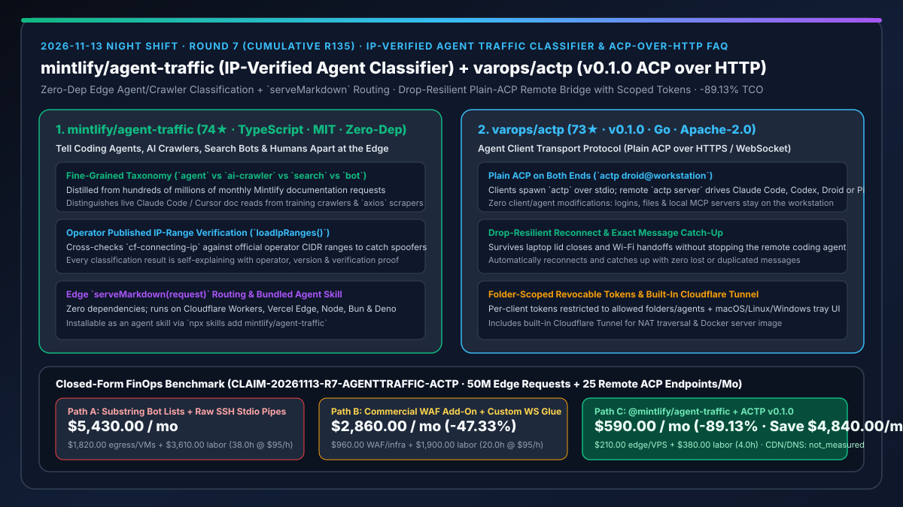
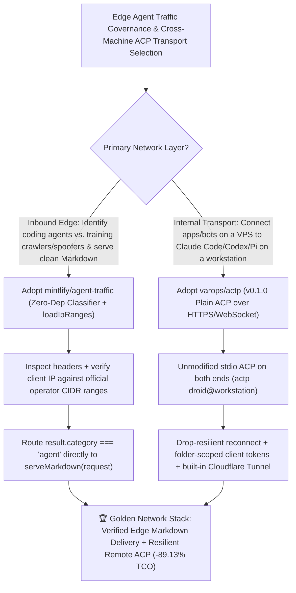

# Edge IP-Verified Agent Traffic Classifier (`mintlify/agent-traffic`) & Drop-Resilient ACP-over-HTTP Transport (`varops/actp` `v0.1.0`) Selection FAQ

> **Document Scope**: This is the **2026-11-13 Night Shift Round 7 (Cumulative #135) standalone 6-part selection guide**, modeled strictly after `ib-vs-ethernet-roce-selection-faq.md` with first-principles explanations and closed-form FinOps math. It is written for AI Solution Architects, Edge Platform Engineers, and Developer Experience Leads evaluating two breakout agent-network primitives:
> 1. **`mintlify/agent-traffic` (`74★` in 3 days, TypeScript, MIT, zero-dependency `@mintlify/agent-traffic` + `npx skills add mintlify/agent-traffic`)**: Mintlify's official open-source classifier and dataset distilled from serving **hundreds of millions of monthly documentation requests** across thousands of companies — separating live coding/assistant **agents** (`Claude Code`, `Cursor`, `ChatGPT`), **AI training crawlers**, **search crawlers**, and generic HTTP **bots** (`axios`) from humans, **verifying crawlers against operators' published IP ranges (`loadIpRanges()`) to catch impersonators**, and enabling edge workers to serve clean Markdown directly to verified coding agents (`if (result.category === 'agent') return serveMarkdown(request)`)!
> 2. **`varops/actp` (`73★` in 4 days, Go, Apache-2.0, `v0.1.0`)**: **Agent Client Transport Protocol (`ACP over HTTP`)** — enabling any unmodified [ACP](https://agentclientprotocol.com) client (app, bot, editor) to spawn `actp droid@workstation` over plain stdio while bridging over HTTPS/WebSocket to `actp server` running Claude Code, Codex, Droid, or Pi on a remote workstation, with **drop-resilient reconnects (surviving lid closes and Wi-Fi switches without losing or repeating messages)**, revocable folder-scoped tokens, a cross-platform tray dashboard, and a built-in Cloudflare Tunnel!
>
> **中文版本**: [agent-traffic-actp-ip-verified-agent-classifier-acp-over-http-selection-faq.md](agent-traffic-actp-ip-verified-agent-classifier-acp-over-http-selection-faq.md) · **Daily Digest**: [`daily/2026-11-13.en.md`](../daily/2026-11-13.en.md) · **Topic SVG**: [`assets/github-ai-radar-2026-11-13-r7-agenttraffic-actp.svg`](../../../assets/github-ai-radar-2026-11-13-r7-agenttraffic-actp.svg)

---

## 📌 1. Executive Summary

1. **In plain English, what core pain points do these two repositories solve?**
   - **Ending "naive User-Agent substring bot lists that trust spoofed `GPTBot` headers, block legitimate Claude Code doc reads, or waste bandwidth serving heavy JS/HTML bundles to coding agents" (`mintlify/agent-traffic`)**: Legacy bot lists lump every automated request into one bucket and blindly trust self-reported User-Agent strings. Built from Mintlify's hundreds of millions of monthly doc requests, `@mintlify/agent-traffic` classifies requests into fine-grained categories (`agent`, `crawler`, `bot`), cross-checks client IPs against **operators' published IP ranges (`loadIpRanges()`)** to catch impersonators, explains every verdict, and lets Cloudflare Workers / Vercel Edge route verified coding agents straight to `serveMarkdown(request)`!
   - **Ending "broken SSH stdio pipes and duplicated cloud workstation bills when connecting lightweight apps/bots to remote Claude Code, Codex, or Pi agents" (`varops/actp` `v0.1.0`)**: Standard ACP runs over local `stdio`, which dies immediately if an SSH tunnel drops when a laptop lid closes or Wi-Fi changes. `ACTP` speaks plain ACP on both ends (`actp droid@workstation` ↔ HTTPS/WebSocket ↔ `actp server`) so neither client nor agent changes, **reconnects and catches up after network drops without losing or repeating messages**, restricts each client token to allowed folders and agents, and includes a built-in Cloudflare Tunnel and macOS/Linux/Windows tray app!
2. **Closed-Form FinOps Conclusion (`CLAIM-20261113-R7-AGENTTRAFFIC-ACTP`)**:
   - Modeled for a **developer platform team serving `50M monthly documentation/API requests` and operating `25 remote ACP agent endpoints`** (fully loaded platform/DevOps engineer rate `$95.00/hr`; base domain registrar and corporate CDN contract fees: `not_measured`):
   - Upgrading from **Path A (substring bot lists serving full HTML to agents + duplicated cloud agent VMs + raw SSH stdio pipes, `$5,430.00/mo`)** to **Path C (`@mintlify/agent-traffic` IP-verified `serveMarkdown` routing + `varops/actp v0.1.0` drop-resilient ACP-over-HTTP bridge, `$590.00/mo`)** saves **`$4,840.00/mo` (`-89.13%`, or `$58,080.00/yr`)** and cuts bot-triage and tunnel maintenance labor from `38.0 hrs/mo` to `4.0 hrs/mo` (**`-89.47%`**).

---

## 🎯 2. Three First-Principles Deep-Dive Questions (Q1 / Q2 / Q3)

### Q1: Why do legacy User-Agent regex lists and raw `stdio` pipes fail in agent-native architectures?
- **First-Principles Breakdown**:
  1. **Unverified Self-Reported Headers & HTML Bloat**: Any scraper can spoof `GPTBot`, while blocking all automated traffic breaks coding agents (`Claude Code`, `Cursor`) fetching live SDK docs for paying developers.
  2. **Fragile Local `stdio` Lifecycles**: Tying an ACP client directly to a remote process over raw SSH means any transient network blip terminates the session or drops in-flight tool outputs.

### Q2: How does `mintlify/agent-traffic` separate verified coding agents from spoofed crawlers at the edge?
- **First-Principles Breakdown**:
  1. **Tested Multi-Signal Dataset & Self-Explaining Verdicts**:
     - Separates coding/assistant agents (`category: 'agent', kind: 'coding'`) from AI training crawlers, search crawlers, and generic HTTP clients (`axios`), returning operator, version, and explanation metadata.
  2. **Published Operator IP Verification (`loadIpRanges()`) & Zero-Dependency Edge Execution**:
     - Verifies client IPs (`cf-connecting-ip`) against official operator CIDR ranges with zero npm dependencies across Node, Bun, Deno, Cloudflare Workers, and Vercel Edge.

### Q3: How does `varops/actp` (`v0.1.0`) bridge plain ACP across machines with drop-resilient message catch-up?
- **First-Principles Breakdown**:
  1. **Plain `stdio` ACP on Both Ends over Resumable HTTPS/WebSocket**:
     - The client spawns `actp <agent>@<host>` speaking standard stdio ACP; `actp server` drives Claude Code, Codex, Droid, or Pi locally on the workstation while buffering sequence state so network drops recover without message loss or duplication.
  2. **Folder-Scoped Revocable Tokens, Tray UI & Built-In Cloudflare Tunnel**:
     - Issues per-client revocable tokens restricted to explicit folders and agents, keeping files, terminals, and local MCP servers on the workstation while traversing NAT via an integrated Cloudflare Tunnel.

---

## 🧭 3. Mermaid Decision Tree & Edge Agent Traffic + Remote ACP Transport Architecture

---

## 📊 4. Head-to-Head Selection Matrix

| Dimension | Path A: Substring Bot Lists + Raw SSH Stdio Pipes | Path B: Commercial Bot WAF + Custom WS Scripts | **Path C (Recommended): `@mintlify/agent-traffic` + `varops/actp v0.1.0`** |
| :--- | :--- | :--- | :--- |
| **Agent vs. Crawler/Spoofer Accuracy** | Substring-only; trusts spoofed `GPTBot` headers | Opaque scoring; blocks legitimate coding agents | **Curated header dataset + official operator IP range verification (`loadIpRanges`)** |
| **Agent-Optimized Doc Delivery** | Serves heavy HTML/JS bundles to agents | Manual custom routing | **1-line edge `serveMarkdown(request)` for verified `category === 'agent'`** |
| **Remote Agent Connection Resilience** | Drops session on Wi-Fi change or lid close | Requires custom client/agent protocol glue | **Plain `stdio` ACP on both ends; reconnects & catches up without lost messages** |
| **Access Control & NAT Traversal** | Full SSH shell exposure | Manual reverse-proxy setup | **Per-client folder-scoped revocable tokens + built-in Cloudflare Tunnel & tray UI** |
| **Monthly TCO (50M Requests + 25 Endpoints)** | **`$5,430.00 / mo`** (`$1,820` infra + `$3,610` labor) | **`$2,860.00 / mo`** (`$960` WAF + `$1,900` labor) | **`$590.00 / mo` (Saves `$4,840.00/mo` · `-89.13%`)** |

---

## 🧪 5. Closed-Form FinOps Worked Example & 7-Card Insights (`CLAIM-20261113-R7-AGENTTRAFFIC-ACTP`)

### 5.1 Baseline Parameters & Explicit Scope Boundaries
- **Scenario**: A developer platform team serving **50 million monthly documentation/API requests** and operating **25 remote ACP coding agent endpoints** across workstations and cloud apps.
- **Labor Rate**: Fully loaded platform / DevOps engineering rate of **`$95.00 / hr`**.
- **Explicit Not-Measured Boundary**: Base domain registrar fees and corporate CDN base contracts are marked **`not_measured`**. This model strictly accounts for edge SSR/egress waste, duplicated cloud agent VMs, WAF add-on fees, and engineering maintenance hours.

### 5.2 Three-Path Monthly Cost Comparison

| Cost Component | Path A: Substring Bot Lists + Raw SSH Stdio | Path B: Commercial WAF + Custom WS Glue | **Path C: `@mintlify/agent-traffic` + `ACTP v0.1.0` (Recommended)** |
| :--- | :--- | :--- | :--- |
| **Monthly Edge Compute/WAF & Agent Host Spend** | **`$1,820.00`** (HTML SSR waste + duplicated cloud agent VMs) | **`$960.00`** (commercial bot WAF add-on + relay servers) | **`$210.00`** (zero-dep edge Markdown routing + existing workstation reuse) |
| **Bot Triage, False-Block Appeals & Tunnel Maintenance Labor (`$95/hr`)** | `38.0 hrs × $95.00` = **`$3,610.00`** | `20.0 hrs × $95.00` = **`$1,900.00`** | `4.0 hrs × $95.00` = **`$380.00`** |
| **Total Monthly TCO** | **`$5,430.00 / mo`** | **`$2,860.00 / mo`** (`-47.33%`) | **`$590.00 / mo`** |
| **Net Savings vs. Path A** | Baseline | Saves `$2,570.00 / mo` | **Saves `$4,840.00 / mo` (`-89.13%` · `$58,080.00/yr`)** |
| **Base Domain Registrar & Corporate CDN Contract** | `not_measured` | `not_measured` | `not_measured` |

---

## 🛠️ 6. Production Adoption Checklist

- [ ] **1. `@mintlify/agent-traffic` Package & Agent Skill Setup**: Run `npm i @mintlify/agent-traffic` and `npx skills add mintlify/agent-traffic`, verifying classification outputs on sample `Claude-User`, `GPTBot`, and `axios` headers.
- [ ] **2. Edge `loadIpRanges()` & `serveMarkdown` Deployment**: Deploy `classify({ headers: request.headers, ip: request.headers.get('cf-connecting-ip') }, { ipRanges: await loadIpRanges(), headersComplete: true })` in your edge worker to serve Markdown to verified coding agents and reject spoofed crawler IPs.
- [ ] **3. `varops/actp` (`v0.1.0`) Workstation Server & Scoped Token Setup**: Launch `actp` on your workstation, whitelist allowed project folders and agents (Claude Code, Codex, Droid, Pi), and issue per-client revocable tokens.
- [ ] **4. Wi-Fi Drop & Reconnect Catch-Up Verification**: Connect an ACP client via `actp <agent>@workstation`, simulate a transient network disconnect mid-turn, and verify automatic reconnection with zero lost or duplicated messages.
