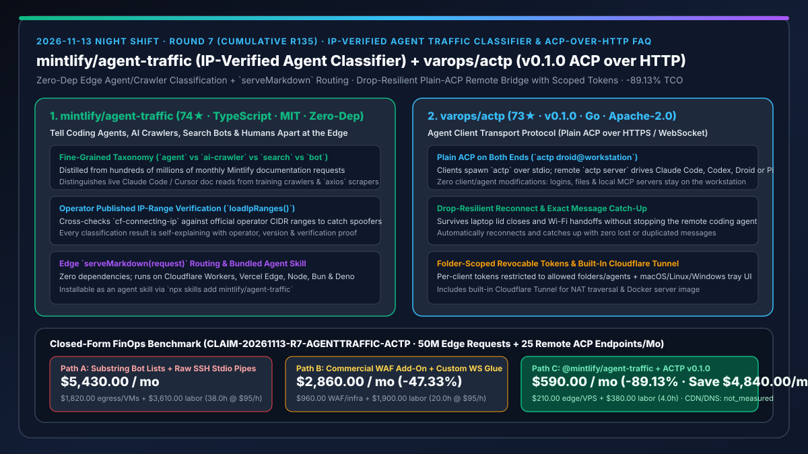
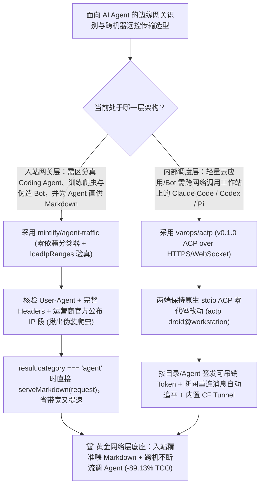

# 边缘 IP 核验智能体流量分类器（`mintlify/agent-traffic`）与断线自愈跨机 ACP-over-HTTP 传输协议（`varops/actp` `v0.1.0`）深度选型 FAQ

> **文档定位**：本专题是 **2026-11-13 夜班第 7 轮（累计第 135 篇）独立六段式选型指南**，严格对标 `ib-vs-ethernet-roce-selection-faq.md` 的通俗第一性原理与闭式 FinOps 核算规范，面向开发者平台负责人、网关架构师与 AI Solution Architect，深度拆解今日新仓爆发榜上解决“智能体如何被网关精准识别”与“智能体如何跨网络无感远控”的两大网络协议层基础设施：
> 1. **`mintlify/agent-traffic`（3 天新建获 `74★`，TypeScript，MIT，零依赖 `@mintlify/agent-traffic` + `npx skills add mintlify/agent-traffic`）**：托管数千家科技公司文档、每月处理数亿次请求的 **Mintlify 官方开源智能体流量分类器与权威数据集**——不再像传统粗糙 Bot 列表那样只匹配 User-Agent 子串并把所有自动化请求一锅炖，而是结合请求头与**运营商官方公布的 IP 段（`loadIpRanges()`）**精准区分**实时查文档的 Coding Agent（如 `Claude-User claude-code/2.1.308`、Cursor）、AI 训练爬虫（如真假 `GPTBot`）、搜索引擎爬虫与普通脚本（`axios`）**，支持在 Cloudflare Workers / Vercel Edge 中一行代码对真 Agent 直接返回纯净 Markdown（`if (result.category === 'agent') return serveMarkdown(request)`）！
> 2. **`varops/actp`（4 天新建获 `73★`，Go，Apache-2.0，首发 `v0.1.0`）**：**Agent Client Transport Protocol（`ACP over HTTP`）**——让任何标准 [ACP](https://agentclientprotocol.com) 客户端（桌面应用、聊天机器人、编辑器）直接启动 `actp droid@workstation`，在不修改客户端和 Agent 任何一行代码的前提下（**两端均保持原生 stdio ACP**），通过带细粒度目录/智能体授权 Token 的 HTTPS/WebSocket 隧道调用远端主力工作站上的 Claude Code、Codex、Droid 或 Pi，且**合上笔记本盖子或切换 Wi-Fi 断线重连后自动补齐消息、不丢不重**！
>
> **English Version**: [agent-traffic-actp-ip-verified-agent-classifier-acp-over-http-selection-faq.en.md](agent-traffic-actp-ip-verified-agent-classifier-acp-over-http-selection-faq.en.md) · **关联日报**: [`daily/2026-11-13.md`](../daily/2026-11-13.md) · **专题架构图**: [`assets/github-ai-radar-2026-11-13-r7-agenttraffic-actp.svg`](../../../assets/github-ai-radar-2026-11-13-r7-agenttraffic-actp.svg)

---

## 📌 一、核心结论速览（Executive Summary）

1. **一句话大白话讲透这两个项目到底解决了什么痛点？**
   - **终结“传统 WAF 或粗糙正则把正在帮客户写代码的 Claude Code/Cursor 当成恶意爬虫一刀切封杀，或者被伪造 `GPTBot` User-Agent 的黑产脚本白嫖算力，又或者给 AI Agent 吐出几百 KB 充满 React 水合脚本的臃肿 HTML”的痛点（`mintlify/agent-traffic`）**：现在技术文档站和 API 门户有很大一部分流量来自正在替开发者干活的 Coding Agent（如 Claude Code 实时拉一页文档进会话）。旧式 Bot 列表既分不清“实时辅助写代码的 Agent”和“抓全站去训模型的爬虫”，也抓不住冒充官方 User-Agent 的李鬼。Mintlify 从每月数亿次真实请求中提炼出零依赖的 `@mintlify/agent-traffic`：不仅能细粒度识别 `{ category: 'agent', kind: 'coding', name: 'Claude Code', operator: 'Anthropic' }`，还能**核对 `cf-connecting-ip` 是否真正落在运营商官方公布的 IP 范围内**，让你在边缘节点放行真 Agent 并直接喂给它最省 Token 的 `serveMarkdown(request)`，同时精准拦截伪装爬虫！
   - **终结“你的轻量 Web/Bot 应用跑在便宜云主机上，但满血 Claude Code / Codex 和代码库在本地高配 Mac/工作站上，用裸 SSH 管道一合笔记本盖子就断流丢消息”的痛点（`varops/actp` `v0.1.0`）**：ACP（Agent Client Transport Protocol）默认走本机 `stdio` 进程管道。如果你想在手机/网页助手或轻量 VPS 上调用家里工作站上已登录好账号、配好本地 MCP 的 Claude Code 或 Codex，`ACTP` 提供了一个完全透明的 `actp bridge <=== HTTPS/WebSocket ===> actp server`：客户端以为自己在调本地 `stdio`，工作站上的 Agent 也以为自己在被本地调用；**哪怕中途合上笔记本或切换 Wi-Fi，重连后也能无损追平消息流（不丢不重）**，还内置了按目录/按 Agent 限权的吊销 Token、系统托盘面板和免公网 IP 的 Cloudflare Tunnel！
2. **闭式 FinOps 投资回报结论（`CLAIM-20261113-R7-AGENTTRAFFIC-ACTP`）**：
   - 以 **开发者平台与文档工程团队每月承载 `5,000 万次` 文档/API 请求（其中 30% 为各类 Agent 与爬虫）并跨主机调度 `25 个` 远端 ACP 编码智能体端点** 为基准（平台工程/DevOps 全包时薪 `$95.00/hr`；企业基础域名与 CDN 底包年费：`not_measured`）：
   - 从 **Path A（粗糙 User-Agent 子串匹配向 Agent 吐全量臃肿 HTML + 云端重复购买高配主机跑 Agent + 手工修补 SSH 断连，月均 `$5,430.00`）** 升级至 **Path C（`@mintlify/agent-traffic` 官方 IP 核验 + 边缘 `serveMarkdown` 分流 + `varops/actp v0.1.0` 断线自愈跨机桥接，月均 `$590.00`）**，每月净省 **`$4,840.00/mo`（降幅 `-89.13%`，年省 `$58,080.00/yr`）**，并将反爬排查、误封申诉与断线重连维护工时从 `38.0 hrs/mo` 压缩至 `4.0 hrs/mo`（节省 **`-89.47%`**）。

---

## 🎯 二、三大灵魂拷问（Q1 / Q2 / Q3 深度原理解析）

### Q1：为什么在“Agent 成为互联网主力访问者”的时代，传统的 User-Agent 正则表与本地 `stdio` 管道成了架构短板？
- **第一性原理拆解**：
  1. **User-Agent 自报家门不可信且分类粒度过粗**：任何 `curl` 或 Python 脚本都能把 Header 改成 `GPTBot` 或 `Claude-User`；反之，如果安全团队把所有自动化请求一刀切拦截，客户用 Claude Code 或 Cursor 读你的 SDK 文档时就会直接报 403，严重损害开发者体验（DX）。
  2. **`stdio` 管道与物理主机生命周期强绑定**：标准 ACP 协议基于父子进程 `stdin/stdout`，一旦跨机器通过普通 SSH 转发，任何网络闪断都会直接杀死子进程或导致半截响应丢失。

### Q2：`mintlify/agent-traffic` 是如何靠“多维指纹 + 官方 IP 段核验”精准分流真 Agent 与伪装爬虫的？
- **第一性原理拆解**：
  1. **四维正交分类体系（Agent / AI-Crawler / Search-Crawler / Bot）与可解释输出**：
     - 精确区分“代人类实时查阅单页的智能体（如 `Claude Code`、`ChatGPT` 检索）”与“批量抓取训练语料的爬虫”及“通用 HTTP 库（`axios`）”，每次 `classify()` 均输出完整的判定依据、运营商与版本号。
  2. **`loadIpRanges()` 官方 CIDR 验真与零依赖全边缘运行时兼容**：
     - 自动加载各家 AI 运营商发布的官方 IP 段，对声称来自特定运营商的请求校验真实源 IP（如 `cf-connecting-ip`），当场揪出伪造 Header 的李鬼；零外部依赖，在 Cloudflare Workers / Vercel Edge 中识别出真 Agent 后可直接 `return serveMarkdown(request)`，省下 80%+ SSR 渲染与带宽开销。

### Q3：`varops/actp` (`v0.1.0`) 是如何做到“两端零感知透明桥接 + 断网不掉会话”的？
- **第一性原理拆解**：
  1. **两端原生 `stdio` ACP，中间 HTTPS/WebSocket 有状态帧重放**：
     - 客户端只需将启动命令从 `droid` 换成 `actp droid@workstation`，两端依然收发标准 ACP `stdio` 消息；中间层由 `actp bridge` 与远端 `actp server` 维护序列号缓冲，Wi-Fi 切换或休眠唤醒后自动重连并从断点续传，不丢消息也不重复执行。
  2. **按客户端独立签发目录白名单 Token + 内置 Cloudflare Tunnel**：
     - 每个客户端分配独立可吊销 Token，严格限制其只能唤醒指定 Agent 及访问允许的工作目录；文件、终端与本地 MCP 始终留在工作站本机，配合内置 Cloudflare Tunnel 无需公网 IP 即可安全穿透。

---

## 🧭 三、Mermaid 选型决策树与「边缘 Agent 流量分流 + 跨机 ACP 远控」架构图

---

## 📊 四、同类方案核心能力对比矩阵（Selection Matrix）

| 评估维度 | Path A：传统 UA 子串黑名单 + 裸 SSH `stdio` 转发 | Path B：商业高价 Bot WAF + 自写 WebSocket 包装脚本 | **Path C（推荐）：`@mintlify/agent-traffic` + `varops/actp v0.1.0`** |
| :--- | :--- | :--- | :--- |
| **Coding Agent 与伪装爬虫区分度** | 仅靠子串匹配，易误杀 Claude Code 或放过伪造 UA | 黑盒评分，常对合法开发者 Agent 弹验证码 | **细粒度 `agent`/`crawler`/`bot` 分类 + 官方公布 IP 段（`loadIpRanges`）验真** |
| **面向 Agent 的文档响应优化** | 统一返回数百 KB 含 JS 的 HTML | 需手工维护多套路由 | **边缘 Worker 一行代码对 `category === 'agent'` 直接 `serveMarkdown`** |
| **跨机器调用 Coding Agent 稳定性** | 笔记本合盖或网络抖动即杀死远端进程 | 需修改客户端与 Agent 适配私有协议 | **两端保持原生 `stdio` ACP 零改动，断网重连自动追平不丢不重** |
| **远端目录权限与内网穿透** | 暴露完整 SSH 账号权限，风险极高 | 需手工配 frp/nginx 与鉴权 | **按客户端签发目录级可吊销 Token + 内置 Cloudflare Tunnel 与托盘面板** |
| **月度总拥有成本（5000 万请求 + 25 端点）** | **`$5,430.00 / mo`**（`$1,820` 资源 + `$3,610` 工时） | **`$2,860.00 / mo`**（`$960` WAF/设施 + `$1,900` 工时） | **`$590.00 / mo`（净省 `$4,840.00/mo` · `-89.13%`）** |

---

## 🧪 五、定量 FinOps 算例与 7-Card 洞察（`CLAIM-20261113-R7-AGENTTRAFFIC-ACTP`）

### 5.1 测算基准与显式边界（Scope & Boundaries）
- **场景设定**：开发者平台团队每月处理 **5,000 万次文档与 API 门户请求**，并跨轻量云端入口与本地高配工作站维护 **25 个远程 ACP 智能体工作节点**。
- **费率假设**：平台与 DevOps 工程师全包时薪 **`$95.00 / hr`**。
- **显式边界声明（Explicit Not-Measured Boundary）**：企业根域名注册年费与集团级基础 CDN 保底合同标记为 **`not_measured`**，本表严格核算边缘 SSR/流量超额账单、云端重复 Agent 主机租赁及工程师排障维护工时。

### 5.2 三路径月度成本闭式对照表

| 成本分项 | Path A：传统 UA 子串表 + 裸 SSH 转发 | Path B：商业 WAF 附加包 + 自写 WS 桥 | **Path C：`@mintlify/agent-traffic` + `ACTP v0.1.0`（推荐）** |
| :--- | :--- | :--- | :--- |
| **月度边缘流量/SSR 与远程 Agent 主机净支出** | **`$1,820.00`**（向爬虫/Agent 渲染全量 HTML + 重复租高配云主机） | **`$960.00`**（商业 Bot WAF 订阅费 + 中继开销） | **`$210.00`**（零依赖边缘直返 Markdown + 复用现有本地工作站算力） |
| **反爬规则维护、误封排障与断线重连修复工时（`$95/hr`）** | `38.0 hrs × $95.00` = **`$3,610.00`** | `20.0 hrs × $95.00` = **`$1,900.00`** | `4.0 hrs × $95.00` = **`$380.00`** |
| **月度总成本（Monthly TCO）** | **`$5,430.00 / mo`** | **`$2,860.00 / mo`**（`-47.33%`） | **`$590.00 / mo`** |
| **相对 Path A 净节省** | 基准线（Baseline） | 净省 `$2,570.00 / mo` | **净省 `$4,840.00 / mo`（`-89.13%` · 年省 `$58,080.00/yr`）** |
| **企业域名注册与集团基础 CDN 底包** | `not_measured` | `not_measured` | `not_measured` |

---

## 🛠️ 六、生产级落地核验 Checklist

- [ ] **1. `@mintlify/agent-traffic` 与 Agent Skill 安装验证**：执行 `npm i @mintlify/agent-traffic` 及 `npx skills add mintlify/agent-traffic`，在本地测试集上验证 `Claude-User`、`GPTBot` 与 `axios` 的分类输出与可解释字段。
- [ ] **2. 边缘 Worker `loadIpRanges()` 验真与 `serveMarkdown` 分流上线**：在 Cloudflare Worker / Vercel Edge 中接入 `classify({ headers, ip }, { ipRanges: await loadIpRanges(), headersComplete: true })`，验证伪造官方 UA 的非官方 IP 请求被精准识破，且合法 Coding Agent 自动获得 Markdown 响应。
- [ ] **3. `varops/actp` (`v0.1.0`) 服务端目录白名单与客户端 Token 签发**：在主力工作站启动 `actp` 托盘/服务端，限定允许启动的 Agent（Claude Code / Codex / Droid / Pi）与受控文件夹，生成可随时吊销的客户端专属 Token。
- [ ] **4. 跨网 `actp bridge` 断线重连无损续传压测**：在远端应用通过 `actp <agent>@workstation` 发起长耗时编码任务，中途模拟网络断开再恢复，验证会话不中断且消息序列零丢失、零重复。
