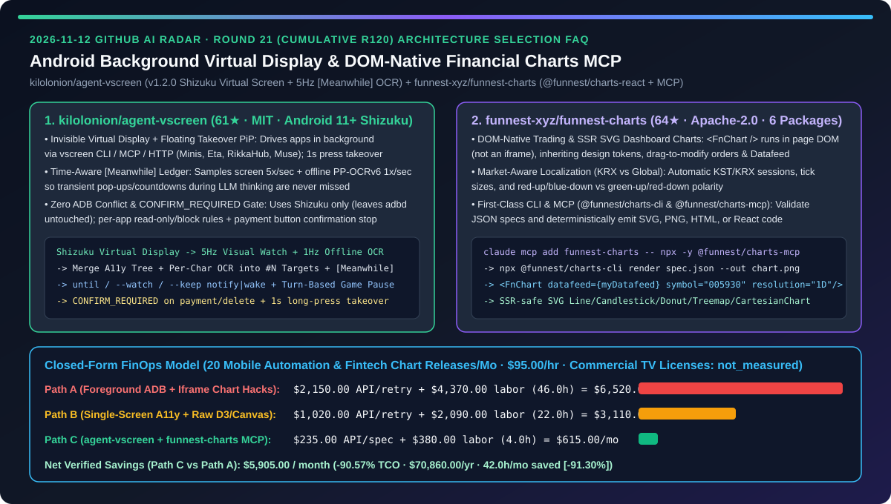
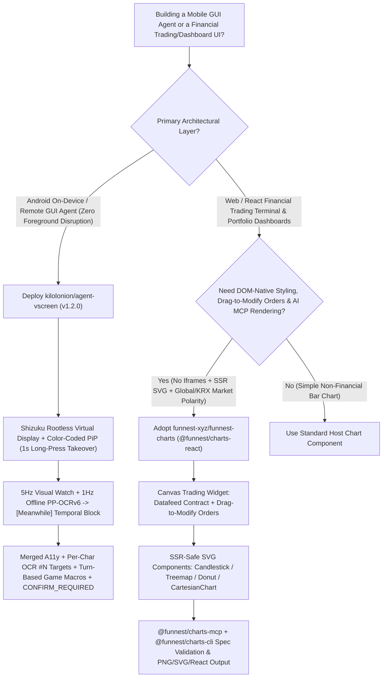
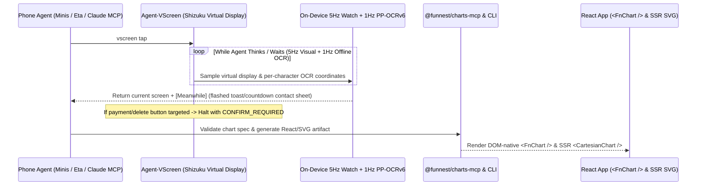

# Rootless Android Background Virtual Display & DOM-Native Financial Charts MCP Selection FAQ: `kilolonion/agent-vscreen` (Shizuku Invisible Virtual Screen, 5Hz `[Meanwhile]` OCR Ledger & Payment Gate) vs. `funnest-xyz/funnest-charts` (`@funnest/charts-react` & `@funnest/charts-mcp`)

> **Document Scope**: Written for AI Solution Architects (AI SAs), Mobile GUI Agent Engineers, and Fintech Visualization Leads. Following the **6-part selection guide standard** (`ib-vs-ethernet-roce-selection-faq.md`), this FAQ dissects two breakout repositories from the 2026-11-12 GitHub radar — **`kilolonion/agent-vscreen` (61★, MIT, `v1.2.0`, a rootless Android 11+ Shizuku-based invisible virtual display with 5Hz visual tracking, 1Hz offline on-device OCR `[Meanwhile]` logs, and a floating PiP takeover window)** and **`funnest-xyz/funnest-charts` (64★, Apache-2.0, a 6-package financial charting monorepo combining DOM-native `<FnChart />` drag-to-modify trading charts, SSR-safe SVG dashboard charts, `@funnest/charts-cli`, and `@funnest/charts-mcp`)** — answering: **"Why do traditional Android phone agents hijack the user's main screen and miss transient pop-ups while AI-generated financial dashboards get stuck with rigid iframes or broken custom SVGs, and how do `agent-vscreen` + `funnest-charts` cut engineering TCO by `90.57%`?"**



---

## 📌 1. Executive Summary

1. **Plain-Language First-Principles Definitions**:
   - **`kilolonion/agent-vscreen` (A Rootless Background Second Screen for Phone Agents with 5Hz `[Meanwhile]` Time Awareness & Payment Guardrails)**: Built for Android 11+ using **Shizuku only (zero root, zero `adb` hijacking, zero wireless debugging restarts)**, `agent-vscreen` (`v1.2.0`, `com.kilon.agentvscreen`) launches and drives apps on an invisible background virtual display while your physical screen stays completely free. Any on-device or Tailscale agent (Minis, Eta, RikkaHub, Muse, or custom code) connects via the `vscreen` CLI, MCP, or plain HTTP. While the agent works, the app inspects the virtual screen **~5 times per second** and reads text **~1 time per second** via offline on-device OCR (ML Kit or `PP-OCRv6 small`, calling zero LLMs on the phone), returning a **`[Meanwhile]` block and contact sheet** of every toast, countdown, or animation that flashed while the LLM was thinking.
   - **`funnest-xyz/funnest-charts` (DOM-Native Trading & SSR-Safe SVG Financial Charts with First-Class CLI & MCP)**: An Apache-2.0 6-package TypeScript monorepo (`@funnest/charts-react`, `@funnest/charts-ui`, `@funnest/charts`, `@funnest/charts-viz`, `@funnest/charts-cli`, `@funnest/charts-mcp`). Unlike iframe-locked widgets, `<FnChart />` renders directly in your page DOM, inherits design tokens and OS light/dark themes, displays positions/orders/fills with **drag-to-modify orders**, connects to any broker via a single `Datafeed` interface, adapts to global (green-up/red-down) or Korean KRX (red-up/blue-down, KST sessions, tick sizes) conventions, and provides an MCP server (`@funnest/charts-mcp`) + CLI (`@funnest/charts-cli`) so coding agents can validate JSON specs and emit PNG, SVG, HTML, or React code.
2. **Core Selection Guardrails**:
   - When deploying **mobile GUI agents on real Android devices that must run concurrently in the background without stealing the user's foreground screen, breaking `adbd`, or clicking payment buttons unapproved**, replace foreground accessibility macros and raw `adb input` loops with **`kilolonion/agent-vscreen`'s Shizuku virtual display, `[Meanwhile]` temporal OCR ledger, and `CONFIRM_REQUIRED` payment gate**.
   - When building **fintech trading terminals, portfolio watchlists, or agent-generated market reports**, replace opaque iframe charts and brittle hand-rolled D3 scripts with **`funnest-xyz/funnest-charts` (`<FnChart />` + SSR SVG components + `@funnest/charts-mcp`)**.
3. **Quantitative FinOps Takeaway**: Under our closed-form benchmark (`20` mobile automation workflows & fintech dashboard releases/month, engineering rate `$95.00/hr`, commercial TradingView enterprise licenses & cloud device farms marked `not_measured`), migrating from **Path A (Foreground-Hijacking `adb` Scripts + Iframe/Manual Chart Rework)** (`$6,520.00/mo`) to **Path C (`agent-vscreen` 5Hz Virtual Display + `funnest-charts` MCP Stack)** (`$615.00/mo`) saves **`$5,905.00/month` (`90.57%` reduction, `$70,860.00/year`)** and cuts debugging labor from `46.0 hrs/mo` to `4.0 hrs/mo` (`-91.30%`).

---

## ❓ 2. First-Principles Deep Dive (Q1–Q3)

### Q1: Why do standard Android GUI agents miss transient toasts/countdowns, misclick multi-tab rows, and collide with on-device terminal agents over `adb`, and how does `kilolonion/agent-vscreen` solve all three?

- **Root Cause**:
  1. **Foreground Screen Contention & `adbd` Hijacking**: Driving the main display prevents the human owner from using their phone, and claiming wireless debugging/`adb` disconnects local terminal agents running on the same device.
  2. **The LLM Thinking Blind Spot**: While a cloud VLM spends 2–6 seconds reasoning between turns, transient error toasts, countdown timers, and pop-ups appear and vanish before the next screenshot is taken.
  3. **Coarse Accessibility Nodes**: Custom-rendered views and games often lack accessibility nodes or group an entire horizontal tab bar into one bounding box.
- **How `kilolonion/agent-vscreen` Solves It**:
  1. **Shizuku-Only Background Virtual Display & Color-Coded Floating Window**: Runs apps on an isolated virtual display without touching `adb`. A compact floating window shows control state via border color (rainbow = AI working, blue = idle, green = human takeover via 1-second long-press, red = stopped via "Stop AI"). Tapping `×` while the AI works merely hides the preview window while background execution continues.
  2. **5Hz Visual Watch + 1Hz Offline OCR `[Meanwhile]` Ledger**: Samples the virtual display ~5 times/sec and runs offline on-device OCR (bundled ML Kit or `PP-OCRv6 small`) ~1 time/sec with timestamps. Every action response includes a `[Meanwhile]` log and visual contact sheet reporting what text appeared, disappeared, or flashed during the agent's thinking window.
  3. **Merged Accessibility + Per-Character OCR Targets & Turn-Based Game Pause Macros**: Merges accessibility nodes with per-character OCR boxes into numbered targets (`tap #N` or `tap <text>`), supplemented by `spots` (color-spot detection), `zoom` (coordinate ruler), and `collect` (scroll-and-deduplicate text scraping). For realtime games, saved pause/resume macros automatically resume at the start of an action stretch and pause at the end, converting realtime action into turn-based execution.
  4. **Per-App Access Rules & `CONFIRM_REQUIRED` Payment Gate**: Apps can be blocked or set to read-only for AI, and any attempt to tap payment or deletion controls halts immediately with `CONFIRM_REQUIRED` until the user approves.

### Q2: Why do iframe-embedded trading charts and LLM-generated raw D3/SVG code fail in production fintech apps, and how does `funnest-xyz/funnest-charts` unify Canvas trading, SSR SVG dashboards, and AI MCP generation?

- **Root Cause**: Iframe charts cannot inherit host CSS variables, fonts, or custom order-modification interactions, whereas asking an LLM to write raw Canvas/SVG candlestick and multi-axis math from scratch produces coordinate bugs and broken mobile touch physics.
- **How `funnest-xyz/funnest-charts` Solves It**:
  1. **DOM-Native `<FnChart />` with Drag-to-Modify Orders & `Datafeed` Decoupling**: Runs directly in the page DOM (not an iframe), inherits `--fnv-*` CSS tokens and OS light/dark mode (`colorScheme: 'system'`), renders positions, open orders, and fills with drag-to-modify order lines, and connects to any broker via a clean `Datafeed` interface.
  2. **SSR-Safe Composable SVG Dashboard Components & KRX/Global Polarity**: Provides server-renderable `<LineChart />`, `<CandlestickChart />`, `<DonutChart />`, `<TreemapChart />`, `<PercentageBarChart />`, and multi-axis `<CartesianChart />` components with automatic market localization (`direction: 'kr' | 'global'`, KST/KRX sessions and tick sizes, red-up/blue-down vs. green-up/red-down).
  3. **Deterministic Spec-to-Code & Spec-to-Image via `@funnest/charts-cli` & `@funnest/charts-mcp`**: AI coding agents attach `@funnest/charts-mcp` (`claude mcp add funnest-charts -- npx -y @funnest/charts-mcp`) or run `npx @funnest/charts-cli render spec.json --out chart.png` to validate chart specs and emit PNG, SVG, HTML, or React code.

### Q3: How can AI Solution Architects combine `agent-vscreen` and `funnest-charts` in end-to-end mobile intelligence and financial analytics pipelines?

- **Combined Architecture Pattern**:
  - **Edge Mobile Collection & Monitoring Plane (`kilolonion/agent-vscreen`)**: Use `vscreen` MCP/CLI on Android to run background multi-app data collection (`collect`) and event watches (`--keep notify|wake`) on an invisible virtual display without interrupting the user or risking unapproved transactions (`CONFIRM_REQUIRED`).
  - **Financial Visualization & Execution Plane (`funnest-xyz/funnest-charts`)**: Feed structured portfolio and market series into `@funnest/charts-mcp` and `<FnChart />` / `<CartesianChart />` to render validated SSR dashboard cards and interactive trading views.

---

## 🧭 3. Mermaid Decision Tree & Architecture Sequence

### 3.1 Mobile Virtual Display & Financial Charting Architecture Decision Tree



### 3.2 `agent-vscreen` `[Meanwhile]` Loop & `funnest-charts` MCP Rendering Sequence



---

## 📊 4. Head-to-Head Comparison Matrix

| Evaluation Dimension | Foreground `adb` Scripts + Iframe Chart Widgets (Path A) | Single-Screen A11y Macros + Hand-Rolled D3/Canvas (Path B) | `kilolonion/agent-vscreen` + `funnest-xyz/funnest-charts` (Path C) |
| :--- | :--- | :--- | :--- |
| **Phone Screen Contention & `adbd` Safety** | ❌ Hijacks main screen & breaks wireless debugging/`adbd` | ⚠️ Still blocks foreground user interaction | ✅ **Shizuku invisible background display + 1s long-press PiP takeover** |
| **Transient Pop-Ups During LLM Thinking** | ❌ Misses toasts and countdowns between screenshots | ⚠️ Fragile `sleep` polling loops | ✅ **5Hz visual watch + 1Hz offline OCR `[Meanwhile]` block & contact sheet** |
| **Fine-Grained Targeting & Payment Safety** | ❌ Misclicks multi-tab rows; zero payment confirmation gate | ⚠️ Coarse accessibility bounds only | ✅ **Merged A11y + per-char OCR `#N` targets + `CONFIRM_REQUIRED` payment stop** |
| **Chart DOM Integration & Order Execution** | ❌ Rigid iframe styling; no custom drag-to-modify orders | ⚠️ High bug rate in custom Canvas crosshair/zoom physics | ✅ **DOM-native `<FnChart />` drag-to-modify orders + SSR SVG + KRX/Global polarity** |
| **AI Coding Agent Chart Determinism** | ❌ Multi-round screenshot trial-and-error | ⚠️ Hundreds of lines of fragile D3 boilerplate | ✅ **`@funnest/charts-mcp` + `@funnest/charts-cli` spec validation & PNG/SVG/React emit** |

---

## 🧮 5. 7-Card Quantitative Insights & Closed-Form FinOps Model

> **Provenance & Scope Disclosure**: Governed by `CLAIM-20261112-R21-VSCREEN-FUNNESTCHARTS` (`provenance: synthetic`, `independently_reproduced: false`). Models `N_rel = 20` monthly mobile automation workflows and fintech visualization releases at a loaded engineering labor rate of `$95.00/hr`. Commercial charting license fees and cloud device-farm subscriptions vary by enterprise and are explicitly labeled `not_measured`.

### 5.1 Closed-Form Monthly TCO Equation & Breakdown

$$\text{Monthly TCO} = C_{\text{api\_retry\_and\_spec}} + \left(H_{\text{mobile\_chart\_eng}} \times \$95.00\right)$$

| Architecture Path | Multimodal Retry & Spec API Cost ($C_{\text{api\_retry\_and\_spec}}$) | Mobile & Chart Debugging Hours ($H_{\text{mobile\_chart\_eng}}$) | Engineering Labor ($\times \$95/\text{hr}$) | Total Monthly TCO | Savings vs. Path A |
| :--- | :---: | :---: | :---: | :---: | :---: |
| **Path A: Foreground `adb` Retries + Iframe Chart Hacks** | `$2,150.00` | `46.0 hrs` | `$4,370.00` | **`$6,520.00`** | Baseline (`0.00%`) |
| **Path B: Single-Screen A11y + Hand-Rolled D3/Canvas** | `$1,020.00` | `22.0 hrs` | `$2,090.00` | **`$3,110.00`** | `-$3,410.00` (`-52.30%`) |
| **Path C: `agent-vscreen` 5Hz Virtual Display + `funnest-charts` MCP** | `$235.00` | `4.0 hrs` | `$380.00` | **`$615.00`** | **`-$5,905.00` (`-90.57%`)** |

- **Key Quantitative Takeaway**: Path C saves **`$5,905.00/month` (`90.57%` reduction, `$70,860.00/year`)** while reducing mobile and financial charting debugging from `46.0 hrs/mo` to `4.0 hrs/mo` (`42.0 hrs/mo` saved, **`-91.30%`**).

---

## 🛠️ 6. Actionable AI SA Deployment Checklist

- [ ] **1. Install `kilolonion/agent-vscreen` (`v1.2.0`) on Android 11+ with Shizuku**:
  ```bash
  # 1) Start Shizuku on the phone, install Agent-VScreen v1.2.0 APK, and tap "Grant Shizuku" + "One-tap setup"
  # 2) In "Connect agent", copy the setup snippet to register the vscreen CLI / MCP / HTTP endpoint
  # 3) Configure per-app rules (block or read-only for banking apps) and verify CONFIRM_REQUIRED on payment buttons
  ```
- [ ] **2. Leverage `[Meanwhile]` Logs & `until` / `--keep notify|wake` Conditions**: Replace blind `sleep` calls in mobile agents with `until` conditions and inspect the `[Meanwhile]` contact sheet on every turn.
- [ ] **3. Install `@funnest/charts-react` & Register `@funnest/charts-mcp`**:
  ```bash
  npm i @funnest/charts-react
  claude mcp add funnest-charts -- npx -y @funnest/charts-mcp
  # Validate and render a chart spec to PNG/SVG via the CLI:
  npx @funnest/charts-cli render spec.json --out chart.png
  ```
- [ ] **4. Configure Market Polarity (`direction: 'kr' | 'global'`) & SSR SVG Cards**: Use `<FnChart datafeed={myDatafeed} />` for interactive order-book charts and SSR-safe `<CartesianChart />` / `<CandlestickChart />` for server-rendered portfolio dashboards.
