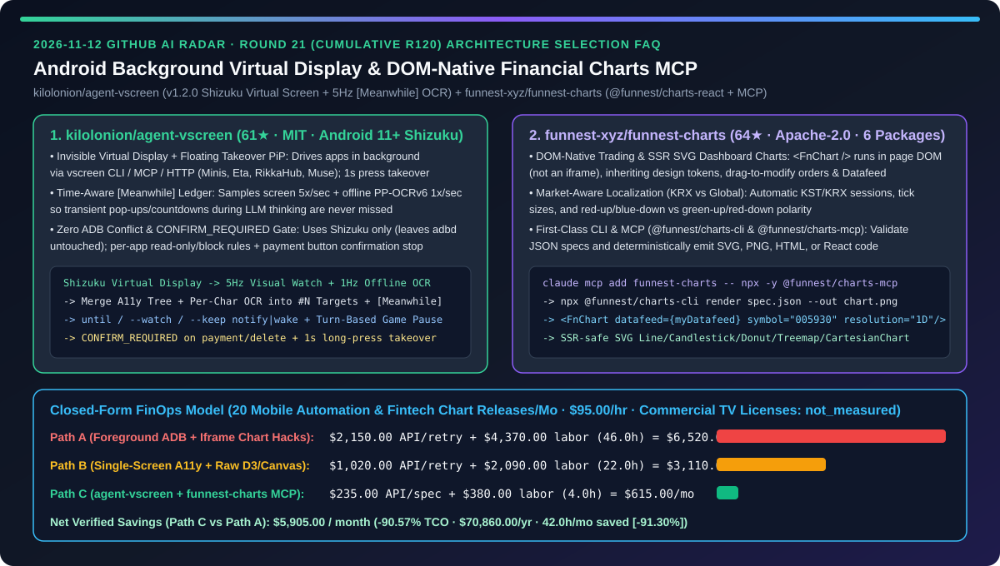
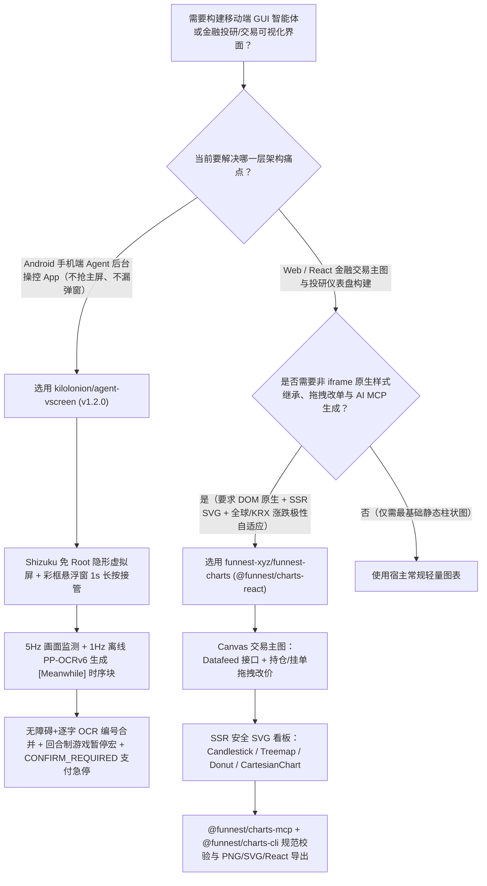
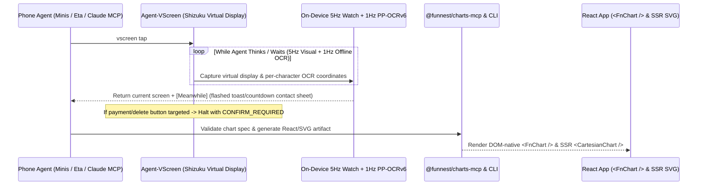

# Android 免 Root 后台虚拟屏幕智能体支架与 DOM 原生金融交易图表 MCP 选型 FAQ：`kilolonion/agent-vscreen`（Shizuku 隐形副屏 + 5Hz `[Meanwhile]` 时序感知 + 支付拦截）与 `funnest-xyz/funnest-charts`（`@funnest/charts-react` + `@funnest/charts-mcp`）深度对比

> **文档定位**：本文面向 AI 解决方案架构师（AI SA）、移动端 GUI Agent 研发负责人与金融科技（Fintech）前端/量化可视化团队，严格对标 `ib-vs-ethernet-roce-selection-faq.md` 的**六段式实战选型体系**，用第一性原理拆解 2026-11-12 GitHub 飙升榜中两款聚焦端侧 GUI 执行环境与专业金融图表工具链的开源项目——**`kilolonion/agent-vscreen`（61★，MIT，`v1.2.0`，基于 Android 11+ Shizuku 的免 Root 后台隐形虚拟屏幕、5Hz 视觉采样 + 1Hz 端侧离线 OCR `[Meanwhile]` 时序账本与悬浮窗一键接管框架）** 与 **`funnest-xyz/funnest-charts`（64★，Apache-2.0，涵盖 `<FnChart />` 拖拽改单交易主图、SSR 安全 SVG 仪表盘组件与 `@funnest/charts-cli` / `@funnest/charts-mcp` 的 6 包金融可视化栈）**，回答“**为什么传统手机端 GUI Agent 一跑起来就抢占用户主屏、漏掉一闪而过的弹窗验证码，而金融看板 Agent 画出的 K 线图总是死板的 iframe 或错位的手写 SVG？如何将移动端与金融看板研发 TCO 降低 `90.57%`？**”



---

## 📌 一、核心结论速览（Executive Summary）

1. **它俩到底是什么？（一句话大白话本质定义）**
   - **`kilolonion/agent-vscreen`（给手机端 AI 智能体配一块带 5Hz 慢动作回放与支付急停的“后台隐形副屏”）**：一款基于 Android 11+ 与 **Shizuku（免 Root、不占 `adb`、不动无线调试）** 的后台虚拟显示器应用（`com.kilon.agentvscreen` `v1.2.0`）。它让手机上的任何智能体（Minis、Eta、RikkaHub、Muse 或 Tailscale 远端 Agent）通过 `vscreen` CLI、MCP 或纯 HTTP 在**看不见的后台虚拟屏幕**里打开并操控第三方 App，用户自己的手机主屏完全不受打扰（仅在角落显示一个彩框悬浮小窗：彩虹框=AI 操作中、长按 1 秒变绿框=人工接管、左下角一键急停）。更绝的是它在端侧内置了**每秒 5 次画面监测 + 每秒 1 次离线 OCR（ML Kit / PP-OCRv6 small，完全不调云端 LLM）**，在每次动作返回里附带 **`[Meanwhile]` 时序感知块**，把 AI 思考那几秒内闪过的弹窗、倒计时与加载动画一五一十汇报给 Agent。
   - **`funnest-xyz/funnest-charts`（非 iframe、继承宿主设计 Token 且自带 CLI/MCP 的开源专业金融图表库）**：一套 Apache-2.0 开源的 6 包 TypeScript 金融图表单仓（`@funnest/charts-react`、`@funnest/charts-ui`、`@funnest/charts`、`@funnest/charts-viz`、`@funnest/charts-cli`、`@funnest/charts-mcp`）。它同时提供**支持持仓/挂单/成交显示与鼠标拖拽改单的 Canvas 专业交易图（`<FnChart />`）**以及 **SSR 服务端渲染安全的轻量 SVG 组合图表（`LineChart`、`CandlestickChart`、`DonutChart`、`TreemapChart`、`PercentageBarChart`、`CartesianChart`）**，通过单一 `Datafeed` 接口对接任意交易所，原生支持国际（绿涨红跌）与韩股 KRX（红涨蓝跌、KST 时区与 Tick 步长）双极性，并让 Claude Code / Cursor 通过 `@funnest/charts-mcp` 直接校验 JSON 规范并导出 PNG / SVG / HTML / React 代码。
2. **核心选型红线**：
   - 当你需要构建**在真机 Android 上后台并发运行、不抢夺用户聊天主屏、不破坏现有 `adbd` 调试通道且必须在付款/删除按钮前强制人工确认（`CONFIRM_REQUIRED`）的移动端 GUI Agent** 时，严禁再用传统前台无障碍连点器或裸 `adb input tap`——直接选用 **`kilolonion/agent-vscreen`（Shizuku 隐形虚拟屏 + `[Meanwhile]` 时序感知 + 逐字离线 OCR 坐标合并）**。
   - 当你需要开发**投资组合看板、量化回测交割单或含实时拖拽改单的 Web/React Native 交易终端**时，淘汰样式割裂的黑盒 iframe 图表与手写脆弱 D3 脚本，全面采用 **`funnest-xyz/funnest-charts`（`<FnChart />` + SSR SVG 组件 + `@funnest/charts-mcp`）**。
3. **定量 TCO 结论**：在每月推进 `20` 个移动端自动化工作流与金融可视化版本发布、移动与前端 AI 工程师综合时薪 `$95.00/hr` 的基准模型下（商业 TradingView 授权费与云真机农场租金标记为 `not_measured`），从“Path A（前台霸屏 `adb` 脚本漏弹窗重跑 + 黑盒 iframe/手写图表排障）”（月均 `$6,520.00`）切换到“Path C（`agent-vscreen` 5Hz `[Meanwhile]` 虚拟副屏 + `funnest-charts` MCP/React 统一栈）”（月均 `$615.00`），每月净省 **`$5,905.00`（降幅 `90.57%`，年化节省 `$70,860.00`）**，排障与重构工时从 `46.0h/月` 降至 `4.0h/月`（节省 `91.30%`）。

---

## ❓ 二、灵魂拷问 Q1–Q3（First-Principles Deep Dive）

### Q1：为什么传统的 Android 手机 GUI Agent（基于前台 Accessibility 或裸 `adb screencap`）一遇到 Toast 提示、倒计时弹窗、一行内多个并排 Tab 或实时小游戏就频繁点偏、漏看甚至把用户的微信聊天界面顶掉？`kilolonion/agent-vscreen` 是如何解决的？

- **痛点本质**：
  1. **霸占物理主屏与 `adbd` 冲突**：传统方案只能在物理主屏前台跑，AI 工作时用户没法用手机；且抢占无线调试/`adb` 经常导致端侧自带终端 Agent 断连；
  2. **大模型推理盲区（Thinking Blind Spot）**：云端多模态大模型思考一轮需要 2–6 秒，这期间屏幕上闪过的 Toast 报错、倒计时或过场动画在下一张静态截图里早就消失了；
  3. **粗粒度无障碍框点不准**：很多自绘 UI 或游戏根本没有无障碍节点，或者把整行 Tab 合成一个大文本块，点击中心永远只能点中中间那个 Tab。
- **`kilolonion/agent-vscreen` 的四大底层创新**：
  1. **Shizuku 免 Root 隐形虚拟显示器 + 彩框悬浮窗接管**：利用 Shizuku 权限创建独立后台 VirtualDisplay，支持 Minis、Eta、RikkaHub、Muse 四大端侧 Agent 同机接入。悬浮窗用边框颜色表达控制权（彩虹=AI 运行、蓝=空闲、长按 1 秒变绿=人工接管、红=已停止），点击 `×` 仅隐藏小窗而不中断后台 AI，唯有左下角 `Stop AI` 按钮才是硬急停。
  2. **5Hz 视觉采样 + 1Hz 离线 OCR 的 `[Meanwhile]` 时序账本**：手机端完全不调用任何 LLM，而是以约 `5 次/秒` 检测画面变化、约 `1 次/秒` 运行端侧离线 OCR（内置 ML Kit 或高精度 `PP-OCRv6 small`）。每次动作返回都附带 `[Meanwhile]` 区块與变化缩略图联系表（Contact Sheet），精确记录自上次返回以来（含 Agent 思考耗时期间）哪些文字出现、消失或闪烁了多久。
  3. **无障碍树 + 逐字离线 OCR 融合编号与回合制游戏包装**：将无障碍树与**按单字切分的离线 OCR** 合并为带坐标的编号元素（支持 `tap #N` 与 `tap <文字>`，同行多个 Tab 可各自精确定位中心），外加 `spots` 局部色块查找、`zoom` 坐标标尺放大与 `collect` 滚动去重采集；针对实时游戏（如洛克王国），支持绑定暂停/恢复宏（Saved Pause & Resume Steps），让每次操作前自动恢复、操作完立即暂停，把实时动作游戏变成从容的回合制。
  4. **应用级黑白名单与支付按钮硬拦截（`CONFIRM_REQUIRED`）**：支持将敏感 App 设为禁止访问或对 AI 只读；一旦识别到付款、删除等高危按钮，自动停机返回 `CONFIRM_REQUIRED` 等待机主放行。

### Q2：在开发金融投研与量化交易应用时，为什么 iframe 嵌入的图表和让 AI 手写的 D3/Recharts 组件总是两边不讨好？`funnest-xyz/funnest-charts` 是如何打通“轻量 SSR 卡片 + 重型拖拽改单 K 线 + AI MCP 生成”的？

- **痛点本质**：重型 iframe 图表无法直接继承宿主页面的字体、背景与 CSS 变量，且内部耦合特定行情源；而让 AI 直接手写 SVG/Canvas K 线图，极易算错对数坐标轴、十字光标吸附、多 Y 轴区间带（`[low, high]`）或韩股/美股红绿涨跌配色。
- **`funnest-xyz/funnest-charts` 的三层架构解法**：
  1. **DOM 原生 `<FnChart />` 交易终端 + 单一 `Datafeed` 解耦**：直接运行在宿主页面 DOM 中（非 iframe），自动跟随系统深浅色模式（`colorScheme: 'system'`）与 `--fnv-*` 设计 Token；画布内原生支持持仓（Positions）、挂单（Open Orders）、成交标记（Fills）与**鼠标/触控直接拖拽修改委托单价格（Drag-to-Modify Orders）**，并通过极简 `Datafeed` 接口对接任意券商或加密交易所。
  2. **SSR 安全的声明式 SVG 看板组件库**：针对不需要重型交易屏的收益卡片、自选股列表与持仓分布，提供服务端渲染安全的 `<LineChart />`、`<CandlestickChart />`、`<DonutChart />`、`<TreemapChart />`、`<PercentageBarChart />` 与可自由组合双 Y 轴/置信区间的 `<CartesianChart />`，且内置 `direction: 'kr' | 'global'`（自动适配韩国 KRX 交易时段、Tick 步长与红涨蓝跌 vs 国际绿涨红跌）。
  3. **面向编码 Agent 的 `@funnest/charts-cli` 与 `@funnest/charts-mcp`**：一行命令将 MCP 挂入 Claude Code（`claude mcp add funnest-charts -- npx -y @funnest/charts-mcp`），Agent 可先用 CLI/MCP 校验 JSON 图表规范并确定性渲染出 PNG / SVG / HTML 或生产级 React 组件代码。

### Q3：AI SA 如何将 `agent-vscreen` 与 `funnest-charts` 组合进端云协同的移动投研或自动化巡检架构？

- **端云协同实战模式**：
  - **端侧数据采集与多 App 后台巡检层（`kilolonion/agent-vscreen`）**：在 Android 终端后台隐形屏幕中，通过 MCP 驱动多个行业/资讯/论坛 App 执行 `collect` 滚动去重采集与 `--keep notify|wake` 异动监控，机主前景正常使用手机且受 `CONFIRM_REQUIRED` 支付护栏保护。
  - **可视化交付与交易执行层（`funnest-xyz/funnest-charts`）**：Agent 将采集并清洗后的结构化行情/组合数据通过 `@funnest/charts-mcp` 转换为经 Schema 校验的 `<FnChart />` 交易视图或 `<TreemapChart />` / `<CartesianChart />` 投研简报。

---

## 🧭 三、Mermaid 选型决策树与架构对比图

### 3.1 移动端 GUI Agent 执行环境与金融可视化组件选型决策树



### 3.2 `agent-vscreen` `[Meanwhile]` 时序感知闭环与 `funnest-charts` MCP 渲染流水线



---

## 📊 四、同类方案核心维度对比矩阵（Comparison Matrix）

| 评估维度 | 前台霸屏 `adb` 脚本 + 黑盒 iframe 图表（Path A） | 单屏无障碍脚本 + 手写 D3/Canvas 代码（Path B） | `kilolonion/agent-vscreen` + `funnest-xyz/funnest-charts`（Path C） |
| :--- | :--- | :--- | :--- |
| **手机主屏占用与 `adbd` 冲突** | ❌ 霸占物理主屏，抢占无线调试导致终端 Agent 断连 | ⚠️ 仍需前台运行，人工一碰屏幕脚本即乱 | ✅ **Shizuku 隐形后台虚拟屏，主屏完全自由，彩框悬浮窗 1s 长按接管** |
| **LLM 思考盲区弹窗/倒计时捕捉** | ❌ 思考期间闪过的 Toast 与动画完全漏掉 | ⚠️ 靠盲目 `sleep` 轮询，极易超时或误判 | ✅ **5Hz 视觉监测 + 1Hz 离线 OCR 自动汇总 `[Meanwhile]` 时序账本与缩略图** |
| **细粒度点击与高危操作安全门禁** | ❌ 同行 Tab 点不准，误触付款/删除无拦截 | ⚠️ 仅支持粗粒度无障碍节点 | ✅ **无障碍树+逐字 OCR 编号融合 + 实时游戏自动暂停宏 + `CONFIRM_REQUIRED` 支付急停** |
| **金融图表样式融合与交易交互** | ❌ iframe 样式割裂，无法自定义挂单拖拽 | ⚠️ 手写 Canvas 十字光标与缩放惯性极易出 Bug | ✅ **DOM 原生 `<FnChart />` 拖拽改单 + SSR 安全 SVG 组件 + 自动适配全球/KRX 涨跌色** |
| **AI 编码智能体图表生成确定性** | ❌ 截图重绘多轮返工，坐标轴经常错位 | ⚠️ 手写数百行样板代码消耗大量 Token | ✅ **`@funnest/charts-mcp` + `@funnest/charts-cli` 规范校验直出 PNG/SVG/React** |

---

## 🧮 五、7-Card 定量洞察与 FinOps 闭式精算模型（Quantitative & FinOps Model）

> **Provenance & 边界声明**：以下采纳 `CLAIM-20261112-R21-VSCREEN-FUNNESTCHARTS` 合成精算模型（`provenance: synthetic`，`independently_reproduced: false`）。假设团队每月推进 `N_rel = 20` 个移动端自动化巡检工作流与金融可视化版本迭代，移动与前端 AI 工程师综合时薪 `$95.00/hr`；商业 TradingView 私有部署授权费与云真机农场租金因企业采购合同不同未做实测，显式标记为 `not_measured`。

### 5.1 三路径月度 TCO 闭式公式与对照表

$$\text{Monthly TCO} = C_{\text{api\_retry\_and\_spec}} + \left(H_{\text{mobile\_chart\_eng}} \times \$95.00\right)$$

| 架构路径 | 多模态重试与图表生成 Token 成本 ($C_{\text{api\_retry\_and\_spec}}$) | 移动端与图表排障工时 ($H_{\text{mobile\_chart\_eng}}$) | 工程人力成本 ($\times \$95/\text{hr}$) | 月度总成本 (Monthly TCO) | 相对 Path A 节省额 / 降幅 |
| :--- | :---: | :---: | :---: | :---: | :---: |
| **Path A：前台霸屏 `adb` 漏弹窗重跑 + 黑盒 iframe 图表改造** | `$2,150.00` | `46.0 hrs` | `$4,370.00` | **`$6,520.00`** | Baseline (`0.00%`) |
| **Path B：单屏无障碍脚本 + 手写 D3/Canvas 样板代码** | `$1,020.00` | `22.0 hrs` | `$2,090.00` | **`$3,110.00`** | `-$3,410.00` (`-52.30%`) |
| **Path C：`agent-vscreen` 5Hz 虚拟副屏 + `funnest-charts` MCP** | `$235.00` | `4.0 hrs` | `$380.00` | **`$615.00`** | **`-$5,905.00` (`-90.57%`)** |

- **核心精算结论**：Path C 每月净省 **`$5,905.00`（降幅 `90.57%`）**，全年节省 **`$70,860.00`**；移动端与金融可视化排障工时从 `46.0h/月` 降至 `4.0h/月`（净省 `42.0h/月`，降幅 **`91.30%`**）。

---

## 🛠️ 六、AI SA 实战上手 Checklist（Actionable Deployment Checklist）

- [ ] **1. 在 Android 11+ 设备上通过 Shizuku 部署 `kilolonion/agent-vscreen` (`v1.2.0`)**：
  ```bash
  # 1) 手机端启动 Shizuku，安装 Agent-VScreen v1.2.0 APK 并点击“授权 Shizuku”与“一键配置”
  # 2) 在“连接智能体”页面点击“复制给智能体的消息”，自动配置 vscreen CLI / MCP / HTTP
  # 3) 配置应用级访问规则：将银行/支付类 App 设为禁止或只读，开启付款按钮 CONFIRM_REQUIRED 拦截
  ```
- [ ] **2. 利用 `[Meanwhile]` 时序块与 `until` / `--keep notify|wake` 消除移动端盲等**：在编写端侧 Agent 指令时，为点击与输入动作附加 `until` 条件（文字出现/画面静止/像素颜色）并读取返回中的 `[Meanwhile]` 历史记录。
- [ ] **3. 安装 `@funnest/charts-react` 并挂载 `@funnest/charts-mcp` 到 Claude Code / Cursor**：
  ```bash
  npm i @funnest/charts-react
  claude mcp add funnest-charts -- npx -y @funnest/charts-mcp
  # 使用 CLI 将 JSON 规范直接渲染为高分 PNG / SVG 进行自动化视觉回归：
  npx @funnest/charts-cli render spec.json --out chart.png
  ```
- [ ] **4. 校验多市场涨跌极性与 SSR 兼容性**：针对亚太/韩国市场开启 `direction: 'kr'`（红涨蓝跌、KRX 时段），针对国际市场使用 `direction: 'global'`（绿涨红跌），并在 Next.js / SSR 页面中使用 `<LineChart />`、`<CartesianChart />` 等纯 SVG 组件。
