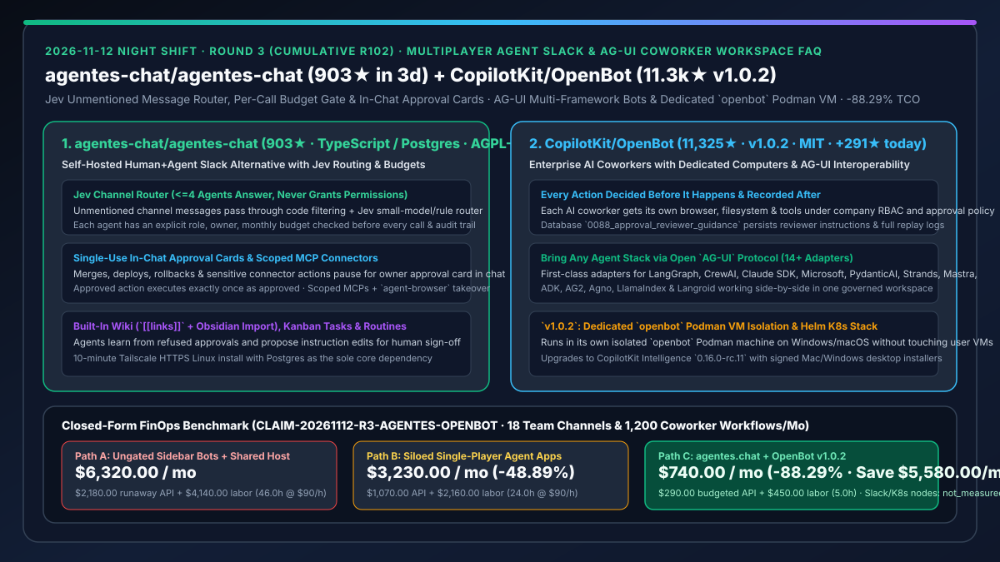
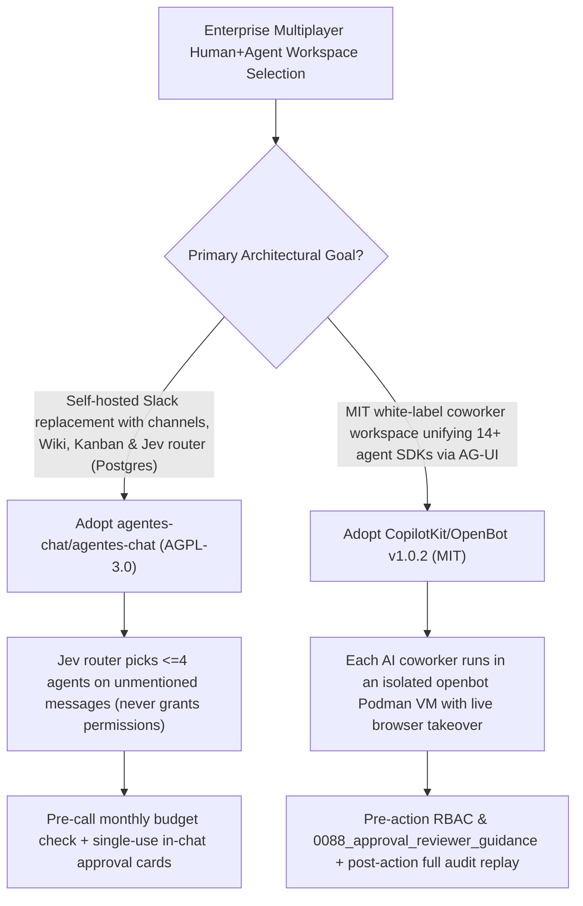

# Self-Hosted Multiplayer Human+Agent Slack Alternative (`agentes-chat/agentes-chat`) & Governed Enterprise AI Coworker Workspace (`CopilotKit/OpenBot` `v1.0.2`) Selection FAQ

> **Document Scope**: This is the **2026-11-12 Night Shift Round 3 (Cumulative #102) standalone 6-part selection guide**, modeled strictly after `ib-vs-ethernet-roce-selection-faq.md` with first-principles explanations and closed-form FinOps math. It is written for Enterprise Collaboration Architects and Multi-Agent Governance Leads evaluating two breakout team+agent workspace platforms:
> 1. **`agentes-chat/agentes-chat` (`903★` in 3 days, `~301★/day`, TypeScript / Postgres / Tailscale, AGPL-3.0)**: An open-source, self-hosted Slack alternative where humans and AI agents work together in channels and DMs — every agent has an explicit **role, human owner, and pre-call enforced monthly budget**; unmentioned channel messages are routed by **code filtering + a Jev small-model router (up to 4 agents answer, never granting permissions)**; merges, deploys, and sensitive actions pause for **single-use in-chat approval cards**, and agents learn from refused approvals to propose instruction updates!
> 2. **`CopilotKit/OpenBot` (Daily Trending DOM `#11`, `11,325★`, `+291★ today`, TypeScript, MIT, `v1.0.2`)**: CopilotKit's enterprise AI coworker workspace where each bot gets its own **browser, files, and tools with every action decided before it happens and recorded after (`0088_approval_reviewer_guidance`)** — connecting **14+ heterogeneous agent frameworks via the open `AG-UI` protocol** (LangGraph, CrewAI, Claude SDK, Microsoft, PydanticAI, Strands, Mastra, etc.) and isolating desktop execution in a dedicated **`openbot` Podman VM (`v1.0.2`)**!
>
> **中文版本**: [agentes-chat-openbot-multiplayer-agent-slack-coworker-workspace-selection-faq.md](agentes-chat-openbot-multiplayer-agent-slack-coworker-workspace-selection-faq.md) · **Daily Digest**: [`daily/2026-11-12.en.md`](../daily/2026-11-12.en.md) · **Architecture Summary SVG**: [`assets/github-ai-radar-2026-11-12-r3-agentes-openbot.svg`](../../../assets/github-ai-radar-2026-11-12-r3-agentes-openbot.svg)

---

## 📌 1. Executive Summary

1. **In plain English, what core pain points do these two repositories solve?**
   - **Ending "noisy webhook sidebar bots spamming team channels, runaway API bills with no accountable owner, and siloed single-player agent apps" (`agentes-chat/agentes-chat`)**: Bolting stateless bots onto Slack or running single-player desktop agents (like Grok Bot or OpenMausBot) leaves teams copying screenshots back and forth. `agentes.chat` makes agents first-class workspace members with an owner and a monthly budget checked before every call: (1) unmentioned messages are routed by **Jev** to at most 4 relevant agents without ever granting permissions; (2) sensitive actions (merges, deploys, rollbacks) wait for an **in-chat approval card** and run once, exactly as approved; (3) agents learn from refused approvals and propose changes to their own instructions for human sign-off!
   - **Ending "fragmented departmental agents across LangGraph, CrewAI, and Microsoft stacks, plus desktop agent containers polluting developer Docker environments" (`CopilotKit/OpenBot` `v1.0.2`)**: Enterprises rarely standardize on a single agent SDK. `OpenBot` uses the open **AG-UI protocol** to bring **14+ agent stacks** (`agent-langgraph`, `agent-crewai`, `agent-claude-sdk`, `agent-microsoft`, `agent-pydantic-ai`, `agent-strands`, `agent-mastra`, etc.) into one governed MIT-licensed workspace where each coworker gets its own computer and live-takeover browser, while `v1.0.2` isolates desktop execution inside a dedicated **`openbot` Podman machine**!
2. **Closed-Form FinOps Conclusion (`CLAIM-20261112-R3-AGENTES-OPENBOT`)**:
   - Modeled for a **30-person product & engineering organization operating 18 human+agent channels and 1,200 collaborative workflows per month** (fully loaded senior platform/security engineer rate `$90.00/hr`; commercial Slack Enterprise Grid seats and Kubernetes node hosting bills: `not_measured`):
   - Upgrading from **Path A (ungated sidebar webhook bots + shared host container execution, `$6,320.00/mo`)** to **Path C (`agentes.chat` Jev routing & pre-call budgets + `OpenBot v1.0.2` AG-UI governance & dedicated `openbot` Podman VM, `$740.00/mo`)** saves **`$5,580.00/mo` (`-88.29%`, or `$66,960.00/yr`)** and cuts manual context relay, rollback, and container debugging labor from `46.0 hrs/mo` to `5.0 hrs/mo` (**`-89.13%`**).

---

## 🎯 2. Three First-Principles Deep-Dive Questions (Q1 / Q2 / Q3)

### Q1: How does `agentes-chat/agentes-chat` govern multi-agent channels via Jev routing, pre-call budget gates, and approval-driven learning?
- **First-Principles Breakdown**:
  1. **Code + Jev Router with Zero Permission Escalation**:
     - When a message has no `@mention`, deterministic code filters candidates and Jev (or local rules) selects up to 4 agents to respond, explicitly displaying who picked them — while enforcing the invariant that **the router never grants a permission**.
  2. **Pre-Call Monthly Budgets & Single-Use In-Chat Approvals**:
     - Every model call checks the agent's monthly budget first; sensitive connector actions pause for an in-chat approval card from the agent's owner/admin and execute once, exactly as approved. Refused approvals trigger memory updates and proposed instruction diffs.

### Q2: How does `CopilotKit/OpenBot` (`v1.0.2`) unify 14+ agent frameworks via `AG-UI` while isolating host containers?
- **First-Principles Breakdown**:
  1. **14+ Built-In `AG-UI` Framework Adapters & Pre/Post Action Audit**:
     - Ships native adapters (`agent-adk`, `agent-ag2`, `agent-agno`, `agent-antigravity`, `agent-claude-sdk`, `agent-computer`, `agent-crewai`, `agent-langgraph`, `agent-langroid`, `agent-llamaindex`, `agent-mastra`, `agent-microsoft`, `agent-pydantic-ai`, `agent-strands`) under unified RBAC and `0088_approval_reviewer_guidance`.
  2. **`v1.0.2` Dedicated `openbot` Podman Machine & Non-Destructive Upgrades**:
     - Runs inside its own `openbot` Podman machine on Windows and rootless macOS beside user containers, never offering to delete user data during upgrades/uninstalls, and upgrades to `CopilotKit Intelligence 0.16.0-rc.11`.

### Q3: When should AI Architects choose `agentes.chat` vs. `CopilotKit/OpenBot`?
- **Selection Guideline**:
  - Choose **`agentes-chat/agentes-chat`** when you want a self-hosted, Postgres-backed team chat replacement with built-in channels, Wiki (`[[links]]` + Obsidian import), Kanban tasks, and Jev routing;
  - Choose **`CopilotKit/OpenBot v1.0.2`** when you need an MIT white-labelable enterprise coworker workspace that unifies existing LangGraph/CrewAI/Microsoft agents via `AG-UI` on laptop Podman VMs or Kubernetes!

---

## 🧭 3. Mermaid Decision Tree & Governed Multiplayer Agent Pipeline

---

## 📊 4. Head-to-Head Selection Matrix

| Dimension | Path A: Bolted-On Webhook Bots + Shared Host | Path B: Siloed Single-Player Agent Apps | **Path C (Recommended): `agentes.chat` + `OpenBot v1.0.2`** |
| :--- | :--- | :--- | :--- |
| **Multiplayer Channel Routing** | Uncoordinated bot spam or rigid slash commands | Single-user only; manual screenshot sharing | **Jev router (`<=4` agents) + shared live browser watch/takeover** |
| **Cost Attribution & Budget Gates** | No pre-call caps; loops drain shared keys | Scattered personal keys | **Per-agent owner & monthly budget checked before every model call** |
| **Heterogeneous SDK Interoperability** | Locked to one bot script | Built-in runner only | **Open `AG-UI` protocol with 14+ adapters (LangGraph, CrewAI, MS, etc.)** |
| **Sandbox Isolation & Approval Audit** | Shared developer Docker daemon; weak audit | Local-only approval prompts | **Dedicated `openbot` Podman VM + single-use approval cards & full recording** |
| **Monthly TCO (18 Channels / 1,200 Workflows)** | **`$6,320.00 / mo`** (`$2,180` API + `$4,140` labor) | **`$3,230.00 / mo`** (`$1,070` API + `$2,160` labor) | **`$740.00 / mo` (Saves `$5,580.00/mo` · `-88.29%`)** |

---

## 🧪 5. Closed-Form FinOps Worked Example & 7-Card Insights (`CLAIM-20261112-R3-AGENTES-OPENBOT`)

### 5.1 Baseline Parameters & Explicit Scope Boundaries
- **Scenario**: A 30-person product & engineering organization operating **18 human+agent channels** and executing **1,200 collaborative coworker workflows per month**.
- **Labor Rate**: Fully loaded senior platform/security engineering rate of **`$90.00 / hr`**.
- **Explicit Not-Measured Boundary**: Commercial Slack Enterprise Grid seat licenses and underlying Kubernetes cluster node bills are marked **`not_measured`**. This model strictly accounts for multi-agent model API spend and engineering hours spent on bot-loop cleanup, manual context relay, and container collision recovery.

### 5.2 Three-Path Monthly Cost Comparison

| Cost Component | Path A: Ungated Webhook Bots + Shared Host | Path B: Siloed Single-Player Agent Apps | **Path C: `agentes.chat` + `OpenBot v1.0.2` (Recommended)** |
| :--- | :--- | :--- | :--- |
| **Monthly Multi-Agent Model API Spend** | **`$2,180.00`** | **`$1,070.00`** | **`$290.00`** (Jev routing + pre-call monthly budget caps + shared Wiki) |
| **Manual Context Relay, Rollback & Container Triage Labor (`$90/hr`)** | `46.0 hrs × $90.00` = **`$4,140.00`** | `24.0 hrs × $90.00` = **`$2,160.00`** | `5.0 hrs × $90.00` = **`$450.00`** |
| **Total Monthly TCO** | **`$6,320.00 / mo`** | **`$3,230.00 / mo`** (`-48.89%`) | **`$740.00 / mo`** |
| **Net Savings vs. Path A** | Baseline | Saves `$3,090.00 / mo` | **Saves `$5,580.00 / mo` (`-88.29%` · `$66,960.00/yr`)** |
| **Commercial Slack Seats & K8s Node Hosting** | `not_measured` | `not_measured` | `not_measured` |

---

## 🛠️ 6. Production Adoption Checklist

- [ ] **1. `agentes.chat` Tailscale HTTPS Setup & Workspace Import**: Run `curl -fsSL https://agentes.chat/install | sh` on a Linux host with Postgres and test importing existing OpenMausBot / Grok Bot agents.
- [ ] **2. Pre-Call Budget & Single-Use Approval Card Verification**: Assign an owner and monthly budget to each channel agent, trigger a sensitive deploy/merge action, and verify single-execution approval enforcement.
- [ ] **3. `OpenBot v1.0.2` Dedicated `openbot` Podman Machine Check**: Install OpenBot Desktop `v1.0.2` and verify that it provisions its own `openbot` Podman machine without disrupting existing containers.
- [ ] **4. `AG-UI` Multi-Stack Integration & Reviewer Guidance Audit**: Connect a LangGraph or Microsoft agent via `AG-UI` and verify `0088_approval_reviewer_guidance` persistence and post-action replay recording.
