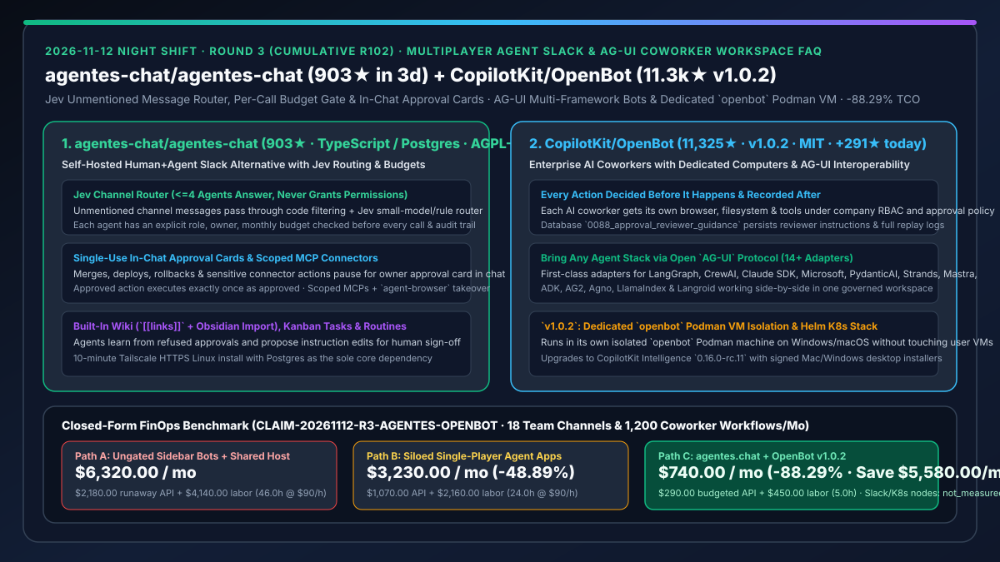
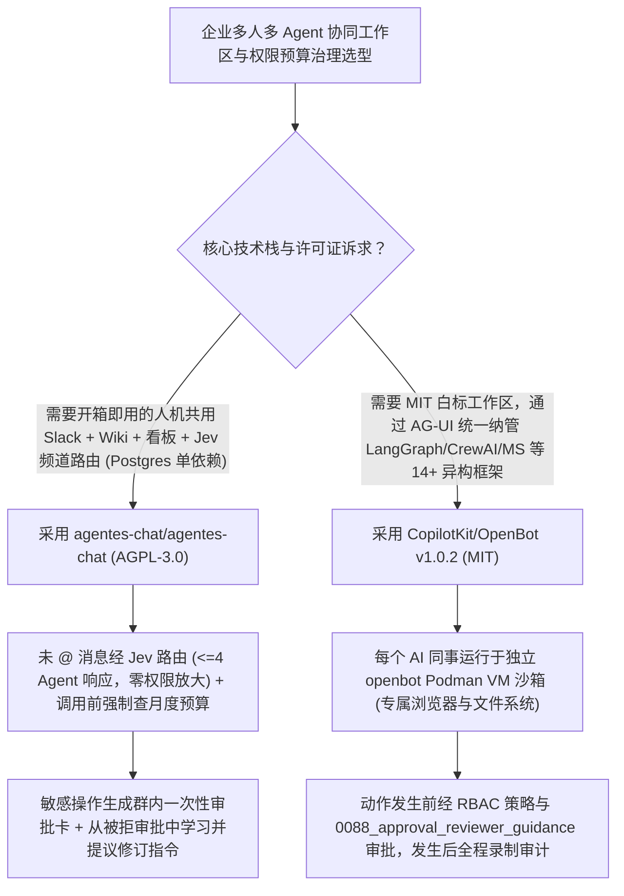

# 自托管人机共用 Slack 协同中枢（`agentes-chat/agentes-chat`）与预授权录制企业 AI 同事工作区（`CopilotKit/OpenBot` `v1.0.2`）深度选型 FAQ

> **文档定位**：本专题是 **2026-11-12 夜班第 3 轮（累计第 102 篇）独立六段式选型指南**，严格对标 `ib-vs-ethernet-roce-selection-faq.md` 的通俗第一性原理与闭式 FinOps 核算规范，面向企业协同办公平台架构师与多智能体治理负责人，深度拆解今日在多人多 Agent 团队工作区赛道爆发的两大标杆项目：
> 1. **`agentes-chat/agentes-chat`（建仓 3 天狂揽 `903★`，日均 `≈301★/天`，TypeScript / Postgres / Tailscale，AGPL-3.0）**：开源自托管的“人类团队与 AI 智能体同处一个频道”的 Slack 替代方案——每个 Agent 都拥有明确的**角色、责任人（Owner）与调用前强制核验的月度预算（Monthly Budget）**；未 `@` 指名的频道消息由 **代码预筛 + Jev 小模型路由器（最多选 4 个 Agent 回答且绝不越权授予权限）** 分发；合并、部署与回滚动作必须生成**聊天内一次性审批卡片（Approved action runs once, exactly as approved）**，并会根据被拒审批自动向人类提议修改自身指令！
> 2. **`CopilotKit/OpenBot`（主日榜 DOM `#11`，`11,325★`，今日新增 `+291★ today`，TypeScript，MIT，最新 `v1.0.2`）**：由 `AG-UI` 协议创始团队 CopilotKit 开源的企业级 AI 同事工作区——每个 Bot 配有独立的**专属电脑、浏览器、文件系统与工具集**，严格遵循**“每个动作发生前先做权限裁决、发生后全程录制审计（`0088_approval_reviewer_guidance`）”**；通过开放 `AG-UI` 协议原生纳管 **LangGraph、CrewAI、Claude SDK、Microsoft、PydanticAI、Strands、Mastra 等 14+ 种异构框架智能体**，并在 `v1.0.2` 中实现 Windows/macOS **专属 `openbot` Podman 虚拟机隔离**！
>
> **English Version**: [agentes-chat-openbot-multiplayer-agent-slack-coworker-workspace-selection-faq.en.md](agentes-chat-openbot-multiplayer-agent-slack-coworker-workspace-selection-faq.en.md) · **关联日报**: [`daily/2026-11-12.md`](../daily/2026-11-12.md) · **架构总结图**: [`assets/github-ai-radar-2026-11-12-r3-agentes-openbot.svg`](../../../assets/github-ai-radar-2026-11-12-r3-agentes-openbot.svg)

---

## 📌 一、核心结论速览（Executive Summary）

1. **一句话大白话讲透这两个项目到底解决了什么痛点？**
   - **终结“群聊里塞了五六个 Webhook 机器人导致抢答刷屏、月底账单爆炸找不到责任人、以及单机 Agent 工具（Grok Bot / OpenMausBot）无法多人共享上下文”的痛点（`agentes-chat/agentes-chat`）**：传统做法是在 Slack 里外挂侧边栏 Bot，或者每个人自己在电脑上跑单机 Agent 再把结果截图发到群里。`agentes.chat` 直接把 Agent 变成拥有工号、主管（Owner）和月度预算的正式频道成员：① 没人点名时由 **Jev 路由器** 精准挑选 0–4 个最合适的 Agent 接话（且路由器绝不放大权限）；② 每次调大模型前先查该 Agent 的月度剩余预算；③ 遇到合并代码、发版或高敏 MCP 操作，直接在群里弹出**一次性精确执行审批卡**；④ 被人类拒绝后，Agent 会自动总结教训并提交修订自身 Prompt 的 PR 供主管验收！
   - **终结“公司不同部门用 LangGraph、CrewAI、Microsoft Agent Framework 各自造轮子无法互通，且桌面端 Agent 与开发者本机 Docker/Podman 容器混跑互相污染”的痛点（`CopilotKit/OpenBot` `v1.0.2`）**：企业内部往往存在多套不同技术栈的 Agent。`OpenBot` 基于开放 **AG-UI 协议** 提供统一企业工作台，内置 `agent-langgraph`、`agent-crewai`、`agent-claude-sdk`、`agent-microsoft`、`agent-pydantic-ai`、`agent-strands`、`agent-mastra` 等 **14+ 个官方适配器**，给每个 AI 同事分配独立的计算机与可实时围观/接管的浏览器；`v1.0.2` 更在 Windows 与 macOS 上强制使用独立的 **`openbot` Podman 虚拟机**（与用户自己的容器环境物理隔离），升级或卸载绝不误删用户数据！
2. **闭式 FinOps 投资回报结论（`CLAIM-20261112-R3-AGENTES-OPENBOT`）**：
   - 以 **30 人产品研发团队维护 18 个跨职能人机协作频道、每月执行 `1,200 次` 研发/测试/发布/运维协同任务** 为基准（高级平台与安全工程师全包时薪 `$90.00/hr`；商业 Slack Enterprise Grid 席位费与底层 K8s 物理节点账单：`not_measured`）：
   - 从 **Path A（无预算门禁的群聊外挂 Bot 抢答空转 + 宿主机混跑未隔离容器导致事故返工，月均 `$6,320.00`）** 升级至 **Path C（`agentes.chat` Jev 路由与调用前预算卡控 + `OpenBot v1.0.2` AG-UI 统一纳管与独立 `openbot` Podman 沙箱，月均 `$740.00`）**，每月净省 **`$5,580.00/mo`（降幅 `-88.29%`，年省 `$66,960.00/yr`）**，并将跨工具复制粘贴、越权操作回滚与容器冲突排障工时从 `46.0 hrs/mo` 压缩至 `5.0 hrs/mo`（节省 **`-89.13%`**）。

---

## 🎯 二、三大灵魂拷问（Q1 / Q2 / Q3 深度原理解析）

### Q1：`agentes-chat/agentes-chat` 是如何通过「Jev 频道路由 + 每次调用前预算门禁 + 拒绝反馈自进化」管住群聊里的多个 Agent 的？
- **第一性原理拆解**：
  1. **代码预筛 + Jev 路由器（零权限放大铁律）**：
     - 当频道里出现未 `@` 特定对象的消息时，先由确定性代码筛选候选 Agent，再由轻量级 Jev 模型或规则选出最多 **4 个 Agent**（或 0 个）作答，并在消息旁透明标注路由决策者；最关键的安全不变量是：**路由器只负责选人，绝不授予任何额外工具权限（It never grants a permission）**。
  2. **调用前月度预算核验（Pre-Call Budget Gate）与一次性审批卡（Single-Use Approval Card）**：
     - 每个 Agent 绑定明确的人类 Owner 与月度美元预算，每次模型调用前强制校验余额；
     - 凡涉及 Merge、Deploy、Rollback 或连接器标记为敏感的操作，一律挂起并向 Owner 发送群内审批卡，批准后**严格按审批快照执行唯一一次**；当审批被拒或被人类纠正时，Agent 将教训记入持久记忆并提议更新自身系统指令（需人类确认后生效）。

### Q2：`CopilotKit/OpenBot` (`v1.0.2`) 是如何通过 `AG-UI` 协议打通 14+ 种异构智能体框架，并用独立 `openbot` Podman 机保护宿主机安全的？
- **第一性原理拆解**：
  1. **开放 `AG-UI` + `MCP` 双协议解耦底座**：
     - 仓库根目录原生提供 `agent-adk`、`agent-ag2`、`agent-agno`、`agent-antigravity`、`agent-bot`、`agent-claude-sdk`、`agent-computer`、`agent-crewai`、`agent-langgraph`、`agent-langroid`、`agent-llamaindex`、`agent-mastra`、`agent-microsoft`、`agent-pydantic-ai`、`agent-strands` 等全套适配器，让不同部门用不同框架写的 Agent 在同一工作区共享 RBAC 权限、交互式结果渲染与 `0088_approval_reviewer_guidance` 审批指导审计库。
  2. **`v1.0.2` 专属 `openbot` Podman 虚拟机隔离与无损升级保护**：
     - 在 Windows（以及使用 rootless 模式的 macOS）上，`OpenBot v1.0.2` 始终运行在名为 `openbot` 的专属 Podman 虚拟机中，与开发者原有的容器环境并列隔离；且安装器覆盖升级或卸载时永不误删历史业务数据，后端同步升级至 `CopilotKit Intelligence 0.16.0-rc.11`。

### Q3：AI 架构师在落地企业多智能体协作时，何时选 `agentes.chat`、何时选 `CopilotKit/OpenBot`、如何组合？
- **选型与组合准则**：
  - 若团队需要一套**带频道/私聊/双链 Wiki (`[[links]]` + Obsidian 导入)/看板任务与定时 Routine 的自托管全功能人机聊天工作台**（仅依赖单台 Linux + Postgres + Tailscale），首选 **`agentes-chat/agentes-chat`**；
  - 若团队已有基于 **LangGraph / CrewAI / Microsoft Agent Framework / PydanticAI** 构建的存量智能体，需要给每个 AI 同事配独立沙盒电脑/浏览器并由企业 SSO 统一治理（MIT 协议可自由白标定制），首选 **`CopilotKit/OpenBot v1.0.2`**！

---

## 🧭 三、Mermaid 选型决策树与「Jev 预算门禁 + AG-UI 独立沙箱」治理流水线

---

## 📊 四、同类方案核心能力对比矩阵（Selection Matrix）

| 评估维度 | Path A：传统 IM 外挂 Webhook Bot + 宿主机裸跑 | Path B：单机个人 Agent 客户端（Grok Bot / OpenMausBot） | **Path C（推荐）：`agentes.chat` + `OpenBot v1.0.2`** |
| :--- | :--- | :--- | :--- |
| **人机频道协同与消息路由** | 群内多个 Bot 盲目抢答刷屏，或必须死记硬背命令 | 仅限单人单机使用，团队无法围观或共同接管 | **Jev 智能路由（`<=4` Agent 响应）+ 团队全员可见可随时接管浏览器** |
| **模型账单与月度预算硬门禁** | 无调用前预算拦截，死循环即打爆公司 API Key | 分散在个人账号，难以按角色/项目核算成本 | **每个 Agent 绑定 Owner 与月度预算，每次调用前强制校验余额** |
| **异构 Agent 框架纳管能力** | 绑定单一框架 | 仅支持内置运行器 | **通过开放 `AG-UI` 协议原生接入 LangGraph / CrewAI / MS 等 14+ 框架** |
| **容器隔离与敏感动作审批** | 混跑在开发者宿主 Docker，极易误改本地配置或越权发版 | 缺乏多人审批流与企业级审计日志 | **独立 `openbot` Podman VM 隔离 + 聊天内一次性审批卡与全程录像审计** |
| **月度总拥有成本（18 频道 / 1,200 任务）** | **`$6,320.00 / mo`**（`$2,180` 失控 API + `$4,140` 工时） | **`$3,230.00 / mo`**（`$1,070` API + `$2,160` 搬运工时） | **`$740.00 / mo`（净省 `$5,580.00/mo` · `-88.29%`）** |

---

## 🧪 五、定量 FinOps 算例与 7-Card 洞察（`CLAIM-20261112-R3-AGENTES-OPENBOT`）

### 5.1 测算基准与显式边界（Scope & Boundaries）
- **场景设定**：30 人产品研发组织，维护 **18 个跨职能人机协作频道**，每月由 AI 同事协同完成 **1,200 次代码修复、测试验证、文档沉淀与发布审批工作流**。
- **费率假设**：高级平台与安全治理工程师全包时薪 **`$90.00 / hr`**。
- **显式边界声明（Explicit Not-Measured Boundary）**：商业 Slack Enterprise Grid 席位订阅费与底层 Kubernetes 物理服务器租金标记为 **`not_measured`**，本表严格核算多 Agent 频道模型 API 消耗以及因抢答空转、跨端人工复制粘贴、宿主机容器污染与未授权操作回滚产生的工程工时。

### 5.2 三路径月度成本闭式对照表

| 成本分项 | Path A：无门禁外挂 Bot + 宿主机混跑 | Path B：单机孤岛 Agent + 人工截图同步 | **Path C：`agentes.chat` + `OpenBot v1.0.2`（推荐）** |
| :--- | :--- | :--- | :--- |
| **月度多智能体频道模型 API 支出** | **`$2,180.00`**（群内多 Bot 重复触发与失控循环） | **`$1,070.00`**（重复粘贴背景上下文） | **`$290.00`**（Jev 精准路由 + 调用前月度预算硬上限 + 共享 Wiki 上下文） |
| **跨工具人工搬运、越权事故回滚与容器冲突排障工时（`$90/hr`）** | `46.0 hrs × $90.00` = **`$4,140.00`** | `24.0 hrs × $90.00` = **`$2,160.00`** | `5.0 hrs × $90.00` = **`$450.00`** |
| **月度总成本（Monthly TCO）** | **`$6,320.00 / mo`** | **`$3,230.00 / mo`**（`-48.89%`） | **`$740.00 / mo`** |
| **相对 Path A 净节省** | 基准线（Baseline） | 净省 `$3,090.00 / mo` | **净省 `$5,580.00 / mo`（`-88.29%` · 年省 `$66,960.00/yr`）** |
| **商业 Slack 席位与 K8s 物理节点租金** | `not_measured` | `not_measured` | `not_measured` |

---

## 🛠️ 六、生产级落地核验 Checklist

- [ ] **1. `agentes.chat` Tailscale 私有 HTTPS 部署与历史迁移**：在 Linux 主机执行 `curl -fsSL https://agentes.chat/install | sh`，验证 Postgres 单依赖启动，并测试从 OpenMausBot / Grok Bot 导入历史配置。
- [ ] **2. Agent 角色 Owner 绑定、月度预算与一次性审批卡演练**：为每个入驻频道的 Agent 设置月度美元上限与责任人，触发一次敏感发布动作，验证群内审批卡拦截及“批准后仅执行唯一一次”契约。
- [ ] **3. `OpenBot v1.0.2` 独立 `openbot` Podman VM 隔离核查**：在 Windows 或 macOS 上安装 `OpenBot v1.0.2`，确认其创建并使用独立的 `openbot` Podman 机器，不影响本机既有容器。
- [ ] **4. `AG-UI` 异构框架接入与 `0088_approval_reviewer_guidance` 审计**：通过 `agent-langgraph` 或 `agent-microsoft` 接入存量智能体，验证审批人附加指导意见（Reviewer Guidance）与动作事后回放录像完整性。
