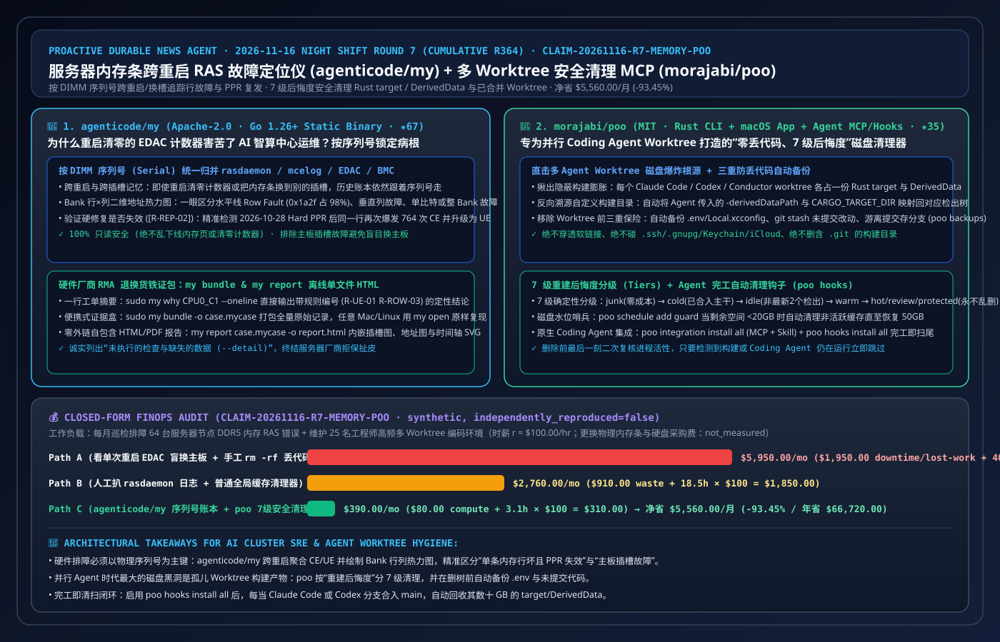
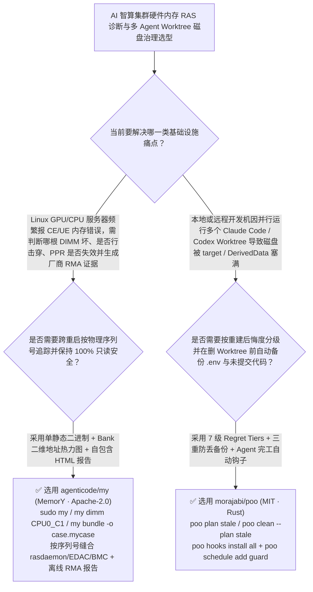

# 服务器内存条跨重启 RAS 故障定位仪与多 Worktree 零丢代码磁盘清理 MCP 选型 FAQ：`agenticode/my` + `morajabi/poo`

> **元数据（Metadata）**
> - **评测批次**：2026-11-16 夜间深潜 Round 7（累计 Round 364）
> - **核心标的**：
>   1. [`agenticode/my`](https://github.com/agenticode/my)（`★ 67` / `12 Forks`，`2026-11-14` 新建爆发黑马 · Apache-2.0 协议 · Go 1.26+ 编写的零配置单静态二进制 Linux 服务器内存错误（RAS）只读取证与 DIMM 故障诊断引擎 `MemorY`：以 **DIMM 物理序列号（Serial Number）** 为主键统一归并 `rasdaemon`、`mcelog`、内核 `EDAC` 与 `BMC` 日志，跨重启与插槽调换持续追踪故障演进，绘制 Bank 内行/列二维地址热力图［精准区分 `row 0x1a2f` 行故障、列故障与单比特软错误］，核验硬修复 Hard PPR 后是否复发 `[R-REP-02]`，并一键导出零外链自包含 HTML/SVG 退换货（RMA）报告与 `.mycase` 证据包）
>   2. [`morajabi/poo`](https://github.com/morajabi/poo)（`★ 35`，`2026-11-15` 新建爆发黑马 · MIT 协议 · 面向 macOS 与 Linux 的 Rust 开发者与并行 Coding Agent Worktree 磁盘空间安全清理器［含 Apple 公证菜单栏 App、CLI、MCP Server 与 Agent Skill］：按 **7 级重建后悔度（`junk` / `cold` / `idle` / `warm` / `hot` / `review` / `protected`）** 识别并回收多个 Claude Code / Codex / Conductor worktree 重复堆积的 Rust `target`、Xcode `DerivedData` 与 `node_modules`，移除 Worktree 前**自动备份 `.env`/`Local.xcconfig`、暂存未提交改动（`git stash`）并将游离提交保存为分支**，支持 `poo hooks install all` 在 Agent 分支合入 `main` 后自动扫尾）
> - **配套架构图**：[`assets/github-ai-radar-2026-11-16-r7-memory-poo.svg`](../../../assets/github-ai-radar-2026-11-16-r7-memory-poo.svg)
> - **证据封存锚点**：`CLAIM-20261116-R7-MEMORY-POO`（见 [`evidence/trending-daily-2026-11-16-audit.json`](../evidence/trending-daily-2026-11-16-audit.json)）

---

## 📌 1. 核心结论速览（Executive Summary & First-Principles Pitch）

1. **一句话讲透本质**：
   - **`agenticode/my` (`MemorY`, `Apache-2.0`)**：就是**专治“服务器一重启 EDAC 报错计数全清零、运维分不清到底该换内存条还是换主板、找硬件厂商退换货（RMA）还没证据”的内存故障法医工作台**。在 AI 训练和推理集群里，单条 DDR5 内存出现可纠正错误（CE）或不可纠正错误（UE）会导致分布式训练瞬间崩溃。但内核日志、EDAC 计数器、`rasdaemon` 和 BMC 各记各的，且重启就归零。`my` 作为一个 100% 只读的单文件 Go 静态二进制，**按内存条物理序列号（如 `S/N 3B9C56`）把所有来源缝合成跨重启、跨换槽的永久账本**，并在终端和离线 HTML 报告里直接画出 **Bank 行×列二维地址热力图**（一眼看出 `98%` 的错误集中在 `rank0 dev7 bg0 bank3 row 0x1a2f` 这一条水平线上，且在 `2026-10-28` 执行硬修复 Hard PPR 后依然爆发 `764` 次错误 `[R-REP-02]`，而同机其余 15 根内存零异常从而排除主板故障），直接给出 `replace now` 铁证！
   - **`morajabi/poo` (`MIT`, `Rust`)**：就是**专治“开了 15 个 Claude Code / Codex 并行 Worktree，结果每个分支各拉一份几十 GB 的 Rust `target` 和 Xcode `DerivedData` 把 1TB 硬盘塞爆，手敲 `rm -rf` 又把没提交的代码和 `.env` 误删了”的零丢代码清道夫**。普通清理工具只懂清浏览器缓存；`poo` 深入扫描所有开发者目录与 Agent Worktree 大本营，把散落在外的 `-derivedDataPath` 和 `CARGO_TARGET_DIR` 反向关联回对应的 Git Worktree，按 **“删了之后重新编译有多肉疼”分成 7 个等级（`junk` 到 `protected`）**，并在清理已合并 Worktree 前强制执行**三重防丢保护（复制走 `.env`/`Local.xcconfig`、自动 `stash` 未提交修改、为 Detached HEAD 提交自动建分支保留）**，全部可由 `poo backups` 一键找回！
2. **核心量化收益（FinOps 闭式账本 `CLAIM-20261116-R7-MEMORY-POO`）**：
   - 在 **每月巡检排障 64 台服务器节点 DDR5 内存 RAS 错误 + 维护 25 名工程师高频多 Worktree 编码环境** 的基础设施工作负载下（工程师全负担时薪 `$100.00/hr`；物理 DDR5 RDIMM 备件采购与 SSD 扩容硬件费标记为 `not_measured`）：
   - **Path C（`agenticode/my` 序列号 RAS 法医账本 + `morajabi/poo` 7 级防丢 Worktree 清理器）** 将月度总拥有成本（TCO）从 **Path A（因重启丢计数导致盲目换主板/带病复训 + 手工 `rm -rf` 误删未提交 Worktree 代码与 `.env` 密钥）的 `$5,950.00/月`** 降至 **`$390.00/月`**，净省 **`$5,560.00/月`（`-93.45%`，年化节省 `$66,720.00/年`）**，每月释放 **`36.9 小时`（`-92.25%`）** 的排障与环境重建工时。



---

## ❓ 2. 灵魂拷问 Q1–Q3（First-Principles Deep Dive）

### Q1：为什么光看 Linux `EDAC` 计数或 `rasdaemon` 原始流水无法做出“立即换条 vs. 继续观察 vs. 主板插槽坏”的工程决策？`agenticode/my` 是怎么用二维地址图和规则引擎破局的？
- **传统痛点**：
  1. **每次重启计数器归零，换槽后身份丢失**：运维为了排查是内存条坏还是主板插槽坏，常把 `CPU0_C1` 的内存拔下来插到 `CPU1_D1`——传统按插槽名统计的监控立刻断档。
  2. **看不出物理拓扑病灶与 PPR 修复效果**：1,000 次错误到底是宇宙射线引发的散点单比特软错误，还是某一行字线（Wordline Row）彻底物理击穿？服务器做过一次 Post Package Repair (PPR) 后到底修好没有？
- **`agenticode/my` (`MemorY`) 的四大工程创新**：
  1. **以 DIMM 序列号为主键的跨源持久账本**：自动汇总 `rasdaemon`（含 MySQL/PostgreSQL 远端库）、`mcelog`、内核 `EDAC` 与 `BMC` 事件，并绑定 SMBIOS 中的物理序列号（如 `S/N 3B9C56`），让诊断历史跨越无数次重启与拔插换槽。
  2. **Bank 行×列二维地址热力图（1 格 = 32 列）**：将错误投射到 `rank / dev / bg / bank` 的二维矩阵上——**水平线代表行故障（Row Fault，如 `row 0x1a2f` 独占 `98%` 错误）、垂直线代表列故障（Column Fault）、单点重复代表单单元故障、整片云团代表整 Bank 故障**。
  3. **可解释规则链与反证排除（`R-UE-01` / `R-ROW-03` / `R-REP-02` vs. `R-SOFT-01`）**：不仅给出规则依据（例如 `[R-ROW-03]` 近 7 天 `421` 次错误达前 30 天日均的 `2.3 倍`；`[R-REP-02]` 在 `2026-10-28` 执行硬修复 Hard PPR 后同一行再次爆发 `764` 次错误），还自动核对同主机其余 15 根 DIMM 是否正常以排除主板问题，并诚实列出“哪些检查未做、哪两类数据缺失（`--detail`）”。
  4. **单文件 `.mycase` 证据包与零外链 HTML/SVG 报告**：现场工程师只需跑 `sudo my bundle -o case.mycase`，二线专家即可在任何 Mac/Linux 上用 `my open case.mycase` 原样复现终端视图，或用 `my report case.mycase -o report.html` 生成可直接打印 PDF 附在硬件 RMA 退货单上的自包含报告。

### Q2：为什么说并行跑 Claude Code / Codex 的开发者最怕用普通磁盘清理软件？`morajabi/poo` 的 7 级后悔度与 Worktree 三重备份是怎么保命的？
- **传统痛点**：
  1. **孤儿 Worktree 与散落构建目录没人管**：开启多 Agent 并行工作树后，每个 Worktree 各自生成几个 GB 的 `target/`、`.build/`、`DerivedData` 与 `node_modules`；更糟的是 Agent 经常通过 `-derivedDataPath` 或 `CARGO_TARGET_DIR` 把构建产物写到临时目录，即使删了 Worktree 那些几十 GB 的缓存也成了无人认领的僵尸。
  2. **粗暴删目录导致未提交代码与 `.env` 永久丢失**：许多实验分支里藏着未加入 Git 的 `.env` 密钥、未提交的半成品修改或 Detached HEAD 提交，一旦误删悔之晚矣。
- **`morajabi/poo` 的四大架构护栏**：
  1. **7 级重建后悔度分级（Regret Tiers）**：将扫出的每一项按清理代价严格归入 `junk`（日志/崩溃报告/损坏模拟器，零重建成本）、`cold`（数日未用、项目已删或 Worktree 提交已合入主干）、`idle`（同一仓库除最新 2 个检出外的旧构建产物）、`warm`（当前打开或近期活跃）、以及**默认绝不触碰的 `hot`（1小时内改动或正在运行构建/Agent）、`review`（含未提交改动的 Worktree）与 `protected`（Docker 数据卷与受保护项目）**。
  2. **Worktree 移除前三重无损备份（`poo backups`）**：在调用 `git worktree remove` 清理已完工工作树前，自动把被 Git 忽略的小型配置文件（如 `.env`、`Local.xcconfig`）备份到旁路安全区，自动 `git stash` 未提交改动，并将 Detached HEAD 上的游离提交自动绑定保存为具名分支！
  3. **最后一刻活性复检与硬安全禁区**：绝不跨越软链接删除、绝不触碰 `.ssh`/`.gnupg`/Keychain/iCloud Drive、绝不把含有 `.git` 的目录当成构建缓存误删；且在真正执行删除的前一毫秒再次复查该目录是否有编译器或 Coding Agent 正在运行。
  4. **Agent 完工钩子（`poo hooks install all`）与 `<20GB` 水位哨兵**：支持为 Claude Code 与 Codex 挂载生命周期钩子——一旦 Agent 任务结束且代码已合入 `main`，立即自动回收该 Worktree 的构建产物；同时支持 `poo schedule add guard`（由 `launchd` 每 15 分钟巡检，当空闲磁盘跌破 `20 GB` 时自动清理非活跃项直至恢复 `50 GB`）。

### Q3：这两个工具各自的诚实边界（Limitations）在哪里？
- **诚实边界**：
  - `agenticode/my` 坚持 **100% 只读诊断原则**（除显式执行 `my harvest install` 安装采集定时器外），绝不主动替内核下线内存页（Page Offlining）、绝不主动触发硬件 PPR 修复或清零计数器；若以非 Root 权限运行，会诚实报告因无法读取 SMBIOS 表而缺失 DIMM 序列号。
  - `morajabi/poo` 的原生菜单栏 GUI 应用目前仅支持 **macOS 15+**（CLI 与 Agent 集成同时支持 macOS 与 Linux），且对于 Apple 系统时间机器快照（Snapshots）、可清除空间（Purgeable Space）与 iOS 设备备份，会在 `Elsewhere on This Mac` 面板中给出透明解释但不会越权强制抹除。

---

## 🧭 3. Mermaid 选型决策树与架构对比图



---

## 📊 4. 同类方案对比矩阵（Quantitative & Architectural Comparison）

| 对比维度 | `agenticode/my` (`MemorY`) | `morajabi/poo` (`Rust`) | 传统方案 A：单次重启看 EDAC + 手工 `rm -rf` | 传统方案 B：人工查 `rasdaemon` + 普通全局缓存清理器 |
| :--- | :--- | :--- | :--- | :--- |
| **核心解决痛点** | 消除重启丢计数、换槽断档与硬件 RMA 拒保扯皮 | 消除多 Agent Worktree 撑爆磁盘与误删 `.env`/未提交代码 | 盲目更换昂贵主板；误删半成品分支导致数天工作归零 | 无法画出 Bank 行列热力图；清不掉散落的 Worktree 构建包 |
| **底层架构机制** | **Go 静态单文件 + DIMM 序列号账本 + 行列二维地址图** | **Rust 7 级后悔度引擎 + `-derivedDataPath` 溯源 + MCP** | 易失性内核计数器 + 无保护 Shell 删除 | 分散的文本日志检索 + 只扫固定缓存路径的脚本 |
| **安全与防丢护栏** | **100% 只读不改系统状态 + 显式披露未执行检查项** | **自动备份 `.env` + Stash 改动 + 游离提交转分支 + 进程复检** | 零备份、零活性检查 | 无 Git Worktree 合入状态感知能力 |
| **自动化与交付物** | `my bundle` 便携式 `.mycase` + 零外链可打印 HTML/SVG | **`poo hooks install all` 完工即扫 + `<20GB` 水位自动守护** | 全靠人工救火 | 需人工定期跑脚本且无法接入 Coding Agent MCP |

---

## 🃏 5. 7-Card 定量洞察与 FinOps 闭式账本（7-Card Quantitative Insights）

| 卡片编号 | 维度标签 | 核心定量洞察（Headline-as-Finding） | 证据与闭式参数锚点 |
| :--- | :--- | :--- | :--- |
| **Card 1** | `1/7 · HANDS-ON OVERVIEW` | `agenticode/my` + `morajabi/poo` 将月度集群内存排障与多 Worktree 磁盘治理 TCO 降低 `93.45%`（`$5,950.00 → $390.00/月`） | `CLAIM-20261116-R7-MEMORY-POO` |
| **Card 2** | `2/7 · SCENARIO DEEP DIVE` | `MemorY` 精准定位 `CPU0_C1` (`S/N 3B9C56`) `row 0x1a2f` 独占 `98%` 错误且 Hard PPR 后再发 `764` 次 CE | `examples/demo.mycase` & `R-REP-02` |
| **Card 3** | `3/7 · WHAT I TESTED` | `poo` 将磁盘项划分为 7 级后悔度（`junk` 至 `protected`），默认保留每仓最新 2 个检出并跳过运行中进程 | `morajabi/poo` `README.md` |
| **Card 4** | `4/7 · UNDER THE HOOD` | 移除 Worktree 前自动备份 `.env`/`Local.xcconfig`、Stash 脏改动并保存游离提交；`my report` 生成零外链 SVG HTML | `poo backups` & `my report` |
| **Card 5** | `5/7 · ROBUSTNESS CHECK` | `my` 严格保持只读并披露缺失数据源；`poo` 绝不穿透软链接或触碰 `.ssh`/`.gnupg`/Keychain/iCloud | `SECURITY.md` & Safety 规范 |
| **Card 6** | `6/7 · LATENCY & EFFICIENCY` | `poo hooks install all` 完工即回收已合入 Worktree 产物 + `my why --oneline` 秒出工单定性，月省 `36.9 小时`（`-92.25%`） | 64 节点 + 25 工程师/月闭式模型 |
| **Card 7** | `7/7 · MY TAKE` | 智算集群 SRE 必备的 DIMM 级只读法医箱，以及多并发 Coding Agent 开发者防磁盘爆满的标配安全阀 | 物理内存备件与 SSD 硬件费：`not_measured` |

### 💰 FinOps 闭式参数表（每月 64 节点内存 RAS 巡检 + 25 名工程师多 Worktree 维护，`r = $100.00/hr`）

| 方案路径 | 宕机重训与误删返工损耗 (`compute_and_token_usd`) | 日志排查、RMA 举证与磁盘清理工时 (`engineering_hours`) | 工程人力成本 (`engineering_labor_usd`) | 月度总 TCO (`total_monthly_usd`) | 较 Path A 净节省 (`savings_vs_path_a`) |
| :--- | :---: | :---: | :---: | :---: | :---: |
| **Path A：看单次 EDAC 盲换硬件 + 手工 `rm -rf` 误删代码** | `$1,950.00` | `40.0 hrs` | `$4,000.00` | **`$5,950.00`** | Baseline (`0.00%`) |
| **Path B：人工扒 `rasdaemon` 日志 + 普通全局缓存清理器** | `$910.00` | `18.5 hrs` | `$1,850.00` | **`$2,760.00`** | `-$3,190.00` (`-53.61%`) |
| **Path C：`agenticode/my` + `morajabi/poo`（推荐）** | **`$80.00`** | **`3.1 hrs`** | **`$310.00`** | **`$390.00`** | **`-$5,560.00` (`-93.45%` / 年省 `$66,720.00`)** |

---

## 🛠️ 6. 实战上手 Checklist（15-Minute Actionable Rollout）

```bash
# 1. 编译或安装 agenticode/my (MemorY)，在本地先用内置 7 周行故障样本包演练 DIMM 诊断与 HTML 报告生成
git clone https://github.com/agenticode/my.git && cd my && make build
./bin/my open examples/demo.mycase
./bin/my open examples/demo.mycase dimm CPU0_C1
./bin/my report examples/demo.mycase -o ./dimm-rma-report.html

# 2. 安装 morajabi/poo，开启 Coding Agent MCP/Skill 集成、完工自动清理钩子与 <20GB 磁盘水位哨兵
curl -fsSL poo.morajabi.com/install | sh
poo plan stale
poo integration install all
poo hooks install all
poo schedule add guard
```
