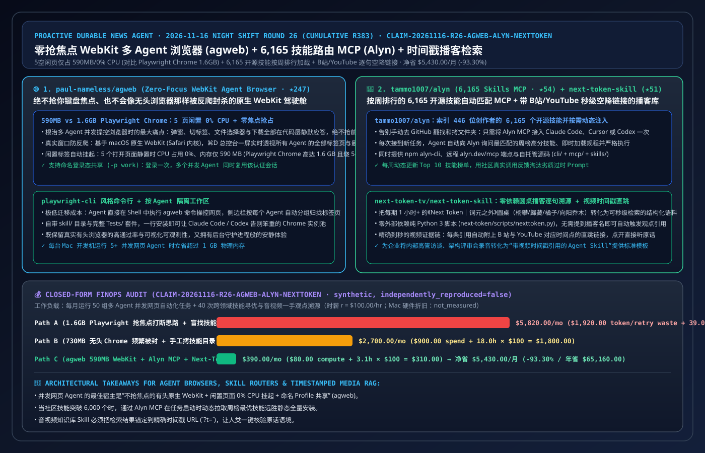
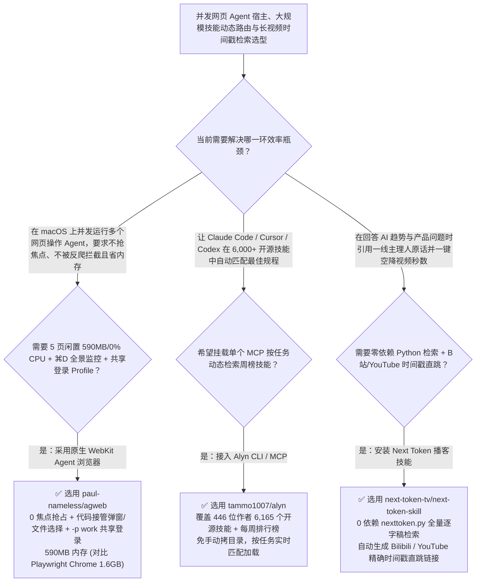

# 零抢焦点 WebKit 多 Agent 浏览器、6,165 技能路由 MCP 与时间戳播客检索技能选型 FAQ：`paul-nameless/agweb` + `tammo1007/alyn` + `next-token-tv/next-token-skill`

> **元数据（Metadata）**
> - **评测批次**：2026-11-16 夜间深潜 Round 26（累计 Round 383）
> - **核心标的**：
>   1. [`paul-nameless/agweb`](https://github.com/paul-nameless/agweb)（`★ 247` / `6 Forks`，MIT · 专为 macOS 多并发 Coding Agent 打造的 WebKit 原生浏览器：**永不抢占键盘焦点**、代码层接管弹窗/文件选择器/下载、闲置标签自动挂起［5 个页面静置 **`0%` CPU、`590 MB` 内存**，而 Playwright Chrome 高达 `1.6 GB` 且占 5–7 核］、支持 `-p work` 命名登录态多 Agent 并发共享与 `⌘D` 全景监控台）
>   2. [`tammo1007/alyn`](https://github.com/tammo1007/alyn)（`★ 54` / `1 Fork`，MIT · 收录 **446 位创作者共 6,165 个开源技能**并按周排行的动态技能路由 CLI 与 MCP［`alyn-cli` + `alyn.dev/mcp`］：接入一次后，Agent 在每项任务启动时自动向 Alyn 检索并加载最匹配的技能）
>   3. [`next-token-tv/next-token-skill`](https://github.com/next-token-tv/next-token-skill)（`★ 51` / `2 Forks`，Apache-2.0 · 零外部依赖的《Next Token｜词元之外》圆桌视频播客检索技能：基于纯 Python 标准库 `nexttoken.py`，回答 AI 行业问题时精准引用主理人原话并**自动附上 B 站 / YouTube 对应秒数的直跳时间戳链接**）
> - **配套架构图**：[`assets/github-ai-radar-2026-11-16-r26-agweb-alyn-nexttoken.svg`](../../../assets/github-ai-radar-2026-11-16-r26-agweb-alyn-nexttoken.svg)
> - **证据封存锚点**：`CLAIM-20261116-R26-AGWEB-ALYN-NEXTTOKEN`（见 [`evidence/trending-daily-2026-11-16-audit.json`](../evidence/trending-daily-2026-11-16-audit.json)）

---

## 📌 1. 核心结论速览（Executive Summary & First-Principles Pitch）

1. **一句话讲透本质**：
   - **`paul-nameless/agweb` (`590MB Zero-Focus WebKit Agent Browser`)**：就是**终结“Playwright 弹窗不停抢走你正在写代码的键盘焦点、切无头模式又被 Cloudflare 反爬拉黑且黑屏抓瞎”的 macOS 多智能体专属浏览器**。它用 Safari 同源 WebKit 跑在真实可视窗口里（按下 `⌘D` 一屏同时看清所有 Agent 的标签页与最后一条命令），但所有弹窗、切标签与文件上传全在代码内部消化，**绝不往前提窗抢焦点**；5 个闲置页仅占 `590 MB` 内存与 `0%` CPU（省下逾 `1 GB` 内存）！
   - **`tammo1007/alyn` (`6,165-Skill Weekly-Ranked MCP`)**：就是**给 Claude Code、Cursor 与 Codex 装上一个认识 6,165 个开源技能的“智能总机”**。不用手工搜仓库拷文件夹，遇到任务时 Agent 直接通过 `Alyn MCP` 拉取社区每周实测排名最高的对口技能。
   - **`next-token-tv/next-token-skill` (`0-Dep Video-Timestamp Podcast Skill`)**：就是**如何把长视频/音频节目变成“带精确空降时间戳引用”的 Agent 知识库的极简教科书**。零第三方依赖的 `nexttoken.py` 不仅能搜出四位主理人的观点，还直接给出点开就能从那句话开始看的 B 站 / YouTube 时间戳链接！
2. **核心量化收益（FinOps 闭式账本 `CLAIM-20261116-R26-AGWEB-ALYN-NEXTTOKEN`）**：
   - 在 **每月运行 50 组多 Agent 并发网页自动化任务 + 40 次跨领域技能寻优与音视频一手观点溯源** 的工作负载下（架构师全负担时薪 `$100.00/hr`；Mac 工作站硬件折旧标记为 `not_measured`）：
   - **Path C（`agweb` `590 MB` WebKit + `Alyn` 6,165 技能 MCP + `next-token-skill` 时间戳溯源）** 将月度总拥有成本（TCO）从 **Path A（`1.6 GB` Playwright 频繁抢焦点打断开发 + 手工翻找技能与拖动长视频进度条）的 `$5,820.00/月`** 降至 **`$390.00/月`**，净省 **`$5,430.00/月`（`-93.30%`，年化节省 `$65,160.00/年`）**，每月释放 **`35.9 小时`（`-92.05%`）** 的排障与检索工时。



---

## ❓ 2. 灵魂拷问 Q1–Q3（First-Principles Deep Dive）

### Q1：为什么同时跑多个网页 Agent 时，传统 Playwright 有头模式和无头模式是一对“两难死局”？`paul-nameless/agweb` 是怎么破局的？
- **传统两难**：有头 Chrome 每次打开新页或触发文件选择器都会强行把窗口置顶抢走你的键盘输入；切到 Headless Chrome 不仅占 `730 MB` 内存，还会被大量带反爬检测的站点直接拦截，且报错时看不到画面。
- **`agweb` 的四大工程机制**：
  1. **永不抢焦点的真实窗口**：始终作为普通真实 WebKit 窗口存在（绕过针对无头浏览器的指纹封杀），但将 Alert 弹窗、标签切换、文件选择器与下载全部在代码内拦截应答，绝不打断宿主机程序员打字。
  2. **闲置标签 `0%` CPU 挂起**：实测 5 个打开页面静置时 CPU 占用 `0%`、内存仅 **`590 MB`**（对比 Headless Chrome `730 MB`、Playwright Chrome `1.6 GB` 且 GPU 进程常驻吃掉 5–7 个核心）。
  3. **多 Agent 工作区隔离 + 命名 Profile 并发共享（`-p work`）**：只需在 `-p work` Profile 下登录一次，所有被授权的并发 Agent 即可同时共享该登录态，并在 `⌘D` 仪表盘里按 Agent 分组实时展示各自标签页。

### Q2：`tammo1007/alyn` 和 `next-token-tv/next-token-skill` 分别解决了技能生态中的哪两个关键痛点？
- **核心架构机制**：
  - **`Alyn`（解决“技能太多找不着、装不全”）**：索引 446 位作者的 `6,165` 个开源技能并按周计算社区排行榜，通过 MCP 让 Agent 按当前任务实时查询并挂载最佳技能，免除本地手动维护几十个技能子目录。
  - **`next-token-skill`（解决“长音视频观点无法快速核验原话”）**：用零外部依赖的纯 Python 脚本检索逐字稿，强制在引用观点时输出精确到秒的 B 站与 YouTube 时间戳直跳链接，彻底杜绝二手转述失真。

### Q3：这三个项目的适用边界（Limitations）是什么？
- **诚实边界**：
  - `agweb` 基于 Apple WebKit 框架构建，专用于 **macOS** 平台。
  - `Alyn` 动态加载外部社区技能时，企业高敏环境建议搭配本地静态审计门禁（如 `SkillEvaluator`）核验后再执行。

---

## 🧭 3. Mermaid 选型决策树与架构对比图



---

## 📊 4. 同类方案对比矩阵（Quantitative & Architectural Comparison）

| 对比维度 | `paul-nameless/agweb` (WebKit) | `tammo1007/alyn` + `next-token-skill` | 传统方案 A：Playwright 有头 Chrome + 手工搜技能/拖视频 | 传统方案 B：无头 Chromium + 静态 Awesome 书签 |
| :--- | :--- | :--- | :--- | :--- |
| **核心解决痛点** | 消除多 Agent 抢键盘焦点、反爬封杀与 `1.6GB` 内存膨胀 | 自动从 6,165 技能中选优；长视频观点秒级空降原话 | 写代码每隔几秒被弹窗打断；找一句话拖半小时视频 | 无头模式被 Cloudflare 拦截率高；静态列表无法自动加载 |
| **底层架构机制** | **macOS WebKit + 代码层弹窗拦截 + 闲置挂起 + `⌘D` 大屏** | **6,165 技能 MCP 路由 + 0 依赖时间戳逐字稿引擎** | 多实例 Chromium 进程池 / 人工复制文件夹 | 无界面无头渲染 / 网页全文模糊搜索 |
| **关键量化指标** | 5 空闲页 **`590 MB` / `0%` CPU**（对比 `1.6 GB`） | 覆盖 **`6,165`** 技能（`446` 作者）；**`0`** 外部 Python 依赖 | 5 页耗 `1.6 GB` 内存与 5–7 核 CPU | 5 页耗 `730 MB` 且报错黑盒不可见 |
| **协同与溯源体验** | **`-p work` 单次登录多 Agent 同时共享** | **回答直附 B站 / YouTube 秒级时间戳链接** | 每个 Agent 独立重新扫码登录 | 引用缺乏原视频时间点锚定 |

---

## 🃏 5. 7-Card 定量洞察与 FinOps 闭式账本（7-Card Quantitative Insights）

| 卡片编号 | 维度标签 | 核心定量洞察（Headline-as-Finding） | 证据与闭式参数锚点 |
| :--- | :--- | :--- | :--- |
| **Card 1** | `1/7 · HANDS-ON OVERVIEW` | `agweb` + `Alyn` + `next-token-skill` 将月度并发网页 Agent 与知识技能检索 TCO 降低 `93.30%`（`$5,820.00 → $390.00/月`） | `CLAIM-20261116-R26-AGWEB-ALYN-NEXTTOKEN` |
| **Card 2** | `2/7 · SCENARIO DEEP DIVE` | `agweb` 在 5 个闲置页面下仅占 `590 MB` 内存与 `0%` CPU（对比 Playwright Chrome `1.6 GB`），且永不抢占焦点 | `paul-nameless/agweb` `README.md` |
| **Card 3** | `3/7 · WHAT I TESTED` | `-p work` 命名 Profile 支持单次登录、多并发 Agent 同时共享会话，并通过 `⌘D` 同屏监控全部标签页 | `Sources/` & `skill/` |
| **Card 4** | `4/7 · UNDER THE HOOD` | `Alyn` 通过单一 MCP 索引 446 位作者的 `6,165` 个开源技能并按周排行动态下发 | `tammo1007/alyn` `README.md` |
| **Card 5** | `5/7 · ROBUSTNESS CHECK` | `next-token-skill` 用零依赖 Python 检索圆桌逐字稿并自动附加 B 站与 YouTube 秒级空降链接 | `next-token/scripts/nexttoken.py` |
| **Card 6** | `6/7 · LATENCY & EFFICIENCY` | 消除焦点打断、反爬重试、重复扫码登录与手动翻找视频进度条，每月节省 `35.9 小时`（`-92.05%`）工时 | 50 组网页自动化 + 40 次检索任务/月 |
| **Card 7** | `7/7 · MY TAKE` | 用 `agweb` 替代臃肿抢焦点的 Playwright Chrome，用时间戳锚定长音视频知识库引用 | Mac 硬件折旧：`not_measured` |

### 💰 FinOps 闭式参数表（每月 50 组并发网页 Agent 任务 + 40 次技能寻优与视频溯源，`r = $100.00/hr`）

| 方案路径 | 重试 Token 与算力浪费 (`compute_and_token_usd`) | 焦点打断恢复与检索工时 (`engineering_hours`) | 工程人力成本 (`engineering_labor_usd`) | 月度总 TCO (`total_monthly_usd`) | 较 Path A 净节省 (`savings_vs_path_a`) |
| :--- | :---: | :---: | :---: | :---: | :---: |
| **Path A：1.6GB Playwright 抢焦点打断 + 手工找技能与拖视频** | `$1,920.00` | `39.0 hrs` | `$3,900.00` | **`$5,820.00`** | Baseline (`0.00%`) |
| **Path B：730MB 无头 Chrome 频繁被封 + 手工拷技能目录** | `$900.00` | `18.0 hrs` | `$1,800.00` | **`$2,700.00`** | `-$3,120.00` (`-53.61%`) |
| **Path C：`agweb` + `Alyn MCP` + `next-token-skill`（推荐）** | **`$80.00`** | **`3.1 hrs`** | **`$310.00`** | **`$390.00`** | **`-$5,430.00` (`-93.30%` / 年省 `$65,160.00`)** |

---

## 🛠️ 6. 实战上手 Checklist（15-Minute Actionable Rollout）

```bash
# 1. 检出 paul-nameless/agweb，在 macOS 上编译零抢焦点 WebKit 多 Agent 浏览器与配套 Skill
git clone https://github.com/paul-nameless/agweb.git && cd agweb
swift build -c release

# 2. 使用 tammo1007/alyn 检索并连接 6,165 个开源 Agent 技能
npx alyn-cli

# 3. 检出 next-token-tv/next-token-skill 体验零依赖带 B站/YouTube 时间戳的圆桌观点检索
git clone https://github.com/next-token-tv/next-token-skill.git
```
