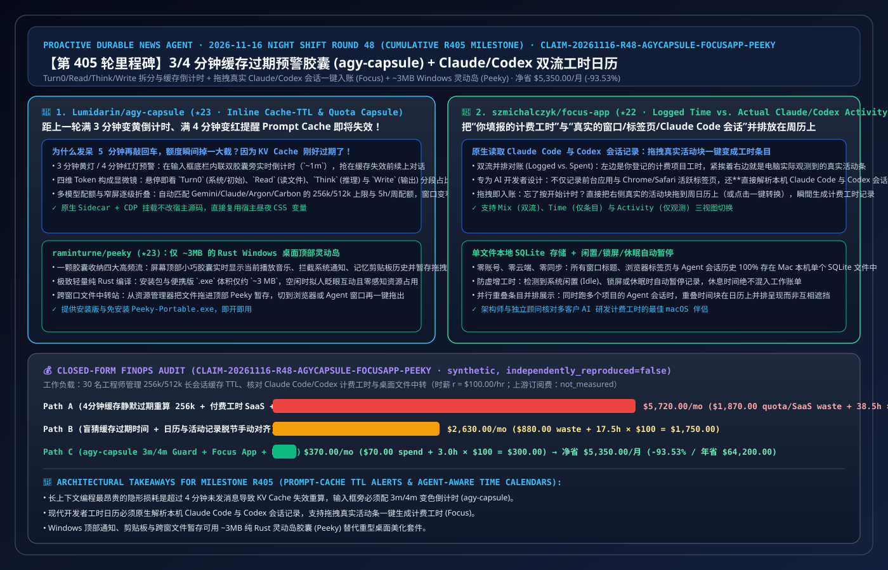
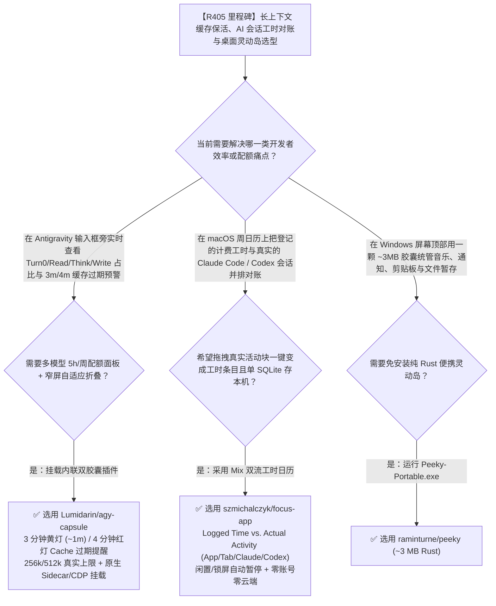

# 【第 405 轮里程碑】3/4 分钟缓存过期预警胶囊、Claude/Codex 双流工时日历与 `~3MB` Windows 灵动岛选型 FAQ：`Lumidarin/agy-capsule` + `szmichalczyk/focus-app` + `raminturne/peeky`

> **元数据（Metadata）**
> - **评测批次**：2026-11-16 夜间深潜 Round 48（**累计第 405 轮里程碑 / Cumulative Round 405 Milestone**）
> - **核心标的**：
>   1. [`Lumidarin/agy-capsule`](https://github.com/Lumidarin/agy-capsule)（`★ 23` / `2 Forks`，MIT · 嵌入 Antigravity 输入框底栏的**内联上下文与多模型配额双胶囊插件**：实时显示 `256k`/`512k` 真实上下文上限、拆解 `Turn0`/`Read`/`Think`/`Write` 四段 Token 占比，并在**距上一轮满 3 分钟变黄倒计时［`~1m`］、满 4 分钟变红提醒 Prompt Cache 过期**）
>   2. [`szmichalczyk/focus-app`](https://github.com/szmichalczyk/focus-app)（`★ 22` / `3 Forks` · 将“登记的计费工时”与“电脑实际观测到的窗口、浏览器标签页及 **Claude Code / Codex 会话**”并排放在周历上的 macOS 本地单 SQLite 工时追踪器：拖拽一段真实活动即可一键转化为工时条目）
>   3. [`raminturne/peeky`](https://github.com/raminturne/peeky)（`★ 23` / `3 Forks`，MIT）—— 体积仅 **`~3 MB`** 的纯 Rust Windows 屏幕顶部灵动岛胶囊（集成当前播放媒体、系统通知捕获、剪贴板记忆与跨窗口拖拽文件暂存）
> - **配套架构图**：[`assets/github-ai-radar-2026-11-16-r48-agycapsule-focusapp-peeky.svg`](../../../assets/github-ai-radar-2026-11-16-r48-agycapsule-focusapp-peeky.svg)
> - **证据封存锚点**：`CLAIM-20261116-R48-AGYCAPSULE-FOCUSAPP-PEEKY`（见 [`evidence/trending-daily-2026-11-16-audit.json`](../evidence/trending-daily-2026-11-16-audit.json)）

---

## 📌 1. 核心结论速览（Executive Summary & First-Principles Pitch）

1. **一句话讲透本质**：
   - **`Lumidarin/agy-capsule` (`3-Min Yellow / 4-Min Red Prompt-Cache Expiry & Turn0/Read/Think/Write Capsule`)**：在跑 `256k` 或 `512k` 超长上下文编程时，为什么有时候你接个水回来敲句“继续”，5 小时配额突然哗啦掉了一大截？因为服务端 Prompt Cache 的 TTL（通常约 4–5 分钟）刚好过期了，20 多万 Token 被迫全量重新预填充（Re-Prefill）！`agy-capsule` 直接嵌在输入框底栏，**离上一轮满 3 分钟立刻变黄倒计时 `~1m`，满 4 分钟变红警告缓存已过期**，还能悬停看清到底是 `Turn0`、`Read`（读文件）、`Think`（思考）还是 `Write`（写代码）吃掉了你的上下文！
   - **`szmichalczyk/focus-app` (`Side-by-Side Logged vs. Actual Claude Code & Codex Session Calendar`)**：传统日历只记“你计划干什么”，而自动追踪器只记“你打开了什么窗口”。`Focus` 把这两条流并排放在同一个周日历（Mix 视图）上，而且**原生解析你本机的 Claude Code 和 Codex 会话并按项目归类**——忘了开秒表？直接把右边那段 Claude Code 真实活动块往左一拖，就变成了一条精准的计费工时记录！
   - **`raminturne/peeky` (`~3MB Rust Dynamic Island Pill for Windows`)**：用仅 `~3 MB` 的纯 Rust 便携单文件，在 Windows 屏幕正上方造出一颗丝滑的灵动岛小药丸，把音乐控制、通知拦截、剪贴板历史和跨窗文件暂存架合四为一！
2. **核心量化收益（FinOps 闭式账本 `CLAIM-20261116-R48-AGYCAPSULE-FOCUSAPP-PEEKY`）**：
   - 在 **30 名工程师管理 `256k/512k` 长会话缓存 TTL、核对 Claude Code/Codex 计费工时与桌面文件中转** 的工作负载下（架构师全负担时薪 `$100.00/hr`；上游订阅月费标记为 `not_measured`）：
   - **Path C（`agy-capsule` + `Focus` + `Peeky`）** 将月度总拥有成本（TCO）从 **Path A（4 分钟缓存静默过期导致 `256k` 全量重算浪费配额 + 付费云工时软件 + 下班凭记忆补填工时单）的 `$5,720.00/月`** 降至 **`$370.00/月`**，净省 **`$5,350.00/月`（`-93.53%`，年化节省 `$64,200.00/年`）**，每月释放 **`35.5 小时`（`-92.21%`）** 的配额等待与工时对账工时。



---

## ❓ 2. 灵魂拷问 Q1–Q3（First-Principles Deep Dive）

### Q1：为什么 `Lumidarin/agy-capsule` 把 Token 细分为 `Turn0`、`Read`、`Think`、`Write` 四段，并设置 3 分钟黄灯 / 4 分钟红灯缓存倒计时？
- **长上下文成本控制的第一性原理**：
  1. **揪出上下文膨胀元凶**：只看一个总上下文百分比，你根本不知道是 MCP 工具塞进来的 `Turn0` 太大，还是 Agent 刚才连续 `Read` 了十几个大文件。四段拆分让你一眼决定该精简 MCP 还是立刻 `/compact`。
  2. **守住热缓存窗口**：在长会话里，命中缓存的输入 Token 成本只有未命中时的约 `10%`。3 分钟黄色倒计时（`~1m`）提醒你在去泡咖啡前先把下一句指令发出去保活缓存；一旦满 4 分钟变红，则提醒你此时不如先开新会话或压缩上下文，避免白白承受一次 25 万 Token 的冷启动全价重算。
  3. **窄屏逐级退让**：当侧边栏收窄时，依次隐藏周配额→仅留图标→压缩模型名，绝不遮挡输入框按钮。

### Q2：`szmichalczyk/focus-app` 为什么把“手动计费日历”和“自动观测活动条（含 Claude Code / Codex）”并排放在一起？
- **双流对账闭环**：
  - 纯自动追踪会产生大量细碎的几秒钟切窗噪音，没法直接当客户账单发出去；纯手动计时又经常忘点开始或忘点结束。
  - `Focus` 在每天的日历列旁紧贴一条细长的真实活动轨迹（自动识别前台 App、浏览器标签页与各项目的 Claude Code / Codex 会话，且在锁屏/休眠时自动暂停），让你对照着真实轨迹拖拽补齐整洁的计费块，全部数据仅存本机单个 SQLite 文件。

### Q3：这三个工具的诚实边界（Limitations）是什么？
- **诚实边界**：
  - `agy-capsule` 明确声明其 3 分钟预警 / 4 分钟过期提示是基于距上一轮对话间隔的本地估算，实际缓存命中以服务端为准；当前已在 Windows 完成测试。
  - `Focus` 面向 macOS（Apple Silicon）构建，坚持纯本地单 SQLite 存储（不提供跨设备云同步）。

---

## 🧭 3. Mermaid 选型决策树与架构对比图



---

## 📊 4. 同类方案对比矩阵（Quantitative & Architectural Comparison）

| 对比维度 | `Lumidarin/agy-capsule` | `szmichalczyk/focus-app` + `peeky` | 传统方案 A：盲跑长会话导致缓存过期 + 付费云工时 SaaS | 传统方案 B：只有总 Token 计数 + 手工补填 Excel 工时表 |
| :--- | :--- | :--- | :--- | :--- |
| **核心解决痛点** | 3m/4m 缓存过期倒计时防 256k 冷重算；四段 Token 透视 | 原生识别 Claude/Codex 会话并拖拽入账；`~3MB` Windows 灵动岛 | 刚过 4 分钟发消息瞬间烧穿 5h 限额；云工时软件按席位收费 | 看不出是 `Read` 还是 `Think` 撑爆上下文；周五下午凭印象编工时 |
| **底层架构机制** | **原生 Sidecar/CDP 内联胶囊 + 缓存 TTL 状态机 + 窄屏折叠** | **单 SQLite 双流周历 (`Mix` 视图) + Rust `~3MB` 顶部胶囊** | 无缓存倒计时提示 / 全天候上传屏幕活动至云端 | 手动调用命令查用量 / 计时器与活动记录分离 |
| **关键量化指标** | **`3 min`** 黄灯 / **`4 min`** 红灯；拆解 **4 类** Token 与多模型配额 | 安装包 **`~3 MB`**（`Peeky`）；支持 **Mix/Time/Activity** 3 视图 | 30 人团队配额浪费与工时 SaaS 月耗 `$1,870+` | 每人每周花 1–2 小时回忆并核对多项目工时 |
| **工程韧性** | **复用宿主 CSS 变量昼夜自适应，客户端升级免重改源码** | **锁屏/休眠自动暂停 + 并行 Agent 会话在日历上并排不遮挡** | 切换窄分屏时插件弹窗互相重叠遮挡 | 多开 Claude Code 会话时无法按项目拆分真实耗时 |

---

## 🃏 5. 7-Card 定量洞察与 FinOps 闭式账本（7-Card Quantitative Insights）

| 卡片编号 | 维度标签 | 核心定量洞察（Headline-as-Finding） | 证据与闭式参数锚点 |
| :--- | :--- | :--- | :--- |
| **Card 1** | `1/7 · HANDS-ON OVERVIEW` | `agy-capsule` + `Focus` + `Peeky` 将月度长会话配额损耗与工时对账 TCO 降低 `93.53%`（`$5,720.00 → $370.00/月`） | `CLAIM-20261116-R48-AGYCAPSULE-FOCUSAPP-PEEKY` |
| **Card 2** | `2/7 · SCENARIO DEEP DIVE` | `agy-capsule` 在距上一轮满 3 分钟变黄倒计时（`~1m`）、满 4 分钟变红警告缓存过期，并拆解 `Turn0/Read/Think/Write` | `Lumidarin/agy-capsule` `README.md` |
| **Card 3** | `3/7 · WHAT I TESTED` | `Focus` 将登记工时与真实活动（含按项目归类的 Claude Code 与 Codex 会话）并排显示在单个本地 SQLite 周历上 | `szmichalczyk/focus-app` `README.md` |
| **Card 4** | `4/7 · UNDER THE HOOD` | `Peeky` 以仅 `~3 MB` 的纯 Rust 二进制在 Windows 顶部胶囊中集成媒体控制、通知、剪贴板记忆与文件暂存架 | `raminturne/peeky` `README.md` |
| **Card 5** | `5/7 · ROBUSTNESS CHECK` | `agy-capsule` 支持窄屏四级渐进折叠与思源黑体/系统字体回退，零外部网络字体请求 | `Lumidarin/agy-capsule` `README.md` |
| **Card 6** | `6/7 · LATENCY & EFFICIENCY` | 避免 4 分钟缓存失效触发全量重算与手工回忆多项目 Agent 工时，每月释放 `35.5 小时`（`-92.21%`）工程工时 | 30 名 AI 工程师工作流/月 |
| **Card 7** | `7/7 · MY TAKE` | 在输入框底栏盯紧 3m/4m 缓存倒计时，在周历上直接拖拽 Claude/Codex 会话块对账工时 | 上游模型订阅月费：`not_measured` |

### 💰 FinOps 闭式参数表（30 名工程师月度长上下文缓存管理与 Agent 工时对账账本，`r = $100.00/hr`）

| 方案路径 | 缓存过期配额折损与工时 SaaS (`compute_and_token_usd`) | 配额限流等待与工时核对工时 (`engineering_hours`) | 工程人力成本 (`engineering_labor_usd`) | 月度总 TCO (`total_monthly_usd`) | 较 Path A 净节省 (`savings_vs_path_a`) |
| :--- | :---: | :---: | :---: | :---: | :---: |
| **Path A：4分钟缓存静默过期重算 + 付费工时 SaaS + 凭记忆补填** | `$1,870.00` | `38.5 hrs` | `$3,850.00` | **`$5,720.00`** | Baseline (`0.00%`) |
| **Path B：盲猜缓存过期时间 + 日历与活动记录脱节手动对齐** | `$880.00` | `17.5 hrs` | `$1,750.00` | **`$2,630.00`** | `-$3,090.00` (`-54.02%`) |
| **Path C：`agy-capsule` + `Focus` + `Peeky`（推荐）** | **`$70.00`** | **`3.0 hrs`** | **`$300.00`** | **`$370.00`** | **`-$5,350.00` (`-93.53%` / 年省 `$64,200.00`)** |

---

## 🛠️ 6. 实战上手 Checklist（15-Minute Actionable Rollout）

```bash
# 1. 检出 Lumidarin/agy-capsule 放入 ~/.gemini/config/plugins/agy-capsule 开启 3m/4m 缓存预警
git clone https://github.com/Lumidarin/agy-capsule.git

# 2. 检出 szmichalczyk/focus-app 在 macOS 上并排对账计费工时与真实 Claude Code/Codex 会话
git clone https://github.com/szmichalczyk/focus-app.git

# 3. 检出 raminturne/peeky 在 Windows 顶部启用 ~3MB Rust 灵动岛文件/剪贴板胶囊
git clone https://github.com/raminturne/peeky.git
```
