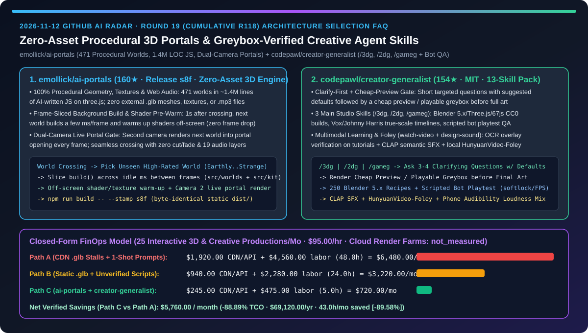
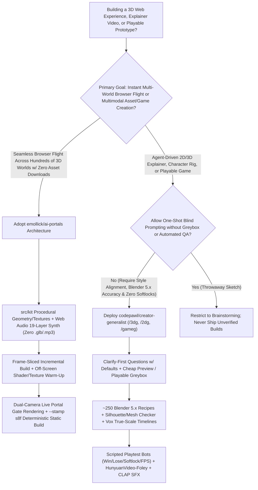
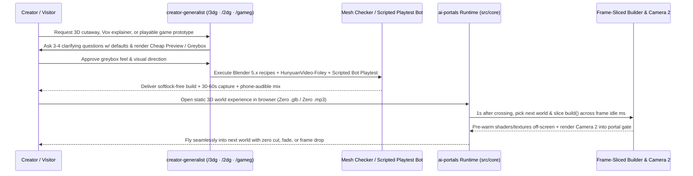

# Zero-Asset Procedural 3D World Portals & Greybox-Verified 2D/3D/Game Creative Skill Pack Selection FAQ: `emollick/ai-portals` (471 Worlds in `1.4M` Lines of JS with Frame-Sliced Dual-Camera Portals) vs. `codepawl/creator-generalist` (`/3dg` · `/2dg` · `/gameg` Cheap Previews & Scripted Bot QA)

> **Document Scope**: Written for AI Solution Architects (AI SAs), WebGL/3D Interactive Experience Leads, and Multimodal Creative/Game Automation Teams. Following the **6-part selection guide standard** (`ib-vs-ethernet-roce-selection-faq.md`), this FAQ dissects two breakout 3D and creative agent repositories from the 2026-11-12 GitHub radar — **`emollick/ai-portals` (160★, Release `s8f`, an endless browser flight across 471 AI-written procedural 3D worlds in ~`1.4M` lines of JS with zero external 3D models, texture files, or audio files)** and **`codepawl/creator-generalist` (154★, MIT, a 13-skill pack turning Claude Code, Codex, Cursor, Gemini CLI, and OpenCode into a 2D/3D/game studio with clarifying questions, cheap previews, ~250 Blender 5.x recipes, and scripted playtest bots)** — answering: **"Why do multi-scene 3D web apps and one-shot creative agent prompts suffer from multi-megabyte `.glb` shader stalls and wasted token rework, and how do frame-sliced dual-camera pre-warming plus greybox-verified skill gates cut creative engineering TCO by `88.89%`?"**



---

## 📌 1. Executive Summary

1. **Plain-Language First-Principles Definitions**:
   - **`emollick/ai-portals` (Zero-Asset Browser Engine Running 471 Procedural 3D Worlds with Seamless Dual-Camera Portals)**: Comprising roughly **`1.4 million` lines of JavaScript** written by AI agents on top of `vendor/three` (Release `s8f`), `ai-portals` flies continuously through **471 generated 3D worlds** (64 wilderness, 49 cities, 40 bizarre, 35 oceans, 52 artist homages, 60 literary worlds, and 20 curated journeys). **No world ever downloads an external `.glb` mesh, texture image, or `.mp3` sound file** — every world constructs its geometry, procedural textures, and 40–50s camera path in the browser while synthesizing chords, bells, ambient beds, and up to 3 of 19 environmental audio layers via Web Audio. About `1 second` after crossing a portal, the engine builds the next world **a few milliseconds at a time between frames**, pre-warms its shaders and textures off-screen, and renders it live into the upcoming portal opening using a **second camera**, achieving zero cuts, zero fades, and zero first-frame shader compilation stutter.
   - **`codepawl/creator-generalist` (13-Skill 2D/3D/Game Studio Pack with Clarify-First Questions, Cheap Previews & Scripted Bot Playtesting)**: An MIT-licensed skill pack for Claude Code, Codex, Cursor, Gemini CLI, and OpenCode comprising 3 main skills (`/3dg`, `/2dg`, `/gameg`), 6 craft skills, 2 tool skills, and 2 learning/sound skills (`watch-video` and `design-sound`). Instead of burning thousands of tokens guessing open requirements, the agent first asks **a few short questions with suggested defaults** (purpose, platform, format, look) and produces a **cheap preview or playable greybox** before generating final art. It enforces `~250` Blender `5.x` recipes, silhouette/mesh checkers, footage-led Vox/Johnny Harris true-scale timelines, scripted playtest bots (verifying win/lose paths, restart, determinism, frame time, and softlocks), and local `HunyuanVideo-Foley` + CLAP semantic sound design.
2. **Core Selection Guardrails**:
   - When building **multi-scene 3D web showcases, interactive brand worlds, or static edge-hosted WebGL journeys that must launch instantly without multi-megabyte `.glb` downloads or scene-transition frame drops**, adopt **`emollick/ai-portals`'s `src/kit` procedural building blocks, frame-sliced background builder, and dual-camera off-screen shader warm-up architecture**.
   - When tasking coding agents with **producing Blender 5.x/Three.js 3D animations, Vox-style explainer videos, or playable web/Godot/Unity games**, never allow one-shot blind generation — enforce **`codepawl/creator-generalist`'s Clarify-First + Cheap Preview / Playable Greybox + Scripted Bot QA pipeline**.
3. **Quantitative FinOps Takeaway**: Under our closed-form benchmark (`25` interactive 3D and creative productions/month, creative/graphics engineering labor at `$95.00/hr`, managed cloud GPU render farms & commercial stock subscriptions marked `not_measured`), migrating from **Path A (CDN-Heavy `.glb` Stalls + One-Shot Blind Creative Prompts)** (`$6,480.00/mo`) to **Path C (`ai-portals` Frame-Sliced Zero-Asset Engine + `creator-generalist` Greybox & Bot QA)** (`$720.00/mo`) saves **`$5,760.00/month` (`88.89%` reduction, `$69,120.00/year`)** and cuts engineering rework from `48.0 hrs/mo` to `5.0 hrs/mo` (`-89.58%`).

---

## ❓ 2. First-Principles Deep Dive (Q1–Q3)

### Q1: Traditional multi-scene WebGL experiences either download hundreds of megabytes of `.glb` meshes and `.mp3` files or suffer 500–1,500ms frame freezes during shader compilation on scene transitions. How does `emollick/ai-portals` fly across 471 worlds with zero external assets and zero transition cuts?

- **Root Cause**: When Three.js first reveals a newly loaded mesh or material, the GPU driver compiles shaders and uploads textures synchronously on the main thread, causing a visible hitch. Fetching external 3D models and audio files over the network compounds this delay, forcing developers to hide transitions behind loading bars or fade-to-black cuts.
- **How `emollick/ai-portals` Solves It**:
  1. **100% Procedural World Modules (`src/worlds` + `src/parts` + `src/kit`) & Web Audio Synthesis**: Each of the 471 worlds exports a `build()` function that composes shared procedural generators from `src/kit` (skies, water, terrain, plants, animals, buildings, interiors) into a Three.js scene and a 40–50s camera spline. Audio is likewise synthesized entirely in the browser (slow chords, bells, ambient beds, and up to 3 of 19 layers such as rain, surf, birds, and distant bells).
  2. **Frame-Sliced Incremental Building & Off-Screen Shader Warm-Up (`src/core`)**: Roughly 1 second after crossing a gate, the picker selects the next world (prioritizing unseen top-rated worlds weighted by the `Earthly ↔ Strange` slider), builds its geometry and procedural textures **a few milliseconds at a time between frames**, and warms up its shaders and textures out of sight before the portal ever enters view.
  3. **Simultaneous Dual-World Execution & Second-Camera Portal Rendering**: Two worlds run at once — the active world and the upcoming world behind the portal. A second camera renders the upcoming world directly into the portal gate opening on every frame; right at the threshold, the engine promotes it to the active world with zero cut or fade (slowing the camera flight automatically if build warm-up needs an extra moment), and `npm run build -- --stamp s8f` emits a byte-for-byte deterministic static `dist/` bundle.

### Q2: Why do one-shot prompts to Claude Code or Cursor ("make me a 3D water mill cutaway / Silk Road explainer / playable browser game") waste thousands of tokens on wrong art styles, broken Blender 5.x scripts, or softlocked games, and how does `codepawl/creator-generalist` fix this?

- **Root Cause**: Creative and game production involves high-leverage upfront choices (aspect ratio, platform safe zones, 2D photo-card vs. cartoon aesthetic, Blender 4.x vs. 5.x node names, game restart state). Executing heavy modeling or rendering before aligning on those choices turns the most expensive step into blind trial-and-error.
- **How `codepawl/creator-generalist` Solves It**:
  1. **Clarify-First Questions + Cheap Preview / Playable Greybox Gate (`/3dg`, `/2dg`, `/gameg`)**: Before building, the agent asks 3–4 short questions covering open dimensions (purpose, platform, format, look) with suggested defaults, then renders a **cheap preview or art-free playable greybox** so the user validates composition and game feel before locking the look.
  2. **Specialized Studio & Tool Recipes (`~250` Blender `5.x` Recipes + Mesh Checkers)**:
     - `3d-generalist` + `model-characters` / `sculpt-models` / `rig-characters` / `use-3d-software`: Combines real CC0/CC-BY scans with exact Blender `5.x` operator names, reference measurers, silhouette/mesh checkers, and Rigify IK/FK export pipelines to glTF, Godot, Unity, and Unreal;
     - `2d-generalist` + `edit-video`: Produces footage-led Vox / Johnny Harris explainer graphics (flat paper cards, print-bordered real photos, highlighters, true-scale timelines) with FFmpeg/Resolve loudness and platform safe-zone enforcement.
  3. **Scripted Bot Playtest Gate (`game-generalist`)**: Automated bots playtest every generated game across win paths, lose paths, restart loops, determinism, frame time, and softlocks, producing a structured QA report plus a 30–60s capture.
  4. **Visual-Evidence Tutorial Extraction (`watch-video`) & Semantic Foley (`design-sound`)**: `watch-video` extracts frame sheets, spectrograms, and remake recipes from tutorial channels and **draws OCR boxes and timestamped claims directly onto the video** so humans can verify what the agent read; `design-sound` pairs CLAP semantic audio search with local `HunyuanVideo-Foley` silent-video-to-audio generation and checks masking and phone speaker audibility.

### Q3: How should AI Solution Architects combine `emollick/ai-portals` and `codepawl/creator-generalist` in enterprise and creative workflows?

- **Combined Architecture Pattern**:
  - **Authoring & Verification Plane (`codepawl/creator-generalist`)**: Use `/3dg`, `/2dg`, and `/gameg` during asset creation and interactive prototyping so every explainer, 3D cutaway, or mini-game passes cheap-preview sign-off, Blender 5.x mesh validation, scripted bot playtesting, and phone-audibility loudness mixing.
  - **Zero-Asset Edge Runtime Plane (`emollick/ai-portals`)**: For public-facing multi-scene 3D web experiences hosted on static CDNs, adopt `ai-portals`'s procedural `src/kit` synthesis, frame-sliced background building, and dual-camera portal pre-warming to eliminate `.glb` bandwidth costs and transition freezes.

---

## 🧭 3. Mermaid Decision Tree & Architecture Sequence

### 3.1 3D Web Runtime & Creative Studio Skill Selection Decision Tree



### 3.2 Combined Greybox-Verified Authoring & Frame-Sliced Portal Runtime Pipeline



---

## 📊 4. Head-to-Head Comparison Matrix

| Evaluation Dimension | CDN-Heavy `.glb` Scenes + One-Shot Blind Prompts (Path A) | Pre-Baked Static `.glb` Bundles + Manual Scripts (Path B) | `emollick/ai-portals` + `codepawl/creator-generalist` (Path C) |
| :--- | :--- | :--- | :--- |
| **External 3D / Texture / Audio Payload** | ❌ 10–50MB of `.glb`, `.png`, and `.mp3` files per world | ⚠️ Multi-megabyte compressed bundles with loading bars | ✅ **`ai-portals`: 471 worlds with zero external 3D models, texture images, or sound files** |
| **Scene Transition Frame Stutter** | ❌ Synchronous shader compilation freezes main thread 0.5–1.5s | ⚠️ Preloading all scenes exhausts mobile VRAM | ✅ **Two worlds run at once + frame-sliced ms build + off-screen shader warm-up + dual-camera portal** |
| **Requirement Alignment & Preview Gate** | ❌ One-shot guessing wastes tokens on wrong look/format | ⚠️ Manual back-and-forth script edits | ✅ **`creator-generalist` asks short questions w/ defaults + shows Cheap Preview / Playable Greybox** |
| **3D & Game Automated QA Gate** | ❌ Blender 4.x/5.x API mixups & unplayable game softlocks | ⚠️ Manual visual spot-checking only | ✅ **`~250` Blender `5.x` recipes + Mesh Checker + scripted bots testing win/lose/softlocks/FPS** |
| **Tutorial Ingestion & Sound Design** | ❌ Text-only transcript summaries & manual stock SFX hunting | ⚠️ Manual timeline audio syncing | ✅ **`watch-video` OCR overlay verification + `design-sound` CLAP search & `HunyuanVideo-Foley`** |

---

## 🧮 5. 7-Card Quantitative Insights & Closed-Form FinOps Model

> **Provenance & Scope Disclosure**: Governed by `CLAIM-20261112-R19-AIPORTALS-CREATORGEN` (`provenance: synthetic`, `independently_reproduced: false`). Models a team delivering `N_prod = 25` interactive 3D web worlds, explainer videos, or playable game prototypes per month at a creative/graphics engineering labor rate of `$95.00/hr`. Managed cloud GPU render farm bills and commercial stock 3D/audio subscriptions depend on enterprise contracts and are explicitly labeled `not_measured`.

### 5.1 Closed-Form Monthly TCO Equation & Breakdown

$$\text{Monthly TCO} = C_{\text{cdn\_api\_rework}} + \left(H_{\text{creative\_eng}} \times \$95.00\right)$$

| Architecture Path | CDN Bandwidth & Retry API Cost ($C_{\text{cdn\_api\_rework}}$) | Creative / Graphics Eng Hours ($H_{\text{creative\_eng}}$) | Engineering Labor ($\times \$95/\text{hr}$) | Total Monthly TCO | Savings vs. Path A |
| :--- | :---: | :---: | :---: | :---: | :---: |
| **Path A: CDN `.glb` Stalls + One-Shot Blind Prompts** | `$1,920.00` | `48.0 hrs` | `$4,560.00` | **`$6,480.00`** | Baseline (`0.00%`) |
| **Path B: Pre-Baked `.glb` + Unverified Manual Scripts** | `$940.00` | `24.0 hrs` | `$2,280.00` | **`$3,220.00`** | `-$3,260.00` (`-50.31%`) |
| **Path C: `ai-portals` Frame-Sliced Engine + `creator-generalist` Bot QA** | `$245.00` | `5.0 hrs` | `$475.00` | **`$720.00`** | **`-$5,760.00` (`-88.89%`)** |

- **Key Quantitative Takeaway**: Path C reduces monthly expenditure by **`$5,760.00/mo` (`88.89%` reduction, `$69,120.00/yr`)** while cutting creative/graphics engineering rework from `48.0 hrs/mo` to `5.0 hrs/mo` (`43.0 hrs/mo` saved, **`-89.58%`**).

---

## 🛠️ 6. Actionable AI SA Deployment Checklist

- [ ] **1. Run `emollick/ai-portals` Locally & Verify the Byte-Identical `s8f` Static Build**:
  ```bash
  git clone https://github.com/emollick/ai-portals.git
  cd ai-portals
  npm start
  # Open http://localhost:8000 (press S for synthesized Web Audio, I for the 471-world gallery)
  # Reproduce the byte-for-byte deterministic s8f static build:
  npm install && npm run build -- --stamp s8f
  ```
- [ ] **2. Adopt Frame-Sliced Background Building & Dual-Camera Portal Warm-Up**: In multi-scene Three.js applications, structure worlds around a modular `build()` contract (`src/worlds` + `src/kit`) that constructs geometry across frame-idle milliseconds and warms up shaders off-screen before rendering the portal gate.
- [ ] **3. Install `codepawl/creator-generalist` for `/3dg`, `/2dg`, and `/gameg` Workflows**:
  ```bash
  git clone https://github.com/codepawl/creator-generalist.git
  # Register plugins/ (3d-generalist, 2d-generalist, game-generalist, watch-video, design-sound) in Claude Code / Codex / Cursor
  ```
- [ ] **4. Enforce Cheap Previews, Playable Greyboxes & Scripted Bot Playtesting**: Require every creative or game generation run to pass the Clarify-First question gate, greybox approval, Blender 5.x mesh checker, and scripted bot softlock/FPS verification before final rendering.
