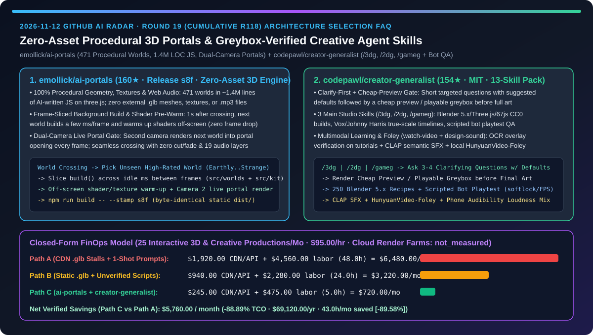
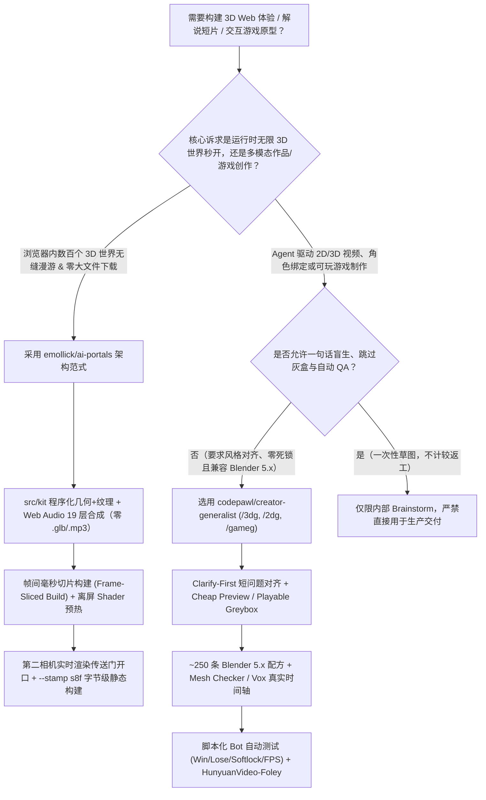
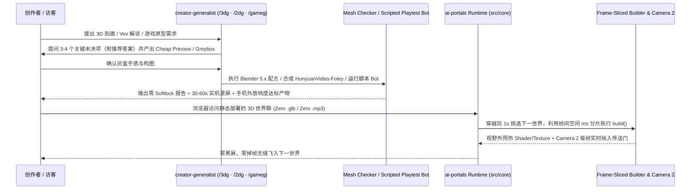

# 零外部资产程序化 3D 世界传送门引擎与带灰盒/脚本 Bot 验收的 2D/3D/游戏全栈创作技能包选型 FAQ：`emollick/ai-portals`（471 世界 `1.4M` 行 JS 帧切片双相机无缝穿越）与 `codepawl/creator-generalist`（`/3dg` · `/2dg` · `/gameg` 低成本预览 + 自动化通关检测）深度对比

> **文档定位**：本文面向 AI 解决方案架构师（AI SA）、WebGL/3D 交互体验负责人与多模态内容/游戏自动化工程团队，严格对标 `ib-vs-ethernet-roce-selection-faq.md` 的**六段式实战选型体系**，用第一性原理拆解 2026-11-12 GitHub 新星爆发榜中两款极具工程启发性的 3D 与全栈创作智能体项目——**`emollick/ai-portals`（160★，Release `s8f`，零外部 3D 模型/贴图/音频文件的 471 个程序化 3D 世界双相机无缝传送门引擎）** 与 **`codepawl/creator-generalist`（154★，MIT，内置“先提问对齐 → 低成本灰盒预览 → 脚本 Bot 自动通关与 Blender 5.x 网格质检”的 13 技能创作工作室）**，回答“**为什么 3D 网页体验和 AI 创作脚本总卡在‘首屏下载几十 MB `.glb` 掉帧卡死’和‘一句话盲生出烂图/死锁游戏白烧 Token’？如何用帧切片后台预热 + 低成本灰盒确认把创意与 3D 生产 TCO 砍掉 `88.89%`？**”



---

## 📌 一、核心结论速览（Executive Summary）

1. **它俩到底是什么？（一句话大白话本质定义）**
   - **`emollick/ai-portals`（浏览器内零外部资产程序化生成的 471 世界双相机无缝传送门引擎）**：由 AI 智能体编写约 **`140 万行`（1.4M LOC）JavaScript**（Release `s8f`，仅依赖 `vendor/three`），在浏览器中实现跨越 **471 个 3D 世界**（64 荒野、49 城市、40 奇境、35 海洋、52 名画风格、60 文学意境等）的无限自动巡航。**全站没有任何一个世界加载外部 3D 模型（`.glb`）、贴图图片或 `.mp3` 音频文件**——所有几何体、程序化纹理与 19 层环境音效均在浏览器内实时合成；每次穿越后约 `1s`，引擎利用**帧间空闲的几毫秒（Frame-Sliced Build）**在后台构建下一个世界并完成离屏 Shader/纹理预热，通过**第二台相机（Dual-Camera Portal）**将下一世界实时渲染进传送门门框中，实现零黑屏、零切镜、零首帧掉帧的无缝穿越。
   - **`codepawl/creator-generalist`（带“先提问 + 低成本灰盒预览 + 脚本 Bot 自动跑测”的 2D/3D/游戏全栈创作技能包）**：一套兼容 Claude Code、Codex、Cursor、Gemini CLI 与 OpenCode 的 MIT 开源 13 技能包（3 个主控技能 `/3dg`、`/2dg`、`/gameg` + 6 个工艺技能 + 2 个工具技能 + 2 个学习/音效技能）。它在动手生成昂贵资产前，强制先向用户提出 **3–4 个带推荐默认值的短问题**（用途、平台、画幅、美术风格）并生成**低成本预览（Cheap Preview）或可试玩灰盒（Playable Greybox）**；随后调用约 `250` 条 Blender `5.x` 配方、真实 CC0/CC-BY 扫描资产、脚本化游戏测试 Bot（自动测通关/失败路径、重开、确定性、帧耗时与死锁 Softlocks）以及本地 `HunyuanVideo-Foley` 视频配音与 CLAP 语义音效检索，交付可直接发布的成品。
2. **核心选型红线**：
   - 当你需要构建**免 CDN 大体积 `.glb` 下载、零后端追踪、纯静态托管且跨数百个 3D 场景丝滑切换的 WebGL 展厅或沉浸式品牌世界**时，参考并复用 **`emollick/ai-portals` 的 `src/kit` 程序化构件库 + 帧间分片后台构建 + 双相机传送门离屏 Shader 预热架构**。
   - 当你需要让编码 Agent **稳定产出 Blender 5.x/Three.js 3D 短片、Vox/Johnny Harris 风格真实比例时间轴解说视频或可玩小游戏**时，严禁让 Agent 一句话盲猜到底——必须引入 **`codepawl/creator-generalist` 的“提问对齐 → 灰盒/低成本预览 → 脚本 Bot / Mesh Checker 门禁”工作流**。
3. **定量 TCO 结论**：在每月交付 `25` 个 3D Web 交互场景与视频/游戏创意资产、创意与图形工程师时薪 `$95.00/hr` 的基准模型下（云端渲染农场与商业模型订阅标记为 `not_measured`），从“Path A（大体积 CDN `.glb` 加载卡顿 + 一句话盲生返工）”（月均 `$6,480.00`）切换到“Path C（`ai-portals` 帧切片零资产双世界引擎 + `creator-generalist` 灰盒预览与 Bot 质检）”（月均 `$720.00`），每月净省 **`$5,760.00`（降幅 `88.89%`，年化节省 `$69,120.00`）**，排障与返工工时从 `48.0h/月` 降至 `5.0h/月`（节省 `89.58%`）。

---

## ❓ 二、灵魂拷问 Q1–Q3（First-Principles Deep Dive）

### Q1：传统 WebGL 3D 展厅一旦包含几十个场景，要么需要下载数百 MB `.glb` 模型和贴图，要么在切换场景编译 Shader 时出现明显卡顿（Frame Hitch）。`emollick/ai-portals` 是如何做到 471 个世界零外部模型/音频文件且跨门完全不掉帧的？

- **痛点本质**：Three.js 首次将新场景送入 GPU 时，WebGL 驱动必须同步编译顶点/片元着色器并上传纹理到显存，主线程往往冻结 200ms–1,500ms；若通过网络拉取 `.glb` 与 `.mp3`，首屏加载与跨场景过渡只能靠 Loading 进度条或黑场淡入淡出遮丑。
- **`emollick/ai-portals` 的三层工程解法**：
  1. **全程序化构件库（`src/kit` + `src/worlds` + `src/parts`）与 Web Audio 实时合成**：每个世界都是 `src/worlds/` 下导出 `build()` 函数的纯 JS 模块，组合 `src/kit` 中的天空、水体、地形、植被、动物、建筑与室内程序化生成器，返回 Three.js 场景与 40–50 秒相机轨迹；音频同样零音频文件，由浏览器原生 Web Audio 实时合成慢和弦、钟声、环境底噪（风声/水流/太空嗡鸣）以及 19 种环境声层中的最多 3 层（雨声、海浪、鸟鸣、远钟）。
  2. **帧间毫秒级时间切片构建（Frame-Sliced Incremental Build）+ 离屏 Shader 预热**：每次穿过传送门后约 `1 秒`，挑选器（Picker，优先挑选未见过的高评分世界并参考 `Earthly ↔ Strange` 滑块）选定下一世界，**在相邻两帧之间的几毫秒空闲时间里分片执行几何体与程序化纹理生成**，随后在视野外（Out of Sight）完成 Shader 编译与显存纹理预热，确保真正显示的第一帧没有任何同步编译开销。
  3. **双世界同屏运行与第二相机实时门框渲染（Dual-Camera Live Portal）**：当前世界与传送门背后的下一世界同时在内存中运行；第二台相机每帧将下一世界的实时画面绘制进传送门开口内，飞抵门前瞬间直接将下一世界切换为主世界，若后台构建尚未完成则自动放缓飞行速度在门前优雅等待，并使用 `npm run build -- --stamp s8f` 生成字节级确定性（Byte-for-Byte Identical）的纯静态 `dist/`。

### Q2：为什么直接对 Claude Code 或 Cursor 说“帮我做一个 3D 水车剖面动画 / 丝绸之路解说短片 / 网页小游戏”，往往烧掉几万 Token 却得到错误的画风、Blender 5.x 报错或卡死的半成品？`codepawl/creator-generalist` 是如何把 Agent 变成专业工作室的？

- **痛点本质**：创意与游戏任务天然存在大量隐性约束（目标平台是 YouTube Shorts 竖屏还是桌面横屏？2D 解说是要实拍照片加马克笔高亮还是全卡通？游戏重开后状态是否重置？Blender 5.x 节点 API 改名了吗？）。One-Shot 盲生等于拿最贵的渲染和建模步骤去做需求试错。
- **`codepawl/creator-generalist` 的四道质量护栏**：
  1. **Clarify-First + Cheap Preview / Playable Greybox 门禁**：无论通过自然语言隐式触发还是显式输入 `/3dg`、`/2dg`、`/gameg`，Agent 在动工前必须先针对未指明的维度（用途、平台、画幅、视觉风格）提出简短问题并附带推荐答案，随后**先交付低成本预览或免美术可玩灰盒（Playable Greybox）**，确认手感与构图无误后再锁死美术风格。
  2. **四大专业管线与 `~250` 条 Blender `5.x` 精确配方**：
     - `3d-generalist` + `sculpt-models` / `model-characters` / `rig-characters` / `use-3d-software`：基于真实 CC0 / CC-BY 扫描资产与 Blender `5.x` 精确 API 命名，内置参考测量器（Reference Measurer）、剪影与网格检查器（Silhouette & Mesh Checker）以及 Rigify / IK-FK 吸附 / glTF-Godot-Unity 导出规范；
     - `2d-generalist` + `edit-video`：主打实拍素材驱动的 Vox / Johnny Harris 纪实解说美学（平铺纸卡、带冲印白边的真实照片、荧光笔高亮、真实比例时间轴 True-Scale Timelines），严控字幕安全区与平台响度标准。
  3. **脚本化测试 Bot 自动跑测（Scripted Playtest Bots）**：在 `game-generalist` 中，交付前强制由脚本化 Bot 自动跑通胜利路径（Win Path）、失败路径（Lose Path）、重开重置（Restart）、确定性（Determinism）、帧耗时（Frame Time）与死锁检测（Softlocks），并自动录制 30–60 秒试玩视频附上可玩链接。
  4. **带视觉证据链的教程内化（`watch-video`）与语义拟音（`design-sound`）**：`watch-video` 不仅提取分镜表、频谱图与多语种字幕，还会把从全尺寸帧中读取的数值直接画回视频画面（OCR 框、时间戳断言）供人工核验；`design-sound` 则结合 CLAP 语义检索音效库、本地 `HunyuanVideo-Foley` 默片自动生成拟音（Foley），并校验平台响度、频段掩蔽与手机外放清晰度（Phone Audibility）。

### Q3：AI SA 在设计互动营销 3D 站点、技术架构可视化短片与内部创新原型时，该如何组合 `emollick/ai-portals` 与 `codepawl/creator-generalist`？

- **双剑合璧架构模式**：
  - **资产生产与验证期（Design & Authoring Phase）**：在本地开发机挂载 `codepawl/creator-generalist`，利用 `/3dg`、`/2dg`、`/gameg` 先通过 3–4 个问题对齐规格并跑通灰盒预览，借助 `watch-video` 从标杆演示视频提取分镜参数、用 `design-sound` + `HunyuanVideo-Foley` 生成配套音效，或者用脚本化 Bot 验证交互逻辑零死锁。
  - **零后端/零大文件运行时交付期（Zero-Asset Web Runtime Phase）**：对于需要部署到公网边缘 CDN（如 GitHub Pages / Netlify / Cloudflare Pages）且要求秒开的多场景 3D 漫游展厅，采用 `emollick/ai-portals` 的 `src/kit` 程序化几何/纹理生成与**帧间分片后台构建 + 双相机传送门离屏 Shader 预热**机制，彻底消灭数十 MB `.glb` 下载等待与场景切换掉帧。

---

## 🧭 三、Mermaid 选型决策树与架构对比图

### 3.1 3D 交互体验与多模态创作智能体选型决策树



### 3.2 `ai-portals` 帧切片双相机传送门 + `creator-generalist` 灰盒 Bot 验收协同流水线



---

## 📊 四、同类方案核心维度对比矩阵（Comparison Matrix）

| 评估维度 | 传统重资产 WebGL + 一句话盲生 Agent（Path A） | 静态预烘焙 `.glb` 包 + 手写 Three.js/Blender 脚本（Path B） | `emollick/ai-portals` + `codepawl/creator-generalist`（Path C） |
| :--- | :--- | :--- | :--- |
| **外部 3D/贴图/音频网络依赖** | ❌ 每场景需拉取 10–50MB `.glb`、贴图与 `.mp3` | ⚠️ 压缩后仍需数 MB 静态资源包，首屏有加载条 | ✅ **`ai-portals` 471 个世界零外部 3D 模型、零贴图文件、零音频文件** |
| **跨场景切换掉帧与转场体验** | ❌ 同步编译 Shader 导致主线程卡死 0.5–1.5s，需黑场切镜 | ⚠️ 预加载占满显存，超过 5 个场景易触发移动端崩溃 | ✅ **双世界同屏 + 帧间毫秒切片构建 + 离屏 Shader 预热 + 第二相机实时门框渲染** |
| **需求对齐与防返工机制** | ❌ 一句话盲猜到底，画幅/画风/玩法不符直接推倒重来 | ⚠️ 依赖工程师手工反复沟通改脚本 | ✅ **`creator-generalist` 强制先提带默认值的短问题 + 先出 Cheap Preview / Playable Greybox** |
| **3D 建模与游戏自动化 QA 门禁** | ❌ Blender 4.x/5.x API 混用报错，游戏常出现死锁（Softlock） | ⚠️ 仅靠人工肉眼抽检 | ✅ **`~250` 条 Blender `5.x` 配方 + Mesh Checker + 脚本化 Bot 自动跑测 Win/Lose/Softlock/FPS** |
| **教程吸纳与音效/配音合成** | ❌ 字幕纯文本摘要丢失参数，音效靠人工翻找免版权网 | ⚠️ 手工对齐音画时间轴 | ✅ **`watch-video` 将 OCR 参数框画回原视频核验 + `design-sound` CLAP 检索与 `HunyuanVideo-Foley`** |

---

## 🧮 五、7-Card 定量洞察与 FinOps 闭式精算模型（Quantitative & FinOps Model）

> **Provenance & 边界声明**：以下采纳 `CLAIM-20261112-R19-AIPORTALS-CREATORGEN` 合成精算模型（`provenance: synthetic`，`independently_reproduced: false`）。假设团队每月交付 `N_prod = 25` 个交互式 3D Web 场景、技术解说短片或可玩原型，图形与创意工程师综合时薪 `$95.00/hr`；托管云端 GPU 渲染农场账单与商业 3D/音效素材库订阅费因团队采购差异未做实测，显式标记为 `not_measured`。

### 5.1 三路径月度 TCO 闭式公式与对照表

$$\text{Monthly TCO} = C_{\text{cdn\_api\_rework}} + \left(H_{\text{creative\_eng}} \times \$95.00\right)$$

| 架构路径 | CDN 流量与盲生重试 API 成本 ($C_{\text{cdn\_api\_rework}}$) | 创意/图形工程排障与返工工时 ($H_{\text{creative\_eng}}$) | 工程人力成本 ($\times \$95/\text{hr}$) | 月度总成本 (Monthly TCO) | 相对 Path A 节省额 / 降幅 |
| :--- | :---: | :---: | :---: | :---: | :---: |
| **Path A：重资产 CDN `.glb` 加载 + 一句话盲生返工** | `$1,920.00` | `48.0 hrs` | `$4,560.00` | **`$6,480.00`** | Baseline (`0.00%`) |
| **Path B：静态预烘焙 `.glb` + 无灰盒/无 Bot 质检脚本** | `$940.00` | `24.0 hrs` | `$2,280.00` | **`$3,220.00`** | `-$3,260.00` (`-50.31%`) |
| **Path C：`ai-portals` 帧切片双相机 + `creator-generalist` 灰盒 Bot 验收** | `$245.00` | `5.0 hrs` | `$475.00` | **`$720.00`** | **`-$5,760.00` (`-88.89%`)** |

- **核心精算结论**：Path C 每月净省 **`$5,760.00`（降幅 `88.89%`）**，全年节省 **`$69,120.00`**；创意与图形工程返工工时从 `48.0h/月` 压缩至 `5.0h/月`（净省 `43.0h/月`，降幅 **`89.58%`**）。

---

## 🛠️ 六、AI SA 实战上手 Checklist（Actionable Deployment Checklist）

- [ ] **1. 本地一键拉起 `emollick/ai-portals` 体验 471 个零资产程序化世界与字节级构建**：
  ```bash
  git clone https://github.com/emollick/ai-portals.git
  cd ai-portals
  npm start
  # 浏览器打开 http://localhost:8000（按 S 开启 Web Audio 实时合成音效，按 I 打开 471 世界画廊）
  # 复现与线上字节级完全一致的 s8f 静态构建产物：
  npm install && npm run build -- --stamp s8f
  ```
- [ ] **2. 拆解并复用 `src/core` 的帧间分片构建与双相机传送门预热逻辑**：在自研 Three.js 多场景项目中，借鉴 `src/worlds/` 的 `build()` 接口与 `src/core/` 的后台帧间切片调度器，将下一场景的几何体生成与 Shader 预热分摊到前序场景巡航的帧间空闲毫秒内。
- [ ] **3. 安装 `codepawl/creator-generalist` 并启用 `/3dg`、`/2dg`、`/gameg` 灰盒预览门禁**：
  ```bash
  git clone https://github.com/codepawl/creator-generalist.git
  # 将 plugins/ 下的 3d-generalist、2d-generalist、game-generalist、watch-video、design-sound 注册到 Claude Code / Codex / Cursor
  ```
- [ ] **4. 强制执行可玩灰盒（Playable Greybox）与脚本化 Bot 验收**：在所有互动原型与小游戏交付流水线中，要求 Agent 先输出无贴图可玩灰盒并通过脚本 Bot 的 Win/Lose 路径、Restart 重置、帧耗时与 Softlock 死锁检查，再进入最终美术渲染与平台响度混音。
