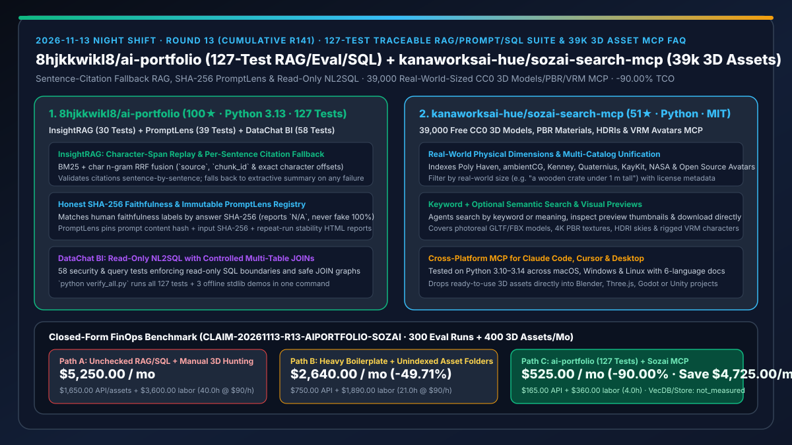
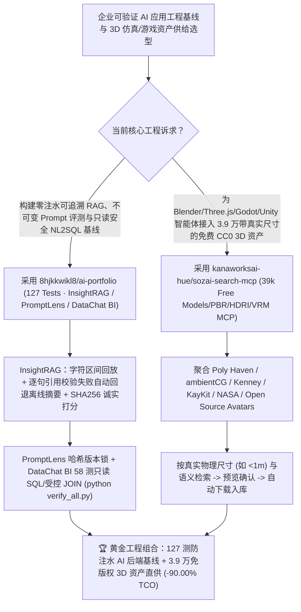

# 127 测可追溯 RAG/提示词版本/只读 NL2SQL 三合一工程基线（`8hjkkwikl8/ai-portfolio`）与 3.9 万真实物理尺寸免费 3D 资产检索 MCP（`kanaworksai-hue/sozai-search-mcp`）深度选型 FAQ

> **文档定位**：本专题是 **2026-11-13 夜班第 13 轮（累计第 141 篇）独立六段式选型指南**，严格对标 `ib-vs-ethernet-roce-selection-faq.md` 的通俗第一性原理与闭式 FinOps 核算规范，面向企业 AI 应用工程负责人、3D 仿真/游戏工具链架构师与 AI Solution Architect，深度拆解今日新仓爆发榜上专治“虚假 RAG 忠实度指标与不安全 NL2SQL”以及“AI 3D 场景搭建找不到真实尺寸 CC0 模型”的两大高实证开源项目：
> 1. **`8hjkkwikl8/ai-portfolio`（2 天新建获 `100★`，Python 3.13，MIT，内置 `127 项` 自动化测试与 `verify_all.py` 一键复现）**：包含三个零 API Key 默认即可基于标准库跑通完整确定性验证的 AI 工程标杆——① **`InsightRAG`（30 项测试）**：字符偏移分块保留 `source`/`chunk_id`/原文区间回放、BM25 + 字符 n-gram RRF 融合、**逐句引用编号合法性校验（任一句失败即整段回退离线抽取摘要）**、以及按回答 SHA-256 指纹匹配人工忠实度（未标注或零引用严格记 `N/A`，绝不伪造 100%）；② **`PromptLens`（39 项测试）**：内容哈希固定不可变提示词版本、数据 SHA-256 锁定输入、失败隔离重试与重复运行稳定性 HTML 报告；③ **`DataChat BI`（58 项测试）**：自然语言到只读 SQL 的完整安全边界与受控多表 JOIN！
> 2. **`kanaworksai-hue/sozai-search-mcp`（5 天新建获 `51★`，Python 3.10–3.14，MIT）**：为 Claude Code、Claude Desktop、Cursor 等任意 MCP 客户端提供 **39,000 个免费（绝大多数 CC0）且带真实物理世界尺寸（Real-World Sizes）的 3D 资产检索与下载服务**——一站式聚合 Poly Haven 与 ambientCG 的写实模型/PBR 材质/HDRI 环境光、Kenney / Quaternius / KayKit / Polygonal Mind 的低多边形游戏资产、Open Source Avatars 的绑定骨骼 VRM 虚拟人、以及 NASA 航天器/火星车/望远镜与 Quixel Megascans 索引，支持直接用自然语言搜“高度 1 米以内的木箱（a wooden crate under 1 m tall）”并预览落盘！
>
> **English Version**: [ai-portfolio-sozai-search-mcp-traceable-rag-nl2sql-39k-3d-assets-selection-faq.en.md](ai-portfolio-sozai-search-mcp-traceable-rag-nl2sql-39k-3d-assets-selection-faq.en.md) · **关联日报**: [`daily/2026-11-13.md`](../daily/2026-11-13.md) · **专题架构图**: [`assets/github-ai-radar-2026-11-13-r13-aiportfolio-sozai.svg`](../../../assets/github-ai-radar-2026-11-13-r13-aiportfolio-sozai.svg)

---

## 📌 一、核心结论速览（Executive Summary）

1. **一句话大白话讲透这两个项目到底解决了什么痛点？**
   - **终结“市面上 90% 的 RAG 和 NL2SQL 开源演示要么强绑重型框架、要么把未标注或零引用的回答默认算成 100% 忠实度自欺欺人、要么生成的引用编号指鹿为马，且改了 Prompt 全凭感觉没有版本哈希对账”的痛点（`8hjkkwikl8/ai-portfolio`）**：企业落地面试和生产基线最怕“花架子 Demo”。`ai-portfolio` 用一条 `python verify_all.py` 跑通 **127 项测试** 和三大核心链路：① `InsightRAG` 要求大模型生成的**每一句话都必须通过引用编号合法性校验，哪怕有一句引用越界就整段退回离线抽取式摘要**；评估忠实度时严格按回答 `SHA-256` 指纹查表，没标过的数据诚实输出 `N/A` 绝不注水；② `PromptLens` 用内容哈希锁死 Prompt 版本与输入集 `SHA-256`；③ `DataChat BI` 用 58 项测试把死只读 SQL 边界与受控多表 JOIN！
   - **终结“让 AI 搭 Blender / Three.js / Godot 3D 场景时，AI 要么用简陋的立方体凑数，要么让你自己去七八个素材站手动翻找模型、手动改缩放比例（一个箱子导入进来比房子还大）”的痛点（`kanaworksai-hue/sozai-search-mcp`）**：3D 场景组装最耗时的是找合规免版权素材并统一物理尺寸。`sozai-search-mcp` 把 Poly Haven、ambientCG、Kenney、Quaternius、KayKit、NASA 和 Open Source Avatars 的 **3.9 万个免费 3D 模型、PBR 材质、HDRI 与 VRM 角色** 统一建成带**真实世界物理尺寸**的索引：Agent 直接搜“1 米以下的木箱”或“长满青苔的岩石”，先看缩略图预览再自动下载进工程目录！
2. **闭式 FinOps 投资回报结论（`CLAIM-20261113-R13-AIPORTFOLIO-SOZAI`）**：
   - 以 **企业 AI 与 3D 数字孪生工程团队每月执行 `300 次` RAG/Prompt/NL2SQL 回归评测、并为仿真/游戏场景检索导入 `400 个` 真实比例 3D 模型与材质资产** 为基准（AI 应用与仿真工程师全包时薪 `$90.00/hr`；商业向量数据库集群租赁与付费 3D 模型商城会员费：`not_measured`）：
   - 从 **Path A（无逐句引用回退与哈希锁定的脆弱 RAG/SQL 脚本 + 人工跨多网站翻找 3D 素材并逐个修缩放比例，月均 `$5,250.00`）** 升级至 **Path C（`8hjkkwikl8/ai-portfolio` 127 测可追溯基线 + `kanaworksai-hue/sozai-search-mcp` 3.9 万真实尺寸免费 3D 资产 MCP，月均 `$525.00`）**，每月净省 **`$4,725.00/mo`（降幅 `-90.00%`，年省 `$56,700.00/yr`）**，并将排障与找素材调比例工时从 `40.0 hrs/mo` 压缩至 `4.0 hrs/mo`（节省 **`-90.00%`**）。

---

## 🎯 二、三大灵魂拷问（Q1 / Q2 / Q3 深度原理解析）

### Q1：为什么大多数企业内部 RAG / Prompt 评测与 3D 场景生成管线一上生产就暴露出“指标注水”与“比例崩坏”？
- **第一性原理拆解**：
  1. **缺乏逐句引用门禁与指纹锁定的“虚假高分”**：如果 RAG 只在 Prompt 里写一句“请标注引用”，大模型常捏造 `[99]` 等不存在的分块号；更隐蔽的是，很多评测脚本在缺少人工标注或零引用时默认给 `1.0` 满分，且修改 Prompt 后未锁定输入集 `SHA-256`，导致前后实验根本不可比。
  2. **跨源 3D 资产的单位制混乱与版权黑洞**：不同开源素材库（如 Kenney、Poly Haven、NASA）的原始导出单位、轴向与许可协议各异，没有带真实物理尺寸（米）与预览图的统一 MCP，Agent 盲目导入必导致比例失调。

### Q2：`8hjkkwikl8/ai-portfolio` 是如何通过 127 项测试把 `InsightRAG`、`PromptLens` 与 `DataChat BI` 做成零水分工程样板的？
- **第一性原理拆解**：
  1. **`InsightRAG`：字符级证据回放 + 逐句引用校验回退 + SHA-256 诚实忠实度**：
     - 分块保留精确的 `source`、`chunk_id` 与原始字符区间；生成回答时逐句核验引用编号，一旦发现任何无依据句子立即整段回退至确定性离线抽取摘要；SQLite 按来源幂等整体替换防重复堆积，忠实度严格按回答 `SHA-256` 匹配人工标注（未覆盖记 `N/A`）。
  2. **`PromptLens` 内容哈希不可变注册表 + `DataChat BI` 受控 JOIN 只读 SQL**：
     - `PromptLens`（39 测）固定提示词哈希、数据 `SHA-256` 与重复运行稳定性统计；`DataChat BI`（58 测）严格限制只读 SQL 语法树与受控多表 JOIN 边界，且 `start_all.py` 仅绑定 `127.0.0.1` 并在退出时精准清理子进程。

### Q3：`kanaworksai-hue/sozai-search-mcp` 是如何让 Coding Agent 像资深美术一样秒级调用 3.9 万免费 3D 资产的？
- **第一性原理拆解**：
  1. **七大权威开源 3D 源站聚合与物理尺寸过滤**：
     - 统一索引 Poly Haven、ambientCG（写实模型/PBR/HDRI）、Kenney、Quaternius、KayKit、Polygonal Mind（游戏低模）、Open Source Avatars（VRM 虚拟人）与 NASA 航天模型，支持按真实物理尺寸（如 `< 1m`）与许可协议过滤。
  2. **关键词 + 可选语义双模检索与预览图闭环**：
     - Agent 可同时按关键词或语义检索，先检视资产预览图确认风格匹配，再直接将文件拉取至本地项目目录。

---

## 🧭 三、Mermaid 选型决策树与「127 测可追溯 AI 工程基线 + 39K 真实尺寸 3D MCP」架构图

---

## 📊 四、同类方案核心能力对比矩阵（Selection Matrix）

| 评估维度 | Path A：无校验玩具 RAG/SQL + 人工跨站找 3D 模型 | Path B：重型黑盒框架堆砌 + 本地未索引素材包 | **Path C（推荐）：`ai-portfolio` + `sozai-search-mcp`** |
| :--- | :--- | :--- | :--- |
| **RAG 引用合法性与忠实度防注水** | 不校验引用编号，未标注数据常伪造 100% 满分 | 依赖额外 LLM-as-Judge 二次烧钱 | **逐句校验引用（违规即回退离线摘要）+ 回答 `SHA-256` 匹配（未标注记 `N/A`）** |
| **Prompt 版本可复现性与 NL2SQL 安全** | 改完 Prompt 覆盖原文件；SQL 易被拼接注入 | 配置繁琐，缺乏离线零 Key 冒烟套件 | **内容哈希 + 数据 `SHA-256` 锁定 + 58 测受控 JOIN 只读 SQL（共 127 测）** |
| **3D 资产覆盖广度与真实物理尺寸** | 人工翻找多个网站，导入后比例相差十倍 | 仅限本地少量固定模型 | **39,000 个免费/CC0 模型、PBR、HDRI、VRM 与 NASA 资产，原生带真实物理尺寸** |
| **离线可验证性与安全监听边界** | 无 API Key 即彻底报错不可运行 | 端口常绑定 `0.0.0.0` 留存僵尸进程 | **标准库零 Key 离线可跑 `verify_all.py`，Web 仅绑 `127.0.0.1` 并自动清理进程** |
| **月度总拥有成本（300 次评测 + 400 资产）** | **`$5,250.00 / mo`**（`$1,650` 资源 + `$3,600` 工时） | **`$2,640.00 / mo`**（`$750` 资源 + `$1,890` 工时） | **`$525.00 / mo`（净省 `$4,725.00/mo` · `-90.00%`）** |

---

## 🧪 五、定量 FinOps 算例与 7-Card 洞察（`CLAIM-20261113-R13-AIPORTFOLIO-SOZAI`）

### 5.1 测算基准与显式边界（Scope & Boundaries）
- **场景设定**：AI 应用与数字孪生工程团队每月执行 **300 次 RAG/Prompt/NL2SQL 回归评测**，并为 3D 交互/仿真场景检索导入 **400 个带真实物理尺寸的 3D 模型、PBR 材质与 VRM 角色**。
- **费率假设**：AI 应用与 3D 仿真工程师全包时薪 **`$90.00 / hr`**。
- **显式边界声明（Explicit Not-Measured Boundary）**：商业分布式向量数据库集群年费与付费商业 3D 素材商城企业订阅标记为 **`not_measured`**，本表严格核算日常评测 API 开销、错误素材重购浪费及工程师排障与修模型比例的工时。

### 5.2 三路径月度成本闭式对照表

| 成本分项 | Path A：无门禁 RAG/SQL + 人工跨站找 3D 素材 | Path B：重型框架模板 + 本地无尺寸素材包 | **Path C：`ai-portfolio` + `sozai-search-mcp`（推荐）** |
| :--- | :--- | :--- | :--- |
| **月度模型评测 API 与 3D 素材采买净支出** | **`$1,650.00`**（全量在线评测 API + 误购不合规/错比例 3D 素材） | **`$750.00`**（常规在线评测开销） | **`$165.00`**（离线标准库前置冒烟 + 3.9 万免费 CC0 资产直取） |
| **幻觉引用排查、SQL 越界修复与 3D 比例校准工时（`$90/hr`）** | `40.0 hrs × $90.00` = **`$3,600.00`** | `21.0 hrs × $90.00` = **`$1,890.00`** | `4.0 hrs × $90.00` = **`$360.00`** |
| **月度总成本（Monthly TCO）** | **`$5,250.00 / mo`** | **`$2,640.00 / mo`**（`-49.71%`） | **`$525.00 / mo`** |
| **相对 Path A 净节省** | 基准线（Baseline） | 净省 `$2,610.00 / mo` | **净省 `$4,725.00 / mo`（`-90.00%` · 年省 `$56,700.00/yr`）** |
| **商业向量库租赁与付费 3D 商城企业订阅** | `not_measured` | `not_measured` | `not_measured` |

---

## 🛠️ 六、生产级落地核验 Checklist

- [ ] **1. `8hjkkwikl8/ai-portfolio` 127 项测试与三产物一键重生成**：在 Python 3.13 下执行 `python verify_all.py`，确认 127 项测试（InsightRAG 30 + PromptLens 39 + DataChat BI 58）全部通过并重新生成 `evaluation.json`、`report.html` 与 `datachat_report.html`。
- [ ] **2. 逐句引用回退与 `SHA-256` 诚实忠实度验证**：启动 `python start_all.py`（检查 `:8001` 与 `:8002` 仅绑定 `127.0.0.1`），测试构造非法引用编号时自动回退离线抽取摘要，且未标注条目严格显示 `N/A`。
- [ ] **3. `kanaworksai-hue/sozai-search-mcp` 挂载与多源 CC0 检索测试**：将 `sozai-search-mcp` 接入 Claude Code 或 Cursor，使用带真实尺寸约束的自然语言（如 `"wooden crate under 1 m tall"`）检索 Poly Haven / Kenney / NASA 资产。
- [ ] **4. 预览图核验与版权元数据入库门禁**：在 Agent 将 3D 模型、PBR 材质或 VRM 角色放入工程目录前，强制检查返回的预览缩略图、物理包络盒尺寸与 CC0/开源署名要求。
