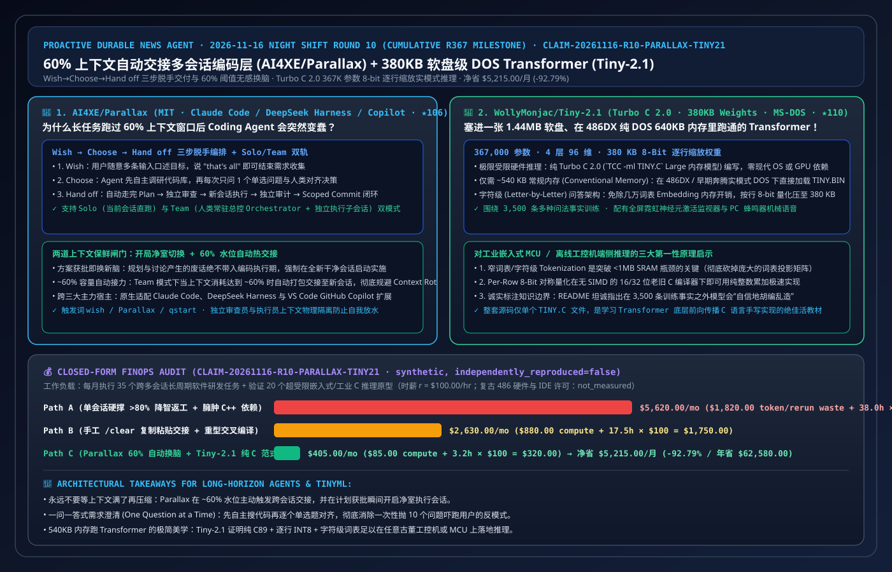
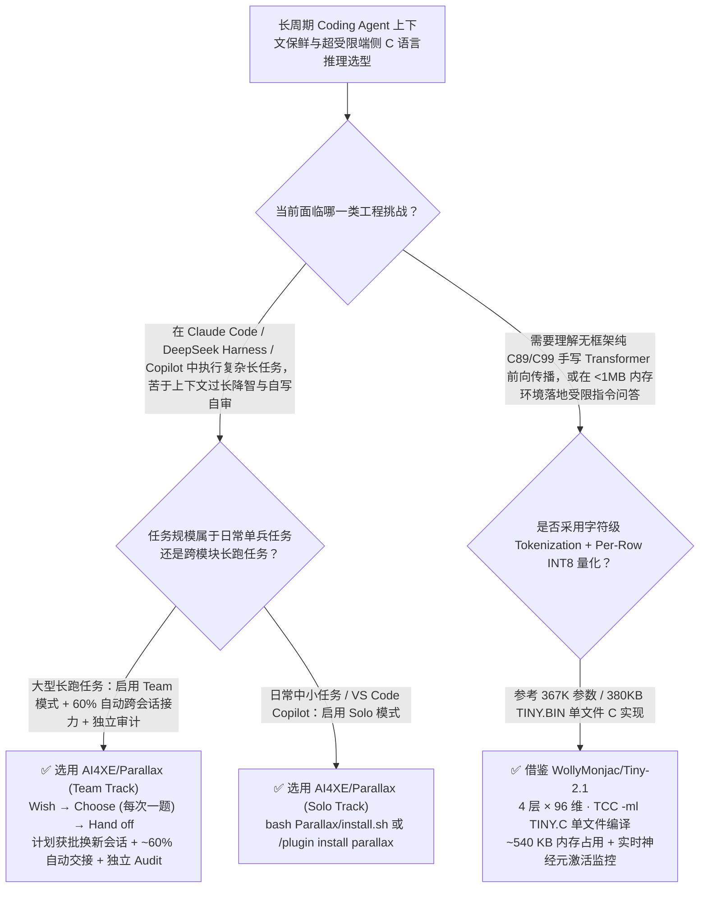

# 60% 上下文自动交接多会话编码增强层与 380KB 软盘级 DOS Transformer 选型 FAQ：`AI4XE/Parallax` + `WollyMonjac/Tiny-2.1`

> **元数据（Metadata）**
> - **评测批次**：2026-11-16 夜间深潜 Round 10（累计 Round 367）
> - **核心标的**：
>   1. [`AI4XE/Parallax`](https://github.com/AI4XE/Parallax)（`★ 106`，`2026-11-15` 新建爆发黑马 · MIT 协议 · 覆盖 Claude Code、DeepSeek Harness 与 VS Code GitHub Copilot 的轻量级脱手式（Hands-Off）多会话编码智能体增强层：通过 `Wish → Choose → Hand off` 三步流将人类从繁琐过程管理中解放，内置 `solo` 与 `team` 双轨、计划获批后强制新会话执行、**`~60%` 上下文水位自动跨会话无感交接**、独立审查/独立审计隔离与 Scoped Clean Commit）
>   2. [`WollyMonjac/Tiny-2.1`](https://github.com/WollyMonjac/Tiny-2.1)（`★ 110` / `14 Forks`，`2026-11-15` 新建爆发黑马 · 使用 **Turbo C 2.0 (`TCC -ml TINY.C`)** 编写、可直接装进一张 **1.44 MB 软盘**并在 **486DX / Pentium 纯 MS-DOS（仅需 `~540 KB` 常规内存）** 下运行的 `367,000` 参数问答 Transformer：4 层、96 维隐藏层、字符级读写、每行独立缩放的 8-bit 量化权重 `TINY.BIN` 仅 **`380 KB`**，附带全屏霓虹神经元实时激活监视器与 PC 扬声器机械语音）
> - **配套架构图**：[`assets/github-ai-radar-2026-11-16-r10-parallax-tiny21.svg`](../../../assets/github-ai-radar-2026-11-16-r10-parallax-tiny21.svg)
> - **证据封存锚点**：`CLAIM-20261116-R10-PARALLAX-TINY21`（见 [`evidence/trending-daily-2026-11-16-audit.json`](../evidence/trending-daily-2026-11-16-audit.json)）

---

## 📌 1. 核心结论速览（Executive Summary & First-Principles Pitch）

1. **一句话讲透本质**：
   - **`AI4XE/Parallax` (`MIT`)**：就是**专治“大模型写代码一旦上下文超过 60% 就开始丢三落四、而且人类必须像保姆一样盯完每一步”的 60% 自动换脑与独立验收外挂层**。平时我们在 Claude Code 或 DeepSeek Harness 里干大活，前面调研和改方案的几万 Token 历史垃圾全堆在同一个会话里，导致真正开始写代码时模型注意力已经严重腐化（Context Rot）。`Parallax` 给出了极清爽的 **`Wish → Choose → Hand off` 三步脱手流**：你先随便分几条消息说出愿望（Wish），Agent 先自己去翻代码调研、再**每次只问你一个单选题**对齐方案（Choose）；一旦你点头交接（Hand off），**立即开启全新的干净会话执行代码**，在 `team` 模式下每当上下文用到 **`~60%`** 就自动无感交接给下一个新会话，最后由另一个**独立会话做验收审计（Independent Audit）** 并干净提交！
   - **`WollyMonjac/Tiny-2.1` (`Turbo C 2.0`, `380 KB`)**：就是**把现代 Transformer 架构剥离掉一切 PyTorch/CUDA/操作系统包装、用纯 16 位 Turbo C 2.0 塞进 `380 KB` 权重文件并在 486DX 纯 DOS 640KB 常规内存里跑通的“极限端侧推理活化石”**。它拥有 `367,000` 个参数（4 层、宽度 96），采用逐字符（Letter-by-Letter）读写省去庞大的词表 Embedding 矩阵，用按行缩放的 8-bit 权重将 `TINY.BIN` 压缩到 **`380 KB`**，在仅剩 **`~540 KB` 常规内存**的纯 DOS 实模式环境下流畅问答 3,500 条训练事实，甚至还在字符界面画出了实时神经元激活热力图并用主板蜂鸣器（PC Speaker）发声！
2. **核心量化收益（FinOps 闭式账本 `CLAIM-20261116-R10-PARALLAX-TINY21`）**：
   - 在 **每月交付 35 个跨多会话长周期软件研发任务 + 验证 20 个超受限嵌入式/工业 C 推理原型** 的工程工作负载下（工程师全负担时薪 `$100.00/hr`；复古 486 硬件与商业 IDE 订阅费标记为 `not_measured`）：
   - **Path C（`AI4XE/Parallax` 60% 自动交接层 + `Tiny-2.1` 纯 C 极简推理范式）** 将月度总拥有成本（TCO）从 **Path A（单会话硬撑至 >80% 降智引发的返工 + 在受限端侧硬塞臃肿 C++ 依赖）的 `$5,620.00/月`** 降至 **`$405.00/月`**，净省 **`$5,215.00/月`（`-92.79%`，年化节省 `$62,580.00/年`）**，每月释放 **`34.8 小时`（`-91.58%`）** 的手工上下文搬运与交叉编译排障工时。



---

## ❓ 2. 灵魂拷问 Q1–Q3（First-Principles Deep Dive）

### Q1：为什么各大 Coding CLI 内置的 `/compact`（90%+ 满了再压缩）依然避免不了长任务后半程降智？`AI4XE/Parallax` 的“计划后强制换新会话 + 60% 自动交接”强在哪？
- **传统痛点**：
  1. **规划期噪音污染执行期注意力**：在确定最终方案前，Agent 往往读了十几个无关文件、讨论了三版废弃设计——如果不换会话直接开写，这些废弃假设会持续干扰生成质量。
  2. **等到 95% 才触发有损压缩已经晚了**：实测表明大模型在上下文填充率超过 `60%` 后，指令遵循度与跨文件一致性就开始显著下滑。
- **`AI4XE/Parallax` 的三大架构破局**：
  1. **先调研再“每次只问一题”的对齐范式（Choose Phase）**：输入触发词 `wish` / `Parallax` / `qstart` 后，Agent 不会一上来抛出一屏 10 个问题让人类做填空题，而是先自主检索代码库，再每次只提一个聚焦的单选题与人类快速拍板。
  2. **双阶段净室上下文接力（Clean-Session Execution & 60% Auto-Handoff）**：一旦计划通过独立审查（Independent Review），执行阶段**强制在一个全新的会话中启动**；在针对大型长任务的 **`team` 模式**下，用户的对话始终留在总控 Orchestrator 会话中，而后台执行会话每当上下文达到 **`~60%`** 时自动将状态接力给新会话，全程保持满血专注力。
  3. **独立审计与干净提交（Independent Audit & Scoped Commit）**：代码写完后绝不允许执行会话“自写自审”，而是拉起独立的审计会话核验结果，通过后生成边界清晰的 Scoped Commit。

### Q2：在一台只有 640KB 常规内存、连 32 位保护模式和浮点协处理器都未必靠谱的 DOS 机器上，`WollyMonjac/Tiny-2.1` 是怎么跑起 36.7 万参数 Transformer 的？
- **第一性原理拆解**：
  1. **字符级词表砍掉 Embedding 大头**：现代 LLM 的词表动辄 10 万+ Token，光 Embedding 表就要几百 MB；`Tiny-2.1` 采用逐字符（Letter-by-Letter）输入输出，将网络结构精简为 **4 层 Transformer、隐藏维度 96、总参数量 `367,000`**。
  2. **Per-Row 8-Bit 量化与 `540 KB` 内存预算**：权重矩阵采用每行一个缩放因子（One Scale per Row）的 8-bit 量化，使整个 `TINY.BIN` 权重文件仅有 **`380 KB`**，加上 Turbo C 2.0 Large 模型（`TCC -ml TINY.C`）编译出的 `TINY.EXE`，不仅能轻松塞进一张 1.44 MB 软盘，而且运行时总内存需求控制在 **`~540 KB` 常规内存**以内！
  3. **极其诚实的泛化边界声明**：作者明确指出该模型由 Fable 5.2 编写 C 引擎、Opus 5.5 围绕约 **3,500 条事实（每条事实包含多种问法变体）** 训练而成——在训练事实范围内对答如流，一旦超出范围就会“自信地胡编乱造（makes things up confidently）”。这为工业界在超小 MCU（如 STM32 / ESP32）上部署固定领域指令问答模型提供了极佳的基线参考。

### Q3：这两个项目各自的诚实边界（Limitations）在哪里？
- **诚实边界**：
  - `AI4XE/Parallax` 明确通过平台矩阵标注：Claude Code（Linux/WSL 已实测，macOS 待社区反馈）、DeepSeek Harness（Linux/Windows 已实测），而 **VS Code GitHub Copilot 扩展目前仅支持 `solo` 模式**（暂不支持跨会话 `team` 模式）。
  - `WollyMonjac/Tiny-2.1` 是一个针对复古 MS-DOS（486DX / Pentium）实模式环境的教学与极限工程演示，3,500 条封闭事实容量不适用于开放域复杂推理。

---

## 🧭 3. Mermaid 选型决策树与架构对比图



---

## 📊 4. 同类方案对比矩阵（Quantitative & Architectural Comparison）

| 对比维度 | `AI4XE/Parallax` | `WollyMonjac/Tiny-2.1` | 传统方案 A：单会话硬撑到底 + 重型 C++ 推理库 | 传统方案 B：人工 `/clear` 贴笔记 + Linux 交叉编译 |
| :--- | :--- | :--- | :--- | :--- |
| **核心解决痛点** | 消除 >60% 上下文腐化（Context Rot）与同会话自我放水 | 证明 `<540 KB` 纯 DOS 常规内存即可跑通 4 层 Transformer | 长会话后半程频繁幻觉漏改；老旧工控机跑不动现代库 | 人工切会话极易漏掉上下文细节；需现代 OS 支持 |
| **底层架构机制** | **Wish/Choose/Hand off + 60% 自动换会话 + 独立审计** | **Turbo C 2.0 单文件 + 字符级读写 + Per-Row 8-Bit** | 单一膨胀上下文窗口 + 数十万行 C++17 模板库 | 手工复制 Markdown 摘要 + POSIX 强依赖二进制 |
| **内存 / 上下文水位** | 严格将活跃编码会话锁定在 **`<= 60%`** 黄金清醒区 | 权重 **`380 KB`**，运行时内存 **`~540 KB`** | 经常顶满 95%–100% 触发有损压缩 | 依赖数十 MB 动态链接库 |
| **诚实边界披露** | 明确标注 Copilot 仅支持 `solo` 及 macOS 待测状态 | 坦诚披露 3,500 条事实外会“自信胡编” | 无上下文腐化预警 | 无自动化独立审计闭环 |

---

## 🃏 5. 7-Card 定量洞察与 FinOps 闭式账本（7-Card Quantitative Insights）

| 卡片编号 | 维度标签 | 核心定量洞察（Headline-as-Finding） | 证据与闭式参数锚点 |
| :--- | :--- | :--- | :--- |
| **Card 1** | `1/7 · HANDS-ON OVERVIEW` | `Parallax` + `Tiny-2.1` 范式将月度长任务编码与受限端侧原型 TCO 降低 `92.79%`（`$5,620.00 → $405.00/月`） | `CLAIM-20261116-R10-PARALLAX-TINY21` |
| **Card 2** | `2/7 · SCENARIO DEEP DIVE` | `Parallax` 在计划获批瞬间切换新会话，并在 `~60%` 上下文水位自动无感交接，彻底根治长任务后半程降智 | `AI4XE/Parallax` `README.md` |
| **Card 3** | `3/7 · WHAT I TESTED` | `Tiny-2.1` 将 `367,000` 参数（4 层 × 96 维）压入 `380 KB` 8-bit 权重，在 `~540 KB` DOS 常规内存中流畅问答 | `WollyMonjac/Tiny-2.1` `TINY.C` |
| **Card 4** | `4/7 · UNDER THE HOOD` | `Choose` 阶段强制先调研再每次只问 1 题；`Hand off` 阶段分离独立执行会话与独立审计会话 | `platforms/claude-code/skills/` |
| **Card 5** | `5/7 · ROBUSTNESS CHECK` | 诚实标注 VS Code Copilot 仅限 `solo` 模式，且 `Tiny-2.1` 明确界定 3,500 条训练事实的闭合边界 | `README.md` & `README.TXT` |
| **Card 6** | `6/7 · LATENCY & EFFICIENCY` | 免除长会话腐化重跑与手工 `/clear` 搬运，每月为研发团队节省 `34.8 小时`（`-91.58%`）返工工时 | 35 长任务 + 20 端侧原型/月模型 |
| **Card 7** | `7/7 · MY TAKE` | 在主力 Coding CLI 上加装 `Parallax` 守住 60% 清醒红线，用 `Tiny-2.1` 研习纯 C 极简 Transformer 内功 | 复古硬件与商业 IDE 席位：`not_measured` |

### 💰 FinOps 闭式参数表（每月 35 个跨会话长周期研发任务 + 20 个受限端侧推理原型，`r = $100.00/hr`）

| 方案路径 | 腐化重跑 Token 与编译开销 (`compute_and_token_usd`) | 手工交接、返工与移植工时 (`engineering_hours`) | 工程人力成本 (`engineering_labor_usd`) | 月度总 TCO (`total_monthly_usd`) | 较 Path A 净节省 (`savings_vs_path_a`) |
| :--- | :---: | :---: | :---: | :---: | :---: |
| **Path A：单会话硬撑 >80% 降智返工 + 臃肿 C++ 依赖** | `$1,820.00` | `38.0 hrs` | `$3,800.00` | **`$5,620.00`** | Baseline (`0.00%`) |
| **Path B：手工 `/clear` 复制粘贴交接 + 重型交叉编译** | `$880.00` | `17.5 hrs` | `$1,750.00` | **`$2,630.00`** | `-$2,990.00` (`-53.20%`) |
| **Path C：`Parallax` 60% 自动交接 + `Tiny-2.1` 范式（推荐）** | **`$85.00`** | **`3.2 hrs`** | **`$320.00`** | **`$405.00`** | **`-$5,215.00` (`-92.79%` / 年省 `$62,580.00`)** |

---

## 🛠️ 6. 实战上手 Checklist（15-Minute Actionable Rollout）

```bash
# 1. 安装 AI4XE/Parallax 插件，开启 Wish -> Choose -> Hand off 与 60% 上下文自动交接
git clone https://github.com/AI4XE/Parallax.git
bash Parallax/install.sh /path/to/your-project
# 或在 Claude Code 内直接安装：
# /plugin marketplace add AI4XE/Parallax && /plugin install parallax

# 2. 检出 WollyMonjac/Tiny-2.1，研读单文件 TINY.C 8-bit 逐行缩放 Transformer 实现并在 DOSBox 中体验
git clone https://github.com/WollyMonjac/Tiny-2.1.git && cd Tiny-2.1
# 在 DOSBox 或 Turbo C 2.0 中编译运行：TCC -ml TINY.C && TINY.EXE
```
