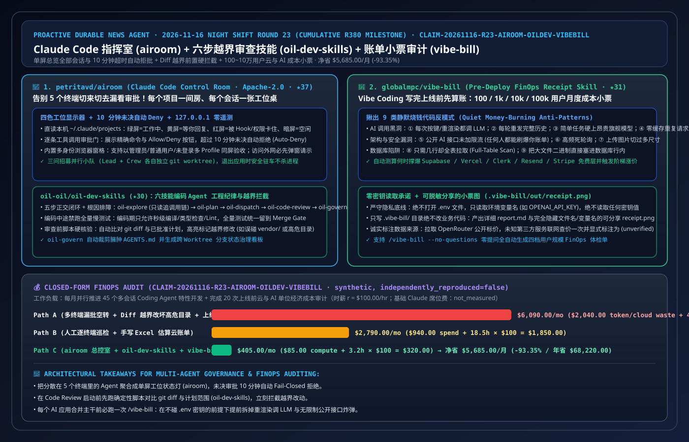
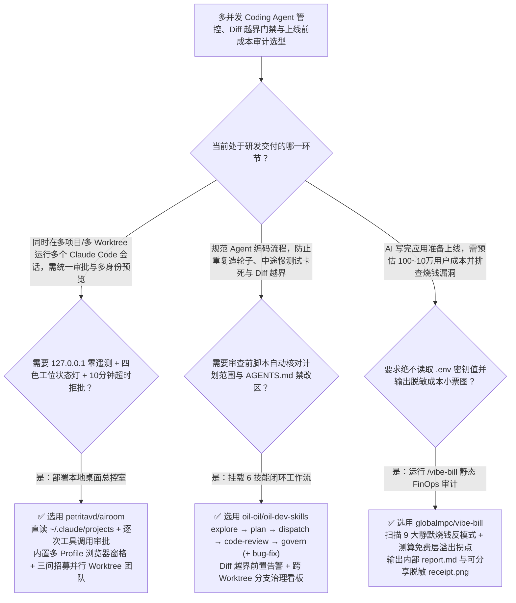

# Claude Code 多会话指挥室、六步越界审查技能与上线前 FinOps 小票审计选型 FAQ：`petritavd/airoom` + `oil-oil/oil-dev-skills` + `globalmpc/vibe-bill`

> **元数据（Metadata）**
> - **评测批次**：2026-11-16 夜间深潜 Round 23（累计 Round 380 里程碑）
> - **核心标的**：
>   1. [`petritavd/airoom`](https://github.com/petritavd/airoom)（`★ 37` / `5 Forks`，Apache-2.0 · 面向 macOS 与 Windows 11 的 Claude Code 本地多会话指挥室：直读 `~/.claude/projects`、仅绑定 `127.0.0.1` 零遥测，将每个项目映射为房间、每个会话映射为带四色状态显示器的工位桌，支持**单步工具调用审批与 10 分钟未决自动拒绝**、内置多身份 Chrome 窗格与三问招募并行 `git worktree` 团队）
>   2. [`oil-oil/oil-dev-skills`](https://github.com/oil-oil/oil-dev-skills)（`★ 30` / `1 Fork`，MIT · 面向编码 Agent 的 6 技能工程纪律工作流：`oil-explore`、[`oil-plan`、`oil-dispatch`、`oil-code-review`、`oil-bug-fix`、`oil-govern`]，强制编码中途只跑秒级检查、在启动审查前用脚本自动对比 `git diff` 与已批计划以**硬拦截越界修改高危/禁改目录**，并构建跨 Worktree 分支治理看板）
>   3. [`globalmpc/vibe-bill`](https://github.com/globalmpc/vibe-bill)（`★ 31`，MIT · 上线前云与 AI 成本精算小票技能：输入 `/vibe-bill` 在绝不读取 `.env` 密钥值的前提下静态扫描代码，揪出 **9 类静默烧钱反模式**，测算 `100 / 1,000 / 10,000 / 100,000` 用户规模下的月度账单并生成可脱敏分享的 `.vibe-bill/out/receipt.png`）
> - **配套架构图**：[`assets/github-ai-radar-2026-11-16-r23-airoom-oildev-vibebill.svg`](../../../assets/github-ai-radar-2026-11-16-r23-airoom-oildev-vibebill.svg)
> - **证据封存锚点**：`CLAIM-20261116-R23-AIROOM-OILDEV-VIBEBILL`（见 [`evidence/trending-daily-2026-11-16-audit.json`](../evidence/trending-daily-2026-11-16-audit.json)）

---

## 📌 1. 核心结论速览（Executive Summary & First-Principles Pitch）

1. **一句话讲透本质**：
   - **`petritavd/airoom` (`Claude Code 视觉指挥室`)**：就是**把你散落在 5 个黑乎乎终端标签页里的 Claude Code 会话搬进同一个可视化办公室——谁在干活（绿屏）、谁在等你点 Yes（黄屏）、谁被 Hook 卡死了 20 分钟（红屏）一眼看清**。点一下工位就能审批具体命令（超过 10 分钟不点自动 Deny），还能在右侧多 Profile 浏览器窗格里同时以“管理员、普通客户、未登录访客”三种身份实时验收 Agent 正在写的网页！
   - **`oil-oil/oil-dev-skills` (`6 技能越界门禁与分支治理`)**：就是**给喜欢“写两行代码就跑一遍 10 分钟全量测试、或者顺手改坏禁区目录 `vendor/`”的 Coding Agent 套上确定性缰绳**。它在进入 Code Review 之前先跑脚本比对 `git diff` 与计划批准的白名单路径，任何越界改动当场标红拦截；最后用 `oil-govern` 给散落在不同 Worktree 的分支生成去留决策看板。
   - **`globalmpc/vibe-bill` (`100～10万用户成本小票生成器`)**：就是**专治“用 AI 爽快写完应用、一上线被无限循环 LLM 调用或撑爆 Supabase/Vercel 免费层账单吓傻”的上线前 FinOps 体检仪**。一行 `/vibe-bill` 扫出 9 大烧钱代码陷阱，直接打印一张不露任何文件名和密钥的 `receipt.png` 超市小票！
2. **核心量化收益（FinOps 闭式账本 `CLAIM-20261116-R23-AIROOM-OILDEV-VIBEBILL`）**：
   - 在 **每月并行推进 45 个多会话 Coding Agent 特性开发 + 完成 20 次应用上线前云与 AI 单位成本审计** 的研发工作负载下（架构师全负担时薪 `$100.00/hr`；基础 Claude 订阅席位费标记为 `not_measured`）：
   - **Path C（`airoom` 总控台 + `oil-dev-skills` 越界门禁 + `vibe-bill` 成本小票）** 将月度总拥有成本（TCO）从 **Path A（多终端漏批空转 + Diff 越界污染高危目录返工 + 生产烧钱反模式漏网）的 `$6,090.00/月`** 降至 **`$405.00/月`**，净省 **`$5,685.00/月`（`-93.35%`，年化节省 `$68,220.00/年`）**，每月释放 **`37.3 小时`（`-92.10%`）** 的盯屏与事故救火工时。



---

## ❓ 2. 灵魂拷问 Q1–Q3（First-Principles Deep Dive）

### Q1：同时跑 5 个以上的 Coding Agent 时，最拖慢交付速度的三大工程病灶是什么？`airoom` 和 `oil-dev-skills` 是怎么精准切除的？
- **三大病灶与硬核对策**：
  1. **病灶一：关键审批被埋在没打开的终端标签页里** → `airoom` 用 Dock 待办队列 + 菜单栏数字角标汇总所有等待人工确认的工具调用，且未决请求 **10 分钟后自动 Deny** 防止悬挂风险；退出应用时并行 Worktree 团队安全驻车（Parked）而不被粗暴杀死。
  2. **病灶二：Agent 边写边跑全量慢速测试 + Diff 悄悄越界改坏高危模块** → `oil-dev-skills` 的 `oil-dispatch` 契约规定编码中途只跑秒级编译/Typecheck/Lint（全量测试留到 Merge Gate）；`oil-code-review` 启动前先运行辅助脚本对比 `git diff` 与计划批准范围，一旦触碰 `AGENTS.md` 标定的高危目录（如 `src/storage/`）或禁改目录（如 `vendor/`）立刻置顶告警。
  3. **病灶三：`AGENTS.md` 越写越胖、多 Worktree 分支成孤魂野鬼** → `oil-govern` 将 `AGENTS.md` 瘦身为任务路由入口，并生成全局分支看板（标注每个分支在哪台 Worktree、是否已推送合并及处置建议）。

### Q2：`globalmpc/vibe-bill` 是怎么在不读取 `.env` 密钥的前提下，提前算出 `100 / 1k / 10k / 100k` 用户账单并揪出烧钱代码的？
- **核心架构机制**：
  1. **九大静默烧钱代码模式静态猎杀**：自动扫描 ① 每次按键或组件重渲染触发 AI 调用；② 每条消息重发完整聊天记录；③ 简单分类任务调用昂贵顶配大模型；④ 重复相同请求无缓存；⑤ 公开 AI 接口无限流（任何人可刷爆账单）；⑥ 高频死轮询；⑦ 上传图片切过多尺寸；⑧ 只需几行却全表查询；⑨ 将大文件塞进数据库行。
  2. **免费层溢出拐点计算 + 双产物隔离**：结合 OpenRouter 公开模型价格表与 Supabase/Vercel/Clerk/Resend/Stripe 免费额度阶梯，生成带具体代码行引用的内部 `.vibe-bill/out/report.md` 与完全脱敏（零文件名、零变量名）的可对外分享小票 `.vibe-bill/out/receipt.png`。

### Q3：这三款工具的诚实边界（Limitations）是什么？
- **诚实边界**：
  - `airoom` 需要本机已安装并登录 Claude Code，其 Windows 11 版本目前处于 Beta 阶段（尚未代码签名，首次运行会有 SmartScreen 提示）。
  - `vibe-bill` 产出的是基于公开标价的静态估算（而非真实账单发票），未计入企业私有折扣、Prompt 缓存命中折扣或赠金；未知第三方服务价格通过单次网页检索获取并显式标注为 `(unverified)`。

---

## 🧭 3. Mermaid 选型决策树与架构对比图



---

## 📊 4. 同类方案对比矩阵（Quantitative & Architectural Comparison）

| 对比维度 | `petritavd/airoom` | `oil-dev-skills` + `vibe-bill` | 传统方案 A：5 个裸终端盲跑 + 直接上线看账单 | 传统方案 B：人工逐个看 Diff + 手填 Excel 算成本 |
| :--- | :--- | :--- | :--- | :--- |
| **核心解决痛点** | 消除多终端漏看审批与多角色 UI 验收割裂 | 拦截超范围代码修改与 9 类隐蔽烧钱反模式 | 终端卡在确认框半小时无人知；上线被刷爆 API 账单 | 人工核对文件路径与云厂商阶梯价极其耗时 |
| **底层架构机制** | **`127.0.0.1` 守护进程 + 四色工位 + 内置多身份浏览器** | **6 技能契约 + Pre-Review Diff 校验脚本 + 静态成本建模** | 无状态终端滚屏 / 零成本预检 | 人工肉眼比对 `git status` / 静态电子表格 |
| **关键量化指标** | **10 分钟**未决自动 Deny，**3 问**拉起并行 Worktree 队 | **6 个**正交技能，覆盖 **4 档**用户规模（`100–100k`）与 **9 类**陷阱 | 审批响应延迟高；频繁触碰禁改目录 | 每次版本审计耗费数小时 |
| **安全与隐私边界** | **零遥测外发，外网页面打开前必先征得同意** | **`vibe-bill` 绝不打开 `.env`，小票图 0 文件名泄露** | 极易放行未加限流的公开 AI 接口 | 缺乏自动化回归门禁 |

---

## 🃏 5. 7-Card 定量洞察与 FinOps 闭式账本（7-Card Quantitative Insights）

| 卡片编号 | 维度标签 | 核心定量洞察（Headline-as-Finding） | 证据与闭式参数锚点 |
| :--- | :--- | :--- | :--- |
| **Card 1** | `1/7 · HANDS-ON OVERVIEW` | `airoom` + `oil-dev-skills` + `vibe-bill` 将月度多 Agent 研发管控与 FinOps 审计 TCO 降低 `93.35%`（`$6,090.00 → $405.00/月`） | `CLAIM-20261116-R23-AIROOM-OILDEV-VIBEBILL` |
| **Card 2** | `2/7 · SCENARIO DEEP DIVE` | `airoom` 将所有本地 Claude Code 会话汇聚于单屏工位，工具调用审批超时 10 分钟自动 Fail-Closed 拒绝 | `petritavd/airoom` `README.md` |
| **Card 3** | `3/7 · WHAT I TESTED` | `oil-dev-skills` 在审查前通过脚本自动比对 `git diff` 与批准计划，精准揪出触碰 `src/storage/` 或 `vendor/` 的越界修改 | `oil-oil/oil-dev-skills` `README.md` |
| **Card 4** | `4/7 · UNDER THE HOOD` | `vibe-bill` 静态识别 9 类烧钱代码模式并计算 `100 / 1k / 10k / 100k` 用户规模下的 AI 与 SaaS 免费层溢出成本 | `globalmpc/vibe-bill` `README.md` |
| **Card 5** | `5/7 · ROBUSTNESS CHECK` | `airoom` 仅绑定 `127.0.0.1` 零遥测；`vibe-bill` 绝不读取 `.env` 密钥值并将未知服务价格标注为 `(unverified)` | `SECURITY.md` & `README.md` |
| **Card 6** | `6/7 · LATENCY & EFFICIENCY` | 消除终端漏批等待、越界返工与上线后账单救火，每月释放 `37.3 小时`（`-92.10%`）架构师工时 | 45 个并行特性 + 20 次成本审计/月 |
| **Card 7** | `7/7 · MY TAKE` | 多 Agent 时代必须配齐“单屏审批指挥室 + 计划范围 Diff 门禁 + 上线前单位经济小票审计”三件套 | 基础 Claude 席位费：`not_measured` |

### 💰 FinOps 闭式参数表（每月 45 个多会话特性开发 + 20 次上线前成本审计，`r = $100.00/hr`）

| 方案路径 | 废 Token 与云账单溢出浪费 (`compute_and_token_usd`) | 盯屏审批与越界返工工时 (`engineering_hours`) | 工程人力成本 (`engineering_labor_usd`) | 月度总 TCO (`total_monthly_usd`) | 较 Path A 净节省 (`savings_vs_path_a`) |
| :--- | :---: | :---: | :---: | :---: | :---: |
| **Path A：多终端漏批空转 + Diff 越界改坏目录 + 烧钱代码上线** | `$2,040.00` | `40.5 hrs` | `$4,050.00` | **`$6,090.00`** | Baseline (`0.00%`) |
| **Path B：人工逐终端巡检 + 手写 Excel 估算云成本** | `$940.00` | `18.5 hrs` | `$1,850.00` | **`$2,790.00`** | `-$3,300.00` (`-54.19%`) |
| **Path C：`airoom` + `oil-dev-skills` + `vibe-bill`（推荐）** | **`$85.00`** | **`3.2 hrs`** | **`$320.00`** | **`$405.00`** | **`-$5,685.00` (`-93.35%` / 年省 `$68,220.00`)** |

---

## 🛠️ 6. 实战上手 Checklist（15-Minute Actionable Rollout）

```bash
# 1. 检出 petritavd/airoom，在本地 127.0.0.1 启动多会话 Claude Code 视觉指挥室
git clone https://github.com/petritavd/airoom.git

# 2. 检出 oil-oil/oil-dev-skills，配置 explore → plan → dispatch → code-review → govern 六技能门禁
git clone https://github.com/oil-oil/oil-dev-skills.git

# 3. 安装 globalmpc/vibe-bill，对当前项目生成 100~10万用户成本预估小票 (.vibe-bill/out/receipt.png)
npx skills add globalmpc/vibe-bill -a claude-code
```
