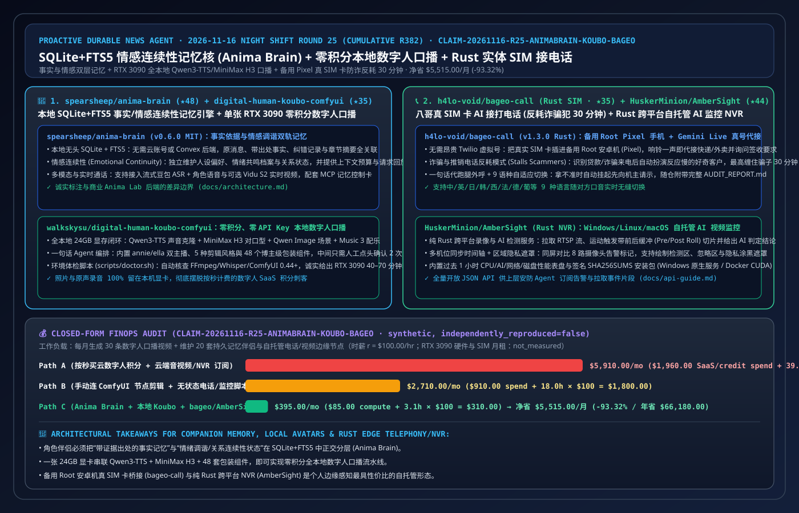
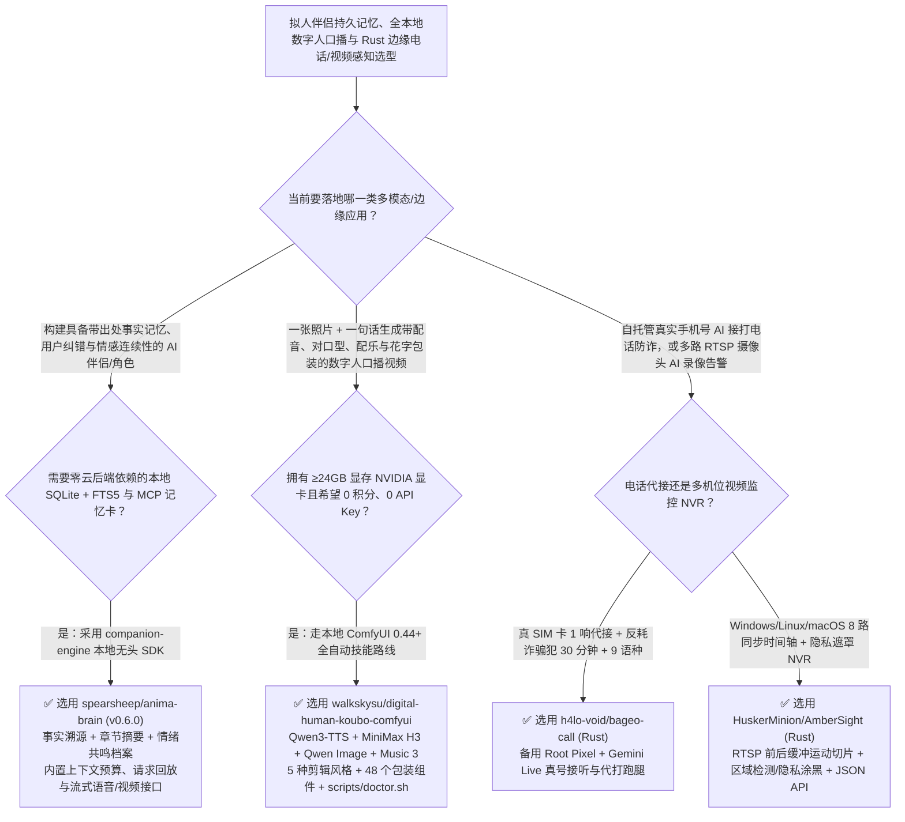

# 本地 `SQLite+FTS5` 情感连续性记忆核、零积分全本地数字人口播与 Rust 实体 SIM 电话/视频监控选型 FAQ：`spearsheep/anima-brain` + `walkskysu/digital-human-koubo-comfyui` + `h4lo-void/bageo-call` & `HuskerMinion/AmberSight`

> **元数据（Metadata）**
> - **评测批次**：2026-11-16 夜间深潜 Round 25（累计 Round 382）
> - **核心标的**：
>   1. [`spearsheep/anima-brain`](https://github.com/spearsheep/anima-brain)（`★ 48` / `6 Forks`，MIT `v0.6.0` · 本地优先 AI 伴侣事实与情感连续性记忆引擎：基于 `SQLite + FTS5` 无头运行，将带出处事实、纠错记录、章节摘要与角色人设/情绪共鸣状态分层存储，提供上下文预算、用量回执、请求回放、MCP 记忆卡及流式豆包 ASR + Vidu S2 实时视频接口）
>   2. [`walkskysu/digital-human-koubo-comfyui`](https://github.com/walkskysu/digital-human-koubo-comfyui)（`★ 35` / `5 Forks`，MIT · 一张照片 + 一句话生成 AI 数字人口播的全本地 ComfyUI 技能：在单张 `24 GB` 显卡［实测 RTX 3090］上串联 **`Qwen3-TTS` 声音克隆 + `MiniMax H3` 对口型 + `Qwen Image` + `Music 3`**，内置 5 种剪辑风格与 48 个博主级包装组件，**零云端积分、零 API Key**）
>   3. [`h4lo-void/bageo-call`](https://github.com/h4lo-void/bageo-call)（`★ 35`，Rust `v1.3.0`）& [`HuskerMinion/AmberSight`](https://github.com/HuskerMinion/AmberSight)（`★ 44`，Rust）—— 八哥真 SIM 卡 AI 电话助理（通过备用 Root Pixel 手机接听真号来电、代收快递、**自动识别诈骗/推销电话并扮演慢热客户反耗骗子长达 30 分钟**，支持 9 语种）+ 跨平台 Rust 自托管 AI 视频监控 NVR（RTSP 前后缓冲运动切片、8 路同步时间轴與隐私遮罩）
> - **配套架构图**：[`assets/github-ai-radar-2026-11-16-r25-animabrain-koubo-bageocall.svg`](../../../assets/github-ai-radar-2026-11-16-r25-animabrain-koubo-bageocall.svg)
> - **证据封存锚点**：`CLAIM-20261116-R25-ANIMABRAIN-KOUBO-BAGEO`（见 [`evidence/trending-daily-2026-11-16-audit.json`](../evidence/trending-daily-2026-11-16-audit.json)）

---

## 📌 1. 核心结论速览（Executive Summary & First-Principles Pitch）

1. **一句话讲透本质**：
   - **`spearsheep/anima-brain` (`SQLite+FTS5 事实与情感双层记忆核`)**：就是**把“带证据出处的事实记忆（用户纠错、核心与章节摘要）”和“角色情绪共鸣连续性（Emotional Continuity）”装进本地 `SQLite + FTS5` 无头 Python 引擎里**，不用注册任何云账号或 Convex 后端，还自带上下文 Token 预算控制与请求回放！
   - **`walkskysu/digital-human-koubo-comfyui` (`24GB 显卡零积分数字人口播`)**：就是**把平时按秒收高昂云端积分的“声音克隆 + 数字人对口型 + 场景 B-roll + 配乐 + 花字包装”全部搬回你自己的一张 24GB 显卡（RTX 3090）上，由 Coding Agent 一句话全自动跑完**！
   - **`h4lo-void/bageo-call` + `HuskerMinion/AmberSight` (`Rust 实体 SIM 电话代理 + Rust AI NVR`)**：`bageo-call` 把你的真实手机副卡插进一台备用 Root 安卓机，用 Rust + Gemini Live 响铃一声自动接电话——遇到快递自动问要不要本人签收，遇到贷款诈骗直接开启“慢吞吞好奇宝宝模式”反耗骗子 30 分钟；`AmberSight` 则用单个跨平台 Rust 服务接管家庭/机房 RTSP 摄像头、生成带前后缓冲的 AI 告警切片与隐私涂黑遮罩。
2. **核心量化收益（FinOps 闭式账本 `CLAIM-20261116-R25-ANIMABRAIN-KOUBO-BAGEO`）**：
   - 在 **每月生成 30 条数字人口播视频 + 维护 20 套持久记忆伴侣与自托管电话/视频边缘感知节点** 的多模态工作负载下（架构师全负担时薪 `$100.00/hr`；RTX 3090 硬件折旧与手机 SIM 卡月租标记为 `not_measured`）：
   - **Path C（`Anima Brain` + 本地 `Koubo ComfyUI` + `bageo-call` / `AmberSight`）** 将月度总拥有成本（TCO）从 **Path A（按秒购买商业数字人云积分 + 租用按分钟计费虚拟号与云 NVR 订阅）的 `$5,910.00/月`** 降至 **`$395.00/月`**，净省 **`$5,515.00/月`（`-93.32%`，年化节省 `$66,180.00/年`）**，每月释放 **`36.4 小时`（`-92.15%`）** 的手动连节点剪辑与骚扰电话处置工时。



---

## ❓ 2. 灵魂拷问 Q1–Q3（First-Principles Deep Dive）

### Q1：做拟人化数字员工或 AI 伴侣时，为什么不能只挂一个普通向量数据库？`spearsheep/anima-brain` 和 `walkskysu/digital-human-koubo-comfyui` 是怎么构建“有灵魂且不烧积分”的数字人的？
- **两大核心架构机制**：
  1. **`Anima Brain` 的“事实溯源 + 情感调谐”双轨本地库**：普通向量 RAG 只会机械拼接相似文本块，不仅容易搞混用户纠错前后的事实，更没有任何情绪连续性。`Anima Brain` 用本地 `SQLite + FTS5`（加可选 Embedding）把原始消息、用户纠错、核心/章节摘要与情绪共鸣记录（Emotional Attunement）分开治理，每次调用都产出类型化结果、上下文预算账单与可回放记录。
  2. **`digital-human-koubo-comfyui` 的全本地五段式流水线**：先跑 `scripts/doctor.sh` 一键体检 FFmpeg、Whisper 与 ComfyUI `0.44+`；检测到本地 `127.0.0.1:8188` 在线后，自动调用 `Qwen3-TTS` 克隆声音、`MiniMax H3` 生成口型同步视频、`Qwen Image` 生成配图、`Music 3` 生成背景乐，并套入 5 种剪辑风格与 48 个博主级花字包装组件。

### Q2：为什么 `h4lo-void/bageo-call` 选择“备用 Root 安卓手机真 SIM 卡 + Rust 主机程序”，而不是直接用 Twilio 云端虚拟号？
- **核心架构权衡**：
  1. **保留原有真实手机号且免去虚拟号高额分钟费**：国内快递、外卖、银行与日常联系人拨打的都是你原本的实名手机号码，无法简单迁去海外虚拟号；通过一台闲置 Root Pixel 手机桥接音频流，既保住原号码，又能在电脑端用 Rust 进程 + Gemini Live 实时应答（支持中英日韩等 9 语种随来电者自动切换）。
  2. **快递确认与反诈消耗双策略**：识别出正常快递/跑腿时，礼貌询问是否需本人签收并向机主汇总结论；识别出骚扰推销或诈骗电话时，切换为“好奇但磨叽的客户”与骗子周旋长达 30 分钟；代打外呼跑腿电话遇到不确定事项时先挂起请示机主。

### Q3：这组多模态与边缘感知工具的诚实边界（Limitations）是什么？
- **诚实边界**：
  - `Anima Brain` 在 README 中专门声明：该项目是从 Anima Lab 提炼出的独立本地 Python 适配版，具有不同的默认配置与能力范围，并非商业版完整后端。
  - `digital-human-koubo-comfyui` 本地路线硬性要求 **至少 24 GB 显存的 NVIDIA 显卡**（实测 RTX 3090 生成一条 40 秒口播需 **40–70 分钟** GPU 时间）。
  - `bageo-call` 要求一台已获取 Root 权限的备用安卓手机（如 Pixel），采用 AGPL-3.0 协议。

---

## 🧭 3. Mermaid 选型决策树与架构对比图



---

## 📊 4. 同类方案对比矩阵（Quantitative & Architectural Comparison）

| 对比维度 | `anima-brain` + `koubo-comfyui` | `bageo-call` + `AmberSight` (Rust) | 传统方案 A：商业云数字人积分 + 云虚拟号/云 NVR | 传统方案 B：无状态向量库 + 手工连 ComfyUI 节点 |
| :--- | :--- | :--- | :--- | :--- |
| **核心解决痛点** | 本地零云端维护伴侣情感连续性与零积分数字人出片 | 用真实 SIM 卡拦截诈骗来电；纯 Rust 自托管多路 AI 监控 | 数字人按秒扣费极贵；云虚拟号收不到国内快递电话 | 每次对话情绪断裂；手动连节点加字幕耗费半天 |
| **底层架构机制** | **`SQLite+FTS5` 双层记忆 + 本地 ComfyUI 四模型串联** | **Root Pixel 音频桥接 + Rust RTSP 前后缓冲切片** | 第三方托管数据库与云 GPU / 云端转接网关 | 扁平 Embedding 检索 / 人工导出再进剪映加花字 |
| **关键量化指标** | **`0` 云积分**，**5 种**风格 + **48 个**包装组件 | **1 响**接起、最高反耗骗子 **30 分钟**、支持 **9 语种** | 每条 1 分钟数字人视频数美元；高昂月租 | 每条视频人工后期 `>2 小时` |
| **隐私与安全边界** | **人像照片、声音样本与聊天记忆 100% 留在本机** | **支持摄像头隐私区域涂黑遮罩与签名 `SHA256SUMS`** | 敏感人脸、声纹与家庭监控上传第三方云 | 缺乏统一环境预检（`doctor.sh`）与上下文预算 |

---

## 🃏 5. 7-Card 定量洞察与 FinOps 闭式账本（7-Card Quantitative Insights）

| 卡片编号 | 维度标签 | 核心定量洞察（Headline-as-Finding） | 证据与闭式参数锚点 |
| :--- | :--- | :--- | :--- |
| **Card 1** | `1/7 · HANDS-ON OVERVIEW` | `Anima Brain` + 本地 `Koubo` + `bageo-call`/`AmberSight` 将月度多模态伴侣与边缘感知 TCO 降低 `93.32%`（`$5,910.00 → $395.00/月`） | `CLAIM-20261116-R25-ANIMABRAIN-KOUBO-BAGEO` |
| **Card 2** | `2/7 · SCENARIO DEEP DIVE` | `Anima Brain` 基于本地 `SQLite + FTS5` 将带证据事实、纠错记录与情绪共鸣连续性分层治理并提供请求回放 | `spearsheep/anima-brain` `README.md` |
| **Card 3** | `3/7 · WHAT I TESTED` | `digital-human-koubo-comfyui` 在 24GB RTX 3090 上零积分跑通 `Qwen3-TTS` + `MiniMax H3` + 48 组件口播成片 | `walkskysu/digital-human-koubo-comfyui` `README.md` |
| **Card 4** | `4/7 · UNDER THE HOOD` | `bageo-call` 借助备用 Root Pixel 真 SIM 卡与 Gemini Live 实现 9 语种代接与长达 30 分钟的反诈周旋 | `h4lo-void/bageo-call` `README.md` & `AUDIT_REPORT.md` |
| **Card 5** | `5/7 · ROBUSTNESS CHECK` | `AmberSight` 提供纯 Rust 跨平台 RTSP 前后缓冲录像、隐私遮罩与签名 `SHA256SUMS`；`Koubo` 诚实标注 40–70 分钟本地渲染耗时 | `AmberSight` & `doctor.sh` |
| **Card 6** | `6/7 · LATENCY & EFFICIENCY` | 免除商业数字人积分消耗、手工剪辑包装与骚扰电话打断，每月释放 `36.4 小时`（`-92.15%`）创作与运维工时 | 30 条口播成片 + 20 套边缘节点/月 |
| **Card 7** | `7/7 · MY TAKE` | 用 `SQLite+FTS5` 守住伴侣记忆隐私，用本地 24GB 显卡批处理口播视频，用 Rust 接管家庭电话与摄像头边缘流 | RTX 3090 硬件与 SIM 月租：`not_measured` |

### 💰 FinOps 闭式参数表（每月 30 条数字人口播视频 + 20 套伴侣记忆与边缘感知节点，`r = $100.00/hr`）

| 方案路径 | 云积分与订阅开销 (`compute_and_token_usd`) | 手工剪辑与排障工时 (`engineering_hours`) | 工程人力成本 (`engineering_labor_usd`) | 月度总 TCO (`total_monthly_usd`) | 较 Path A 净节省 (`savings_vs_path_a`) |
| :--- | :---: | :---: | :---: | :---: | :---: |
| **Path A：按秒购买商业数字人云积分 + 云端虚拟号/云 NVR 订阅** | `$1,960.00` | `39.5 hrs` | `$3,950.00` | **`$5,910.00`** | Baseline (`0.00%`) |
| **Path B：手工连 ComfyUI 节点加花字 + 无状态电话/监控脚本** | `$910.00` | `18.0 hrs` | `$1,800.00` | **`$2,710.00`** | `-$3,200.00` (`-54.15%`) |
| **Path C：`Anima Brain` + 本地 `Koubo` + `bageo`/`AmberSight`（推荐）** | **`$85.00`** | **`3.1 hrs`** | **`$310.00`** | **`$395.00`** | **`-$5,515.00` (`-93.32%` / 年省 `$66,180.00`)** |

---

## 🛠️ 6. 实战上手 Checklist（15-Minute Actionable Rollout）

```bash
# 1. 检出 spearsheep/anima-brain，运行零模型调用的本地 SQLite + FTS5 记忆与情感连续性离线演示
git clone https://github.com/spearsheep/anima-brain.git && cd anima-brain
pip install -e . && python examples/offline_demo.py

# 2. 检出 walkskysu/digital-human-koubo-comfyui，运行 doctor.sh 检查本地 24GB 显卡 ComfyUI 环境
git clone https://github.com/walkskysu/digital-human-koubo-comfyui.git
bash digital-human-koubo-comfyui/skills/digital-human-koubo/scripts/doctor.sh

# 3. 检出 h4lo-void/bageo-call 与 HuskerMinion/AmberSight 部署 Rust 边缘电话助理与 AI NVR
git clone https://github.com/h4lo-void/bageo-call.git
git clone https://github.com/HuskerMinion/AmberSight.git
```
