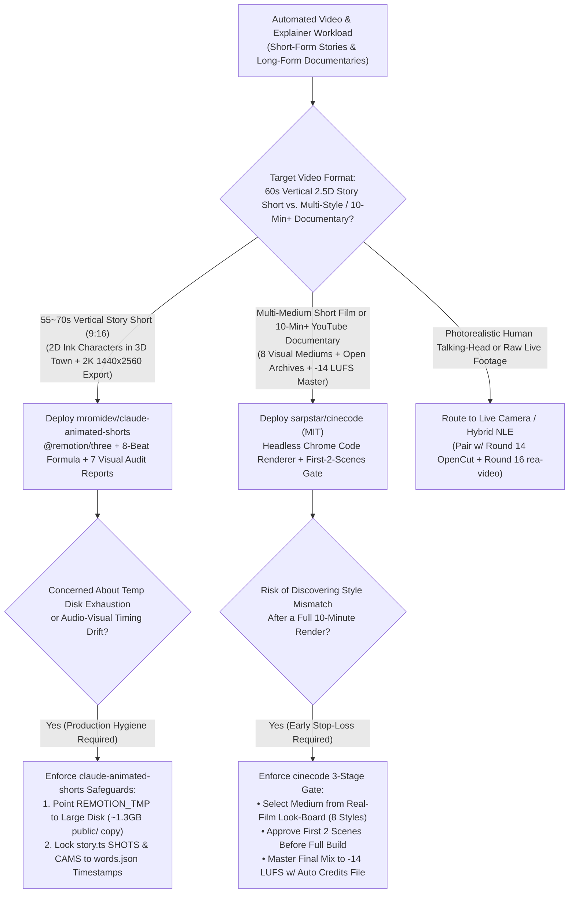

# Programmatic Code-Driven Video & 2.5D Story Shorts Selection FAQ: `mromidev/claude-animated-shorts` + `sarpstar/cinecode` vs. Diffusion Video Slot-Machines & Manual After-Effects

> **Document Scope**: A first-principles architecture and FinOps selection guide for AI Solution Architects, Technical Explainer Producers, and Automated Content Engineering Leads. Focusing on two breakout "Films Made with Code" repositories from the `2026-11-09` GitHub AI Radar (Track B) — **`mromidev/claude-animated-shorts`** (MIT, Track B **#B21**, **2,542 Stars** on search snapshot / **2,578 Stars** live API in 8 days, **`318 Stars/day`** lifecycle velocity, `stars_today = not_measured`) and **`sarpstar/cinecode`** (MIT, Track B **#B28**, **1,829 Stars** on search snapshot / **1,874 Stars** live API in 6 days, **`305 Stars/day`** lifecycle velocity, `stars_today = not_measured`) — this guide dissects how **Three.js + Remotion 2.5D Vertical Story Pipelines (7 Measured Visual Reports + `words.json` Word-Level Sync)** and **Headless Chrome 8-Medium Code Film Engines (First-2-Scenes Approval Gate + `-14 LUFS` Mastering)** replace `$0.15/sec` video diffusion slot-machines with `$0.00/frame` deterministic local rendering.
>
> **Navigation**: [中文版 (`animated-shorts-cinecode-programmatic-video-selection-faq.md`)](./animated-shorts-cinecode-programmatic-video-selection-faq.md) · [2026-11-09 Daily Radar](../daily/2026-11-09.en.md) · [Back to Radar Index](../README.en.md)

---

## 📌 1. Executive Summary

1. **First-Principles Definition**:
   - **`mromidev/claude-animated-shorts` (TypeScript + `@remotion/three` + Python + FFmpeg, MIT)** is a Claude Code skill for producing **55–70 second viral vertical 2.5D animated story shorts** ("2D flat bean-head cartoon cards with ink outlines inside a painted 3D world with depth-of-field lens blur, gliding cameras, and march/SFX audio"). Rendered 100% locally via Three.js inside Remotion at **2K vertical resolution (`1440x2560`, `--scale 1.3333`) with zero AI video generators**, it enforces an **8-Beat Story Formula (`~3.7 words/s`)**, deterministic word-level camera/shot timing (`words.json` → `story.ts`), and QA against **7 measured visual audit reports** (`1,200` contact-sheet frames + `38` full-size `540x960` reference stills).
   - **`sarpstar/cinecode` (Python + Three.js + Headless Chrome + FFmpeg, MIT)** is an end-to-end programmatic filmmaking engine for **multi-style short films, ads, explainers, and 10+ minute YouTube documentaries**. Running inside Claude Code or Cursor on your PC, the agent cross-pollinates ideas with real historical/museum artifacts, checks against prior films to avoid self-repetition, renders frames in headless Chrome across **8 visual mediums** (3D real light, 2D animation, paint, ink, paper, clay, motion graphics, pixel art + self-drawing maps and counters), enforces a **First-Two-Scenes Approval Gate**, and masters audio to **`-14 LUFS`** with an automatic archive credits file.
2. **Core Architectural Insight (Why Text-to-Video Diffusion APIs Fail at Story Shorts & Technical Explainers)**:
   - **Failure Mode #1 (Per-Second Diffusion Token Drain & Garbled Diagrams/Physics)**: Generating 104 finished minutes (`6,240` seconds/month) of explainers via commercial video diffusion APIs (`$0.15/sec` at a `4.0x` take ratio) burns **`$3,744/mo`** while still failing to render legible counters, self-drawing maps, or exact mechanical resonance analogies (such as the 1831 Broughton suspension bridge collapse). Rendering Three.js/Canvas code locally in Remotion or Headless Chrome costs **`$0.00/frame` in video API fees** and allows single-line surgical edits in `story.ts`.
   - **Failure Mode #2 (Late Style Rejection & Unmastered Audio)**: Waiting for a full video render before noticing look/pacing drift wastes hours. `cinecode` renders and requires user approval on the **first two scenes** before building the rest of the film and masters audio to **`-14 LUFS`**, while `claude-animated-shorts` checks stills against 7 quantitative look reports (`STYLE_BIBLE.md`) and locks audio ducking (`Music +3 dB`, `SFX -6 dB`).
3. **30-Second Selection Rule**:
   - Choose **`mromidev/claude-animated-shorts`** when producing **55–70s vertical (`9:16`, 2K `1440x2560`) science/history story shorts in a consistent "2D ink characters in a 3D painted town" visual identity**.
   - Choose **`sarpstar/cinecode`** when producing **diverse-medium short films (linocut, clay, ink, 3D) or 10+ minute horizontal YouTube documentaries combining cited historical research, open-archive photos, and procedural maps/diagrams**.

---

## 🎯 2. Architect's First-Principles Deep Dive (Q1 / Q2 / Q3)

### Q1: How does `mromidev/claude-animated-shorts` achieve viral 2.5D visual quality and frame-accurate pacing using only `@remotion/three` and `words.json`?

Inspecting `SKILL.md`, `templates/bridge/`, and `references/STYLE_BIBLE.md` reveals four deterministic engineering pillars:

1. **8-Beat Story Pacing Formula (`~3.7 words/s`, 55–70s)**:
   - Every script in `SCRIPT.md` is structured around 8 beats backed by cited facts: **(1) Hook** (absurd true cause-and-effect in one line) → **(2) Setting** (year, place, pride) → **(3) Action** (3–4 escalating beats) → **(4) Snap** (the breaking point) → **(5) Deadpan double line** (`"Luckily ... / Unluckily ..."`) → **(6) Explanation** (one physics concept explained via an everyday analogy like a kid on a swing) → **(7) Consequence** (the engineering rule it created) → **(8) Callback twist** (ending payoff), strictly forbidding on-screen captions or describing what the viewer already sees.
2. **Word-Level `words.json` Synchronization (`story.ts`)**:
   - After generating `voice.wav` and word timestamps `words.json`, every shot entry in `story.ts` (`SHOTS` with `a/b` frames, `day/golden` light, crowd mode, and story time `tau`; `XFADE` transitions; `FLASH_AT` white hook flash; and `CAMS` camera trajectories) is locked to exact word boundaries.
3. **7 Measured Visual Audit Reports & 1,200 Contact-Sheet Frames (`references/`)**:
   - Stills are audited against 7 empirical reports (`motion`, `depth`, `textures`, `characters`, `lighting`, `outlines`, `grade`) derived from 20 reference shorts (`1,200` frames across 20 contact sheets + `38` full-size `540x960` stills).
4. **2K Vertical Oversampling (`1440x2560`) & Standardized Audio Ducking**:
   - Exports `1080x1920` @ 30fps compositions at `--scale 1.3333` (`1440x2560` 2K) with synthesized SFX (`-6 dB`), march score (`+3 dB`), and voice ducking (`0 dB`), using `REMOTION_TMP` on a high-capacity drive to absorb the `~1.3 GB` per-bundle `public/` copy.

### Q2: How does `sarpstar/cinecode` orchestrate 10+ minute multi-act YouTube documentaries and multi-style short films in Headless Chrome?

Inspecting `sarpstar/cinecode`'s `README.en.md`, `SKILL.md`, `styles/`, and `scripts/` highlights three architectural innovations:

1. **Anti-Cliché Cross-Pollination & Historical Deduplication**:
   - Crosses the user's seed idea with real-world anchors (museum artifacts, historical inventions, space photography, traditional crafts) and checks every proposal against previously generated local films so it never repeats itself.
2. **8 Code-Rendered Visual Mediums & The First-Two-Scenes Approval Gate**:
   - Lets the creator pick from 8 procedural mediums (3D with real light, 2D animation, paint, ink, paper, clay, motion graphics, or pixels) via a real-film look-board, then **renders and presents the first two scenes for human sign-off** before building the full film.
3. **Multi-Act Documentary Mode, Open-Archive Blending & `-14 LUFS` Mastering**:
   - For 10+ minute YouTube essays, scripts are organized into acts and chapters with source citations on every factual claim and a curiosity map planted in the first minute. Where open-archive photos/maps exist, they are integrated with an automatic `credits` file; where no photo exists, `cinecode` writes procedural code (self-drawing maps, counters, diagrams, 3D reconstructions) and masters the final mix to **`-14 LUFS`**.

### Q3: When should a team deploy `mromidev/claude-animated-shorts` vs. `sarpstar/cinecode`?

- **Deploy `mromidev/claude-animated-shorts`** for repeatable **55–70s vertical (`9:16`) animated story shorts** with a unified 2.5D ink-and-town aesthetic built on React and `@remotion/three`.
- **Deploy `sarpstar/cinecode`** for **multi-style artistic shorts and 10+ minute horizontal (`16:9`) YouTube documentaries/explainers** blending archival media with procedural code graphics.

---

## 🧭 3. Mermaid Decision Tree & Rendering Sequence

### 3.1 Programmatic Video Engine Selection Decision Tree

### 3.2 End-to-End Rendering Sequence (`claude-animated-shorts` + `cinecode`)

```mermaid
sequenceDiagram
    autonumber
    participant User as Creator / Technical Architect
    participant Agent as Claude Code / Cursor Agent
    participant CAS as claude-animated-shorts<br/>(@remotion/three + words.json)
    participant CC as sarpstar/cinecode<br/>(Headless Chrome + 8 Styles)
    participant FF as Local FFmpeg Audio & Master<br/>(+3dB/-6dB Ducking & -14 LUFS)

    rect rgb(35, 22, 12)
    Note over User,FF: Track 1: 55-70s Vertical 2.5D Story Short (claude-animated-shorts)
    User->>Agent: 1. Provide story topic (e.g., 1831 Broughton bridge resonance collapse)
    Agent->>CAS: 2. Author 8-beat script (~3.7 words/s) & generate voice.wav + words.json
    CAS->>CAS: 3. Program SHOTS / XFADE / FLASH_AT / CAMS in story.ts (with REMOTION_TMP set)
    CAS->>CAS: 4. Render test stills & verify against 7 measured reports + 38 reference frames
    CAS->>FF: 5. Render 2K vertical MP4 (1440x2560, --scale 1.3333) w/ +3dB/-6dB ducked mix
    end

    rect rgb(32, 14, 36)
    Note over User,FF: Track 2: Multi-Style Short or 10-Min+ Documentary (sarpstar/cinecode)
    User->>Agent: 6. Submit one-sentence prompt & pick medium from 8-style look-board
    Agent->>CC: 7. Write source-cited multi-act script & render First 2 Scenes in Headless Chrome
    CC-->>User: 8. User reviews & approves First 2 Scenes (2-Scene Early Approval Gate)
    CC->>FF: 9. Render full film (archive media + self-drawing code maps) & master to -14 LUFS
    end
```

---

## 📊 4. Comparison Matrix Across Video Production Paradigms

| Dimension | `mromidev/claude-animated-shorts` (`MIT`) | `sarpstar/cinecode` (`MIT`) | Commercial Diffusion Video APIs (Sora / Runway / Kling) | Manual After Effects / Blender Keyframing |
| :--- | :--- | :--- | :--- | :--- |
| **Rendering Stack** | **React `@remotion/three` (3D town + 2D ink cards) + FFmpeg** | **Three.js / Canvas 8-Medium Shaders + Headless Chrome + FFmpeg** | Cloud diffusion transformer pixel generation | Manual keyframe animation & compositing |
| **Per-Second Video API Cost** | **`$0.00 / sec`** (100% local PC rendering) | **`$0.00 / sec`** (100% local headless Chrome rendering) | **Expensive**: `~$0.15/sec` (`~$0.60/finished sec` at 4x take ratio) | `$0` API cost, but high human animator labor |
| **Diagrams, Maps & Physics** | **Exact**: Mathematical Three.js control over bridge resonance & pendulums | **Exact**: Self-drawing maps, counters, diagrams & archive blending | **Poor**: Garbled text, jumping numbers, broken physics | Accurate but slow to revise when script changes |
| **Quality & Stop-Loss Gates** | **7 Measured Visual Reports + 38 Reference Frames + 1,200-Frame Sheets** | **First-2-Scenes Approval Gate + Historical Film Deduplication** | Full-clip slot machine; style drift requires full re-generation | Manual storyboard review |
| **Audio & Loudness Engineering** | Synthesized march/SFX w/ **`+3 dB` music, `-6 dB` SFX & auto-ducking** | Per-act music + voice filtering + **`-14 LUFS` broadcast master** | Silent or noisy raw stems requiring full external DAW post | Manual DAW mixing |

---

## 🧪 5. Closed-Form FinOps Worked Example & 7-Card Insights

### 5.1 Monthly Programmatic Video Studio Cost Model (`synthetic (independently_reproduced=false)`)

> **Provenance Notice**: This closed-form calculation is a synthetic architectural model (`synthetic (independently_reproduced=false)`) comparing **Path A (Commercial Text-to-Video Diffusion API at 4x Take Ratio + Unapproved Style Rework + Manual Audio/Timing Post)** against **Path B (`mromidev/claude-animated-shorts` + `sarpstar/cinecode` Local Code-Driven Rendering)**. Optional paid commercial TTS voiceover subscriptions (e.g., ElevenLabs) and local workstation electricity/SSD amortization are explicitly marked `not_measured`.

**Workload Parameters**:
- **Monthly Output**: A technical media studio produces **`24` vertical 60-second animated story shorts** (`1,440` sec) and **`8` horizontal 10-minute explainers/documentaries** (`4,800` sec) = **`6,240` finished video seconds/month (`104` minutes across `32` videos)**.
- **Pricing & Labor Rates**: Commercial video diffusion API priced at **`$0.15 / generated second`** with a **`4.0x` take ratio** (`24,960` generated seconds/month); coding-agent LLM script/shader authoring averages **`$4.50 / video`**; motion/audio engineer labor is valued at **`$55.00 / hour`**.

| Cost Component | Path A: Video Diffusion API + Manual Post Rework | Path B: `claude-animated-shorts` + `cinecode` | Governing Engineering Mechanism |
| :--- | :--- | :--- | :--- |
| **1. Video Generation & Code Authoring (6,240 finished sec/mo)** | **$3,744.00 / mo** (`6,240 sec` × `4.0x takes` = `24,960 sec` × `$0.15/sec`) | **$144.00 / mo** (`$0` local GPU render fee; `32 videos` × `$4.50` coding LLM) | Local `@remotion/three` & Headless Chrome code rendering eliminates per-second video diffusion bills (**-96.2%**) |
| **2. Style-Drift Full-Video Rework Labor (`@$55/hr`)** | **$1,760.00 / mo** (`25%` = `8 videos` rebuilt × `4.0 hr/video` = **`32.0 hours/mo`**) | **$220.00 / mo** (2-scene gate + 7-report reference QA = **`4.0 hours/mo`**) | `cinecode` First-2-Scenes Gate & `STYLE_BIBLE.md` 38-frame QA catch style drift before full rendering |
| **3. Word-Timing & `-14 LUFS` Audio Mastering Labor (`@$55/hr`)** | **$1,760.00 / mo** (`32 videos` × `1.0 hr/video` manual sync/mix = **`32.0 hours/mo`**) | **$220.00 / mo** (Automated `words.json` `story.ts` + `-14 LUFS` master = **`4.0 hours/mo`**) | Deterministic word-timestamp camera sync & FFmpeg ducking save **`28.0 hours/mo`** of audio post |
| **4. Optional Commercial TTS API & Local PC Amortization** | `not_measured` | `not_measured` | External voiceover subscriptions and local hardware depreciation vary by studio and are never fabricated |
| **Total Modeled Monthly Cost** | **$7,264.00 / mo** | **$584.00 / mo** | **Net Savings: `$6,680.00 / mo` (`-91.96%` cost reduction, `12.44x` efficiency, `56.0 hours` saved)** |

### 5.2 Key Engineering & Rendering Invariants

- **`REMOTION_TMP` Disk-Headroom Invariant**: Every Remotion bundle copies the `public/` directory (`~1.3 GB`) into the temporary folder; always point `REMOTION_TMP` to a high-capacity volume before batch rendering `claude-animated-shorts`.
- **Broadcast Audio Mastering Invariant**: `claude-animated-shorts` locks mix levels at `Music +3 dB`, `SFX -6 dB`, and `Voice 0 dB`, while `sarpstar/cinecode` normalizes long-form outputs to **`-14 LUFS`** alongside an auto-generated archival `credits` manifest.

---

## 🛠️ 6. Actionable Production Checklist

- [ ] **1. Configure `REMOTION_TMP` on a High-Capacity Volume**: Set `REMOTION_TMP` to a drive with `>20 GB` free space before running `@remotion/three` builds so repeated `~1.3 GB` `public/` bundle copies never exhaust the OS boot disk.
- [ ] **2. Lock `story.ts` to Verified `words.json` Timings**: Verify the script pacing hits **`~3.7 words/s`** across the 8-beat structure and hand-verify `words.json` word timestamps before compiling `SHOTS`, `XFADE`, and `CAMS`.
- [ ] **3. Audit Stills Against the 7 Quantitative Visual Reports**: Compare rendered contact sheets against `references/reports/` (motion, depth, textures, characters, lighting, outlines, grade) and the `38` reference frames before launching the 2K (`1440x2560`, `--scale 1.3333`) final export.
- [ ] **4. Enforce `cinecode`'s First-Two-Scenes Approval Gate**: Never render a full 10-minute `cinecode` documentary in one blind pass; always inspect and approve the look-board and the rendered first two scenes first.
- [ ] **5. Verify Source Citations, Archive Credits & `-14 LUFS` Loudness**: Before publishing long-form `cinecode` videos, verify that every historical/scientific claim carries its citation, the open-archive `credits` file is complete, and the master hits `-14 LUFS`.
