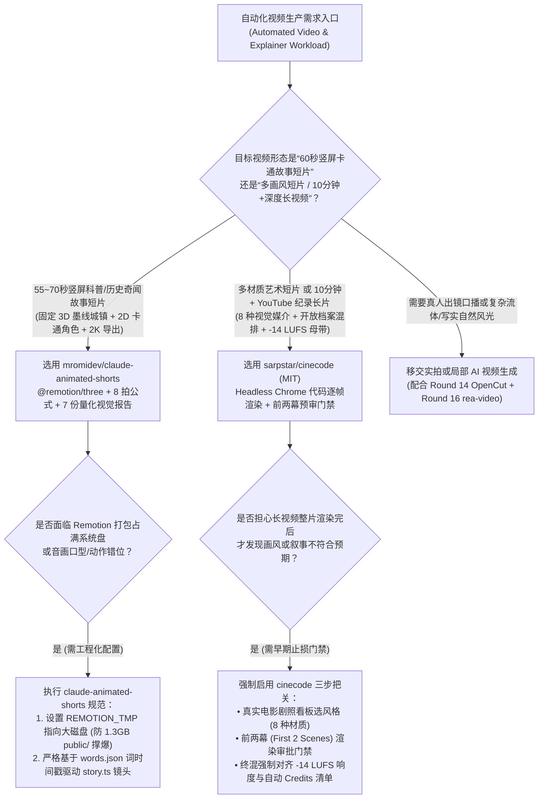

# 程序化代码成片与 2.5D 故事短视频选型 FAQ：`mromidev/claude-animated-shorts` + `sarpstar/cinecode` vs 视频生成模型抽卡与手工 AE 动效

> **文档定位**：面向 AI Solution Architect（AI 解决方案架构师）、技术布道视频制作团队与自动化内容工程负责人的第一性原理选型指南。聚焦 `2026-11-09` GitHub 新仓黑马爆发榜（Track B）同日崛起的“用代码逐帧写电影（Films Made with Code）”双雄——**`mromidev/claude-animated-shorts`**（MIT，Track B **#B21**，建仓 8 天揽下 **2,542 Stars** 搜索快照 / **2,578 Stars** 实时 API，日均斜率 **`318 Stars/day`**，`stars_today = not_measured`）与 **`sarpstar/cinecode`**（MIT，Track B **#B28**，建仓 6 天揽下 **1,829 Stars** 搜索快照 / **1,874 Stars** 实时 API，日均斜率 **`305 Stars/day`**，`stars_today = not_measured`），深度拆解如何通过 **“Three.js + Remotion 2.5D 竖屏叙事管线（7 份量化视觉报告 + `words.json` 词级对齐）+ Headless Chrome 8 材质代码电影引擎（前两幕预审门禁 + `-14 LUFS` 广播级混音）”** 彻底告别昂贵且不可控的 AI 视频生成抽卡。
>
> **阅读导航**：[English Version (`animated-shorts-cinecode-programmatic-video-selection-faq.en.md`)](./animated-shorts-cinecode-programmatic-video-selection-faq.en.md) · [2026-11-09 全景日报](../daily/2026-11-09.md) · [返回雷达首页](../README.md)

---

## 📌 1. 核心结论速览（Executive Summary）

1. **一句话本质定义**：
   - **`mromidev/claude-animated-shorts`（TypeScript + `@remotion/three` + Python + FFmpeg，MIT）** 是专为制作 **55–70 秒爆款竖屏 2.5D 科普/历史故事短片（“彩色 3D 世界里的 2D 墨线卡通角色”）** 打造的 Claude Code Skill。它不调用任何 AI 视频生成大模型，全部在本机通过 Three.js + Remotion 逐帧渲染并输出 **2K 竖屏成片（`1440x2560`，`--scale 1.3333`）**；仓库内置从 20 部爆款短片（`1,200` 帧接触表 + `38` 张全尺寸参考帧）实测提炼的 **7 份量化视觉报告（运动、景深、材质、角色、灯光、墨线、调色）** 与 **8 拍叙事公式（`~3.7 词/秒`，严格绑定 `words.json` 词级时间戳）**。
   - **`sarpstar/cinecode`（Python + Three.js + Headless Chrome + FFmpeg，MIT）** 是面向**多画风艺术短片、广告、代码解说以及 10 分钟以上 YouTube 深度纪录片**的全栈代码制片引擎。Coding Agent 负责考证史料（每处事实附带出处）、编写分幕剧本、在无头 Chrome 中用代码构建每一帧（涵盖 3D 真实光影、2D 动画、油画、墨水、剪纸、粘土、动态图形、像素艺术 8 种媒介，以及自动绘制的地图与计数器），并通过**前两幕早期审批门禁（First-Two-Scenes Approval Gate）** 与 **`-14 LUFS` 广播级母带响度标准化**直接交付 `.mp4` 成片。
2. **核心架构洞察（为什么科普/叙事类视频用 Sora/Runway 抽卡是典型的“方向性错误”？）**：
   - **痛点一（视频扩散模型按秒烧钱、文字乱码且无法做精确科学类比演示）**：用商业 Text-to-Video API 制作 10 分钟（600 秒）技术解说或 67 秒共振物理故事（如 1831 年布劳顿吊桥因 74 名士兵齐步走引发共振坍塌），不仅按 `4.0 倍` 废片率每秒消耗 `$0.15` 算力费，而且扩散模型画不出精确的摆锤共振频率、自绘历史地图或数据计数器。代码渲染（Three.js + Remotion / Headless Chrome）**视频生成 API 成本为 `$0.00`、100% 帧级可复现、改一句台词只需改一行 `story.ts` 局部重渲**。
   - **痛点二（AI 写长视频脚本极易套路化同质、整片渲染完才发现画风不对）**：`cinecode` 引入了**历史去重与跨界碰撞机制**（将用户点子与随机抽取的博物馆藏品/历史发明交叉，并比对历史已做影片防重复）以及**前两幕预审门禁（先看并批准前两幕画面再建整部片子）**；`claude-animated-shorts` 则用 **7 份实测视觉报告 + 38 张标准帧比对** 锁死成片质感。
3. **30 秒选型口诀**：
   - 需要制作 **55–70 秒抖音/Shorts/Reels 竖屏科普、历史奇闻、物理原理故事短片（2D 卡通人物在 3D 城镇中演绎 + 墨线景深）** → 选 **`mromidev/claude-animated-shorts`**。
   - 需要制作 **10 分钟以上横屏 YouTube 深度技术/历史纪录片、多材质艺术短片（版画/粘土/3D/自绘地图）或带完整考证引用的解释性长视频** → 选 **`sarpstar/cinecode`**。

---

## 🎯 2. 架构师灵魂拷问（Q1 / Q2 / Q3 First-Principles Deep Dive）

### Q1：`mromidev/claude-animated-shorts` 是如何仅靠 `@remotion/three` 代码和 `words.json`，在本地 PC 上复刻出百万播放级 2.5D 动画短片的？

拆解 `mromidev/claude-animated-shorts` 的 `SKILL.md`、`templates/bridge/`（67 秒代表作《The Bridge That Fell for a Song》源码）与 `references/STYLE_BIBLE.md`，其工程管线由四大确定性支柱构成：

1. **支柱一：8 拍叙事节拍器（8-Beat Story Formula，`~3.7 words/s`）**：
   - 严格规定 55–70 秒剧本必须遵循 8 个节拍：① **Hook**（一句荒诞但真实的物理因果，如“74 名士兵仅靠走路就踏垮了一座铁桥”）→ ② **Setting**（年份、地点与骄傲感）→ ③ **Action**（3–4 拍递进升级）→ ④ **Snap**（崩塌瞬间）→ ⑤ **Deadpan double line**（冷面双关“幸运的是……/不幸的是……”）→ ⑥ **Explanation**（用荡秋千等日常类比讲透一个物理概念）→ ⑦ **Consequence**（由此催生的工程铁律）→ ⑧ **Callback twist**（首尾呼应反转），且严守“画面已展示的内容绝不在台词里废话赘述”。
2. **支柱二：`words.json` 词级时间轴驱动的 `story.ts` 镜头编排**：
   - 先生成或录制 `voice.wav` 并提取词级时间戳 `words.json`；在 `story.ts` 中，所有镜头数组 `SHOTS`（起止帧 `a/b`、昼/金时刻光照、人群模式、故事时间 `tau`）、转场 `XFADE`、Hook 后的白闪 `FLASH_AT` 以及平滑轨移相机函数 `CAMS` 全部精确对齐到 `words.json` 的毫秒级词边界。
3. **支柱三：7 份实测视觉报告与 1,200 帧接触表 QA（`references/`）**：
   - 提供了对 20 部标杆短片实测得出的 7 份量化报告（`motion`、`depth`、`textures`、`characters`、`lighting`、`outlines`、`grade`）及 `38` 张 `540x960` 标准帧。Agent 渲染静态帧后必须对照报告自检墨线粗细、景深模糊与色调。
4. **支柱四：标准混音配比与 2K 竖屏超采导出**：
   - 合成音效与进行曲配乐（`templates/audio/`）严格执行 **配乐 `+3 dB`、音效 `-6 dB`、人声 `0 dB`（带自动闪避 Ducking）**；最终在 `1080x1920` 基础上以 `--scale 1.3333` 渲染输出 **`1440x2560`（2K 竖屏）**，并通过环境变量 `REMOTION_TMP` 将每次打包复制的 `~1.3 GB` `public/` 临时目录指向大容量磁盘防止系统盘爆满。

### Q2：`sarpstar/cinecode` 是如何支撑 10 分钟以上长视频的“事实考证 + 档案/代码混排 + 前两幕审批 + `-14 LUFS` 母带交付”的？

查看 `sarpstar/cinecode` 的 `README.en.md`、`SKILL.md`、`styles/` 与 `scripts/`，它解决了程序化长视频制作的三个核心痛点：

1. **防同质化创意碰撞与历史去重（Anti-Cliché & Deduplication）**：
   - 当用户输入一句话想法时，Agent 不会直接生成平庸的第一反应剧本，而是先从真实世界知识库（博物馆文物、古发明、太空照片、历史遗迹、传统工艺）中抽取跨界锚点进行碰撞，并强制比对本地已制作影片库防止自我重复。
2. **情绪看版（Look-Board）与“前两幕早期审批门禁（2-Scene Early Approval Gate）”**：
   - 用户从 8 种代码视觉媒介（真实光照 3D、2D 动画、油画、水墨、剪纸、粘土、Motion Graphics、像素画）及真实电影剧照看板中选定基调后，Agent **仅先构建并渲染前两幕（First Two Scenes）供用户审阅拍板**，批准后才全量构建整部影片，把返工扼杀在摇篮期。
3. **长片分幕考证、开放档案混排与 `-14 LUFS` 响度母带**：
   - 在 10 分钟以上的 YouTube 纪录片模式（Film Mode）下，剧本按幕（Acts）与章节（Chapters）组织：每一条关于真实人物或事件的断言都附带来源引用；有现成开放档案照片/地图的地方直接引用并自动生成 `credits` 署名文件，没有现成画面的地方则用代码实时生成自绘地图、动态计数器与三维重建场景；最终音频通过 FFmpeg 管线统一标准化至 **`-14 LUFS`**（YouTube 标准响度）并注入专属人声滤波器处理。

### Q3：在内容工程与架构演示中，何时选 `mromidev/claude-animated-shorts`，何时选 `sarpstar/cinecode`？

- **制作 60 秒左右的竖屏故事型科普/技术典故短视频（统一“3D 场景 + 2D 墨线卡通小人”IP 形象）** → 选 **`mromidev/claude-animated-shorts`**（基于 React/Remotion 生态，组件复用极强）。
- **制作多样性画风的艺术短片、产品宣传片，或 10 分钟以上包含大量真实历史档案、自绘地图与数据图表的横屏长视频** → 选 **`sarpstar/cinecode`**（基于 Headless Chrome + FFmpeg + 8 大视觉材质库）。

---

## 🧭 3. Mermaid 选型决策树与双引擎渲染时序图（Decision Tree & Architecture Flow）

### 3.1 程序化代码视频引擎选型决策树

### 3.2 `claude-animated-shorts` 与 `cinecode` 代码渲染流水线时序图

```mermaid
sequenceDiagram
    autonumber
    participant User as 创作者 / 架构师
    participant Agent as Claude Code / Cursor Agent
    participant CAS as claude-animated-shorts<br/>(@remotion/three + words.json)
    participant CC as sarpstar/cinecode<br/>(Headless Chrome + 8 Styles)
    participant FF as 本地 FFmpeg 混音与母带管线<br/>(+3dB/-6dB Ducking & -14 LUFS)

    rect rgb(35, 22, 12)
    Note over User,FF: 路径一：55-70s 竖屏 2.5D 故事短片 (claude-animated-shorts)
    User->>Agent: 1. 输入主题 (如：1831 年士兵齐步走踏垮吊桥的共振故事)
    Agent->>CAS: 2. 撰写 8 拍剧本 (~3.7 词/秒) 并生成 voice.wav + 词级时间戳 words.json
    CAS->>CAS: 3. 在 story.ts 中编排 SHOTS / XFADE / FLASH_AT / CAMS (配置 REMOTION_TMP)
    CAS->>CAS: 4. 渲染静态帧并对照 7 份量化报告 & 38 张 540x960 参考帧执行 QA 自检
    CAS->>FF: 5. 执行 2K 竖屏超采渲染 (1440x2560, --scale 1.3333) + 配乐(+3dB)/SFX(-6dB) 混音
    end

    rect rgb(32, 14, 36)
    Note over User,FF: 路径二：多画风短片与 10 分钟+ 深度长视频 (sarpstar/cinecode)
    User->>Agent: 6. 输入一句话主题并从 8 种材质看板选定画风 (3D/版画/水墨/粘土等)
    Agent->>CC: 7. 史料考证 (每处断言附出处) + 先构建并渲染前两幕 (First 2 Scenes)
    CC-->>User: 8. 用户审阅并批准前两幕画面 (2-Scene Early Approval Gate)
    CC->>FF: 9. Headless Chrome 逐帧渲染全片 (混排开放档案与自绘地图) + -14 LUFS 母带交付
    end
```

---

## 📊 4. 同类视频制作方案核心能力对比矩阵（Comparison Matrix）

| 评估维度 | `mromidev/claude-animated-shorts` (`MIT`) | `sarpstar/cinecode` (`MIT`) | 商业文生视频大模型抽卡（Sora / Runway / Kling API） | 传统手工 After Effects / Blender 制作 |
| :--- | :--- | :--- | :--- | :--- |
| **核心渲染技术栈** | **React `@remotion/three`（3D 城镇 + 2D 墨线角色）+ FFmpeg** | **Three.js / Canvas 8 大材质着色器 + Headless Chrome + FFmpeg** | 云端扩散トランスフォーマー黑盒生成像素 | 纯人工关键帧 K 动画与手动合成 |
| **视频生成 API 账单** | **`$0.00 / 秒`**（100% 本地 PC 渲染） | **`$0.00 / 秒`**（100% 本地无头浏览器渲染） | **极贵**：约 `$0.15/秒`，算上 4 倍废片重抽高达 **`$0.60/成片秒`** | 无 API 费，但极度消耗高薪动画师工时 |
| **精确图表/地图/物理演示** | **极强**：可通过 Three.js 数学函数精确控制桥梁共振振幅与摆锤频率 | **极强**：原生支持自绘地图、动态计数器、架构图与开放历史档案混排 | **极差**：文字乱码、数字跳变、科学规律严重失真 | 准确但每改一处数据需重新手动拉关键帧 |
| **质量门禁与防翻车机制** | **7 份实测视觉报告 + 38 张参考帧 + 1,200 帧接触表逐帧比对** | **前两幕早期审批门禁（First-2-Scenes Gate）+ 历史作品去重** | 只能整条抽卡完再看，风格漂移需整条作废重抽 | 依赖人工分镜脚本评审 |
| **音频混音与响度工程** | 程序化合成进行曲/SFX，固定 **`+3 dB` 配乐 / `-6 dB` 音效 + 自动闪避** | 分幕配乐 + 人声滤波处理 + **`-14 LUFS` 广播级响度母带** | 多数无声或仅生成杂乱环境音，需后期重做全套声音 | 需专业音频工程师在 DAW 中手动混音 |

---

## 🧪 5. 定量 FinOps 算例与 7-Card 评测洞察（Closed-Form Quantitative Model）

### 5.1 封闭式月度程序化视频工作室成本算例（`synthetic (independently_reproduced=false)`）

> **口径声明**：本算例为合成架构基准模型（`synthetic (independently_reproduced=false)`），用于量化对比 **Path A（商业文生视频扩散 API 4 倍抽卡 + 缺乏前两幕门禁导致的整片返工 + 手工对轨混音）** 与 **Path B（`mromidev/claude-animated-shorts` + `sarpstar/cinecode` 本地代码逐帧渲染流水线）**。可选的付费商业 TTS 配音 API（如 ElevenLabs 商业套餐）与本地工作站电费/SSD 硬件折旧均显式标记为 `not_measured`。

**基准工作负载设定**：
- **月度交付规模**：某技术内容与科普媒体工作室每月产出 **`24` 支 60 秒竖屏故事短片**（共 `1,440` 秒）与 **`8` 部 10 分钟横屏深度解说长片**（共 `4,800` 秒），月度成片总时长为 **`6,240` 秒（`104` 分钟/月，共 `32` 部视频）**。
- **单价与工时设定**：商业视频生成大模型按 **`$0.15 / 生成秒`** 计，平均需 **`4.0 倍` 抽卡比（Take Ratio）** 才能筛出可用镜头；代码生成与 QA 的文本/代码 LLM 成本平均为 **`$4.50 / 部视频`**；动效/音频工程师综合时薪按 **`$55.00 / 小时`** 计。

| 成本分项 | Path A：商业视频扩散抽卡 + 手工后期返工 | Path B：`claude-animated-shorts` + `cinecode` | 核心工程机制差异说明 |
| :--- | :--- | :--- | :--- |
| **1. 视频画面生成与代码编排成本（6,240 成片秒/月）** | **$3,744.00 / 月** （`6,240 秒` × `4.0 倍抽卡` = `24,960 秒` × `$0.15/秒`） | **$144.00 / 月** （本地 GPU 渲染 `$0` 视频 API 费；`32 部` × `$4.50` 代码 LLM 费） | Three.js + Remotion / Headless Chrome 本地代码渲染彻底免除按秒计费的视频扩散税（省 **96.2%**） |
| **2. 画风不符整片推翻重做工时成本（@$55/hr）** | **$1,760.00 / 月** （`25%` 即 `8 部` 画风跑偏重做 × `4.0 小时/部` = **`32.0 小时/月`**） | **$220.00 / 月** （前两幕预审门禁 + 7 份报告 QA，仅微调 **`4.0 小时/月`**） | `cinecode` 前两幕审批门禁与 `STYLE_BIBLE.md` 38 张参考帧比对拦截早期画风偏移 |
| **3. 词级音画对齐与 `-14 LUFS` 混音工时成本（@$55/hr）** | **$1,760.00 / 月** （`32 部` × `1.0 小时/部` 手工对字幕/压限混音 = **`32.0 小时/月`**） | **$220.00 / 月** （`words.json` 自动驱动 `story.ts` + `-14 LUFS` 自动母带 = **`4.0 小时/月`**） | 词级时间戳绑定与 FFmpeg 自动闪避/响度标准化，每月净省 **`28.0 小时`** 后期工时 |
| **4. 可选付费 TTS 配音与本地 PC 硬件折旧** | `not_measured` | `not_measured` | 外部商用配音订阅与本地存储/显卡折旧因团队配置而异，严禁捏造或归零 |
| **月度可建模总成本（Modeled Total）** | **$7,264.00 / 月** | **$584.00 / 月** | **月度净节省 `$6,680.00`（总成本直降 `-91.96%`，成本效率提升 `12.44x`，月省 `56.0 小时`）** |

### 5.2 关键工程与渲染不变量（Key Invariants）

- **`REMOTION_TMP` 临时盘空间不变量**：如 `mromidev/claude-animated-shorts` 文档所强调，每次 Remotion 打包渲染都会将 `public/` 目录（约 **`1.3 GB`**）完整拷贝至系统临时目录；批量渲染前必须显式配置环境变量 `REMOTION_TMP` 指向大容量数据盘，防止系统盘写满崩溃。
- **响度与声压级配比不变量**：`claude-animated-shorts` 强制锁定配乐 `+3 dB`、音效 `-6 dB` 与人声自动闪避（Ducking），而 `sarpstar/cinecode` 强制将长视频终混标准化至 **`-14 LUFS`** 并生成开放档案 `credits` 署名文件，确保持续集成产出的视频直接达到平台发布标准。

---

## 🛠️ 6. 生产落地核验清单（Actionable Production Checklist）

- [ ] **1. 挂载 `REMOTION_TMP` 大容量缓存目录**：在运行 `mromidev/claude-animated-shorts` 前，设置 `export REMOTION_TMP=/data/remotion-tmp`（预留 `>20 GB` 空间），应对每次 Bundle 复制 `~1.3 GB` `public/` 资产的开销。
- [ ] **2. 执行 `words.json` 手工微调与 8 拍字数密度门禁**：生成 `voice.wav` 与 `words.json` 后，先校验语速是否落在 **`~3.7 words/s`**（55–70 秒总长）且满足 8 拍结构，再将时间戳注入 `story.ts` 的 `SHOTS` 与 `CAMS`。
- [ ] **3. 运行 7 份量化视觉报告对比自检**：在导出 `--scale 1.3333`（`1440x2560` 2K）终片前，使用 `templates/scripts/` 导出静态接触表，与 `references/reports/`（墨线、景深、调色等 7 项指标）及 `38` 张标准帧进行并排核验。
- [ ] **4. 严格执行 `cinecode` 的“前两幕审批门禁（First-2-Scenes Gate）”**：使用 `sarpstar/cinecode` 制作长视频或艺术短片时，严禁让 Agent 直接一次性跑完 10 分钟渲染；必须先审阅并批准前两幕渲染样片与风格看板。
- [ ] **5. 校验长视频事实来源引用与 `-14 LUFS` 响度报告**：发布 `cinecode` 纪录长片前，核查剧本中所有历史/科学断言的引用来源、开放档案 `credits` 文件完整性以及 FFmpeg 终混输出的 `-14 LUFS` 响度指标。
