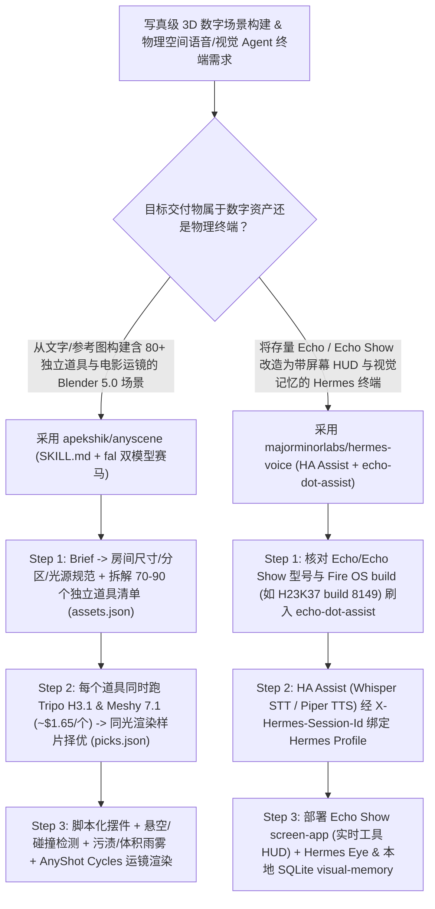

# 双模型赛马写真级 Blender 3D 场景构建技能（`apekshik/anyscene`）与 Echo Show 硬件级语音视觉 Agent 终端（`majorminorlabs/hermes-voice`）深度选型 FAQ

> **文档定位**：本专题是 **2026-11-11 夜班第 47 轮（累计第 92 篇）独立六段式选型指南**，严格对标 `ib-vs-ethernet-roce-selection-faq.md` 的通俗第一性原理与闭式 FinOps 核算规范，面向生成式 3D 数字资产管线（Generative 3D Pipeline）架构师与智能空间硬件交互（Ambient AI Hardware）工程负责人，深度拆解今日在脚本化 Blender 5.0 场景总装与闲置智能音箱改装赛道爆发的两大高赞开源仓：
> 1. **`apekshik/anyscene`（`361★`，Python / Blender 5.0+ Cycles + `fal.ai` Tripo H3.1 & Meshy 7.1 + `AnyShot` 摄影机系统）**：给它一段文字描述或 1–4 张参考图，AI Agent 按照 `SKILL.md` 与 `builder/CRAFT.md` 8 步门禁自动构建一个包含 **74～86 个独立 3D 道具模型、碰撞与悬空检测（Floating-prop check）、做旧污渍/贴花、真实体积雾/雨滴/蒸汽与电影级推焦运镜（Rack Focus）** 的完整 Blender Cycles 场景——每个道具同时跑 **`Tripo H3.1` 与 `Meshy 7.1` 双模型同光渲染赛马（`picks.json`）**，甚至支持在 Serverless GPU 上不到 2 小时无人值守构建整座巴黎面包房！
> 2. **`majorminorlabs/hermes-voice`（`670★`，Python / Home Assistant Assist + `echo-dot-assist` + Echo Show 全屏屏显与 `Hermes Eye` 视觉记忆）**：把闲置的旧款 Amazon Echo / Echo Show（经验证支持 `RS03QR`、`D9N29T`、`H23K37` build `8149` 等 8 款机型）刷入 `echo-dot-assist` 后，直接变成 **NousResearch `Hermes Agent`（保有独立 `SOUL.md`、长期记忆与工具链）的桌面级全屏语音+视觉分身**——屏幕实时流式展示识别文本、正在调用的工具与后台任务，更内置带硬件 `REC` 指示灯的 `Hermes Eye` 摄像头与本地 SQLite + `qwen3.6` 驱动的 **`visual-memory`（回答“房间里什么变了？”“我上次把东西放哪了？”并同屏展示前后对比图）**！
>
> **English Version**: [anyscene-hermes-voice-blender-3d-scene-echo-show-agent-selection-faq.en.md](anyscene-hermes-voice-blender-3d-scene-echo-show-agent-selection-faq.en.md) · **架构总结图**: [`assets/github-ai-radar-2026-11-11-r47-anyscene-hermesvoice.svg`](../../../assets/github-ai-radar-2026-11-11-r47-anyscene-hermesvoice.svg)

---

## 📌 一、核心结论速览（Executive Summary）

1. **一句话大白话讲透这两个项目到底解决了什么痛点？**
   - **终结“AI 生成单个 3D 白模还行、但拼不出带 80 个道具、真实灯光、不悬空穿模的完整写真级 Blender 房间”的痛点（`apekshik/anyscene`）**：以前做 3D 场景要么靠美术手工建模摆件几周，要么生成的整体网格糊成一团根本没法单独移动道具或打光。`AnyScene` 让 Claude Code 按 `SKILL.md` 走完 8 步工业流水线：先拆出 70–90 个独立道具清单（`assets.json`），每个道具先生成参考图，再**同时送进 `Tripo H3.1` 和 `Meshy 7.1` 生成两个 3D 模型（单道具成本约 `$1.65`）**，在完全相同的灯光下渲染出对比样片（Contact Sheet），由 Agent 择优录取（记录进 `picks.json`）；接着用纯脚本搭建房间外壳、从大件家具到桌面杂物逐层摆放并执行**自动碰撞与悬空检测（Floating-prop check）**，最后加上做旧污渍、去商标、体积雨雾和 `AnyShot` 手持运镜！
   - **终结“买新 AI 硬件盒子贵且封闭、而树莓派 DIY 麦克风阵列回声消除差且没有屏幕和视觉记忆”的痛点（`majorminorlabs/hermes-voice`）**：二手市场上百元级的 Amazon Echo Show 拥有极佳的远场麦克风阵列、音箱与触控屏，但被锁死在 Alexa 云端。`hermes-voice` 基于 `echo-dot-assist` 保留 Fire OS 底层硬件音频处理，将其接入 Home Assistant Assist 并通过固定 `X-Hermes-Session-Id` 直连你的 **`Hermes Agent`**——你在跟它说话时，Echo Show 屏幕实时跟进显示听到的句子、正在调用的 Agent 工具，空闲时展示后台任务；开启 `Hermes Eye` 与本地 SQLite `visual-memory` 后，它还能用摄像头记住房间状态，随时回答“我上次把钥匙放哪了？”并在屏幕上弹出前后对比照片！
2. **闭式 FinOps 投资回报结论（`CLAIM-20261111-R47-ANYSCENE-HERMESVOICE`）**：
   - 以 10 人数字内容与智能空间工程团队每月制作 **8 个含 80+ 独立道具的写真级 Blender 3D 场景** 与运营 **25 台房间级全天候语音/视觉 AI 硬件终端** 为基准（高级 3D 技术美术/IoT 系统工程师含税费率 `$90.00/hr`；二手 Echo Show 硬件购置费与本地渲染显卡硬件折旧：`not_measured`）：
   - 从 **Path A（人工 Blender 建模摆件打光 + 商业云语音助手/单模型 3D 盲盒抽卡重跑，月均 `$6,060.00`）** 升级至 **Path C（`AnyScene` 双模型赛马与脚本化 8 门禁组装 + `Hermes Voice` Echo Show 本地 Whisper/Piper/Ollama 视觉记忆终端，月均 `$790.00`）**，每月净省 **`$5,270.00/mo`（降幅 `-86.96%`，年省 `$63,240.00/yr`）**，并将 3D 场景总装与智能终端排障工时从 `48.0 hrs/mo` 压缩至 `5.0 hrs/mo`（节省 **`-89.58%`**）。

---

## 🎯 二、三大灵魂拷问（Q1 / Q2 / Q3 深度原理解析）

### Q1：`apekshik/anyscene` 是如何用 `Tripo H3.1` vs `Meshy 7.1` 双模型赛马、8 道样片门禁与代码化 `.blend` 造出东京修表铺和巴黎面包房的？
- **第一性原理拆解**：
  1. **每个道具独立成模 + 双模型同光赛马（`picks.json`）**：
     - 拒绝“整个房间生成一个不可编辑的大 Mesh”：东京凌晨 1 点电子维修店含 **86 个独立生成道具**、拉面店 **74 个**、香港大排档 **78 个**。每个道具都通过 `fal` 同时调用 `Tripo H3.1` 与 `Meshy 7.1`（1 张图 + 2 个 3D 模型合计约 `$1.65/prop`，90 道具场景约 `$150`），在统一光照下渲染对比图，由 Agent 按 `builder/CRAFT.md` 挑选几何与贴图更优者并把理由写入 `picks.json`。
  2. **脚本化摆件、悬空/穿模检查与体积氛围营造**：
     - 整个 `.blend` 文件是**由构建脚本确定性生成的编译产物**（Git 仓库只存轻量的 `assets.json`、`picks.json`、`shots.json` 与脚本，告别几十 GB 二进制入库难题）；自动执行碰撞与悬空道具检测（Floating-prop check），并叠加污渍（grime）、贴花（decals）、实用光源、薄雾/蒸汽与 `AnyShot` 变焦/手持漫游镜头。
  3. **支持本地交互门禁或 Serverless 无人值守（`<2 小时`）**：
     - 既可在本地 Claude Code 中逐门禁（概念图 → 道具选型 → 白模布局 → 打光静帧 → 镜头预览）把关，也可一键部署 `fal deploy builder/app.py::SceneBuilderApp` 在云端 Worker 上从单张参考图全自动生成完整 `.blend` / `.glb`（如巴黎 `Maison Roussel` 面包房耗时不到 2 小时）。

### Q2：`majorminorlabs/hermes-voice` 是如何打通 Echo Show 硬件解锁、Home Assistant Assist 与 `Hermes Visual Memory` 的？
- **第一性原理拆解**：
  1. **严格的固件版本前置核验（8 款 Echo / Echo Show 兼容表）**：
     - 亚马逊部分新固件封堵了 bootloader 解锁（例如一代 Echo Show 5 `H23K37` 在 Fire OS `6575.1` build `8848` 被封堵，而 build `8149` 可正常解锁；三代 Echo Dot 仅支持 `D9N29T`）。项目给出了精确到型号标签与 build 号的采购核验表，刷入 `echo-dot-assist` 后完整保留 Echo 原生硬件级远场降噪与音频管线。
  2. **`X-Hermes-Session-Id` 会话保持 + Echo Show 全屏 Web HUD（`screen-app`）**：
     - `custom_components/hermes_voice` 将每次唤醒对话通过稳定的 `X-Hermes-Session-Id` 转发给指定 Hermes Agent Profile（保留其 `SOUL.md` 人格、长期记忆与工具），流式清洗文本提前触发 TTS 播报；Echo Show 上的 `screen-app` 实时展示听写内容、流式回复、当前调用的 MCP/工具卡片以及空闲时的后台任务状态。
  3. **带硬件 `REC` 标志的 `Hermes Eye` 与本地 SQLite 前后对比视觉记忆**：
     - 默认关闭、仅在显式开启并使用自有签名密钥构建时激活 `eye-app`（屏幕强制显示 `REC` 录制徽章），为语音 Profile 提供 `look` 视觉工具；配套 `extras/visual-memory` 将画面存入本地 SQLite，结合本地 `qwen3.6`（Ollama）或 Codex CLI 回答“哪里变了？”并在 Echo Show 屏幕上直接弹出 Before/After 对比图！

### Q3：AI 架构师如何将这两个项目应用到数字孪生与智能办公/展厅场景？
- **黄金组合落地范式**：
  - 用 **`apekshik/anyscene`** 快速为智能展厅、工业巡检仿真或游戏/影视预演批量生成带 80+ 独立可交互道具的 Blender 5.0 物理级 3D 场景（导出 `.glb` 或 Cycles 漫游视频）；
  - 用 **`majorminorlabs/hermes-voice`** 将低成本 Echo Show 部署为实验室/机房/办公桌面的 **Hermes 实体语音+视觉哨兵终端**，实时看管物理空间变化并播报后台 Agent 研发进度！

---

## 🧭 三、Mermaid 选型决策树与“3D 场景总装 + 实体终端交互”流水线

---

## 📊 四、同类方案核心能力对比矩阵（Selection Matrix）

| 评估维度 | Path A：纯手工 Blender 建模 + 商业闭源智能音箱 | Path B：单模型文生 3D 脚本 + 树莓派无屏麦克风 | **Path C（推荐）：`AnyScene` + `Hermes Voice`** |
| :--- | :--- | :--- | :--- |
| **3D 道具幾何质量与可编辑性** | 手工建模 80 个道具需数周时间 | 单一 3D 模型盲盒抽卡常出现破面；或整体 Mesh 无法单拆 | **`Tripo H3.1` + `Meshy 7.1` 双模型同光赛马，80+ 独立道具可重生成** |
| **物理摆放合理性与光影质感** | 全靠美术肉眼调位置、手刷贴图 | 道具严重穿模或半空悬浮，缺乏体积雾与做旧细节 | **自动碰撞/悬空检测 + 脚本化污渍/雨雾/实用灯 + 8 道样片门禁** |
| **物理空间语音交互与屏显反馈** | 锁死在厂商闭源云端，无法调本地 Coding Agent 工具 | 只有语音没有屏幕，看不见 Agent 正在调什么工具 | **复用 Echo 硬件降噪，Echo Show 全屏实时显示字幕、工具与后台任务** |
| **房间级视觉记忆（Visual Memory）** | 云端摄像头隐私风险高且按月收订阅费 | 无视觉对比记忆能力 | **带 `REC` 标识的 `Hermes Eye` + 本地 SQLite/`qwen3.6` 前后画面对比** |
| **月度总拥有成本（8 场景 + 25 终端）** | **`$6,060.00 / mo`**（`$1,740` API/重跑 + `$4,320` 人工） | **`$3,040.00 / mo`**（`$880` 算力 + `$2,160` 人工） | **`$790.00 / mo`（净省 `$5,270.00/mo` · `-86.96%`）** |

---

## 🧪 五、定量 FinOps 算例与 7-Card 洞察（`CLAIM-20261111-R47-ANYSCENE-HERMESVOICE`）

### 5.1 测算基准与显式边界（Scope & Boundaries）
- **场景设定**：10 人数字孪生内容与智能空间工程团队，每月构建 **8 个含 80+ 独立道具的写真级 Blender 3D 场景**，并维护 **25 台房间级全天候语音/视觉 Agent 终端**。
- **费率假设**：高级 3D 技术美术与 IoT 系统工程师全包时薪 **`$90.00 / hr`**。
- **显式边界声明（Explicit Not-Measured Boundary）**：二手 Echo / Echo Show 终端一次性硬件采购成本与本地 Cycles 渲染 GPU 显卡折旧标记为 **`not_measured`**，本表核算 3D 生成 API、语音/视觉推理算力与工程师建模/集成工时。

### 5.2 三路径月度成本闭式对照表

| 成本分项 | Path A：手工建模摆件 + 商业云语音/视觉 API | Path B：单模型 3D 抽卡 + 无屏树莓派套件 | **Path C：`AnyScene` + `Hermes Voice`（推荐）** |
| :--- | :--- | :--- | :--- |
| **3D 资产生成（`fal`）与语音/视觉推理开销** | **`$1,740.00`**（盲目重绘浪费 + 云端语音计费） | **`$880.00`** | **`$340.00`**（`$1.65/prop` 精准赛马 + 本地 Whisper/Piper/Ollama） |
| **3D 摆件穿模修复、打光渲染与终端集成工时（`$90/hr`）** | `48.0 hrs × $90.00` = **`$4,320.00`** | `24.0 hrs × $90.00` = **`$2,160.00`** | `5.0 hrs × $90.00` = **`$450.00`** |
| **月度总成本（Monthly TCO）** | **`$6,060.00 / mo`** | **`$3,040.00 / mo`**（`-49.83%`） | **`$790.00 / mo`** |
| **相对 Path A 净节省** | 基准线（Baseline） | 净省 `$3,020.00 / mo` | **净省 `$5,270.00 / mo`（`-86.96%` · 年省 `$63,240.00/yr`）** |
| **二手 Echo 硬件购置与渲染显卡硬件折旧** | `not_measured` | `not_measured` | `not_measured` |

---

## 🛠️ 六、生产级落地核验 Checklist

- [ ] **1. `AnyScene` 环境与 `FAL_KEY` 预算日志配置**：安装 Blender 5.0+、Node 20+、`uv` 与 `ffmpeg`（NVIDIA GPU 使用 `h264_nvenc`），配置 `FAL_KEY` 并检查 `generate/` 目录下的本地消费账本（约 `$1.65/prop`）。
- [ ] **2. 8 道样片门禁（Contact Sheet Gates）与悬空检测强制执行**：在 Claude Code 执行 `SKILL.md` 时，严格核查概念图、`Tripo H3.1` vs `Meshy 7.1` 同光对比样片（`picks.json`）、白模悬空检测（Floating-prop check）与 Cycles 镜头预览。
- [ ] **3. Echo / Echo Show 型号与 Fire OS 版本前置验机**：采购或解锁设备前，严格对照兼容表核验型号与当前 Fire OS build（如确认 `H23K37` 为 build `8149` 而非封堵解锁的 `8848`，且解锁前保持断网）。
- [ ] **4. Home Assistant `hermes_voice` 与 `X-Hermes-Session-Id` 联调**：部署 `custom_components/hermes_voice` 与 Echo Show `screen-app`，验证多轮语音对话保持同一 Hermes Profile 会话且屏幕实时刷新工具调用卡片。
- [ ] **5. 自有密钥签名 `Hermes Eye` 与本地 SQLite `visual-memory`**：使用自有签名密钥编译安装 `eye-app`（确保拍照/录像时屏幕常亮 `REC` 标志），并将 `extras/visual-memory` 对接本地 Ollama `qwen3.6` 测试前后画面变化问答。
