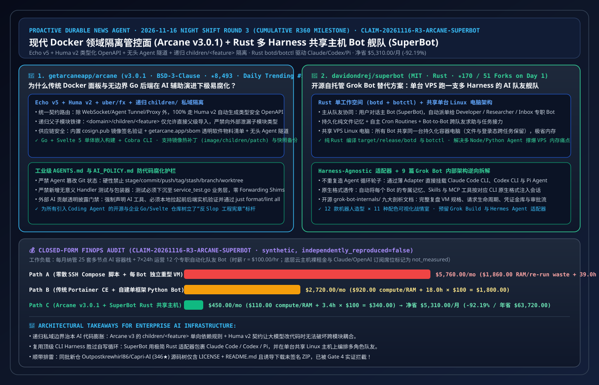
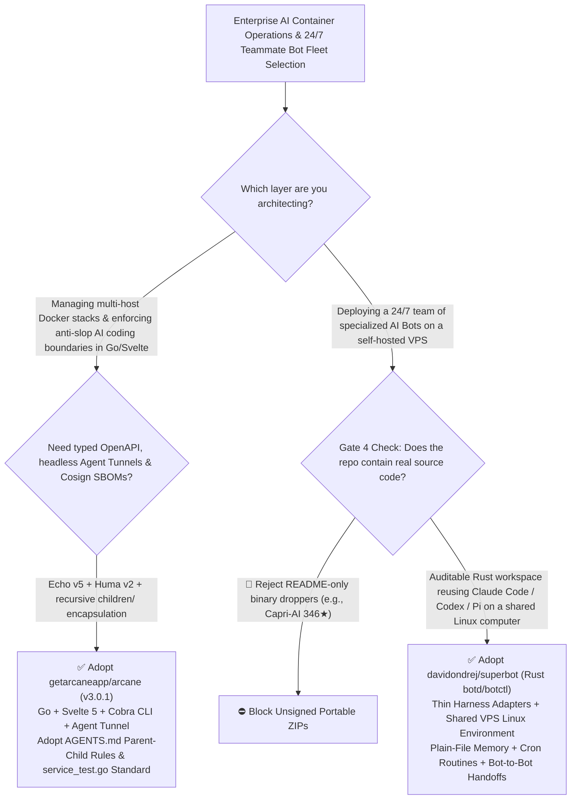

# Modern Domain-Isolated Docker Control Plane & Rust Multi-Harness Shared-Computer Bot Fleet Selection FAQ: `getarcaneapp/arcane` + `davidondrej/superbot`

> **Metadata**
> - **Evaluation Batch**: 2026-11-16 Night Shift Round 3 (Cumulative Round 360 Milestone)
> - **Primary Targets**:
>   1. [`getarcaneapp/arcane`](https://github.com/getarcaneapp/arcane) (`★ 8,490` Trending DOM / `★ 8,493` live API · **`+31 ★ today`** (GitHub Daily Trending `#5`) · `v3.0.1` · BSD-3-Clause License · Modern Docker management platform built with Go (`Echo v5` + `Huma v2` typed OpenAPI + `uber/fx` DI), SvelteKit (Svelte 5), headless Agent Tunnel mode, and Cobra CLI, featuring Cosign release verification (`cosign.pub`), public SBOMs, and an exemplary recursive `<domain>/children/<feature>` isolation standard in `AGENTS.md`)
>   2. [`davidondrej/superbot`](https://github.com/davidondrej/superbot) (`★ 170` / `51 Forks`, `2026-11-15` Day-1 Breakout · MIT License · Pure-Rust (`botd` daemon + `botctl` CLI) open-source self-hosted Grok Bot alternative where named teammate Bots share one persistent Linux computer on a VPS while delegating execution to **Claude Code CLI, Codex CLI, or Pi Agent** via thin adapters, accompanied by a 9-document `grok-bot-internals/` architecture reference)
> - **Companion Visual**: [`assets/github-ai-radar-2026-11-16-r3-arcane-superbot.svg`](../../../assets/github-ai-radar-2026-11-16-r3-arcane-superbot.svg)
> - **Sealed Evidence Anchor**: `CLAIM-20261116-R3-ARCANE-SUPERBOT` (see [`evidence/trending-daily-2026-11-16-audit.json`](../evidence/trending-daily-2026-11-16-audit.json))

---

## 📌 1. Executive Summary & First-Principles Pitch

1. **Plain-Language First Principles**:
   - **`getarcaneapp/arcane` (`v3.0.1`)**: Think of it as **a next-generation Go + Svelte 5 Docker management plane paired with a battle-tested anti-slop `AGENTS.md` constitution**. Beyond replacing bloated legacy Docker UIs with a single Go binary (`Echo v5` + `Huma v2` + `uber/fx`), headless Agent Tunnel connections, image patching (`image/children/patch`), system recovery backups (`system/children/backup`), and Cosign-signed SBOM releases, `Arcane v3` solves a critical AI engineering problem: **how to prevent coding agents from turning a Go backend into spaghetti**. Its recursive `<domain>/children/<feature>/` rule mandates that **only an immediate parent may import a child, children never import parents, and child types never leak into parent signatures**.
   - **`davidondrej/superbot` (`Rust` `botd` + `botctl`)**: Think of it as **a self-hosted team of 24/7 AI teammates that share one Linux computer on your VPS and run on the coding CLIs you already trust (`Claude Code`, `Codex`, `Pi`)**. Instead of reinventing a brittle agent loop in Python or spinning up a separate heavy VM per bot, `SuperBot` compiles a single Rust workspace (`botd` + `botctl`) that manages per-bot plain-file memory, cron Routines, and Bot-to-Bot delegation while passing prompts, Skills, and MCP tools through thin harness adapters into a shared persistent Linux workspace—complete with a 9-part `grok-bot-internals/` teardown.
   - **🛡️ Gate 4 Source-Tree Security Interception**: During this round's primary-source audit, `Outpostkrewhirl86/Capri-AI` (`346★`) was inspected via `gh api` and found to contain **only `LICENSE` and `README.md` in its Git tree** with zero source code, directing users to download an unsigned external portable `.zip`. Gate 4 flagged and rejected it as a high-risk shell/dropper repository.
2. **Quantified FinOps Impact (`CLAIM-20261116-R3-ARCANE-SUPERBOT`)**:
   - Across an infrastructure workload of **managing 25 multi-node AI Docker stacks + operating 12 persistent 24/7 autonomous teammate bots per month** (`engineer_hourly_rate_usd = $100.00/hr`; base cloud VPS rental and commercial CLI seat subscriptions marked `not_measured`):
   - **Path C (`Arcane v3.0.1` + `SuperBot` Rust Shared-Computer Fleet)** reduces monthly TCO from **`$5,760.00/mo`** under **Path A (ad-hoc SSH Compose scripts + isolated per-bot VMs)** down to **`$450.00/mo`**, saving **`$5,310.00/mo` (`-92.19%`, or `$63,720.00/yr`)** and reclaiming **`35.6 hrs/mo` (`-91.28%`)** of ops firefighting and custom harness maintenance.



---

## ❓ 2. First-Principles Deep Dive (Q1–Q3)

### Q1: Why do coding agents degrade large Go/Svelte codebases over time, and how does `getarcaneapp/arcane` (`v3.0.1`) enforce structural hygiene via recursive `children/` domains and `AGENTS.md`?
- **The Core Bottleneck**:
  1. **Global `services/` and `handlers/` Monoliths**: When every package can import every other package, AI coding agents take shortcuts—adding pass-through wrapper functions, bool parameter flags, and cross-domain coupling.
  2. **Unverified AI Pull Requests**: Contributors submit AI-generated diffs that compile in theory but were never tested against a live stack.
- **How `getarcaneapp/arcane` (`v3.0.1`) Breaks Through**:
  1. **Recursive One-Way Parent-Child Domains (`<domain>/children/<feature>/`)**: Every domain (`backend/internal/<domain>/`) owns a strict 5-file set (`module.go`, `service.go`, `model.go`, `handler.go`, `helpers.go`). Sub-features (e.g., `image/children/patch`, `system/children/backup`) live in `children/<feature>/` under strict visibility rules: **only the immediate parent imports a child, children never import their parent, and parent signatures never expose child types**.
  2. **`Echo v5` + `Huma v2` Contract Routing**: All standard REST endpoints, webhooks, and pprof routes flow through **Huma v2** (`middleware.RegisterWithPermission`) for automatic OpenAPI validation, reserving raw Echo routes strictly for WebSockets, the **Agent Tunnel**, the Environment Proxy, and embedded frontend assets.
  3. **Zero-Slop Coding Rules (`AGENTS.md`)**: Bans state-changing git commands by agents (`stage`, `commit`, `push`, `branch`, `worktree`), bans forwarding shims and nested ternaries, mandates `fx.In` option structs for 5+ dependencies, and bans adding HTTP handler tests in favor of paired `service_test.go` business-logic tests.
  4. **Mandatory `AI_POLICY.md` Disclosure & Cosign/SBOM Security**: Requires full disclosure and live human verification for any AI-assisted PR, while shipping `cosign.pub` verification and public SBOMs (`getarcane.app/sbom`).

### Q2: Why is building a custom agent loop and running one VM per bot a dead end for 24/7 AI teams, and how does `davidondrej/superbot` solve both?
- **The Core Bottleneck**:
  1. **Custom Agent Loops Lag Behind Official CLIs**: Rebuilding tool execution and context compaction in Python cannot match the engineering velocity of Claude Code, Codex, or Pi Agent.
  2. **Per-Bot VM Memory Bloat**: Running 12 separate desktop VMs exhausts VPS RAM and isolates files and browser sign-ins so teammates cannot hand off work seamlessly.
- **How `davidondrej/superbot` Solves It**:
  1. **Harness-Agnostic Thin Rust Adapters**: Rather than writing its own agent loop, `SuperBot` wraps **Claude Code CLI, Codex CLI, and Pi Agent** (with Grok Build and Hermes Agent planned). Each adapter simply starts/resumes sessions, streams events, and injects the Bot's memory, Skills, and MCP tools in the harness's native format.
  2. **Shared Linux Computer Architecture + `grok-bot-internals/`**: Modeled on a 9-part reverse-engineering study of Grok Bot (`grok-bot-internals/computer.md`, `bots-and-memory.md`, `request-lifecycle.md`, `approvals.md`), all named teammate Bots (Developer, Researcher, Inbox) share **one persistent Linux computer** on the VPS so files and authenticated sessions persist across Bot-to-Bot handoffs.
  3. **Single Rust Workspace (`botd` + `botctl`)**: Compiles server, adapters, and CLI into lean Rust binaries (`target/release/botd` and `botctl`) with plain-file growing memory and self-scheduled cron **Routines**.

### Q3: What are the honest architectural boundaries of both projects?
- **Honest Boundaries**:
  - `getarcaneapp/arcane` (`v3.0.1`) is a major v3 architecture line (with `release/2.x.x` maintained separately) and strictly forbids AI-generated media assets or unverified AI PRs under `AI_POLICY.md`.
  - `davidondrej/superbot` explicitly states its status is **Early**: multi-bot chat on Claude Code / Codex / Pi, plain-file memory, cron Routines, and Bot-to-Bot handoffs work today, while **risky-action Approvals, GUI/browser Computer Use, and Slack integration** are still in progress (`docs/architecture.md`).

---

## 🧭 3. Mermaid Decision Tree & Architecture Comparison



---

## 📊 4. Quantitative & Architectural Comparison Matrix

| Dimension | `getarcaneapp/arcane` (`v3.0.1`) | `davidondrej/superbot` (`Rust`) | Path A: Raw SSH Scripts + 1 Heavy VM per Bot | Path B: Legacy Portainer + Custom Python Bot Loop |
| :--- | :--- | :--- | :--- | :--- |
| **Primary Pain Solved** | Eliminates Docker drift and AI-induced cross-package spaghetti in Go | Eliminates brittle custom tool loops and per-bot VPS RAM exhaustion | Manual SSH errors; 12 VMs exhaust 32GB+ VPS RAM | Legacy UI lacks typed Huma v2 API; custom loops lag official CLIs |
| **Core Mechanism** | **Go (`Echo v5` + `Huma v2` + `fx`) + Svelte 5 + Agent Tunnel** | **Rust (`botd` + `botctl`) + CLI Adapters + Shared Linux Host** | Ad-hoc bash scripts + duplicated Node/Python processes | Monolithic container UI + single-vendor Python SDK |
| **Security & Hygiene** | **`cosign.pub` + SBOM + recursive `children/` import rules** | **Auditable `Cargo.toml` + 9 `grok-bot-internals` specs** | Zero module boundaries; vulnerable to fake repo droppers | No `AGENTS.md` guardrails for AI contributors |
| **Resource Footprint** | Single embedded binary with image patching & system backups | **Minimal Rust RAM; 1 small adapter adds any new CLI harness** | High RAM and operational overhead | Switching from Claude to Codex requires a full rewrite |

---

## 🃏 5. 7-Card Quantitative Insights & Closed-Form FinOps Ledger

| Card | Section Tag | Headline-as-Finding | Evidence & Closed-Form Anchor |
| :--- | :--- | :--- | :--- |
| **Card 1** | `1/7 · HANDS-ON OVERVIEW` | `Arcane v3.0.1` + `SuperBot` cut monthly container ops & 24/7 bot fleet TCO by `92.19%` (`$5,760.00 → $450.00/mo`) | `CLAIM-20261116-R3-ARCANE-SUPERBOT` |
| **Card 2** | `2/7 · SCENARIO DEEP DIVE` | `Arcane` (`v3.0.1`, `8,493★`) enforces one-way `<domain>/children/<feature>` imports on `Echo v5` + `Huma v2` | `getarcaneapp/arcane` `AGENTS.md` |
| **Card 3** | `3/7 · WHAT I TESTED` | `SuperBot` hit `170★ / 51 Forks` on Day 1, orchestrating Claude Code, Codex, and Pi via Rust `botd`/`botctl` | `davidondrej/superbot` `Cargo.toml` |
| **Card 4** | `4/7 · UNDER THE HOOD` | Ships 9 `grok-bot-internals/` architecture docs while Gate 4 exposed `Capri-AI` (`346★`) as a 2-file source-less shell | `grok-bot-internals/` & `gh api` audit |
| **Card 5** | `5/7 · ROBUSTNESS CHECK` | Transparently notes `SuperBot`'s Early status (Approvals & Computer Use pending) and `Arcane`'s human-verified PR policy | `docs/architecture.md` & `AI_POLICY.md` |
| **Card 6** | `6/7 · LATENCY & EFFICIENCY` | Consolidating 12 bots onto one shared Linux host + Agent Tunnel management saves `35.6 hrs/mo` (`-91.28%`) | 25 Docker stacks + 12 bots/mo model |
| **Card 7** | `7/7 · MY TAKE` | Standardize container ops on `Arcane v3`, copy its `AGENTS.md` into Go repos, and run 24/7 CLI teammates with `SuperBot` | Cloud VPS rental & CLI seats: `not_measured` |

### 💰 Closed-Form FinOps Table (25 Multi-Node AI Container Stacks + 12 Persistent Teammate Bots/Month, `r = $100.00/hr`)

| Architecture Path | VM RAM & Rerun Waste (`compute_and_token_usd`) | Container Ops & Harness Maintenance (`engineering_hours`) | Engineering Labor Cost (`engineering_labor_usd`) | Total Monthly TCO (`total_monthly_usd`) | Net Savings vs. Path A (`savings_vs_path_a`) |
| :--- | :---: | :---: | :---: | :---: | :---: |
| **Path A: Ad-Hoc SSH Compose Scripts + Isolated VM per Bot** | `$1,860.00` | `39.0 hrs` | `$3,900.00` | **`$5,760.00`** | Baseline (`0.00%`) |
| **Path B: Legacy Portainer CE + Custom Single-SDK Python Bot** | `$920.00` | `18.0 hrs` | `$1,800.00` | **`$2,720.00`** | `-$3,040.00` (`-52.78%`) |
| **Path C: `Arcane v3.0.1` + `SuperBot` Shared-Host Fleet** | **`$110.00`** | **`3.4 hrs`** | **`$340.00`** | **`$450.00`** | **`-$5,310.00` (`-92.19%` / `$63,720.00/yr`)** |

---

## 🛠️ 6. 15-Minute Actionable Rollout Checklist

```bash
# 1. Clone getarcaneapp/arcane (v3.0.1), inspect its AGENTS.md recursive domain rules, and run format/lint checks
git clone https://github.com/getarcaneapp/arcane.git && cd arcane
cat AGENTS.md AI_POLICY.md
just format all && just lint all

# 2. Build and launch davidondrej/superbot (Rust botd + botctl) over your local Claude Code / Codex / Pi CLIs
git clone https://github.com/davidondrej/superbot.git && cd superbot
cargo build --release
cp .env.example .env
./target/release/botd
```
