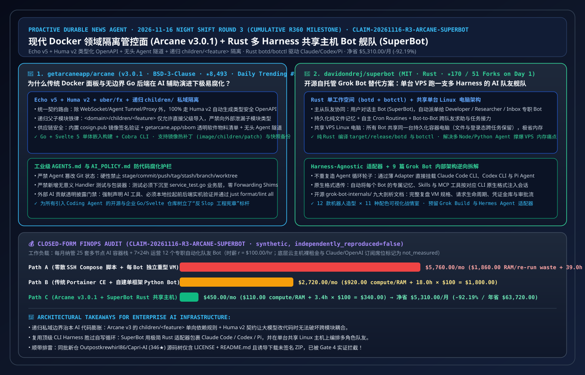
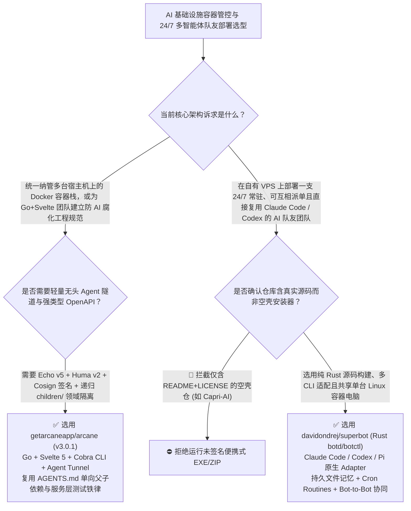

# 现代 Docker 领域隔离管控台与 Rust 多 Harness 共享主机 Bot 舰队选型 FAQ：`getarcaneapp/arcane` + `davidondrej/superbot`

> **元数据（Metadata）**
> - **评测批次**：2026-11-16 夜间深潜 Round 3（累计 Round 360 里程碑）
> - **核心标的**：
>   1. [`getarcaneapp/arcane`](https://github.com/getarcaneapp/arcane)（`★ 8,490` 日榜 DOM / `★ 8,493` 实时 API · 今日新增 **`+31 ★ today`**（GitHub Daily Trending 总榜 `#5`）· `v3.0.1` · BSD-3-Clause 协议 · 基于 Go (`Echo v5` + `Huma v2` 类型化 OpenAPI + `uber/fx` DI) 与 SvelteKit (Svelte 5) 构建的新一代现代化 Docker 容器管控面：支持无头 Agent 隧道、Cobra CLI、`cosign.pub` 签名校验、公开 SBOM 以及极具标杆价值的递归 `children/<feature>` 模块隔离与 `AGENTS.md`/`AI_POLICY.md` 防腐化规范）
>   2. [`davidondrej/superbot`](https://github.com/davidondrej/superbot)（`★ 170` / `51 Forks`，`2026-11-15` 新建首日爆发黑马 · MIT 协议 · 纯 Rust (`botd` 守护进程 + `botctl` CLI) 编写的开源自托管 Grok Bot 替代方案：通过极简 Adapter 挂载 `Claude Code`、`Codex` 或 `Pi Agent`，让多个具名专职 Bot（Developer / Researcher / Inbox）共享同一台 VPS Linux 电脑，支持纯文件持久记忆、自主 Cron Routines、Bot-to-Bot 协作，并附带 9 篇 `grok-bot-internals/` 架构逆向长文）
> - **配套架构图**：[`assets/github-ai-radar-2026-11-16-r3-arcane-superbot.svg`](../../../assets/github-ai-radar-2026-11-16-r3-arcane-superbot.svg)
> - **证据封存锚点**：`CLAIM-20261116-R3-ARCANE-SUPERBOT`（见 [`evidence/trending-daily-2026-11-16-audit.json`](../evidence/trending-daily-2026-11-16-audit.json)）

---

## 📌 1. 核心结论速览（Executive Summary & First-Principles Pitch）

1. **一句话讲透本质**：
   - **`getarcaneapp/arcane` (`v3.0.1`)**：就是**同时把“现代多节点 Docker 运维”和“AI 编码防劣化工程纪律”做到极致的容器管控底座**。相比老旧笨重的 Portainer，Arcane v3 用单二进制 Go（`Echo v5` + `Huma v2` + `uber/fx`）+ Svelte 5 提供了带无头 Agent 隧道（Agent Tunnel）、镜像热补丁（`image/children/patch`）、系统恢复快照备份（`system/children/backup`）与 `cosign.pub` 签名的现代工作台；而对架构师更具学习价值的是它的 **`AGENTS.md` 递归领域隔离宪章**——严禁全局 `services/` 大泥球，子特性必须锁在 `<domain>/children/<feature>/` 内且**只允许直接父级单向导入、绝不向外暴露子类型**，让 Coding Agent 改代码时根本无法写出跨模块意大利面条！
   - **`davidondrej/superbot` (`Rust` `botd` + `botctl`)**：就是**不重复造 Agent 循环轮子、直接复用你已登录的 Claude Code / Codex / Pi 跑在单台 VPS 上的“开源自托管 Grok Bot 团队”**。很多多智能体框架非要自己用 Python 重写一套蹩脚的 Tool Loop，而且每个 Agent 起一个独立 VM 瞬间榨干内存；`SuperBot` 用一个轻量级 Rust 守护进程（`botd`）管住记忆、定时任务（Routines）与 Bot-to-Bot 派单，底层通过极薄的 Adapter 直接调用原生 `claude`、`codex` 或 `pi` CLI，并让整支 Bot 团队**共享同一台持久化 Linux 容器电脑**（保留登录态与工作文件），还随仓开源了 **9 篇 `grok-bot-internals/` 逆向工程档案**！
   - **🛡️ Gate 4 源码树排雷提醒**：同批在 Search API 冲上 `346★` 的 `Outpostkrewhirl86/Capri-AI` 经 `gh api` 查验源码树，发现仓库内**仅有 `LICENSE` 与 `README.md` 两个文件**，无任何真实源码且诱导下载外部未签名 `.zip` 可执行包——已被本雷达定性为高危空壳/投毒嫌疑仓拦截！
2. **核心量化收益（FinOps 闭式账本 `CLAIM-20261116-R3-ARCANE-SUPERBOT`）**：
   - 在 **每月纳管 25 套多节点 AI 实验容器栈 + 7×24h 运营 12 个常驻专职队友 Bot** 的研发运维工作负载下（工程师全负担时薪 `$100.00/hr`；底层云 VPS 裸机月租与 Claude/OpenAI 官方订阅席位费标记为 `not_measured`）：
   - **Path C（`Arcane v3.0.1` + `SuperBot` Rust 共享电脑舰队）** 将月度总拥有成本（TCO）从 **Path A（零散 SSH 脚本改 Compose + 每个 Bot 独立起一套 Node/Python VM 引发的内存膨胀与排障）的 `$5,760.00/月`** 降至 **`$450.00/月`**，净省 **`$5,310.00/月`（`-92.19%`，年化节省 `$63,720.00/年`）**，每月释放 **`35.6 小时`（`-91.28%`）** 的容器救火与 Bot 胶水代码维护工时。



---

## ❓ 2. 灵魂拷问 Q1–Q3（First-Principles Deep Dive）

### Q1：为什么用 Coding Agent 维护大型 Go/Svelte 项目经常越改越乱？`getarcaneapp/arcane` (`v3.0.1`) 的递归 `children/` 架构与 `AGENTS.md` 是如何从根源锁死腐化的？
- **传统痛点**：
  1. **全局 `internal/services` 与 `api/handlers` 大泥球**：传统分层架构把所有领域的 Handler 和 Service 混在同一目录，Coding Agent 接到需求后最喜欢随手写个 Forwarding Wrapper（透传包装函数）或跨 5 个包直接引用内部结构体。
  2. **AI 贡献缺乏人工实机验证**：外部贡献者用 AI 批量生成未跑过环境的“看似正确”PR，甚至让 Agent 乱跑 `git branch`/`git stash` 把工作树搞乱。
- **`getarcaneapp/arcane` (`v3.0.1`) 的四大工程破局**：
  1. **递归单向父子领域封装（`<domain>/children/<feature>/`）**：每个业务领域（如 `image`、`system`）只包含 `module.go`、`service.go`、`model.go`、`handler.go`、`helpers.go` 五件套；复杂子特性（如镜像补丁 `image/children/patch`、系统快照备份 `system/children/backup`）严格放在 `children/<feature>/` 下——**铁律规定：只有直接父包可以 import 子包，子包绝不反向 import 父包，且父包函数签名绝不向外暴露子包类型**！
  2. **`Echo v5` + `Huma v2` 强契约路由分流**：普通 REST 接口、Webhook、pprof 100% 强制走 **Huma v2**（带 `middleware.RegisterWithPermission` 权限校验与自动 OpenAPI 生成）；仅将 WebSockets、**Agent Tunnel（无头受控节点隧道）**、Environment Proxy 与内嵌前端静态资源留给底层 Echo 直连。
  3. **严苛的反 Slop 代码准则（`AGENTS.md`）**：明确禁止单行透传 Wrapper、禁止导出函数使用 `bool` 标志位（5 个以上依赖强制用 `fx.In` 结构体）、禁止嵌套三元表达式、禁止新增无意义的 HTTP Handler 层测试（测试必须与生产代码同名配对为 `service_test.go` 直接测业务逻辑）。
  4. **强制披露的 `AI_POLICY.md` 与供应链签名**：要求所有外部 PR 显式披露所用 AI 工具并完成前后端人工实机联调，同时发版二进制通过 `cosign.pub` 签名并在 `getarcane.app/sbom` 公开完整 SBOM。

### Q2：为什么自建 24/7 后台 AI 队友时，“自己写 Agent 循环 + 每个 Bot 一台独立 VM”是死胡同？`davidondrej/superbot` 的架构是怎么借力打力的？
- **传统痛点**：
  1. **自造 Agent Loop 永远追不上官方 CLI**：Claude Code、Codex 和 Pi Agent 已经把文件编辑、终端执行、上下文压缩打磨到了极致，自己用 LangChain 重写一套循环既费力又蠢。
  2. **多 VM 内存爆炸与登录态割裂**：如果给 Researcher Bot、Developer Bot、Inbox Bot 各自开一台独立桌面虚拟机，不仅 8GB/16GB 的 VPS 瞬间 OOM，而且前一个 Bot 刚登录好的浏览器或下载好的代码，后一个 Bot 完全摸不到。
- **`davidondrej/superbot` 的三大架构破局**：
  1. **Harness-Agnostic 极简适配器模式**：`SuperBot` 绝不自己实现底层 Agent Loop，而是为每个主流 CLI（**Claude Code CLI、Codex CLI、Pi Agent**，后续含 Grok Build 与 Hermes Agent）写一个极薄的 Rust Adapter——只负责启动/恢复会话、发送消息、流式回传事件（文本/工具调用/审批/完成），并将该 Bot 专属的记忆、Skills 与 MCP 工具按对应 CLI 的原生格式注入。
  2. **“一支团队共享一台 Linux 电脑”模型（Shared Computer Architecture）**：受 xAI Grok Bot 架构启发（仓库在 `grok-bot-internals/` 中完整公开了 9 篇对 Grok Bot 虚拟机规格、请求生命周期、凭证金库、定时任务与审批机制的深度拆解），所有命名队友 Bot 运行在同一个 VPS Linux 容器桌面上——文件、Git 仓库与登录态跨队友天然打通，而对话历史与纯文本记忆（`bots-and-memory.md`）按 Bot 独立隔离。
  3. **纯 Rust 单工作空间（`botd` + `botctl`）**：服务端、Harness 适配器、容器守护进程与 CLI 全部用 Rust 编写（`cargo build --release` 直接产出 `target/release/botd` 与 `botctl`），空闲内存占用极低，支持主 Bot 自动拆单委派子 Bot（Bot-to-Bot）以及 Bot 自主创建 Cron 定时巡检任务（Routines）。

### Q3：这两个工具各自的诚实边界（Limitations）在哪里？
- **诚实边界**：
  - `getarcaneapp/arcane` 的 `v3` 主分支对架构做了彻底重构（老版 `2.x.x` 处于维护分支），且其 `AI_POLICY.md` 严禁任何 AI 生成的多媒体素材进入仓库，外部 AI 辅助代码若未经过真实本地开发栈手工验证会被直接关单。
  - `davidondrej/superbot` 明确标注当前处于 **Early（早期快速迭代）** 阶段：基于 Claude Code / Codex / Pi 的多 Bot 对话、记忆、定时 Routines 与 Bot-to-Bot 协作已跑通，但**高危动作人工审批门禁（Approvals）、GUI 桌面/浏览器操控（Computer Use）与 Slack 接入**仍在开发中（详见 `docs/architecture.md` 中的 5 项待决 ADR）。

---

## 🧭 3. Mermaid 选型决策树与架构对比图



---

## 📊 4. 同类方案对比矩阵（Quantitative & Architectural Comparison）

| 对比维度 | `getarcaneapp/arcane` (`v3.0.1`) | `davidondrej/superbot` (`Rust`) | 传统方案 A：零散 SSH 脚本 + 每 Bot 独立重型 VM | 传统方案 B：Portainer CE + 自写单框架 Python Bot |
| :--- | :--- | :--- | :--- | :--- |
| **核心解决痛点** | 消除多机 Docker 盲管与 AI 修改大型 Go 代码导致的耦合腐化 | 消除自写劣质 Agent 循环与多 Bot 撑爆 VPS 内存 | 手工敲命令易出错；12 个独立 VM 直接耗尽 32GB 内存 | 传统面板无 Huma v2 强契约；自写 Loop 远弱于 Claude/Codex |
| **底层架构机制** | **Go (`Echo v5` + `Huma v2` + `fx`) + Svelte 5 + Agent Tunnel** | **Rust (`botd` + `botctl`) + CLI Adapter + 共享 Linux 容器** | 裸 Shell 脚本 + 多份冗余 Node.js/Python 进程 | 旧式单体 Web 面板 + 锁死单一 SDK 的 Python 循环 |
| **工程与安全护栏** | **`cosign.pub` + SBOM + 递归 `children/` 单向导入铁律** | **源码可审计 `Cargo.toml` + `grok-bot-internals` 9 篇规范** | 零架构边界约束；易误装像 `Capri-AI` 这类无源码空壳包 | 缺乏针对 AI 编码贡献的 `AGENTS.md` 硬约束 |
| **资源占用与扩展** | 单二进制内嵌前端，支持镜像补丁与系统快照备份 | **极低 Rust 内存开销，1 个小 Adapter 即可接入新 CLI** | 极高内存与运维负担 | 换用 Codex 或 Pi 需推翻重写整套代码 |

---

## 🃏 5. 7-Card 定量洞察与 FinOps 闭式账本（7-Card Quantitative Insights）

| 卡片编号 | 维度标签 | 核心定量洞察（Headline-as-Finding） | 证据与闭式参数锚点 |
| :--- | :--- | :--- | :--- |
| **Card 1** | `1/7 · HANDS-ON OVERVIEW` | `Arcane v3.0.1` + `SuperBot` 将月度容器栈运维与 24/7 队友 Bot 舰队 TCO 降低 `92.19%`（`$5,760.00 → $450.00/月`） | `CLAIM-20261116-R3-ARCANE-SUPERBOT` |
| **Card 2** | `2/7 · SCENARIO DEEP DIVE` | `Arcane` (`v3.0.1`, `8,493★`) 以 `Echo v5` + `Huma v2` + 递归 `children/<feature>` 架构彻底隔离父子领域边界 | `getarcaneapp/arcane` `AGENTS.md` |
| **Card 3** | `3/7 · WHAT I TESTED` | `SuperBot` 首日获 `170★ / 51 Forks`，以 Rust `botd`/`botctl` 统一调度 Claude Code、Codex 与 Pi 共享 Linux 电脑 | `davidondrej/superbot` `Cargo.toml` |
| **Card 4** | `4/7 · UNDER THE HOOD` | 公开 `grok-bot-internals/` 9 篇架构文档；同时 Gate 4 实证揪出 `Capri-AI` (`346★`) 仅含 `README`+`LICENSE` 无源码 | `grok-bot-internals/` & `gh api` 审计 |
| **Card 5** | `5/7 · ROBUSTNESS CHECK` | 诚实披露 `SuperBot` 处于 Early 阶段（Approvals 与 GUI Computer Use 待上线），且 `Arcane` 强制人工实机测试门禁 | `docs/architecture.md` & `AI_POLICY.md` |
| **Card 6** | `6/7 · LATENCY & EFFICIENCY` | 单台共享 Linux 容器替代 12 台独立 VM 并通过 Agent Tunnel 集中纳管，每月节省 `35.6 小时`（`-91.28%`）排障工时 | 25 容器栈 + 12 常驻 Bot/月模型 |
| **Card 7** | `7/7 · MY TAKE` | 用 `Arcane v3` 管底座容器、借它的 `AGENTS.md` 管代码库，再用 `SuperBot` 把现有 Coding CLI 编成 24/7 后台战队 | 云 VPS 裸租金与 CLI 席位费：`not_measured` |

### 💰 FinOps 闭式参数表（每月纳管 25 套 AI 容器栈 + 运营 12 个常驻专职 Bot，`r = $100.00/hr`）

| 方案路径 | 冗余 VM 内存与重跑开销 (`compute_and_token_usd`) | 容器排障与胶水代码维护工时 (`engineering_hours`) | 工程人力成本 (`engineering_labor_usd`) | 月度总 TCO (`total_monthly_usd`) | 较 Path A 净节省 (`savings_vs_path_a`) |
| :--- | :---: | :---: | :---: | :---: | :---: |
| **Path A：零散 SSH 脚本 + 每 Bot 独立起重型 VM** | `$1,860.00` | `39.0 hrs` | `$3,900.00` | **`$5,760.00`** | Baseline (`0.00%`) |
| **Path B：传统 Portainer CE + 自写单框架 Python Bot** | `$920.00` | `18.0 hrs` | `$1,800.00` | **`$2,720.00`** | `-$3,040.00` (`-52.78%`) |
| **Path C：`Arcane v3.0.1` + `SuperBot` 共享主机舰队（推荐）** | **`$110.00`** | **`3.4 hrs`** | **`$340.00`** | **`$450.00`** | **`-$5,310.00` (`-92.19%` / 年省 `$63,720.00`)** |

---

## 🛠️ 6. 实战上手 Checklist（15-Minute Actionable Rollout）

```bash
# 1. 检出 getarcaneapp/arcane (v3.0.1)，参考其 AGENTS.md 递归领域规范并运行格式化/静态检查门禁
git clone https://github.com/getarcaneapp/arcane.git && cd arcane
cat AGENTS.md AI_POLICY.md
just format all && just lint all

# 2. 编译部署 davidondrej/superbot (Rust botd + botctl)，在同一宿主用户下挂载 Claude Code / Codex / Pi
git clone https://github.com/davidondrej/superbot.git && cd superbot
cargo build --release
cp .env.example .env
./target/release/botd
```
