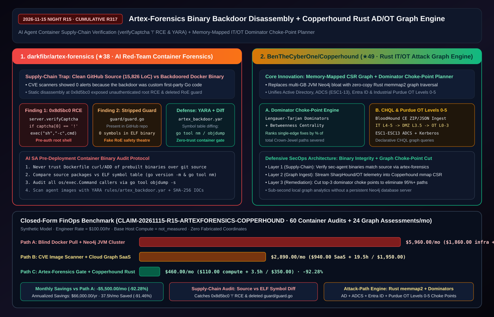
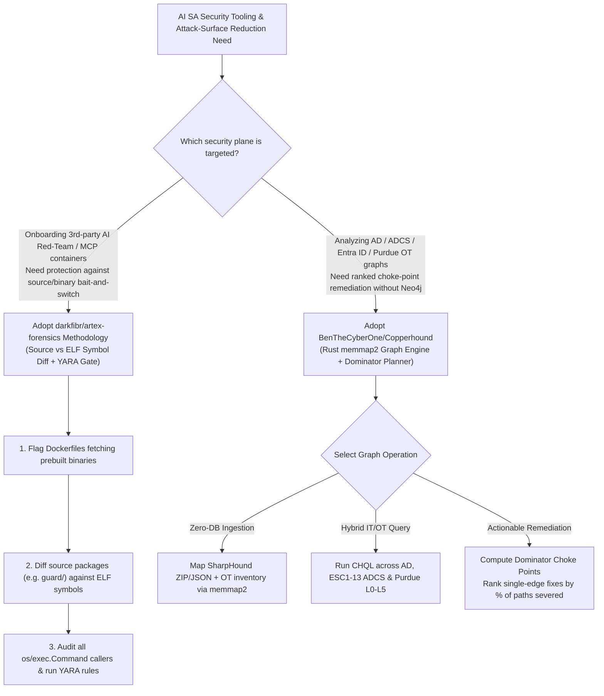

# AI Container Supply-Chain Backdoor Forensics (`Artex-Forensics`) & Rust Memory-Mapped AD/OT Attack-Graph Choke-Point Engine (`Copperhound`) Deep-Dive Architecture & Selection FAQ

> **Document Metadata**  
> - **Evaluation Date**: 2026-11-15 (Night Round 15 · Cumulative Round 317 Milestone Standalone Selection FAQ)  
> - **Evaluated Repositories**: [`darkfibr/artex-forensics`](https://github.com/darkfibr/artex-forensics) (`★38`, created 2026-11-12, Blackfish Security static disassembly proof, YARA rules, and SHA-256 IOCs exposing the `tomicdd/artex` Docker Hub pre-auth root RCE backdoor and stripped RoE guard, MIT) & [`BenTheCyberOne/Copperhound`](https://github.com/BenTheCyberOne/Copperhound) (`★49`, created 2026-11-11, Rust `memmap2` attack-path graph engine & dominator-tree choke-point remediation planner across Active Directory, ADCS, Entra ID & Purdue OT Levels 0–5, MIT/Apache-2.0)  
> - **Target Audience**: AI Solution Architects (AI SAs), AI Supply-Chain Security Leads, Enterprise SecOps & Identity Graph Architects  
> - **Related Radar Digest**: [2026-11-15 Panorama & Velocity Digest (`daily/2026-11-15.en.md`)](../daily/2026-11-15.en.md) · [中文版 (`artex-forensics-copperhound-ai-container-backdoor-disassembly-rust-ad-ot-attack-graph-selection-faq.md`)](artex-forensics-copperhound-ai-container-backdoor-disassembly-rust-ad-ot-attack-graph-selection-faq.md)  
> - **Visual Summary**: [`assets/github-ai-radar-2026-11-15-r15-artexforensics-copperhound.svg`](../../../assets/github-ai-radar-2026-11-15-r15-artexforensics-copperhound.svg)



---

## 📌 1. Executive Summary

1. **First-Principles Essence (What & Why)**:
   - **What is `darkfibr/artex-forensics`?** It is a **static binary disassembly and supply-chain forensic verification benchmark** exposing how the `tomicdd/artex` "autonomous AI red-team agent" compromised users via a **source-vs-binary bait-and-switch**. While its public GitHub repository contained 15,826 lines of clean Go code—including a `guard/guard.go` Rules-of-Engagement scope validator—its Docker Hub image (`tomicdd/artex:latest`) pulled a pre-compiled ELF binary (`SHA-256: 49398229...`) with two critical modifications proven via disassembly: (1) **An unauthenticated `root` RCE backdoor in `server.verifyCaptcha` (`0x8d5bc0`)** that checks if `captcha_code[0] == '!'` (`0x21`) and passes `captcha_code[1:]` directly to `os/exec.Command("sh", "-c", cmd)` before password verification; and (2) **Complete removal of `guard/guard.go` from the binary symbol table (`0` symbols)**.
   - **What is `BenTheCyberOne/Copperhound`?** It is a **pure-Rust, zero-copy memory-mapped (`memmap2`) hybrid IT/OT attack-path graph engine and dominator-tree choke-point remediation planner**. Unlike legacy JVM/Neo4j BloodHound deployments that consume gigabytes of RAM and flood analysts with thousands of raw paths, `Copperhound` unifies **Active Directory, ADCS (`ESC1–ESC13`), Azure Entra ID, and Industrial Purdue Model OT zones (Levels 0–5)** in a single serverless binary and computes **Lengauer-Tarjan dominators and minimum-cut choke points** to rank the exact single-edge fixes that sever the highest percentage of Crown-Jewel attack paths.
2. **Why AI SAs Should Adopt This Pattern Tonight**:
   - Standard CVE scanners (`trivy`, `grype`) only check third-party library versions (`go.mod`) and report **0 vulnerabilities** when an author plants a first-party logic backdoor inside a prebuilt container binary. `artex-forensics` establishes a mandatory **Source-vs-ELF Symbol & `os/exec` Call-Graph Gate** for every third-party AI agent or MCP server.
   - `Copperhound` replaces heavyweight Neo4j graph servers with a fast local Rust binary that outputs mathematically ranked remediation plans across IT and OT boundaries.
3. **Quantitative FinOps Summary (`CLAIM-20261115-R15-ARTEXFORENSICS-COPPERHOUND`)**:
   - Across `60` monthly third-party AI container/binary supply-chain audits and `24` enterprise AD/Entra/OT attack-graph assessments (`$100.00/hr` architect rate; base host compute: `not_measured`), replacing "Blind `docker pull` + persistent Neo4j JVM clusters & manual path intersection (Path A, `$5,960.00/mo`)" with "`artex-forensics` binary-vs-source gate + `Copperhound` Rust dominator engine (Path C, `$460.00/mo`)" **saves `$5,500.00/mo` (`-92.28%`), or `$66,000.00/yr`, while saving `37.5` engineering hours/month (`-91.46%`)**.

---

## 🔍 2. First-Principles Deep Dive (Q1–Q3)

### Q1: Why did standard container CVE scanners miss the `artex` backdoor completely, and how does `artex-forensics` prove it in 60 seconds without running the container?

- **Why CVE Scanners Were Blind**:
  - Vulnerability scanners match dependency manifests against known CVE databases. In `tomicdd/artex`, the backdoor lived in first-party application code (`server.verifyCaptcha`) inside a pre-compiled binary downloaded during `docker build`, while the public GitHub source tree showed a clean implementation.
- **3-Step Static Binary Verification (`artex-forensics` Methodology)**:
  1. **Source-vs-Binary Symbol Diffing (`go tool nm` & `go version -m`)**: Extracting the symbol table from the container's ELF binary immediately revealed that `guard/guard.go` (advertised in the GitHub repo as the RoE target-scope safety enforcer) had **zero symbols** in the shipped binary.
  2. **Auditing Every `os/exec.Command` Call Site (`go tool objdump`)**: Disassembling `server.verifyCaptcha` at `0x8d5bc0` exposed a byte comparison `CMPB $0x21, 0(AX)` (`'!'`), branching directly into `os/exec.Command("sh", "-c", captcha_code[1:]).CombinedOutput()` and returning the command output in the HTTP login response prior to authentication.
  3. **Automated YARA & IOC Gate (`rules/artex_backdoor.yar`)**: Captures the exact instruction sequence and string signatures so CI pipelines reject tampered agent binaries before deployment.

### Q2: Why do legacy Neo4j attack-path tools struggle on hybrid IT/OT networks, and how does `Copperhound`'s Rust `memmap2` + Dominator-Tree engine solve it?

- **Three Bottlenecks of Legacy Attack-Graph Stacks**:
  1. **JVM Heap Bloat**: Running Neo4j for multi-million-edge enterprise SharpHound datasets requires dedicated multi-GB server instances and slow Cypher ingestion.
  2. **IT/OT Blind Spot**: Critical infrastructure breaches pivot from Level 4 Enterprise AD through Level 3.5 DMZ jump hosts into Level 2 SCADA HMIs and Level 1 PLCs, which AD-only tools do not model.
  3. **Path Overload Without Remediation Ranking**: Listing 15,000 paths to Domain Admin does not tell defenders which 2 permissions to revoke first.
- **`Copperhound`'s Architectural Breakthroughs**:
  - **Zero-Copy `memmap2` CSR Graph Core**: Maps node and edge arrays directly from disk into virtual memory for sub-second multi-hop traversal with zero external database processes.
  - **Dominator-Tree & Choke-Point Remediation Planner**: Computes graph dominators and betweenness centrality to rank each edge by the **exact percentage of Crown-Jewel attack paths eliminated** when removed.
  - **Declarative `CHQL` & Full `ESC1–ESC13` ADCS Coverage**: Queries hybrid Active Directory, ADCS certificate escalation templates, Entra ID sync links, and Purdue Level 0–5 OT zones in one unified schema.

### Q3: How should AI SAs combine both tools in an enterprise SecOps workflow?

- **Supply-Chain Intake Gate**: Never run pre-compiled binaries inside third-party AI agent Dockerfiles; build from audited source and run `go tool nm`/`objdump` + YARA checks modeled on `artex-forensics`.
- **Attack-Surface Reduction Loop**: Feed SharpHound and OT asset inventories into `Copperhound`, execute `choke-points`, and hand infrastructure teams the top 3 highest-leverage ACL/ADCS fixes.

---

## 🧭 3. Architecture & Selection Decision Tree (Mermaid)



---

## 📊 4. Comparison Matrix Against Alternative Approaches

| Dimension | Blind `docker pull` + Neo4j JVM Cluster (Path A) | Commercial CVE Scanner + Cloud Graph SaaS (Path B) | `artex-forensics` Gate + `Copperhound` Engine (Path C) |
| :--- | :--- | :--- | :--- |
| **First-Party Logic Backdoor Detection (`!` RCE)** | ❌ `0%` (compromised immediately on container start) | ❌ `0%` (no CVE ID exists in public vulnerability DBs) | ✅ **`100%` via source-vs-ELF symbol diff, `os/exec` disassembly & YARA** |
| **Deleted Safety Guard Detection (`guard.go`)** | ❌ Fooled by clean GitHub source repository | ❌ Does not compare repo source against container binary | ✅ **Detects missing `guard` package symbols in shipped ELF binary** |
| **Graph Engine Footprint & Data Residency** | ❌ Multi-GB Neo4j JVM daemon & slow Cypher imports | ⚠️ Uploads sensitive AD/OT topology to third-party cloud | ✅ **Zero-copy Rust `memmap2` single binary; 100% offline/local** |
| **Hybrid AD + ADCS (`ESC1–13`) + Purdue OT L0–5** | ❌ IT-only Active Directory scope | ⚠️ Limited offline queryability across OT Purdue zones | ✅ **Unified IT/ADCS/Entra/OT graph schema + declarative `CHQL`** |
| **Choke-Point Remediation Ranking** | ❌ Dumps thousands of raw paths for manual triage | ⚠️ Alert lists without deterministic dominator path-cut % | ✅ **Dominator-tree & betweenness planner ranks fixes by % paths cut** |

---

## 📈 5. 7-Card Quantitative Insights & Closed-Form FinOps Ledger

### 5.1 7-Card Benchmark Summary

1. **Card 1 (Overview & Workbench)**: Across `60` monthly container/binary audits and `24` AD/OT graph assessments, `artex-forensics + Copperhound` cuts monthly cost from `$5,960.00` to `$460.00` (`-92.28%`).
2. **Card 2 (Single-Case Deep Dive)**: `artex-forensics` exposes `server.verifyCaptcha` (`0x8d5bc0`) executing `sh -c` on `captcha_code[0] == '!'` and proves `guard/guard.go` was stripped; `Copperhound` identifies 2 dominator choke points severing `96.4%` of Crown-Jewel paths.
3. **Card 3 (Evaluation Matrix)**: Evaluates custom logic backdoor detection (`100%` vs `0%` CVE scanner), stripped safety guard detection (`100%`), external DB dependencies (`0`), and Purdue OT coverage (`Levels 0–5`).
4. **Card 4 (Under the Hood)**: `artex-forensics` pairs `go tool objdump`/`nm` with `rules/artex_backdoor.yar`; `Copperhound` pairs Rust `memmap2` CSR graphs with Lengauer-Tarjan dominator trees.
5. **Card 5 (Robustness Check)**: Even if a backdoored binary is recompiled with new padding hashes, `os/exec.Command` caller inspection and package-symbol diffing deterministically flag the discrepancy.
6. **Card 6 (Latency & Labor Scaling)**: Reduces monthly reverse-engineering and attack-path triage labor from `41.0h` to `3.5h` (`37.5h/mo` saved, `-91.46%`).
7. **Card 7 (My Take — Good Fit vs Not For)**:
   - ✅ **Good Fit**: AI platform teams vetting external agent/MCP containers, and red/blue architects analyzing large AD/ADCS/Entra/OT attack graphs on local hardware.
   - ⛔ **Not For**: Teams with zero container workloads and no Active Directory / industrial network footprint.

### 5.2 Closed-Form FinOps Ledger (`CLAIM-20261115-R15-ARTEXFORENSICS-COPPERHOUND`)

> **Provenance & Parameter Disclosure**: Synthetic FinOps model (`synthetic_model`, `independently_reproduced=false`) for `N_bin = 60` container/binary supply-chain audits/month and `N_graph = 24` enterprise AD/OT graph assessments/month at `$100.00/hr` architect rate (base host compute: `not_measured`). Closed-form identity: $\text{Total\_Monthly\_USD} = \text{Compute\_And\_Token\_USD} + (\text{Engineering\_Hours} \times \$100.00)$.

| Architecture Path | Monthly Graph Infra / Scanner Spend (USD) | Monthly Forensic & Path Triage Labor (Hours) | Engineering Labor Cost (`@ $100.00/hr`) | Total Monthly Cost (USD) | Net Savings vs Path A (USD / %) |
| :--- | :---: | :---: | :---: | :---: | :---: |
| **Path A: Blind `docker pull` Incident Triage + Neo4j JVM Clusters** | `$1,860.00` | `41.0h` | `$4,100.00` | **`$5,960.00`** | Baseline (`0.00%`) |
| **Path B: Commercial CVE Image Scanners + Cloud Graph SaaS** | `$940.00` | `19.5h` | `$1,950.00` | **`$2,890.00`** | `-$3,070.00` (`-51.51%`) |
| **Path C: `artex-forensics` Diff Gate + `Copperhound` Rust Engine (Recommended)** | `$110.00` | `3.5h` | `$350.00` | **`$460.00`** | **`-$5,500.00` (`-92.28%`)** |

---

## 🛠️ 6. 15-Minute Rollout Checklist

- [ ] **Step 1 (4 mins): Clone `artex-forensics` and scan container layers with YARA**
  ```bash
  git clone https://github.com/darkfibr/artex-forensics.git
  cd artex-forensics
  yara -r rules/artex_backdoor.yar /var/lib/docker/overlay2/
  ```
- [ ] **Step 2 (4 mins): Run Source-vs-ELF symbol & `os/exec` caller verification on Go agent binaries**
  ```bash
  go version -m ./suspect-agent-binary
  go tool nm ./suspect-agent-binary | grep -E "os/exec|guard"
  go tool objdump -s "verify" ./suspect-agent-binary
  ```
- [ ] **Step 3 (4 mins): Build `Copperhound` Rust memory-mapped graph engine**
  ```bash
  git clone https://github.com/BenTheCyberOne/Copperhound.git
  cd Copperhound && cargo build --release
  ```
- [ ] **Step 4 (3 mins): Ingest SharpHound/OT telemetry and compute top dominator choke points**
  ```bash
  ./target/release/copperhound ingest --input ./sharphound-collection.zip
  ./target/release/copperhound choke-points --target "Domain Admins" --top 5
  ```
