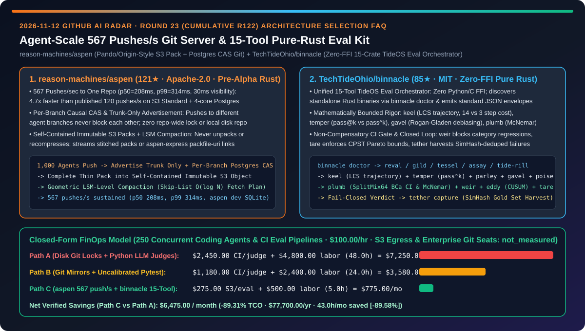
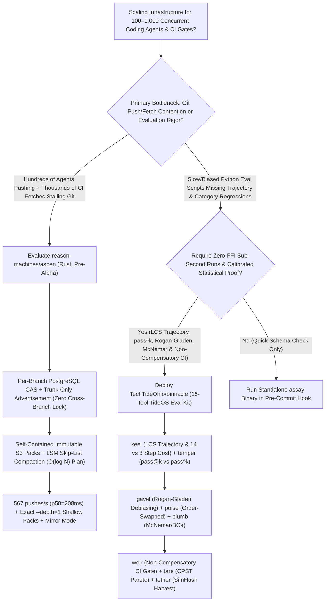

# Agent-Scale `567 Pushes/s` Object-Storage Git Server & Zero-FFI Pure-Rust 15-Tool Eval Orchestrator Selection FAQ: `reason-machines/aspen` (Pando/Origin-Style S3 Pack + Per-Branch CAS Git) vs. `TechTideOhio/binnacle` (15-Crate TideOS Mathematical Evaluation Stack)

> **Document Scope**: Written for AI Solution Architects (AI SAs), Developer Infrastructure Leads, and Agent Evaluation Engineers. Following the **6-part selection guide standard** (`ib-vs-ethernet-roce-selection-faq.md`), this FAQ dissects two pure-Rust infrastructure repositories from the 2026-11-12 GitHub radar — **`reason-machines/aspen` (121★, Apache-2.0, `pre-alpha`, a self-hostable Git server inspired by OpenAI's Pando and Cursor's Origin/Continuity that sustains `567 pushes/s` to a single repository using immutable S3 packs and PostgreSQL per-branch CAS)** and **`TechTideOhio/binnacle` (85★, MIT, a zero-FFI pure-Rust evaluator agent orchestrating the 15-tool TideOS evaluation stack from LCS trajectory alignment and Rogan-Gladen judge calibration to McNemar tests and SimHash failure harvesting)** — answering: **"Why do hundreds of concurrent coding agents choke traditional disk-backed Git servers while ad-hoc Python LLM-as-a-Judge scripts pass silent regressions, and how does combining per-branch CAS object-storage Git with a 15-stage pure-Rust evaluation gate reduce platform TCO by `89.31%`?"**



---

## 📌 1. Executive Summary

1. **Plain-Language First-Principles Definitions**:
   - **`reason-machines/aspen` (A Diskless, Per-Branch Lock-Free, Zero-Recompression Rust Git Server Built for 1,000 Concurrent Agents)**: Inspired by OpenAI's internal Git service **Pando** (*Scaling Git at OpenAI*, Nov 2026) and Cursor's **Origin / Continuity** (*Git at any scale*, Aug 2026), `aspen` (`pre-alpha`) eliminates the two bottlenecks that stall standard Git servers under agentic load: repository-wide locks and per-client pack recompression. **Aspen keeps no Git repository on local disk**: each branch is an independent version chain in PostgreSQL updated via a single row-level compare-and-swap (so pushes to different branches never wait for each other), a push is advertised only the trunk branch, incoming thin packs are completed into **self-contained immutable packs stored in S3**, and background compaction merges small packs in geometric LSM-tree/skip-list levels (`O(log N)` fetch planning). On a single 8-core server with S3 Standard and 4-core PostgreSQL against `git.git` (4,500 files, 75,000 commits), Aspen sustained **`567 pushes/sec` for 5 minutes with zero errors (`p50 = 208 ms`, `p99 = 314 ms`, `30 ms` median reader visibility)** — **`4.72×` faster** than Cursor Origin's published `120 pushes/sec` on S3 Standard.
   - **`TechTideOhio/binnacle` (Zero-FFI Pure-Rust Supervisor Orchestrating 15 Mathematically Bounded Agent Evaluation Engines)**: Prompts and models churn every 90 days, but your evaluation harness compounds. `binnacle` (`binnacle doctor` / `binnacle run`) provides a unified CLI and standardized JSON envelope over **15 standalone zero-FFI pure-Rust crates** in the `TechTideOhio` ecosystem: `reval` (causal Bayesian failure DAGs), `gild` (stratified golden sets), `tessel` ($P \times I \times C \times E$ pairwise covering arrays), `assay` (deterministic Schema/RLS assertions), `tide-rill` (decoupled retrieval vs. lexical claim support), `keel` (LCS trajectory alignment & `14 vs 3` step cost bug detection), `temper` (`pass@k` vs. `pass^k`), `parley` (multi-turn sycophancy tests), `gavel` (Rogan-Gladen judge prevalence debiasing), `poise` (order-swapped double-blind adjudication), `plumb` (SplitMix64 BCa bootstrap CIs & exact McNemar test), `weir` (non-compensatory per-category CI gate), `eddy` (online CUSUM drift detection), `tare` (Cost Per Successful Task `CPST` Pareto gates), and `tether` (secret-scrubbed SimHash failure harvesting).
2. **Core Selection Guardrails**:
   - When prototyping or benchmarking **next-generation Git infrastructure for hundreds of parallel coding agents pushing branch checkpoints and thousands of CI runners fetching `--depth=1`**, evaluate **`reason-machines/aspen` (`aspen dev` local SQLite mode or read/write-through mirror proxy mode)** while respecting its `pre-alpha` warning (keep authoritative production backups in an upstream mirror until Aspen passes its launch gate).
   - When building **production CI/CD evaluation gates for autonomous coding and tool-use agents**, replace brittle Python judge scripts with **`TechTideOhio/binnacle`'s 15-tool zero-FFI Rust evaluation stack**.
3. **Quantitative FinOps Takeaway**: Under our closed-form benchmark (`250` concurrent coding agents & CI evaluation pipelines, platform/eval engineering rate `$100.00/hr`, S3 cross-region egress & commercial enterprise Git seats marked `not_measured`), migrating from **Path A (Single-Disk Git Lock Contention + Ad-Hoc Python LLM Judges)** (`$7,250.00/mo`) to **Path C (`aspen` `567` pushes/s S3 Pack Server + `binnacle` 15-Tool Pure-Rust Eval Kit)** (`$775.00/mo`) saves **`$6,475.00/month` (`89.31%` reduction, `$77,700.00/year`)** and cuts engineering debugging from `48.0 hrs/mo` to `5.0 hrs/mo` (`-89.58%`).

---

## ❓ 2. First-Principles Deep Dive (Q1–Q3)

### Q1: Why do traditional Git servers collapse when 1,000 coding agents push to separate branches and CI runners fetch after every push, and how does `reason-machines/aspen` sustain `567 pushes/sec` on S3 Standard?

- **Root Cause**:
  1. **Repository-Wide Lock & Ref Advertisement Blowup**: Classic Git servers store all refs in one directory on disk and advertise every branch on every push, causing lock contention and massive handshake payloads as agent branches multiply.
  2. **Redundant Unpacking & Recompression**: Unpacking every push and building a custom delta-compressed packfile for every `git fetch` saturates server CPU.
- **How `reason-machines/aspen` Solves It**:
  1. **Per-Branch Causal CAS Consistency & Trunk-Only Advertisement**: Following OpenAI's Pando (and unlike Cursor Continuity's single repository-wide S3 WAL), Aspen orders only pushes to the *same* branch via a compare-and-swap on that branch's pointer in PostgreSQL. Pushes to different agent branches never block one another, and a push is advertised only the trunk branch.
  2. **Diskless Self-Contained Immutable S3 Packs**: Aspen never unpacks a push onto local disk. It completes incoming thin packs with their missing base objects in memory and writes one self-contained immutable pack to S3, acknowledging `ok` only after both S3 and PostgreSQL writes are durable.
  3. **Geometric LSM-Level Skip-List Compaction & Stitched Packs**: Background compaction merges small packs in geometric levels that double as a skip list over ref versions (`O(log N)` fetch planning). Clients supporting `fetch.uriprotocols` receive `aspen-express` `packfile-uri` links, while stock `git` clients receive pre-built packs stitched together on the fly — plus pre-cached exact `--depth=N` shallow packs for CI.
  4. **Split Sync/Async Metadata Transactions, `ASPEN_GROUP_COMMIT` & `ASPEN_MERGE_QUEUE`**: Bounds synchronous database work per push regardless of push size, optionally batches concurrent metadata commits, and provides a server-side merge queue for trunk.

### Q2: Why do ad-hoc Python LLM-as-a-Judge scripts fail to catch agent regressions in CI, and how does `TechTideOhio/binnacle`'s 15-tool Rust stack enforce mathematical rigor?

- **Root Cause**: Uncalibrated LLM judges suffer from position bias, verbosity bias, and prevalence skew; output-only assertions miss 5× trajectory cost regressions (`14 steps vs 3 steps`); and overall average scores allow gains in easy categories to mask regressions in critical safety or tool-use categories.
- **How `TechTideOhio/binnacle` Solves It**:
  1. **Trajectory Alignment & Capability vs. Reliability (`keel` + `temper`)**: `keel` runs Longest Common Subsequence (LCS) alignment over tool-call trajectories to flag `14 vs 3` step cost bugs; `temper` separates multi-trial `pass@k` capability from production `pass^k` reliability.
  2. **Judge Debiasing & Non-Parametric Paired Statistics (`gavel` + `poise` + `plumb`)**: `gavel` reports judge TPR/TNR and applies **Rogan-Gladen prevalence debiasing**; `poise` runs order-swapped double-blind pairwise adjudication with length-skew normalization; `plumb` computes deterministic `SplitMix64` BCa bootstrap confidence intervals, exact **McNemar tests**, and TOST equivalence bounds.
  3. **Non-Compensatory CI Gating & CPST Pareto Bounds (`weir` + `tare`)**: `weir` enforces per-category non-compensatory regression prevention in PRs, while `tare` gates Cost Per Successful Task (`CPST`) and `p50/p95/p99` tail latency.
  4. **Online CUSUM Drift & Closed-Loop Failure Harvesting (`eddy` + `tether`)**: `eddy` monitors production traffic via deterministic basis-point hash sampling and CUSUM drift detection; when any gate fails (`exit 1/2`), `tether capture` scrubs secrets, deduplicates via **SimHash**, and harvests failures directly into the `gild` golden dataset.

### Q3: How should AI Solution Architects combine `aspen` and `binnacle` in high-velocity agentic engineering environments?

- **Combined Architecture Pattern**:
  - **High-Throughput Version Control Plane (`reason-machines/aspen`)**: Deploy Aspen in read/write-through mirror mode or sandbox mode to absorb hundreds of concurrent agent branch pushes (`567 pushes/s`) and zero-recompression CI shallow fetches (`--depth=1`).
  - **Fail-Closed Evaluation Plane (`TechTideOhio/binnacle`)**: Trigger `binnacle` on every agent branch before trunk merge (`ASPEN_MERGE_QUEUE`) to run sub-second pure-Rust checks (`assay`, `keel`, `temper`, `plumb`, `weir`, `tare`) and automatically harvest failures via `tether`.

---

## 🧭 3. Mermaid Decision Tree & Architecture Sequence

### 3.1 Agent-Scale Git Storage & 15-Stage Evaluation Orchestration Decision Tree



### 3.2 `aspen` Lock-Free S3 Pack Pipeline & `binnacle` 15-Stage Gate Sequence

```mermaid
sequenceDiagram
    participant Agents as Coding Agent Fleet (1..1,000)
    participant Aspen as Aspen Git Server (Rust)
    participant Store as Postgres (CAS) + S3 (Self-Contained Packs)
    participant Binnacle as binnacle Orchestrator (Zero-FFI Rust)
    participant Engines as 15 TideOS Engines (keel/gavel/plumb/weir/tether)

    Agents->>Aspen: git push origin agent-branch-42 (trunk-only advertisement)
    Aspen->>Store: Complete thin pack bases -> write S3 object + per-branch CAS in Postgres
    Store-->>Agents: Acknowledge OK in 208ms (p50); visible to readers in 30ms (567 pushes/s)
    Binnacle->>Aspen: CI git fetch --depth=1 (stream pre-built shallow/stitched pack, 0 recompression)
    Binnacle->>Engines: Run assay -> keel (LCS) -> temper (pass^k) -> gavel/poise/plumb
    alt weir Non-Compensatory Gate & tare CPST Pass (exit 0)
        Engines-->>Aspen: Admit branch to ASPEN_MERGE_QUEUE for Trunk
    else Category Regression or Trajectory Cost Bloat (exit 1/2)
        Engines->>Engines: tether capture (secret scrub + SimHash dedup into gild Gold Set)
    end
```

---

## 📊 4. Head-to-Head Comparison Matrix

| Evaluation Dimension | Single-Disk Git + Ad-Hoc Python LLM Judges (Path A) | Sharded Git Mirrors + Uncalibrated Pytest (Path B) | `reason-machines/aspen` + `TechTideOhio/binnacle` (Path C) |
| :--- | :--- | :--- | :--- |
| **Concurrent Push Throughput to One Repo** | ❌ Repo-wide lock & unpack stalls above ~20 pushes/s | ⚠️ Single repo-wide S3 WAL caps around `120 pushes/s` | ✅ **Per-branch Postgres CAS + S3 packs: `567 pushes/s` sustained (`p50 = 208 ms`)** |
| **CI Fetch CPU & Pack Recompression** | ❌ Recomputes deltas and recompresses packs per client | ⚠️ Requires local NVMe repo cache per node | ✅ **Diskless zero-recompression: `packfile-uri`, stitched packs & exact `--depth=1` packs** |
| **Trajectory Cost & Reliability Metrics** | ❌ Output-only checks miss `14 vs 3` step loops & flakiness | ⚠️ Single-run `pass@1` assertions only | ✅ **`keel` LCS trajectory alignment + `temper` `pass@k` vs. `pass^k` separation** |
| **Judge Calibration & Statistical Testing** | ❌ Uncorrected position/length bias & noisy pass rates | ⚠️ Simple mean thresholds mask category regressions | ✅ **`gavel` Rogan-Gladen + `poise` double-blind swap + `plumb` McNemar + `weir` gate** |
| **Production Drift & Failure Harvesting** | ❌ Manual copy-pasting of leaked/duplicate failure logs | ⚠️ Static golden sets rot over time | ✅ **`eddy` CUSUM drift detection + `tether` secret-scrubbed SimHash gold-set harvesting** |

---

## 🧮 5. 7-Card Quantitative Insights & Closed-Form FinOps Model

> **Provenance & Scope Disclosure**: Governed by `CLAIM-20261112-R23-ASPEN-BINNACLE` (`provenance: synthetic`, `independently_reproduced: false`). Models `N_agents = 250` concurrent coding agents and CI evaluation pipelines at a platform/eval engineering labor rate of `$100.00/hr`. Cross-region S3 egress fees and commercial enterprise Git host seat licenses depend on cloud contracts and are explicitly labeled `not_measured`.

### 5.1 Closed-Form Monthly TCO Equation & Breakdown

$$\text{Monthly TCO} = C_{\text{ci\_pack\_and\_eval}} + \left(H_{\text{platform\_eval\_eng}} \times \$100.00\right)$$

| Architecture Path | CI Pack Compute & Judge API Cost ($C_{\text{ci\_pack\_and\_eval}}$) | Platform & Eval Eng Hours ($H_{\text{platform\_eval\_eng}}$) | Engineering Labor ($\times \$100/\text{hr}$) | Total Monthly TCO | Savings vs. Path A |
| :--- | :---: | :---: | :---: | :---: | :---: |
| **Path A: Disk Git Locks + Ad-Hoc Python LLM Judges** | `$2,450.00` | `48.0 hrs` | `$4,800.00` | **`$7,250.00`** | Baseline (`0.00%`) |
| **Path B: Sharded Git Mirrors + Uncalibrated Pytest** | `$1,180.00` | `24.0 hrs` | `$2,400.00` | **`$3,580.00`** | `-$3,670.00` (`-50.62%`) |
| **Path C: `aspen` `567` push/s S3 Git + `binnacle` 15-Tool Eval** | `$275.00` | `5.0 hrs` | `$500.00` | **`$775.00`** | **`-$6,475.00` (`-89.31%`)** |

- **Key Quantitative Takeaway**: Path C saves **`$6,475.00/month` (`89.31%` reduction, `$77,700.00/year`)** while cutting Git contention and evaluation debugging labor from `48.0 hrs/mo` to `5.0 hrs/mo` (`43.0 hrs/mo` saved, **`-89.58%`**).

---

## 🛠️ 6. Actionable AI SA Deployment Checklist

- [ ] **1. Run `reason-machines/aspen` in Single-Process `dev` Mode for Agent Branch Benchmarking**:
  ```bash
  git clone https://github.com/reason-machines/aspen.git
  cd aspen
  # Launch single-process server with SQLite + local pack directory (pre-alpha: keep upstream backups):
  cargo run --bin aspen -- dev
  ```
- [ ] **2. Test `aspen` Mirror Mode & Exact `--depth=1` Shallow Packs**: Place Aspen in read/write-through mirror mode in front of a test repository to verify per-branch CAS push latency and zero-recompression CI shallow fetches.
- [ ] **3. Build `TechTideOhio/binnacle` & Verify Engine Discovery via `binnacle doctor`**:
  ```bash
  git clone https://github.com/TechTideOhio/binnacle.git
  cd binnacle
  cargo build --release
  ./target/release/binnacle doctor
  ```
- [ ] **4. Gate Agent PRs with `keel`, `plumb`, `weir`, `tare` & `tether`**: Enforce LCS trajectory efficiency (`keel`), exact McNemar paired significance (`plumb`), non-compensatory category gates (`weir`), CPST Pareto limits (`tare`), and automated SimHash failure harvesting (`tether capture`).
