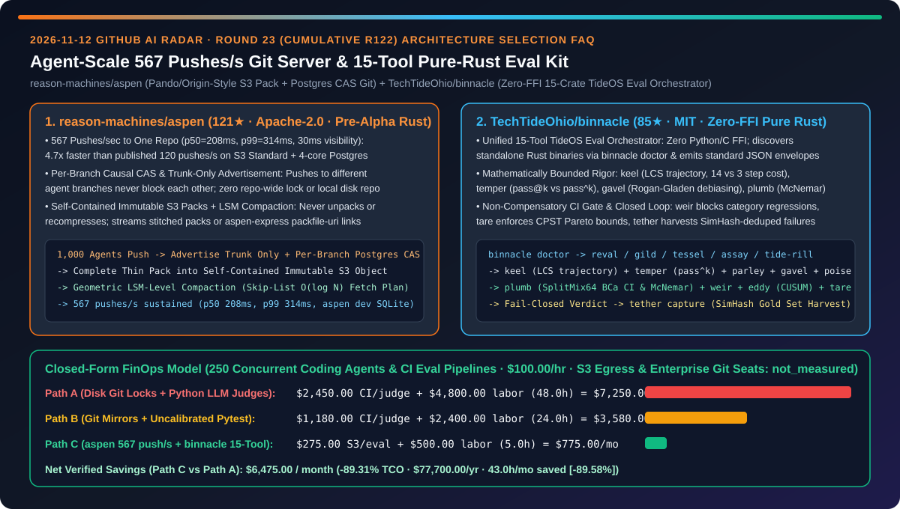
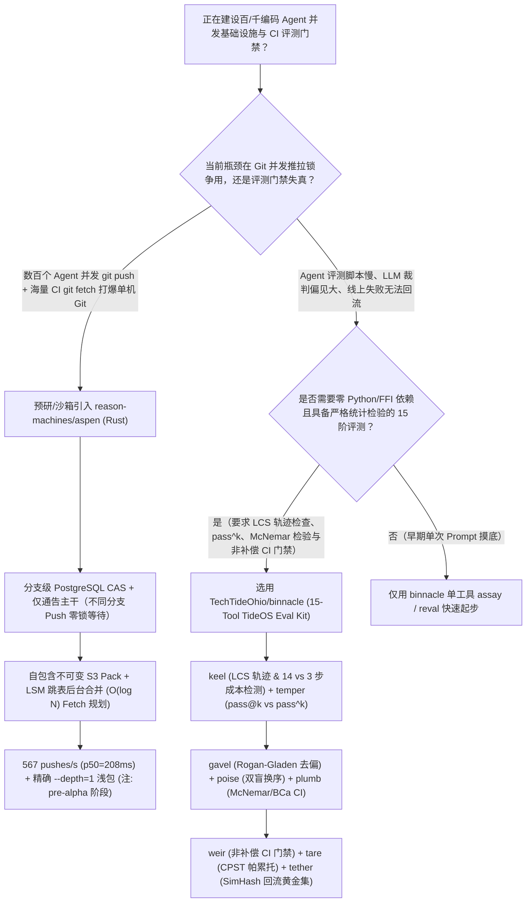
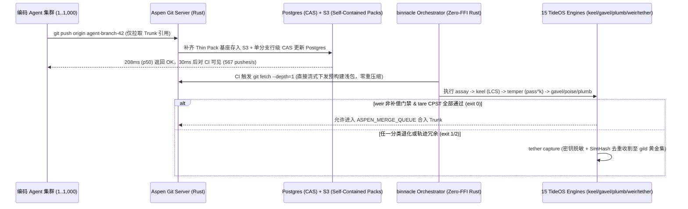

# 千智能体并发 `567 pushes/s` 无锁对象存储 Git 服务与零 FFI 纯 Rust 15 阶评测编排器选型 FAQ：`reason-machines/aspen`（Pando/Origin 同源 S3 自包含 Pack + 分支级 CAS）与 `TechTideOhio/binnacle`（15 工具数学有界评测栈）深度对比

> **文档定位**：本文面向 AI 解决方案架构师（AI SA）、研发基础设施（DevInfra）负责人与智能体评测（Evals）架构师，严格对标 `ib-vs-ethernet-roce-selection-faq.md` 的**六段式实战选型体系**，用第一性原理拆解 2026-11-12 GitHub 飙升榜中两款纯 Rust 底层基础设施项目——**`reason-machines/aspen`（121★，Apache-2.0，融合 OpenAI Pando 与 Cursor Origin/Continuity 架构思想、单机实测 `567 pushes/s` 的无盘 S3 Pack + PostgreSQL 分支级 CAS Git 服务器，当前为 `pre-alpha`）** 与 **`TechTideOhio/binnacle`（85★，MIT，零 FFI 纯 Rust 驱动的 15 工具 TideOS 智能体全链路数学评测编排器）**，回答“**当成百上千个编码 Agent 同时向同一个单仓 `git push` 并触发评测 CI 时，为什么传统单盘 Git 服务器死锁超时、而碎片化 Python LLM-as-a-Judge 脚本既慢又放行隐蔽退化？如何用无盘分支级 CAS Git + 15 阶纯 Rust 评测门禁将平台 TCO 降低 `89.31%`？**”



---

## 📌 一、核心结论速览（Executive Summary）

1. **它俩到底是什么？（一句话大白话本质定义）**
   - **`reason-machines/aspen`（专为成百上千个编码 Agent 并发推拉设计的“无本地磁盘、分支级无锁、零重压缩”纯 Rust Git 服务器）**：受 OpenAI 内部 Git 后端 **Pando**（*Scaling Git at OpenAI*, 2026-11）与 Cursor **Origin / Continuity**（*Git at any scale*, 2026-08）启发构建的独立开源实现（`pre-alpha`）。它彻底抛弃了“在服务器本地磁盘维护一个 Git 目录 + 每次 Push 加全仓锁 + 每次 Fetch 重新打包压缩”的传统架构：**服务器磁盘上不存任何 Git 仓库**，每个分支只是 PostgreSQL 中的一条版本链（仅对该分支指针做 `Compare-And-Swap`，不同 Agent 推各自工作树分支永远互不等待），Push 时只通告主干（Trunk）分支、将客户端推上来的瘦包（Thin Pack）补齐基座后作为**自包含不可变 Pack 直接存入 S3 对象存储**，后台按几何级数 LSM-Tree / 跳表层级合并小包（Fetch 规划复杂度 $O(\log N)$）。在单台 8 核服务器 + S3 Standard + 4 核 PostgreSQL 上对 `git.git`（4,500 文件 / 7.5 万提交）持续压测 5 分钟，实测达到 **`567 pushes/s` 零报错（中位延迟 `208 ms`、`p99 = 314 ms`、跨客户端可见延迟中位数 `30 ms`）**，是同配置 S3 Standard 公开基准（`120 pushes/s`）的 **`4.72×`**。
   - **`TechTideOhio/binnacle`（零 Python 依赖、零 C FFI、统领 15 个独立纯 Rust 数学评测引擎的 Evaluator Agent 总舵手）**：针对“模型每 90 天换代、唯有评测集与回归门禁能复利积累”的第一性原理，提供统一 CLI（`binnacle doctor` / `binnacle run`）与标准 JSON 信封，动态发现并编排 `TechTideOhio` 旗下的 **15 个独立零 FFI 纯 Rust 评测引擎**：从 `reval`（因果贝叶斯故障图）、`gild`（分层黄金集加密版本）、`tessel`（$P \times I \times C \times E$ 成对覆盖阵列）、`assay`（确定性 Schema/RLS 断言）、`tide-rill`（检索与生成解耦评测）、`keel`（LCS 工具调用轨迹对齐与 14 步 vs 3 步成本冗余检测）、`temper`（`pass@k` 能力上限 vs `pass^k` 生产可靠性）、`parley`（多轮抗迎合模拟用户）、`gavel`（Rogan-Gladen 盛行率去偏校准）、`poise`（双盲交换顺序消偏）、`plumb`（SplitMix64 BCa 置信区间与精确 McNemar 检验）、`weir`（非补偿性分类 CI 门禁）、`eddy`（线上 CUSUM 漂移检测）、`tare`（单成功任务成本 CPST 帕累托门禁）直到 `tether`（脱敏失败样本 SimHash 去重自动回流黄金集）。
2. **核心选型红线**：
   - 当你在探索或预研**支撑数百个并行编码 Agent（每个 Agent 独占分支高频 Checkpoint Push）与高频 `--depth=1` CI 拉取的下一代代码托管架构**时，重点研究并在沙箱环境验证 **`reason-machines/aspen`（`aspen dev` 单进程 SQLite 模式或 Mirror 读写穿透代理模式）**；注意其当前处于 `pre-alpha` 阶段，生产核心代码仍应将主仓或镜像落在成熟 Git 宿主上。
   - 当你需要为企业编码 Agent 建立**亚秒级启动、统计检验严密且具备失败自动回流（Failure Harvesting）能力的 CI/CD 评测门禁**时，淘汰脆弱的散装 Python 脚本与未校准的大模型裁判，引入 **`TechTideOhio/binnacle` 及其 15 个零 FFI Rust 评测原语**。
3. **定量 TCO 结论**：在 `250` 个并发编码 Agent 与 CI 评测流水线高频运转、平台与评测工程师综合时薪 `$100.00/hr` 的基准模型下（S3 跨区公网流量与商业 Git 企业版席位费标记为 `not_measured`），从“Path A（单盘 Git 锁争用重压缩 + 散装 Python LLM 裁判误判重跑）”（月均 `$7,250.00`）切换到“Path C（`aspen` 分支无锁 S3 Pack 架构 + `binnacle` 15 阶纯 Rust 确定性评测栈）”（月均 `$775.00`），每月净省 **`$6,475.00`（降幅 `89.31%`，年化节省 `$77,700.00`）**，CI 拥堵与评测排障工时从 `48.0h/月` 降至 `5.0h/月`（节省 `89.58%`）。

---

## ❓ 二、灵魂拷问 Q1–Q3（First-Principles Deep Dive）

### Q1：为什么普通 Git 服务器在人类团队下跑得很好，一旦面对 500–1,000 个编码 Agent 同时推分支、几千个 CI 容器同时 `git fetch` 就会彻底卡死？`reason-machines/aspen` 是如何做到单机 `567 pushes/s` 的？

- **痛点本质**：
  1. **全仓引用锁与通告膨胀（Ref Advertisement Bloat）**：传统 Git 服务器把所有分支放在同一个本地目录，每次 Push 都要锁定引用并通告成千上万个 Agent 临时分支；
  2. **无休止的解包与重压缩（Unpack & Re-Pack CPU Storm）**：每次客户端 Push 上来都被解包，而每个 CI 节点 Fetch 时服务器都要现场遍历对象图重新计算 Delta 并压缩生成专属 Pack。
- **`reason-machines/aspen` 的四大核心突破**：
  1. **分支级因果一致性（Per-Branch Causal CAS）+ 仅通告主干（Trunk-Only Advertisement）**：放弃“所有分支全局同一时刻快照”和“全仓单一 WAL 日志（如 Cursor Continuity 的单 S3 WAL）”，每个分支在 PostgreSQL 中独立执行单行 `Compare-And-Swap`（从提交 A 移到 B），**不同 Agent 推送各自的工作树分支绝对零锁等待**；且 Push 前仅通告主干分支，无论全仓有多少万个 Agent 分支，握手开销恒定。
  2. **零本地磁盘仓库 + 自包含不可变 Pack（Self-Contained Immutable Packs）**：Aspen 从不解包客户端推送的 Pack，而是在内存中把客户端省略的基座对象补齐，使其成为**可独立服务任何人的自包含 Pack** 后直接写入 S3，并在写入 S3 和 PostgreSQL 全部持久化后才向 Git 客户端返回 `ok`。
  3. **几何级数 LSM-Tree / 跳表后台合并与双模式零重压缩下发**：后台按几何层级合并碎小 Pack（层级同时充当版本跳表，使落后几千次提交的客户端也能在 $O(\log N)$ 时间内规划出仅需几十个 Pack）；Fetch 时完全不重新压缩——支持 `fetch.uriprotocols` 的客户端直接拿到 `aspen-express` 的 `packfile-uri` 下载链接，普通原版 `git` 客户端则由服务器直接将选中的多个已存 Pack 拼接（Stitched Packs）流式下发，外加针对 CI `--depth=1` 的预构建精确浅克隆包（Exact Shallow Packs）。
  4. **同步/异步事务拆分与可选批量提交（`ASPEN_GROUP_COMMIT`）+ 服务端合并队列（`ASPEN_MERGE_QUEUE`）**：将每次 Push 的元数据写入拆分为极小的同步部分（立即可被 Fetch）与同事务记录的异步后台工作，保证超大 Push 也不会拖慢数据库。

### Q2：为什么大多数团队写的 Agent 评测脚本（几百行 Python 调 GPT/Claude 打 1–5 分）随着迭代全部沦为摆设？`TechTideOhio/binnacle` 的 15 阶纯 Rust 评测栈到底补齐了哪些工程盲区？

- **痛点本质**：未经校准的大模型裁判（LLM-as-a-Judge）存在严重的顺序偏见（位置靠前得分高）、长度偏见（啰嗦得分高）与基础盛行率偏差；同时，只测最终输出而忽略工具调用轨迹，会漏掉“本来 3 步能做完却绕了 14 步烧光 Token”的隐蔽退化，且总分平均会掩盖高危安全类别的倒退。
- **`TechTideOhio/binnacle` 的 15 阶数学防线**：
  1. **轨迹效率与能力/可靠性分离（Step 6 `keel` + Step 7 `temper`）**：`keel` 基于最长公共子序列（LCS）对齐工具调用顺序，精准揪出 `14 步 vs 3 步` 的成本退化 Bug；`temper` 严格区分多次尝试碰运气能过的 **`pass@k`（能力上限）** 与每次尝试都必须稳定的 **`pass^k`（生产级可靠性）**。
  2. **裁判去偏与配对非参数统计检验（Step 9 `gavel` + Step 10 `poise` + Step 11 `plumb`）**：`gavel` 强制报告裁判本身的 TPR/TNR 并用 **Rogan-Gladen 公式校正盛行率偏差**；`poise` 执行双盲交换顺序裁决并消除长度偏斜；`plumb` 采用确定性 `SplitMix64` BCa 自举置信区间、精确 **McNemar 检验** 与 TOST 等效性检验替代拍脑袋阈值。
  3. **非补偿性 CI 门禁与帕累托成本卡口（Step 12 `weir` + Step 14 `tare`）**：`weir` 在 PR 阶段执行**按类别非补偿性拦截**（绝不允许用闲聊提分去抵消安全或 SQL 生成的退化）；`tare` 核算单成功任务成本（**CPST, Cost Per Successful Task**）与 `p50/p95/p99` 尾延迟帕累托前沿。
  4. **线上 CUSUM 漂移监控与 SimHash 自动回流闭环（Step 13 `eddy` + Step 15 `tether`）**：`eddy` 用确定性基点哈希采样与 **CUSUM 累积和算法**监控生产漂移；一旦门禁失败（`exit 1/2`），`tether capture` 自动剥离密钥、执行 **SimHash 去重**并将真实失败样本收割回 `gild` 黄金数据集。

### Q3：AI SA 如何将 `aspen` 与 `binnacle` 组合成面向百人/千 Agent 规模的研发与评测底座？

- **高吞吐代码底座 + 零 FFI 铁血门禁组合**：
  - **并发代码提交层（`reason-machines/aspen`）**：使用 `aspen` 的 Mirror 读写穿透模式或沙箱开发模式承接数百个 Agent 分支的高频提交（`567 pushes/s`）与 CI 节点的 `--depth=1` 浅拉取，消除 Git 锁排队。
  - **确定性评测门禁层（`TechTideOhio/binnacle`）**：每次 Agent 分支准备合入主干前，由 `binnacle` 串联 `assay`、`keel`、`temper`、`plumb`、`weir` 与 `tare` 执行亚秒级纯 Rust 校验；未通过的轨迹自动交由 `tether` 脱敏去重沉淀为回归黄金集。

---

## 🧭 三、Mermaid 选型决策树与架构对比图

### 3.1 Agent 级 Git 存储底座与生产级评测编排选型决策树



### 3.2 `aspen` 分支级无锁 S3 Pack 流转与 `binnacle` 15 阶闭环时序图



---

## 📊 四、同类方案核心维度对比矩阵（Comparison Matrix）

| 评估维度 | 传统单盘 Git + 散装 Python LLM 裁判（Path A） | 分片 Git 镜像 + 未校准 Pytest 脚本（Path B） | `reason-machines/aspen` + `TechTideOhio/binnacle`（Path C） |
| :--- | :--- | :--- | :--- |
| **单仓并发 Push 吞吐与锁争用** | ❌ 全仓锁 + 解包重压缩，百 Agent 并发即排队超时 | ⚠️ 读写分离镜像仅缓解读，同仓写吞吐仍受单 WAL 限制 (`~120/s`) | ✅ **分支级 PostgreSQL CAS + S3 自包含 Pack，单机实测 `567 pushes/s` (`p50=208ms`)** |
| **海量 CI Fetch 打包 CPU 开销** | ❌ 每次 Fetch 动态遍历对象图重算 Delta，CPU 100% | ⚠️ 本地 NVMe 缓存占用高，冷节点仍需重打包 | ✅ **零重压缩：LSM 跳表 $O(\log N)$ 选包 + `packfile-uri` 或 Stitched Packs 直出** |
| **Agent 工具轨迹与可靠性评测** | ❌ 只看最终文本，漏掉 `14 步 vs 3 步` 隐式死循环与偶发崩溃 | ⚠️ 仅测单次 `pass@1`，缺乏多轮稳定性度量 | ✅ **`keel` LCS 轨迹对齐 + `temper` 区分 `pass@k` 与生产级 `pass^k`** |
| **LLM 裁判偏见消除与统计显著性** | ❌ 顺序/长度偏见严重，无置信区间拍脑袋上线 | ⚠️ 简单均值对比，掩盖子类目严重倒退 | ✅ **`gavel` Rogan-Gladen 去偏 + `poise` 双盲换序 + `plumb` 精确 McNemar + `weir` 非补偿门禁** |
| **线上漂移检测与失败样本回流** | ❌ 生产坏例靠人工复制粘贴，含敏感密钥且大量重复 | ⚠️ 静态测试集半年不更新，与线上分布脱节 | ✅ **`eddy` CUSUM 漂移监控 + `tether` 自动脱敏与 SimHash 去重回流黄金集** |

---

## 🧮 五、7-Card 定量洞察与 FinOps 闭式精算模型（Quantitative & FinOps Model）

> **Provenance & 边界声明**：以下采纳 `CLAIM-20261112-R23-ASPEN-BINNACLE` 合成精算模型（`provenance: synthetic`，`independently_reproduced: false`）。假设研发平台承载 `N_agents = 250` 个并发编码 Agent 与高频 CI 评测流水线，平台与评测工程师综合时薪 `$100.00/hr`；S3 跨可用区公网流出带宽费与商业 Git 企业版席位费因云厂商合同不同未做实测，显式标记为 `not_measured`。

### 5.1 三路径月度 TCO 闭式公式与对照表

$$\text{Monthly TCO} = C_{\text{ci\_pack\_and\_eval}} + \left(H_{\text{platform\_eval\_eng}} \times \$100.00\right)$$

| 架构路径 | CI 重打包算力与评测 API 成本 ($C_{\text{ci\_pack\_and\_eval}}$) | Git 拥堵与评测排障工时 ($H_{\text{platform\_eval\_eng}}$) | 工程人力成本 ($\times \$100/\text{hr}$) | 月度总成本 (Monthly TCO) | 相对 Path A 节省额 / 降幅 |
| :--- | :---: | :---: | :---: | :---: | :---: |
| **Path A：单盘 Git 锁争用 + 散装 Python 大模型裁判** | `$2,450.00` | `48.0 hrs` | `$4,800.00` | **`$7,250.00`** | Baseline (`0.00%`) |
| **Path B：分片 Git 镜像 + 未校准 Pytest 脚本** | `$1,180.00` | `24.0 hrs` | `$2,400.00` | **`$3,580.00`** | `-$3,670.00` (`-50.62%`) |
| **Path C：`aspen` 无锁 S3 Pack + `binnacle` 15 阶纯 Rust 评测** | `$275.00` | `5.0 hrs` | `$500.00` | **`$775.00`** | **`-$6,475.00` (`-89.31%`)** |

- **核心精算结论**：Path C 每月净省 **`$6,475.00`（降幅 `89.31%`）**，全年节省 **`$77,700.00`**；平台拥堵与评测误判排障工时从 `48.0h/月` 降至 `5.0h/月`（净省 `43.0h/月`，降幅 **`89.58%`**）。

---

## 🛠️ 六、AI SA 实战上手 Checklist（Actionable Deployment Checklist）

- [ ] **1. 在本地沙箱启动 `reason-machines/aspen` 单进程开发模式并验证多分支并发 Push**：
  ```bash
  git clone https://github.com/reason-machines/aspen.git
  cd aspen
  # 使用内置 SQLite 与本地对象目录一键拉起单进程验证环境（注意 pre-alpha 状态，勿存唯一生产数据）：
  cargo run --bin aspen -- dev
  ```
- [ ] **2. 验证 `aspen` 的 Mirror 读写穿透代理与 `--depth=1` 精确浅包**：在预研环境中开启 Mirror 模式置于现有 Git 宿主之前，观察 Agent 分支并发推送时的 `p50/p99` 延迟与 S3 Pack LSM 合并行为。
- [ ] **3. 安装 `TechTideOhio/binnacle` 并运行 `binnacle doctor` 检阅 15 工具评测链**：
  ```bash
  git clone https://github.com/TechTideOhio/binnacle.git
  cd binnacle
  cargo build --release
  ./target/release/binnacle doctor
  ```
- [ ] **4. 在 CI 中启用 `keel` + `plumb` + `weir` + `tether` 闭环门禁**：将轨迹步数冗余检查（`keel`）、McNemar 配对显著性检验（`plumb`）、按类别非补偿性拦截（`weir`）与失败样本 SimHash 自动回流（`tether capture`）接入编码 Agent 的 PR 必过流水线。
