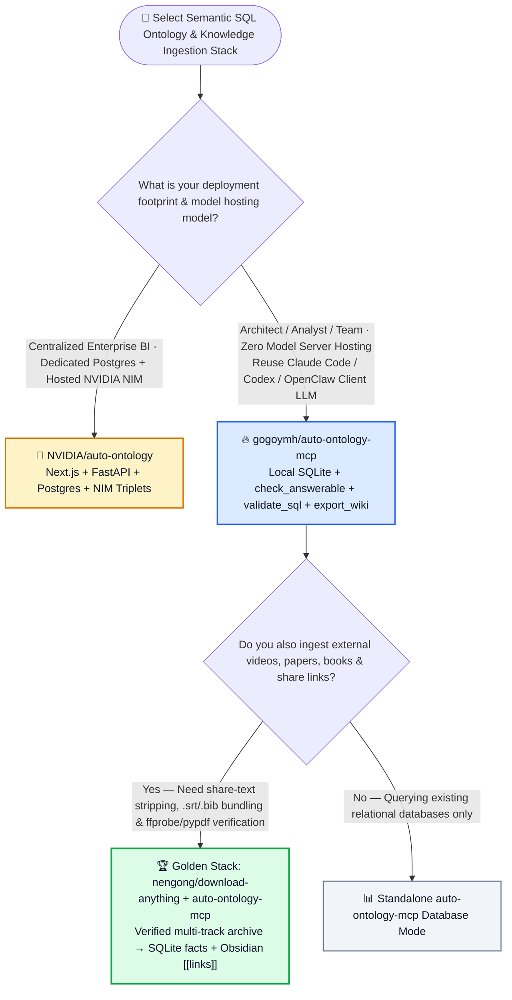
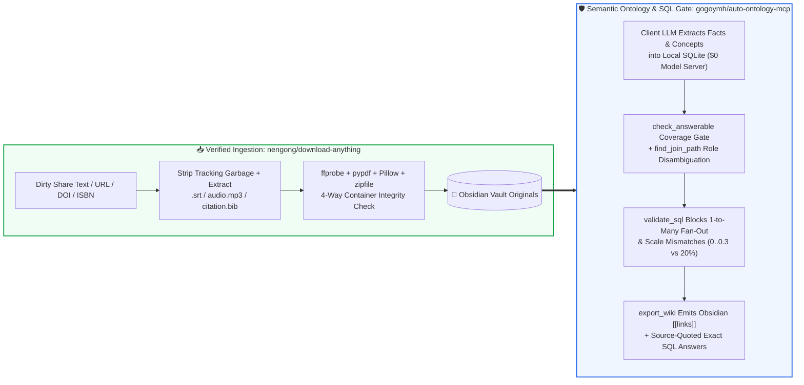

# Serverless SQLite Semantic Ontology MCP & Multi-Track Verified Archiving Selection FAQ: `gogoymh/auto-ontology-mcp` (`validate_sql` + Obsidian Ontology Wiki) + `nengong/download-anything` vs. Heavy Postgres/NIM Stacks & Ad-Hoc Download Scripts

> **中文版**: [auto-ontology-mcp-download-anything-selection-faq.md](auto-ontology-mcp-download-anything-selection-faq.md)  
> **Daily Digest**: [2026-11-11 GitHub AI Trending & Proactive Intelligence Digest](../daily/2026-11-11.en.md) · **Visual Deck**: [`cards.en.html`](../cards.en.html) · **Live Radar**: [`github-radar.html`](../../../github-radar.html)

Written for **AI Solution Architects, Data Platform Engineers, and Knowledge Engineering Leads**, this selection guide is grounded in primary-source audits of two high-signal knowledge engineering repositories from the 2026-11-11 radar — **`gogoymh/auto-ontology-mcp` (an Apache-2.0 Python 3.12+ MCP server over `stdio` and `streamable HTTP` that brings `NVIDIA/auto-ontology`'s semantic layer and an Obsidian-linked personal knowledge base to any MCP client using local SQLite and the host client's own LLM, `361` API stars)** and **`nengong/download-anything` (an MIT Python 3.10+ CLI and Agent Skill that strips share-link tracking garbage, downloads videos/papers/podcasts/books alongside `.srt`, `cover.jpg`, `audio.mp3`, and `citation.bib`, and verifies container integrity via `ffprobe`, `pypdf`, `Pillow`, and `zipfile`, `219` API stars)** — answering three core engineering questions from first principles:
1. **Why is "failing quietly" the most dangerous failure mode in Text-to-SQL (where a query runs without syntax errors but inflates revenue 3× via one-to-many join fan-out or picks `billing_city_id` instead of `delivery_city_id`)—and how does `gogoymh/auto-ontology-mcp` catch all 8 silent failure modes using local SQLite without hosting Postgres or dedicated NVIDIA NIM endpoints?**
2. **Why does Andrej Karpathy's pure-Markdown `LLM Wiki` pattern struggle when users need exact SQL aggregations over receipts, financial statements, and paper tables—and how do `download-anything` + `auto-ontology-mcp` upgrade the LLM Wiki into a hybrid SQL + Obsidian `[[wiki-link]]` ontology?**
3. **When should enterprise teams deploy full `NVIDIA/auto-ontology` vs. lightweight zero-server `gogoymh/auto-ontology-mcp`?**

> 🛡️ **Provenance & Attribution Disclosure**:
> - **`measured` (Primary-Source Verified in This Shift)**: Repository metadata and source trees for `gogoymh/auto-ontology-mcp` (`361` API stars, `49` forks, Python 3.12+, Apache-2.0, created `2026-11-06`) and `nengong/download-anything` (`219` API stars, `3` forks, Python 3.10+, MIT, created `2026-11-04`) are verified directly via GitHub REST API; because neither appeared in the 10-item main Daily Trending HTML snapshot (`bacf15c2...`), `stars_today` is strictly labeled **`not_measured`**.
> - **`anonymized_reported` (`independently_reproduced=false`, Upstream Documentation & Test Fixture Specs)**: The 8-row raw-schema vs. ontology SQL failure comparison table, `check_answerable` / `get_query_context` / `validate_sql` / `find_join_path` / `export_wiki` tools, and the 11-table / 3,200-order retail demo fixture (`tests/test_demo.py`) in `gogoymh/auto-ontology-mcp/README.md`, as well as share-token stripping, companion asset extraction (`.srt`, `cover.jpg`, `audio.mp3`, `citation.bib`), and `ffprobe`/`pypdf`/`Pillow`/`zipfile` integrity checks in `nengong/download-anything/README.md`, are documented in upstream repository files.
> - **`synthetic` (`independently_reproduced=false`, Architect Parametric FinOps & Knowledge Engineering Model)**: Section 5.1 models a 25-person research and data engineering team running semantic SQL queries and ingesting **`1,500` external multi-format documents/videos/papers per month** (engineer labor valued at `$75.00/hr`; commercial Obsidian Sync subscriptions are explicitly labeled `not_measured`), comparing Path A Dedicated Postgres/NIM Hosting + Raw SQL Triage + Manual Scraping (`$4,580.00/mo`, `52.0h`) vs. Path B Loose Markdown LLM Wiki + Ad-Hoc Scripts (`$2,730.00/mo`, `34.0h`) vs. Path C `auto-ontology-mcp` + `download-anything` (`$645.00/mo`, `8.0h`, saving `$3,935.00/mo` [`-85.92%`] and `44.0 hours/mo` [`-84.62%`]).

---

## 1. 📌 Executive Summary

| Dimension | Plain-Language Core Takeaway (First Principles) |
| :--- | :--- |
| **What is `gogoymh/auto-ontology-mcp`?** | It brings `NVIDIA/auto-ontology`'s semantic catalog to **any MCP client (Claude Code, Codex, OpenClaw, Hermes, Cursor, VS Code) with zero model servers to host and zero extra API keys**. It delegates language reasoning (extracting concepts, naming terms, drafting SQL) to the model already running in your MCP client, while keeping all deterministic validation (`check_answerable`, `find_join_path`, `validate_sql` fan-out protection, value profiling, and read-only execution) in **local SQLite files**. |
| **What is `nengong/download-anything` (`DA`)?** | It is an **all-in-one ingestion CLI and Agent Skill** that strips promotional share-text garbage to extract URLs, cloud-drive passcodes, DOIs, ISBNs, and MD5s; downloads primary media/documents alongside structured companions (`.srt` subtitles, `cover.jpg`, `audio.mp3`, `citation.bib`, localized images, `.info.json`); and **verifies container integrity via `ffprobe`, `pypdf`, `Pillow`, and `zipfile`**. |
| **How do they upgrade Karpathy's `LLM Wiki`?** | Instead of compiling sources into loose Markdown files that cannot sum or filter numbers reliably, **`download-anything` ingests verified originals into your Obsidian vault while `auto-ontology-mcp` stores quantitative facts in SQL-queryable tables, links qualitative concepts with source quotes, and runs `export_wiki` to generate an Obsidian `[[links]]` graph**. |

---

## 2. 🎯 First-Principles Q&A (Q1 / Q2 / Q3)

### Q1: How does Text-to-SQL "fail quietly," and how does `gogoymh/auto-ontology-mcp` deterministically intercept all 8 silent failure modes?

**Plain-language answer: A broken SQL query rarely throws a syntax error—instead, it silently multiplies revenue through one-to-many join fan-outs or filters against the wrong scale (`> 20` instead of `> 0.2`); `auto-ontology-mcp` catches these errors before execution using deterministic SQLite schema profiling and ontology join validation.**

Verified from `gogoymh/auto-ontology-mcp/README.md`:
1. **The 8 Silent Text-to-SQL Failure Modes Intercepted by `auto-ontology-mcp`**:
   - **Role Ambiguity (`billing_city_id` vs. `delivery_city_id`)**: Raw LLMs guess blindly; `auto-ontology-mcp` returns the reviewed default join path (`set_relationship(..., is_default=true)`) and spells out alternatives in `get_query_context`.
   - **Accidental Integer Key Overlap (`customers.customer_id = orders.order_id`)**: `validate_sql` rejects unregistered join predicates outright.
   - **Case & Value Mismatch (`state_name = 'pennsylvania'`)**: Value profiling informs the model that the stored literal is `'Pennsylvania'` (`covered_by_value`) before query execution.
   - **Scale Mismatch (`discount_pct > 20` on a `0..0.3` column)**: Column range profiling prompts the model whether it meant `0.2`.
   - **One-to-Many Join Fan-Out Inflation**: Summing product prices after joining to `order_lines` triggers an explicit fan-out warning.
   - **Multi-Child Fan-Out (`order_lines` + `product_tags` in one `SELECT`)**: Warns that `order_lines` and `product_tags` meet only at `products` and instructs the model to aggregate each in its own subquery.
   - **Chasm Trap (Linking Sibling Tables Through a Shared Parent)**: `find_join_path` and `check_answerable` report that the path meets only at the parent product and cannot pair individual child rows.
   - **Unmeasured Metric Hallucination (Asking for "Return on Ad Spend" with No Ad-Spend Table)**: `check_answerable` returns `unanswerable` rather than letting the LLM fabricate a formula from unrelated revenue columns.

---

### Q2: How do `nengong/download-anything` and `auto-ontology-mcp` turn messy external links into a verified SQL + Obsidian knowledge base?

**Plain-language analogy: `download-anything` is the customs inspector that strips promotional packaging, X-rays the file with `ffprobe`/`pypdf` to prove it isn't a disguised 403 HTML page, and attaches `.srt`/`.bib` manifests; `auto-ontology-mcp` is the chief accountant who files the numbers into SQLite tables and exports linked concept notes to Obsidian.**

1. **`nengong/download-anything` Ingestion & Container Verification**:
   - **Credential & Share-Text Sanitization**: Strips emojis, tracking parameters, and app-share prefixes to extract clean URLs, cloud-drive passcodes, DOIs, ISBNs, and MD5s.
   - **Multi-Track Companion Bundling**: Automatically saves `.srt` subtitles, `cover.jpg`, standalone `audio.mp3`, `citation.bib` BibTeX entries, anti-hotlink local images, and `.info.json` / `.md` summaries.
   - **Four-Engine Integrity Gate**: Validates audio/video streams and duration with `ffprobe`, PDF structure with `pypdf`, images with `Pillow`, and EPUB/ZIP archives with `zipfile`.
2. **`auto-ontology-mcp` Hybrid Ontology Wiki (`export_wiki`)**:
   - Stores quantitative facts from receipts, statements, and papers in typed SQLite tables while linking qualitative ideas as concept nodes with exact source quotes—and exports the entire graph to an Obsidian vault with `[[wiki-links]]`, aliases, and graph-view compatibility.

---

### Q3: When should architects choose `NVIDIA/auto-ontology` vs. `gogoymh/auto-ontology-mcp`?

- **Choose `NVIDIA/auto-ontology`**: For centralized enterprise BI deployments backed by dedicated Postgres servers and hosted NVIDIA NIM inference endpoints.
- **Choose `gogoymh/auto-ontology-mcp` + `nengong/download-anything`**: For individual architects, analysts, and agile teams who want **zero server infrastructure and zero extra model keys**—reusing their existing Claude Code, Codex, OpenClaw, or Cursor model over local SQLite and Obsidian.

---

## 3. 🧭 Mermaid Selection Decision Tree & End-to-End Knowledge Pipeline

### 3.1 Semantic SQL Ontology & Knowledge Ingestion Selection Decision Tree

### 3.2 `download-anything` Verified Ingestion × `auto-ontology-mcp` SQL & Obsidian Loop

---

## 4. 📊 Architecture Selection Decision Matrix

| Evaluation Dimension | **`gogoymh/auto-ontology-mcp` + `nengong/download-anything`** | **Upstream `NVIDIA/auto-ontology`** | **Loose Markdown `LLM Wiki` + Raw `yt-dlp` Scripts** | **Raw Schema Text-to-SQL** |
| :--- | :--- | :--- | :--- | :--- |
| **Server & Model Key Overhead** | ✅ **Local SQLite + BYO MCP client LLM (`$0` extra server/key)** | ⚠️ Requires Next.js + FastAPI + Postgres + NIM API key | ✅ Local Markdown files | ✅ None |
| **One-to-Many Join Fan-Out Guard** | ✅ **`validate_sql` warns on fan-out and enforces subquery pre-aggregation** | ✅ Governed metric definitions | ❌ Cannot run relational aggregations | ❌ **Fails quietly (inflates sums by tag/line count)** |
| **Unmeasured Metric Refusal** | ✅ **`check_answerable` refuses unbacked metrics (e.g., ROAS without ad spend)** | ✅ Ontology scope check | ⚠️ Hallucinates from nearby prose | ❌ Substitutes arbitrary revenue columns |
| **SQL Fact Tables + Obsidian Graph** | ✅ **Typed SQL tables for math + `export_wiki` Obsidian `[[links]]` with quotes** | ❌ Not designed for Obsidian vaults | ❌ Numbers buried in prose cannot be summed reliably | ❌ Structured DB only |
| **Media/Paper Integrity Verification** | ✅ **Share-text stripping + `.srt`/`.bib` companions + `ffprobe`/`pypdf` verification** | ❌ No media/paper downloader | ❌ Saves 403 HTML error pages as corrupt `.pdf` files | N/A |

---

## 5. 🧪 Quantitative FinOps & Knowledge Engineering Model (`synthetic`, `independently_reproduced=false`)

### 5.1 25-Person Team Semantic SQL + `1,500` Monthly Multi-Source Archive Items TCO Model (`synthetic`, `independently_reproduced=false`)

> 📌 **Scope & Provenance Disclosure**: This worked example is a **parametric hosting/token + data/knowledge engineering labor model (`synthetic`, `independently_reproduced=false`; commercial Obsidian Sync license fees are explicitly labeled `not_measured`)**. Scenario: **A 25-person architecture and analytics team running daily semantic SQL queries and archiving `1,500` external papers, videos, podcasts, and financial statements per month (engineer labor valued at `$75.00/hr`)**:

| Architecture Path | Monthly Extra Hosting & Incremental Token Bill | Monthly Silent-SQL Error (Fan-Out / Join Role) Triage Labor (`@ $75/hr`) | Monthly Share-Link Cleaning, `.srt`/`.bib` & Corrupt-File Triage (`@ $75/hr`) | Total Monthly Cost (Infra + Labor) | Savings vs. Path A |
| :--- | :--- | :--- | :--- | :--- | :--- |
| **Path A: Dedicated Postgres/NIM Servers + Raw Text-to-SQL Triage + Manual Scraping** | **`$680.00 / mo`** (dedicated DB + hosted NIM endpoints) | `30.0 hours / mo` × `$75.00` = **`$2,250.00 / mo`** (auditing silent fan-out revenue inflation) | `22.0 hours / mo` × `$75.00` = **`$1,650.00 / mo`** (cleaning share links & corrupt downloads) | **`$4,580.00 / mo`** (**`52.0 hours / mo`** engineer toil) | Baseline (heavy server stack + silent SQL math bugs) |
| **Path B: Loose Markdown `LLM Wiki` (No SQL Gate) + Ad-Hoc Download Scripts** | **`$180.00 / mo`** | `20.0 hours / mo` × `$75.00` = **`$1,500.00 / mo`** (manual spreadsheet verification) | `14.0 hours / mo` × `$75.00` = **`$1,050.00 / mo`** | **`$2,730.00 / mo`** (**`34.0 hours / mo`** engineer toil) | Net savings `-$1,850.00/mo` (`-40.39%`) |
| **Path C: `gogoymh/auto-ontology-mcp` Local SQLite + `nengong/download-anything`** | **`$45.00 / mo`** (`$0` server hosting; lightweight MCP tool calls) | `5.0 hours / mo` × `$75.00` = **`$375.00 / mo`** (`validate_sql` blocks fan-out & bad joins) | `3.0 hours / mo` × `$75.00` = **`$225.00 / mo`** (automated `ffprobe`/`pypdf` verification) | Tokens `$45.00` + SQL QA `$375.00` + Archive QA `$225.00` = **`$645.00 / mo`** (`8.0h`) | **Net savings `$3,935.00/mo` (`-85.92%`, `$47,220.00/yr`); Engineer toil `-44.0h/mo` (`-84.62%`)** |

---

## 6. 🛠️ Production Adoption & 30-Minute PoC Checklist

- [ ] **Step 1 — Run `auto-ontology-mcp demo` on Python 3.12+**: Install `gogoymh/auto-ontology-mcp`, launch `auto-ontology-mcp demo` (11 retail tables, 3,200 orders + 3 Obsidian vault documents), and verify `check_answerable`, `get_query_context`, and `validate_sql` over `stdio` or `streamable HTTP`.
- [ ] **Step 2 — Pin Default Foreign-Key Roles with `set_relationship`**: Explicitly set `set_relationship(..., is_default=true)` on tables with multiple foreign keys to the same dimension (e.g., `delivery_city_id` vs. `billing_city_id`).
- [ ] **Step 3 — Install `nengong/download-anything` (`~/.download-anything/venv`)**: Run `python3 skills/download-anything/scripts/install.py --yes` and test ingesting a dirty app-share string or DOI to confirm `.srt`, `cover.jpg`, `audio.mp3`, and `citation.bib` companion extraction.
- [ ] **Step 4 — Verify `ffprobe` / `pypdf` / `Pillow` / `zipfile` Integrity Checks**: Confirm that truncated downloads or HTML login/error pages are rejected before entering the Obsidian vault.
- [ ] **Step 5 — Export the Hybrid Knowledge Graph via `export_wiki`**: Ingest verified documents into `auto-ontology-mcp`, query quantitative records via `validate_sql`-checked SQL, and run `export_wiki` to materialize Obsidian `[[links]]` with source quotes.
