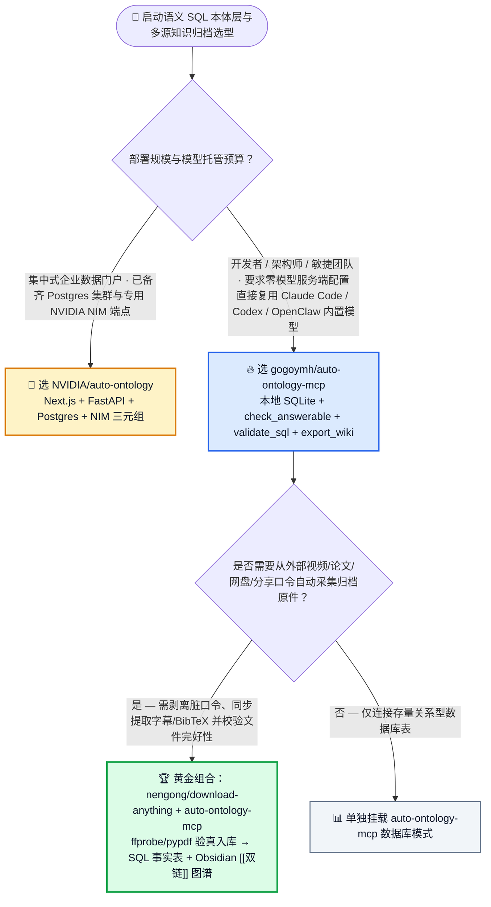
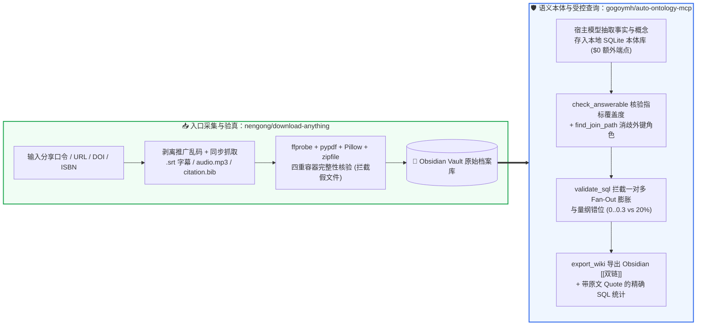

# 免自托管 NIM 的本地 SQLite 语义本体 MCP 与全平台多轨完整性归档选型常见问题解答：`gogoymh/auto-ontology-mcp`（`validate_sql` + 升级替代 Karpathy LLM Wiki）+ `nengong/download-anything` vs 重型 Postgres/NIM 部署 & 散装下载脚本

> **English Edition**: [auto-ontology-mcp-download-anything-selection-faq.en.md](auto-ontology-mcp-download-anything-selection-faq.en.md)  
> **关联日报**: [2026-11-11 GitHub AI 最热榜单与情报摘要](../daily/2026-11-11.md) · **视觉评测卡**: [`cards.html`](../cards.html) · **在线面板**: [`zh-github-radar.html`](../../../zh-github-radar.html)

本文档面向 **AI Solution Architect（AI 解决方案架构师）、数据平台架构师与个人/企业知识库负责人**，基于 2026-11-11 GitHub 新仓爆发榜两款直击“数据查询静默算错与外部资料入库脏乱”痛点的热门项目 —— **`gogoymh/auto-ontology-mcp`（将 `NVIDIA/auto-ontology` 语义本体层轻量化移植到任意 MCP 客户端、用本地 SQLite + 宿主自带大模型完成防扇出 `validate_sql` 校验并升级替代 Karpathy LLM Wiki 导出 Obsidian Vault 的 MCP 服务器，Apache-2.0，建仓 5 天 `361★`）** 与 **`nengong/download-anything`（支持从脏分享口令/链接一键采集视频、论文、播客、网盘与电子书，同步落盘 `.srt`/`.bib`/封面/独立音轨并通过 `ffprobe`/`pypdf` 执行完整性核验的 CLI 与 Agent Skill，MIT，建仓 7 天 `219★`）** 的一手源码与测试套件深度核验，用通俗大白话与第一性原理解答：
1. **为什么说“Text-to-SQL 最可怕的不是报错，而是静默算错（Fails Quietly）”？当大模型看着原始表结构写出看似合法的 SQL 时，它是怎么在“收货城市 vs 账单城市”、“一对多连接扇出膨胀（Fan-Out）”和“百分比字段写 `> 20` 还是 `> 0.2`”上把老板坑惨的？`gogoymh/auto-ontology-mcp` 是如何不用部署重型 Postgres 和 NVIDIA NIM 就能拦住这 8 类静默错误的？**
2. **为什么 Andrej Karpathy 提出的纯 Markdown `LLM Wiki` 在处理包含大量财务数字、收据、论文实验表格的知识库时会力不从心？`auto-ontology-mcp` + `download-anything` 是如何实现“多源资料净化验真 → 数字进 SQL 事实表 + 观点进双链概念图 → 一键 `export_wiki` 同步 Obsidian”的？**
3. **在企业与个人架构师日常工作中，什么时候上重型企业级 `NVIDIA/auto-ontology`，什么时候选轻量零配置的 `gogoymh/auto-ontology-mcp`？**

> 🛡️ **数据来源、归属核验与证据分级声明（Provenance & Attribution Disclosure）**：
> - **`measured`（本班次一手实测抓取）**：`gogoymh/auto-ontology-mcp`（`361` API Stars，`49` Forks，Python 3.12+，Apache-2.0，创建于 `2026-11-06`）与 `nengong/download-anything`（`219` API Stars，`3` Forks，Python 3.10+，MIT，创建于 `2026-11-04`）均通过 GitHub REST API 一手核验；两者不在主日榜 24h DOM 快照内，故 `stars_today` 严格标注为 **`not_measured`**。
> - **`anonymized_reported`（`independently_reproduced=false`，上游仓库文档与测试夹具声明）**：`gogoymh/auto-ontology-mcp` 官方 README 披露的 8 类 Text-to-SQL 静默失败拦截对照表、`check_answerable` / `get_query_context` / `validate_sql` / `find_join_path` / `export_wiki` 工具链、内置 11 张表 3,200 笔订单零售数据库与 Obsidian 文档联查测试夹具（`tests/test_demo.py`），以及 `nengong/download-anything` 的口令剥离、伴生附件提取与 `ffprobe`/`pypdf`/`Pillow`/`zipfile` 四重完整性核验机制。
> - **`synthetic`（`independently_reproduced=false`，架构师参数化 FinOps 与数据/知识工程工时算例）**：第 5.1 节「25 人研发与分析团队日常语义 SQL 查询 + 每月采集归档 `1,500 份` 外部多模态文献/视频/报告（工程师综合时薪 `$75.00/h`；商业 Obsidian Sync 订阅费明确标注为 `not_measured`）」的闭式成本对比（Path A 独立托管 Postgres/NIM + 裸 SQL 排障 + 手工清洗下载 `$4,580.00/月` vs Path B 纯 Markdown LLM Wiki + 散装脚本 `$2,730.00/月` vs Path C `auto-ontology-mcp` + `download-anything` `$645.00/月`，净省 `$3,935.00/月` [`-85.92%`] 与 `44.0 小时/月` [`-84.62%`] 工程工时）。

---

## 1. 📌 核心结论速览（Executive Summary）

| 评估维度 | 一句话大白话核心结论（直指本质） |
| :--- | :--- |
| **`gogoymh/auto-ontology-mcp` 到底是什么？** | 它是把前天周榜冠军 `NVIDIA/auto-ontology` 的核心思想**“做减法去重型化”**后的通用 MCP 服务器：原版需要你搭一套 Next.js + FastAPI + Postgres 还要配 NVIDIA NIM 专属模型 Key；而 **`auto-ontology-mcp` 把所有需要大模型动脑子的活（读表、抽概念、写 SQL）直接交给你正在用的 Claude Code / Codex / OpenClaw 宿主模型**，自己只用本地 **SQLite** 干确定性的活（字段值域画像、外键角色消歧、`validate_sql` 防扇出校验与只读执行）！ |
| **`nengong/download-anything` 到底是什么？** | 它是面向 AI Agent 的**全能外部资料采集、净化与多轨校验归档器（CLI + Skill）**：不管你扔给它一段带乱码表情的 App 分享口令、DOI 论文号、网盘链接还是播客地址，它都能剥离脏前缀，把主文件连同 **`.srt` 字幕、`cover.jpg` 原画封面、`audio.mp3` 独立音轨、`citation.bib` 引用与本地化 Markdown** 一并抓下来，并用 `ffprobe`/`pypdf`/`Pillow` 验明正身（绝不把 403 HTML 报错页当成 PDF 存进库）！ |
| **为什么这两者组合能完美升级 Karpathy 的 `LLM Wiki`？** | Karpathy 的 `LLM Wiki` 把所有资料编译成纯 Markdown 页面，一旦问“今年所有收据里差旅费按月汇总多少”就会算错；而 **`download-anything`（把脏链接变成带引用的干净原件）+ `auto-ontology-mcp`（把定量事实存入 SQL 表、把思想观点存为双链概念页，再用 `export_wiki` 导出为 Obsidian Vault）**，让你既能看双链图谱，又能跑 100% 准确的 SQL 聚合！ |

---

## 2. 🎯 第一性原理灵魂三问（Q1 / Q2 / Q3 大白话拆解）

### Q1：为什么裸写 Text-to-SQL 会“静默算错（Fails Quietly）”？`auto-ontology-mcp` 是如何精准拦截 8 大经典翻车现场的？

**先说大白话结论：SQL 语法报错很容易发现，但最致命的是“SQL 顺利跑出了一个数字，而这个数字因为连接扇出或字段单位错配，比真实值大了 3 倍或变成了 0”！**

根据 `gogoymh/auto-ontology-mcp` 官方一手实证对比，裸大模型直接读数据库 Schema 必踩以下 8 大深坑，而本体层逐一给出了确定性拦截：
1. **外键多角色歧义（Role Ambiguity）**：客户表里既有 `billing_city_id`（账单城市）又有 `delivery_city_id`（收货城市），问“某州客户营收”时裸模型随机盲猜；`auto-ontology-mcp` 通过 `set_relationship(..., is_default=true)` 明确默认角色，并在 `get_query_context` 中同时列出备选角色说明。
2. **一对多扇出膨胀（One-to-Many Fan-Out Inflation）**：当在同一个 `SELECT` 里既 `SUM(order_lines.line_total)` 又关联 `product_tags` 统计标签数时，一个商品如果有 3 个标签，它的每一笔订单金额都会被重复累加 3 次！**`validate_sql` 会当场拦截并发出 Fan-Out 警告**，指导模型先在各自独立子查询中聚合再关联。
3. **同父兄弟表伪关联（Chasm Trap）**：订单明细表和商品标签表都指向同一个 `product_id`，裸模型直接把两张表连起来算“某标签下的明细”；`find_join_path` 与 `check_answerable` 会明确告知这两张表只在商品级汇合，不存在行级对应关系。
4. **大小写与枚举值失配**：裸模型写 `WHERE state_name = 'pennsylvania'` 查出 0 元营收；本体层的值域画像提前告知存储值为 `'Pennsylvania'`。
5. **小数与百分比量纲错位**：字段存的是 `0 ~ 0.3` 的小数，裸模型写 `discount_pct > 20`；服务端剖析器提前提示取值范围并询问是否指 `0.2`。
6. **整形主键巧合碰撞**：裸模型写 `customers.customer_id = orders.order_id`（两个自增整数恰好有重叠值，SQL 不报错但结果全乱）；`validate_sql` 直接拒绝未注册的非法连接路径。
7. **不支持指标强行凑数**：问“广告投放回报率（ROAS）”，库里根本没有广告花费表，裸模型随便抓个收入字段胡诌；**`check_answerable` 先行判定 `unanswerable`**，让模型诚实回答缺少广告支出数据！

---

### Q2：`nengong/download-anything` + `auto-ontology-mcp` 是如何构建“零脏数据、可算账、可溯源”的个人与团队第二大脑的？

**大白话比喻：`download-anything` 是守在知识库大门口的“海关安检与拆包员”（剥掉垃圾包装、用 X 光机 `ffprobe`/`pypdf` 检查包裹没坏、配齐字幕和参考文献卡片）；`auto-ontology-mcp` 则是室内的“总会计师兼档案员”（把账目数字锁进 SQLite 保险柜，把文章观点织成 Obsidian 双链知识网）！**

1. **入口端：`nengong/download-anything` 的三步净化校验**：
   - **第一步（口令与脏链接剥离）**：把手机 App 复制出来的“【小红书/B站/网盘】复制这段话 ￥abc￥ 打开链接 https://... 提取码: 8888”直接喂给它，自动剥离推广乱码，精准提取 URL、提取码、DOI、ISBN、MD5。
   - **第二步（全套伴生资产同步落盘）**：下载视频/播客时自动分离 `.srt` 字幕、`audio.mp3` 独立音轨、`cover.jpg` 原画封面；下载论文/电子书时自动生成 `citation.bib` 引用卡片与防盗链本地化图片。
   - **第三步（四重容器级完整性验真）**：拒绝只看 HTTP 200 状态码！强制用 `ffprobe` 校验音视频流与有效时长、用 `pypdf` 校验 PDF 页数、用 `Pillow` 校验图像帧、用 `zipfile` 校验 EPUB/归档包结构，彻底杜绝把防爬虫 HTML 登录页当成 PDF 塞进知识库！
2. **存储与查询端：`auto-ontology-mcp` 的双轨知识底座**：
   - 把 `download-anything` 归档进 Obsidian Vault 的收据、财报、论文笔记交由助手读取：**结构化数字与事实写入本地 SQLite 类型化表（支持精确 `SUM`/`GROUP BY`），思想与概念存为带类型链接的页面，重点段落建全文索引**，且每条记录都保留原始文件链接与原文引语（Quote），随时通过 `export_wiki` 导出为带 `[[双链]]` 的 Obsidian 视图！

---

### Q3：面对企业级 `NVIDIA/auto-ontology`、个人级 `gogoymh/auto-ontology-mcp` 和 `garrytan/gbrain`，该如何选型？

- **选企业级 `NVIDIA/auto-ontology`**：当你在搭建面向全公司数百人使用的集中式 BI 数据门户，底层是大型云端 Postgres 数据仓库，且有专门的 GPU 预算运行 NVIDIA NIM 模型三元组时选用。
- **选 `gogoymh/auto-ontology-mcp` + `nengong/download-anything`**：当你是架构师、分析师或中小型研发团队，希望**零服务器部署、零额外 API Key**，直接复用手头的 Claude Code / Codex / OpenClaw 客户端模型对业务数据库做防扇出 SQL 查询，并维护一个能精确算账的 Obsidian 个人/团队知识库时首选！
- **选 `garrytan/gbrain`**：当你的核心场景是多智能体 24/7 共享上万页非结构化人物/公司档案并需要 pgvector HNSW + BM25 + 图遍历召回时选用。

---

## 3. 🧭 Mermaid 选型决策树与双工具协同架构图

### 3.1 语义本体 SQL 校验与多源知识归档选型决策树（Decision Tree）

### 3.2 `download-anything` 验真采集 × `auto-ontology-mcp` 防扇出 SQL 与 Obsidian 闭环图

---

## 4. 📊 同类方案全方位选型决策矩阵（Decision Matrix）

| 评估维度 | **`gogoymh/auto-ontology-mcp` + `nengong/download-anything`** | **原版 `NVIDIA/auto-ontology`** | **Karpathy 纯 Markdown `LLM Wiki` + 散装 `yt-dlp` 脚本** | **裸 Schema 直接 Text-to-SQL** |
| :--- | :--- | :--- | :--- | :--- |
| **基础设施与模型 Key 依赖** | ✅ **本地单文件 SQLite + 直接复用 MCP 客户端模型（0 额外部署）** | ⚠️ 需部署 Next.js + FastAPI + Postgres 并配置 NVIDIA NIM API Key | ✅ 纯本地 Markdown 文件 | ✅ 无中间层 |
| **一对多连接扇出（Fan-Out）拦截** | ✅ **`validate_sql` 自动检测并发出 Fan-Out 警告，指导拆分子查询** | ✅ 支持语义层度量定义 | ❌ 纯文本无 SQL 执行能力 | ❌ **静默算错（金额随关联标签数成倍膨胀且不报错）** |
| **未覆盖指标防幻觉（如无广告费问 ROAS）** | ✅ **`check_answerable` 明确返回 `unanswerable` 并指出缺失字段** | ✅ 支持本体范围校验 | ⚠️ 常拿相近段落模糊作答 | ❌ 强行拿普通营收字段凑数作答 |
| **结构化数字统计 + Obsidian 双链兼得** | ✅ **事实进 SQLite 可精确求和对比，概念带 Quote 导出 `[[links]]`** | ❌ 不面向个人 Obsidian 笔记归档 | ❌ 数字散落在 Markdown 文本中，多篇汇总极易漏算 | ❌ 无法管理非结构化文献与收据 |
| **外部资料采集与防破损校验** | ✅ **剥离分享口令 + 自动配齐 `.srt`/`.bib` + `ffprobe`/`pypdf` 容器验真** | ❌ 无外部多源媒体下载能力 | ❌ 散装脚本常把 403 HTML 报错页存成假 `.pdf` | N/A |

---

## 5. 🧪 定量算例与 7-Card 评测洞察（Quantitative Example & 7-Card Insights）

### 5.1 25 人团队语义 SQL 问答 + 月采集归档 1,500 份多源文献/视频闭式成本算例（`synthetic`，`independently_reproduced=false`）

> 📌 **透明口径与边界声明（Scope & Provenance）**：本算例为架构师评估团队语义数据查询与外部知识采集归档的 **托管服务/Token + 工程师核对与清洗工时参数化算例（`synthetic` model；商业 Obsidian Sync 团队许可费明确标注为 `not_measured`）**。场景设定为：**25 人架构师与数据分析团队日常查询多表业务数据库，且每月从外部采集归档 `1,500 份` 行业报告、学术论文、技术演讲视频与票据（工程师综合时薪按 `$75.00 / 小时` 计算）**：

| 方案路径 | 每月额外服务端托管与增量 Token 账单 | 每月排查静默算错 SQL（扇出膨胀/角色错连）工时 (`@ $75/h`) | 每月清洗脏分享链接、补齐字幕/BibTeX 与剔除破损文件工时 (`@ $75/h`) | 每月总综合成本（服务 + 工程师工时） | 相对 Path A 降本增效幅度 |
| :--- | :--- | :--- | :--- | :--- | :--- |
| **Path A：独立托管 Postgres/NIM 服务 + 裸 Text-to-SQL 扇出排障 + 手工清洗下载** | **`$680.00 / 月`** （常驻数据库与独立模型推理端点） | `30.0 小时 / 月` × `$75.00` = **`$2,250.00 / 月`**（人工对账发现一对多汇总金额翻倍） | `22.0 小时 / 月` × `$75.00` = **`$1,650.00 / 月`**（手剥分享口令、重下残损 PDF 与补字幕） | **`$4,580.00 / 月`** （耗费 **`52.0 小时 / 月`** 工程工时） | 基线（服务维护重，静默算错频发，素材整理繁琐） |
| **Path B：纯 Markdown `LLM Wiki`（无 SQL 校验）+ 散装下载脚本** | **`$180.00 / 月`** （长文本反复重编译 Wiki） | `20.0 小时 / 月` × `$75.00` = **`$1,500.00 / 月`**（核对 Markdown 里的手算汇总表） | `14.0 小时 / 月` × `$75.00` = **`$1,050.00 / 月`** | **`$2,730.00 / 月`** （耗费 **`34.0 小时 / 月`** 工时） | 综合降本 `-$1,850.00/月` (`-40.39%`) |
| **Path C：`gogoymh/auto-ontology-mcp` 本地 SQLite + `nengong/download-anything`** | **`$45.00 / 月`** （`$0` 额外服务端，仅宿主模型轻量工具调用） | `5.0 小时 / 月` × `$75.00` = **`$375.00 / 月`**（`validate_sql` 自动拦截扇出与错连） | `3.0 小时 / 月` × `$75.00` = **`$225.00 / 月`**（一键口令净化 + `ffprobe`/`pypdf` 自动验真） | Token `$45.00` + SQL 审阅 `$375.00` + 归档审阅 `$225.00` = **`$645.00 / 月`** (`8.0h`) | **月度净省 `$3,935.00/月` (`-85.92%`，年省 `$47,220.00`)；工程工时省 `44.0h/月` (`-84.62%`)** |

---

## 6. 🛠️ 架构师生产落地与 30 分钟 PoC 核验清单（Production & PoC Checklist）

- [ ] **Step 1 — 运行 `auto-ontology-mcp demo` 实测 11 表零售库与 Obsidian 联查**：在 Python `3.12+` 环境安装 `gogoymh/auto-ontology-mcp` 并执行 `auto-ontology-mcp demo`，在 Claude Code 或 Codex 中观察 `check_answerable`、`get_query_context` 与 `validate_sql` 如何拦截 `billing_city_id` vs `delivery_city_id` 歧义与一对多扇出膨胀。
- [ ] **Step 2 — 用 `set_relationship(..., is_default=true)` 锁死多外键默认业务口径**：对业务数据库中存在多条外键指向同一维表（如创建人 vs 审批人、发货地 vs 账单地）的表，显式指定默认关系角色。
- [ ] **Step 3 — 安装 `nengong/download-anything` 并验证四重容器完整性门禁**：运行 `python3 skills/download-anything/scripts/install.py`（默认安装至 `~/.download-anything/venv`），输入一条包含推广口令的视频或论文 DOI 链接，确认同步产出 `.srt`/`citation.bib`/`.md` 且通过 `ffprobe`/`pypdf` 校验。
- [ ] **Step 4 — 将验真后的文献与票据导入本体层并执行 `export_wiki`**：让助手读取 `download-anything` 归档的原件，将数字事实写入 SQLite 表、概念写入链接表，再运行 `export_wiki` 生成带 `[[双链]]` 与原文引语的 Obsidian Vault。
- [ ] **Step 5 — 开启只读 SQL 执行保护（Read-Only Execution）**：确认 `auto-ontology-mcp` 连接生产或分析数据库时处于严格只读执行模式，所有大模型生成的查询必须先通过 `validate_sql` 语法与本体路径双重核验后才允许执行。
