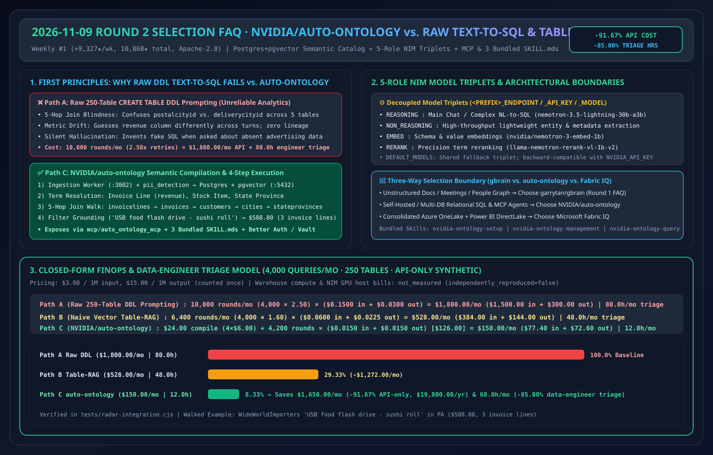
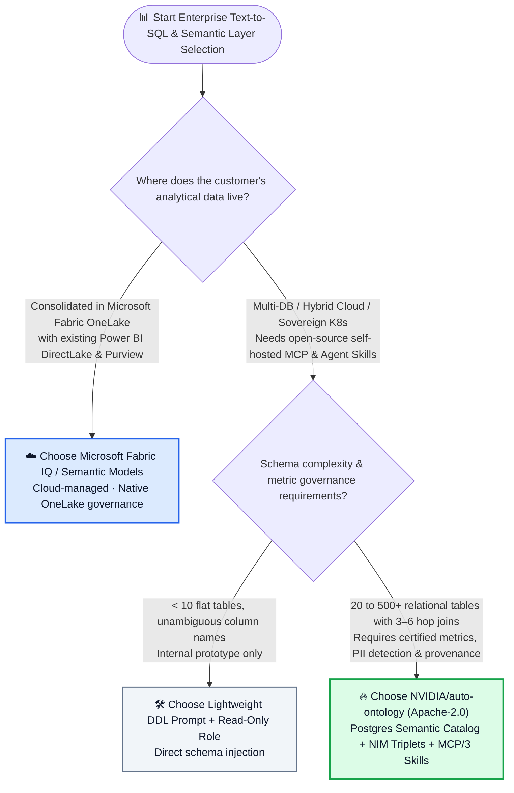
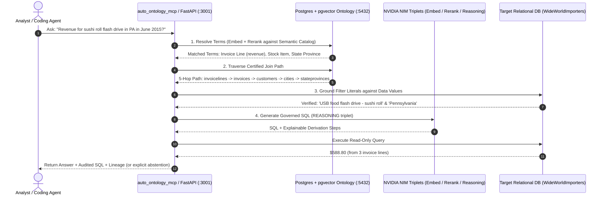

# Enterprise Semantic Ontology & Text-to-SQL Selection FAQ: `NVIDIA/auto-ontology` (Postgres Semantic Catalog + Governed Metrics + NIM Model Triplets + MCP/Skills) vs. Raw Schema Text-to-SQL vs. Legacy BI Cubes

> **中文版 (Chinese Edition)**: [auto-ontology-semantic-sql-vs-raw-text2sql-selection-faq.md](auto-ontology-semantic-sql-vs-raw-text2sql-selection-faq.md)  
> **Related Daily Digest**: [2026-11-09 GitHub AI Trending Digest (EN)](../daily/2026-11-09.en.md) · **7-Card Benchmark Deck**: [`cards.en.html`](../cards.en.html) · **Live Dashboard**: [`github-radar.html`](../../../github-radar.html)

This guide is written for **AI Solution Architects** based on primary-source verification of #1 Weekly Trending repository **`NVIDIA/auto-ontology` (`Apache-2.0`, Python 3.12+ / Next.js 16, `10,868` total stars, `+9,327 stars this week`)** across its source tree (`auto_ontology/`, `mcp/auto_ontology_mcp/`, `skills/`). Using plain language and first principles, it answers:
1. **Why does dumping 200 raw `CREATE TABLE` DDLs into an LLM for Text-to-SQL consistently produce wrong revenue numbers that fail finance audits?**
2. **How does `NVIDIA/auto-ontology` combine Semantic Compilation in Postgres+pgvector, 5-role NIM Model Triplets, built-in `pii_detection`, and 3 bundled Agent `SKILL.md`s to guarantee explainable multi-hop SQL and honest abstention?**
3. **When should an architect choose `NVIDIA/auto-ontology`, when to use Microsoft Fabric IQ / OneLake Semantic Models, and when is simple Table-RAG sufficient?**

> 🛡️ **Provenance & Attribution Disclosure**:
> - **`measured` (Primary API & Trending Verification)**: GitHub REST API metadata (`10,868` stars, `887` forks, `Apache-2.0`, official `NVIDIA` GitHub organization repository) and Weekly Trending #1 velocity (`+9,327 stars this week`).
> - **`anonymized_reported` (`independently_reproduced=false`, Upstream Repo Architecture & Walkthrough Claims)**: 4-service topology (Next.js 16 `:3000` + FastAPI backend `:3001` + FastAPI ingestion worker `:3002` + Postgres+pgvector `:5432` + optional HashiCorp Vault), 5-role NIM Model Triplets (`nvidia/nemotron-3.5-lightning-30b-a3b`, `nvidia/nemotron-3-embed-1b`, `nvidia/llama-nemotron-rerank-vl-1b-v2`), 3 bundled skills (`nvidia-ontology-setup`, `nvidia-ontology-management`, `nvidia-ontology-query`), and the `WideWorldImporters` 5-table join walkthrough (`$588.80` across 3 invoice lines), cited from [`NVIDIA/auto-ontology/blob/main/README.md`](https://github.com/NVIDIA/auto-ontology/blob/main/README.md).
> - **`synthetic` (`independently_reproduced=false`, Architect Parametric FinOps Model)**: Section 5.1 models **4,000 analytical SQL queries/month** over a 250-table enterprise data warehouse at `$3.00/1M` input and `$15.00/1M` output tokens (API-only scope; warehouse compute and NIM GPU hosting bills are marked `not_measured`): Path A Raw DDL Dumping (`$1,800.00/mo`, `80.0h` data-engineer triage) vs. Path B Naive Table-RAG (`$528.00/mo`, `48.0h`) vs. Path C `NVIDIA/auto-ontology` (`$150.00/mo`, `12.0h`), saving **`$1,650.00/mo` (`-91.67%` API-only, `$19,800.00/yr`)** and **`68.0 hours/mo` (`-85.00%`)**.

---

## 1. 📌 Executive Summary

| Selection Dimension | Plain-English Takeaway (First Principles) |
| :--- | :--- |
| **What is `NVIDIA/auto-ontology`?** | It is NVIDIA's official open-source **semantic catalog and ontology reasoning layer over relational databases**. It ingests database metadata, compiles governed business entities, join relationships, and metric definitions into `Postgres + pgvector`, and exposes them to any agent via **MCP (`auto_ontology_mcp`), 3 built-in `SKILL.md` packages, and REST APIs**. |
| **What developer pain point does it solve?** | Raw Text-to-SQL models can write syntactically valid SQL, but they guess business meaning—picking the wrong price column, joining on billing city instead of delivery city, or hallucinating metrics when a table doesn't exist. As NVIDIA's README states: ***"A revenue metric answered faster is worth nothing if the number is wrong."*** |
| **How does it compare to Naive Table-RAG and Legacy BI Cubes?** | Unlike Naive Table-RAG (which only retrieves table DDL snippets without governed join graphs or filter-value validation), `auto-ontology` enforces **Semantic Compilation, value grounding, and certified feedback loops**; unlike months of manual BI cube modeling, it bootstraps ontologies automatically from metadata with built-in `pii_detection`. |

---

## 2. 🎯 First-Principles Deep Dive (Q1 / Q2 / Q3)

### Q1: Why does "Raw Schema-Dump Text-to-SQL" fail in enterprise production?

**Plain-English Answer: Because physical `CREATE TABLE` DDL only tells the LLM column data types—not business metric definitions, multi-hop join paths, or exact filter strings!**

Consider the `WideWorldImporters` query from the repository: *"What was revenue for the USB food flash drive - sushi roll in Pennsylvania in June 2015?"*
1. **The 5-Hop Foreign-Key Maze**: Reaching `stateprovincename = 'Pennsylvania'` from `sales.invoicelines` requires traversing `sales.invoicelines -> sales.invoices -> sales.customers -> application.cities (deliverycityid) -> application.stateprovinces`. A raw LLM routinely joins `postalcityid` instead of `deliverycityid` or invents a non-existent `state` column on `customers`.
2. **Filter Value Grounding**: The user asks for *"sushi roll flash drive,"* while the database stores `'USB food flash drive - sushi roll'`. `auto-ontology` grounds filter literals against indexed data values before executing SQL.
3. **Honest Abstention on Missing Data**: When asked about advertising spend (which does not exist in `WideWorldImporters`), raw Text-to-SQL often fabricates a query over discount columns, whereas `auto-ontology` sees no matching ontology entity and explicitly abstains.

---

### Q2: How do the 4 core subsystems inside `NVIDIA/auto-ontology` work together?

Auditing `auto_ontology/` (`catalog/`, `connectors/`, `dal/`, `ingestion_service/`, `pii_detection/`, `retrieval/`, `semantic/`, `server/`, `vdb/`), `mcp/`, and `skills/` reveals a clean 4-layer architecture:
1. **Decoupled Ingestion Worker (`:3002`) & Semantic Compilation**:
   - The FastAPI ingestion worker scans connected databases, runs **`pii_detection`**, embeds metadata into `Postgres + pgvector (:5432)`, and compiles terms, relationships, and certified metric definitions.
2. **5-Role NIM Model Triplets (`<PREFIX>_ENDPOINT`, `_API_KEY`, `_MODEL`)**:
   - Decouples inference across `DEFAULT_MODELS`, `REASONING` (main NL-to-SQL, default `nvidia/nemotron-3.5-lightning-30b-a3b`), `NON_REASONING` (lightweight entity extraction), `EMBED` (`nvidia/nemotron-3-embed-1b`), and `RERANK` (`nvidia/llama-nemotron-rerank-vl-1b-v2`).
3. **Native MCP Server & 3 Bundled Agent Skills**:
   - Ships with `mcp/auto_ontology_mcp/` and 3 ready-to-mount skills (`skills/nvidia-ontology-setup/`, `skills/nvidia-ontology-management/`, `skills/nvidia-ontology-query/`).
4. **Enterprise Security (`HashiCorp Vault` + `Better Auth` + `Helm`)**:
   - Stores database credentials in HashiCorp Vault, enforces RBAC via Better Auth in the Next.js 16 UI (`:3000`), and deploys via Docker Compose or Kubernetes Helm charts (`helm/`).

---

### Q3: How should an AI Solution Architect choose between `NVIDIA/auto-ontology`, Microsoft Fabric IQ, and `garrytan/gbrain`?

- **Choose `garrytan/gbrain` (Round 1 FAQ)**: For **unstructured/semi-structured knowledge pages** (meeting notes, customer dossiers, people/company graphs, ADRs) shared across coding and personal agents.
- **Choose `NVIDIA/auto-ontology` (Round 2 FAQ)**: For **self-hosted or hybrid-cloud relational databases** where multiple agents need governed business metrics, verified multi-hop SQL joins, and MCP/Skill access.
- **Choose Microsoft Fabric IQ / Power BI Semantic Models**: When the customer's analytical estate already resides in **Microsoft Fabric OneLake / DirectLake** with Purview governance.

---

## 3. 🧭 Mermaid Selection Decision Tree & Query Sequence Diagram

### 3.1 Enterprise Text-to-SQL & Semantic Layer Selection Decision Tree

### 3.2 `NVIDIA/auto-ontology` 4-Step Deterministic Term-to-SQL Execution Flow

---

## 4. 📊 Comprehensive Selection Matrix

| Evaluation Dimension | **`NVIDIA/auto-ontology` (Apache-2.0)** | **Raw DDL Text-to-SQL** | **Naive Vector Table-RAG** | **Legacy Manual BI Cube (LookML/MDX)** |
| :--- | :--- | :--- | :--- | :--- |
| **Metric Definition Consistency** | ✅ **High (Semantic Compilation locks certified formulas)** | ❌ Very Low (guesses columns per prompt) | ⚠️ Medium (retrieves tables, not certified formulas) | ✅ High (manually coded) |
| **Multi-Hop Join Accuracy** | ✅ **High (follows compiled ontology relationship edges)** | ❌ Low (hallucinates join keys on 4+ tables) | ⚠️ Medium (often drops intermediate bridge tables) | ✅ High (pre-modeled) |
| **Cold-Start Modeling Effort** | ✅ **Low (automated metadata ingestion + feedback loop)** | ✅ Zero setup (high runtime failure cost) | ✅ Low (table description embeddings) | ❌ **Very High (weeks of manual modeling)** |
| **Abstention on Missing Data** | ✅ **First-class (abstains when terms absent from ontology)** | ❌ Poor (fabricates queries over unrelated columns) | ⚠️ Moderate | ✅ Supported |
| **Agent MCP & Skill Integration** | ✅ **Bundled `auto_ontology_mcp` + 3 `SKILL.md` packages** | ❌ Custom wrapper required | ❌ Custom wrapper required | ⚠️ Vendor-specific APIs |
| **Security & PII Governance** | ✅ **Built-in `pii_detection` + HashiCorp Vault + Better Auth** | ❌ Leaks raw schema/samples into prompts | ❌ No built-in PII scanner | ✅ Enterprise RBAC |

---

## 5. 🧪 Quantitative FinOps Worked Example & 7-Card Insights

### 5.1 Parametric 250-Table / 4,000-Query Monthly API & Data-Engineer Triage Model (`synthetic`, `independently_reproduced=false`)

> 📌 **Scope & Provenance**: This closed-form model evaluates **LLM API token spend and data-engineer SQL audit hours (`synthetic`, `independently_reproduced=false`; database warehouse compute and self-hosted NIM GPU node bills are explicitly marked `not_measured`)** for an enterprise running **4,000 analytical queries/month** across a 250-table relational schema with **4 weekly semantic compilations/month**, priced at `$3.00/1M` input tokens and `$15.00/1M` output tokens (output counted once):

| Architecture Path | Monthly Semantic Compilation Cost | Monthly Query Rounds (incl. retries) & Per-Round Cost | Monthly Total LLM API Cost (Input + Output) | Monthly Data-Engineer Triage Hours | Net Savings vs. Path A |
| :--- | :--- | :--- | :--- | :--- | :--- |
| **Path A: Raw 250-Table DDL Dumping + Join Error Retries** | `$0.00` (no compilation) | `4,000 × 2.50 = 10,000 rounds` `0.050M` in (`$0.1500`) + `0.002M` out (`$0.0300`) = `$0.1800/round` | `$1,500.00` in + `$300.00` out = **`$1,800.00 / mo`** | **`80.0 hours / mo`** (debugging broken joins & metric disputes) | Baseline (high token waste & low business trust) |
| **Path B: Naive Vector Table-RAG (No Ontology Compilation)** | `$0.00` (table embeddings only) | `4,000 × 1.60 = 6,400 rounds` `0.020M` in (`$0.0600`) + `0.0015M` out (`$0.0225`) = `$0.0825/round` | `$384.00` in + `$144.00` out = **`$528.00 / mo`** | **`48.0 hours / mo`** (fixing missing bridge tables & filter literals) | `-$1,272.00/mo` (`-70.67%` API-only) |
| **Path C: `NVIDIA/auto-ontology` (Semantic Compilation + Triplets + MCP)** | 4 weekly compilations (`4 × $6.00` = **`$24.00 / mo`** [`$14.40` in + `$9.60` out]) | `4,000 × 1.05 = 4,200 rounds` `0.005M` in (`$0.0150`) + `0.001M` out (`$0.0150`) = `$0.0300/round` → **`$126.00 / mo`** | `$24.00` compile + `$126.00` query = **`$150.00 / mo`** (`$77.40` in + `$72.60` out) | **`12.0 hours / mo`** (certifying metric definitions in Web UI) | **Saves `$1,650.00/mo` (`-91.67%` API-only, `$19,800.00/yr`) & `68.0h/mo` (`-85.00%`)** |

---

## 6. 🛠️ Production & 30-Minute PoC Verification Checklist

- [ ] **Step 1 — Run the `WideWorldImporters` 5-Hop Walkthrough**: Clone `NVIDIA/auto-ontology` and `NVIDIA/auto-ontology-eval`, start the 4-container Docker Compose stack, enable `Settings → Semantic Compilation`, and verify the Pennsylvania sushi-roll flash drive query returns `$588.80` across 3 invoice lines with full join lineage.
- [ ] **Step 2 — Verify Honest Abstention on Out-of-Scope Queries**: Ask a question about data absent from the schema (e.g., advertising spend) and confirm the ontology layer abstains rather than fabricating a SQL query.
- [ ] **Step 3 — Configure 5-Role NIM Model Triplets**: Route `NON_REASONING`, `EMBED`, and `RERANK` to fast, low-cost endpoints while reserving `REASONING` for complex SQL generation.
- [ ] **Step 4 — Mount `auto_ontology_mcp` & the 3 Bundled `SKILL.md`s**: Connect `mcp/auto_ontology_mcp` and `skills/nvidia-ontology-query` to Claude Code or your enterprise BI agent.
- [ ] **Step 5 — Enforce Read-Only DB Roles, `pii_detection` & HashiCorp Vault**: Store production database credentials in Vault, enforce read-only database permissions, and audit `pii_detection` rules before enabling ingestion.
