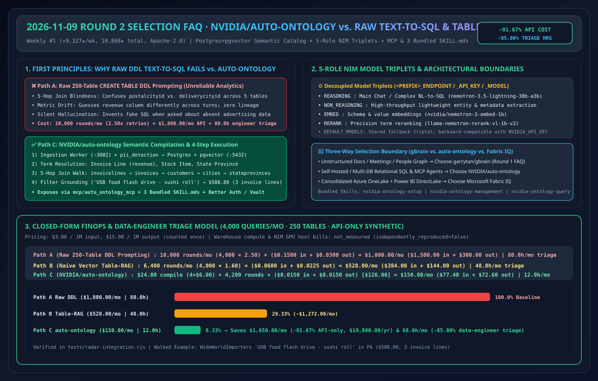
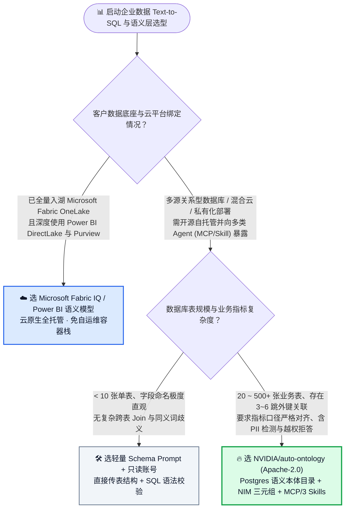
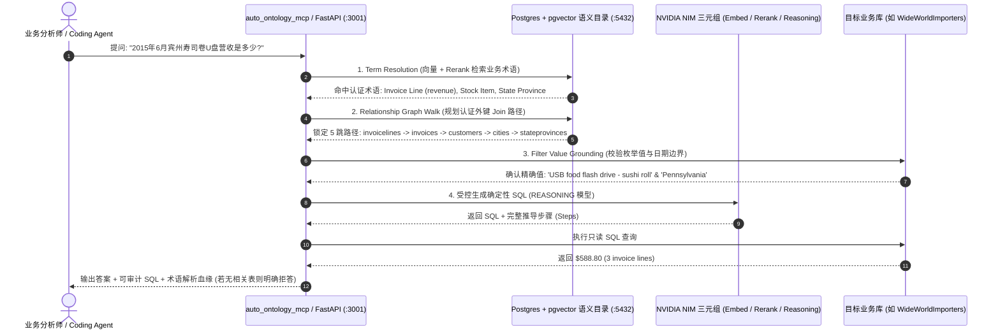

# 企业结构化数据语义本体层与 Text-to-SQL 选型常见问题解答：`NVIDIA/auto-ontology`（Postgres 语义目录 + 指标口径对齐 + NIM 三元组路由 + MCP/Skills 暴露）vs 裸 Schema Text-to-SQL vs 传统重型 BI 语义层

> **English Edition**: [auto-ontology-semantic-sql-vs-raw-text2sql-selection-faq.en.md](auto-ontology-semantic-sql-vs-raw-text2sql-selection-faq.en.md)  
> **关联日报**: [2026-11-09 GitHub AI 最热榜单与情报摘要](../daily/2026-11-09.md) · **视觉评测卡**: [`cards.html`](../cards.html) · **在线面板**: [`zh-github-radar.html`](../../../zh-github-radar.html)

本文档面向 **AI Solution Architect（AI 解决方案架构师）**，基于 2026-11-09 GitHub Weekly Trending 全网总榜第 1 名 **`NVIDIA/auto-ontology`（Apache-2.0，Python 3.12+ / Next.js 16，总 Star `10,868`，单周暴涨 `+9,327 stars this week`）** 的一手源码审计（`auto_ontology/`、`mcp/auto_ontology_mcp/`、`skills/`），用通俗大白话与第一性原理解答：
1. **为什么把数据库 200 张表的 `CREATE TABLE` DDL 直接塞给大模型做 Text-to-SQL，算出来的“上月华北区净营收”总是和财务报表对不上？**
2. **`NVIDIA/auto-ontology` 是如何用「Postgres 语义目录编译（Semantic Compilation）+ 5 角色模型三元组路由 + 内置 PII 检测 + MCP 与 3 大 Agent Skill」打通“查得准、可溯源、敢拒答”闭环的？**
3. **在企业数据架构选型中，什么时候用 `NVIDIA/auto-ontology`，什么时候用 Microsoft Fabric IQ / Power BI 语义模型，什么时候用简单 Table-RAG？**

> 🛡️ **数据来源、归属核验与证据分级声明（Provenance & Attribution Disclosure）**：
> - **`measured`（本班次一手实测抓取）**：`NVIDIA/auto-ontology` GitHub REST API 元数据（`10,868` Stars，`887` Forks，`Apache-2.0`，官方 `NVIDIA` GitHub 组织仓库，配套评测仓 `NVIDIA/ontology-sql-eval`）及 Weekly Trending 榜首周增量（`+9,327 stars this week`）。
> - **`anonymized_reported`（`independently_reproduced=false`，上游仓库文档与架构声明）**：4 容器微服务拓扑（Next.js 16 `:3000` + FastAPI 后端 `:3001` + FastAPI 摄取 Worker `:3002` + Postgres+pgvector `:5432` + 可选 HashiCorp Vault）、5 角色 NIM 模型三元组（默认 `nvidia/nemotron-3.5-lightning-30b-a3b`、`nvidia/nemotron-3-embed-1b`、`nvidia/llama-nemotron-rerank-vl-1b-v2`）、内置 3 大 Agent Skills（`nvidia-ontology-setup`、`nvidia-ontology-management`、`nvidia-ontology-query`）及 `WideWorldImporters` 5 表关联查询示例（返回 `$588.80` / 3 条发票明细），引自 [`NVIDIA/auto-ontology/blob/main/README.md`](https://github.com/NVIDIA/auto-ontology/blob/main/README.md)。
> - **`synthetic`（`independently_reproduced=false`，架构师参数化 FinOps 算例）**：第 5.1 节「250 张表数据仓库、每月 4,000 次分析型 SQL 查询」的纯模型 API 账单对比（Path A 裸 DDL 全量塞入 `$1,800.00/月` vs Path B 纯向量表检索 Table-RAG `$528.00/月` vs Path C `NVIDIA/auto-ontology` 语义编译 + 三元组路由 `$150.00/月`，节省 `$1,650.00/月` [`-91.67%` API-only] 与 `68.0 小时/月` [`-85.00%`] 数据工程师对账工时；底层数据库算力与 NIM 托管费标为 `not_measured`）严格执行 100% 闭式公式可复算门禁。

---

## 1. 📌 核心结论速览（Executive Summary）

| 评估维度 | 一句话大白话核心结论（直指本质） |
| :--- | :--- |
| **`NVIDIA/auto-ontology` 到底是什么？** | 它是英伟达官方开源的**企业关系型数据库“语义本体与指标翻译官”**。它从企业散乱的数据库表结构（Metadata）中自动提炼出统一的业务实体、外键关联路径与认证指标定义（存入 Postgres + pgvector），并通过 **MCP 服务 (`auto_ontology_mcp`)、3 个标准 `SKILL.md` 和 REST API** 暴露给任何智能体，让大模型生成 **100% 符合业务口径、带血缘溯源的确定性 SQL**。 |
| **它解决了以前 Text-to-SQL 的什么致命痛点？** | 以前做 Text-to-SQL，大模型虽然能写出语法不报错的 `SELECT SUM(...)`，但根本不知道**“公司的‘营收’到底该算 `invoices.total` 还是 `invoicelines.extendedprice`？客户所在州该走账单城市还是配送城市（`deliverycityid`）？”**。结果正如 NVIDIA README 第一句所言：**“一个回答得很快但数字算错的营收指标，商业价值为零！”** |
| **它和传统重型 BI 语义层 / 裸 Table-RAG 比，核心优势在哪？** | 相比纯向量表检索（Table-RAG 只找表名不锁关联路径），它多了**语义编译（Semantic Compilation）与过滤值实证校验**；相比传统靠人工拖拽几个月的重型 BI 立方体，它能用小模型自动从元数据发现本体、内置 `pii_detection` 隐私识别，并把人类修正（Certified Corrections）持续反哺回本体库！ |

---

## 2. 🎯 第一性原理灵魂三问（Q1 / Q2 / Q3 大白话拆解）

### Q1：为什么“裸传数据库 Schema 给大模型（Raw Text-to-SQL）”在企业生产环境必死无疑？

**先说大白话结论：因为物理表结构（Physical Schema）只记录了“字段叫什么类型”，完全没记录“业务契约与多跳 Join 规则”！**

以微软经典销售库 `WideWorldImporters` 中一个看似简单的问题为例：*“2015 年 6 月宾夕法尼亚州（Pennsylvania）寿司卷造型 U 盘的营收是多少？”*
1. **多跳外键迷宫（5-Hop Join Path）**：从发票明细 `sales.invoicelines` 到州名 `application.stateprovinces`，中间必须依次穿过 `sales.invoices` -> `sales.customers` -> `application.cities (deliverycityid)` -> `application.stateprovinces`。裸大模型常把 `postalcityid`（邮寄城市）和 `deliverycityid`（配送城市）搞混，或者直接漏掉中间表报错。
2. **枚举值拼写幻觉（Filter Value Hallucination）**：用户口头说“寿司卷 U 盘”，数据库里的真实精确字符串是 `'USB food flash drive - sushi roll'`。如果不先到字典向量索引里对齐枚举值，直接写 `WHERE name LIKE '%sushi%'` 极易多算或漏算。
3. **不懂拒答（Silent Hallucination on Missing Data）**：当高管问 *“上个月我们在宾州的广告投放 ROI 是多少？”* 时，由于库里压根没有广告表，裸 Text-to-SQL 往往强行拿销售折扣字段凑出一个假数字；而 `auto-ontology` 在本体解析阶段发现无对应业务实体，会**直接明确拒答并说明缺失的数据源**。

---

### Q2：`NVIDIA/auto-ontology` 源码里的四大核心机制是怎么协同运转的？

通过审计其顶层源码目录 `auto_ontology/`（含 `catalog/`, `connectors/`, `dal/`, `ingestion_service/`, `pii_detection/`, `retrieval/`, `semantic/`, `server/`, `vdb/`）与 `mcp/`、`skills/`，其核心工程精髓浓缩为四点：
1. **摄取与语义编译分离（Ingestion Worker `:3002` + Semantic Compilation）**：
   - 独立进程 `ingestion_service` 连接目标数据库扫描表结构、采样列值、执行 **`pii_detection`（敏感个人隐私字段检测）**，并将嵌入向量写入 `Postgres + pgvector (:5432)`。
   - 开启 **Semantic Compilation（语义编译）** 后，系统将物理表、列映射为经过对齐的业务术语（Terms，如 `Invoice Line -> revenue`）与有向关联边（Relationships）。
2. **5 角色模型三元组解耦路由（Model Triplets）**：
   - 通过环境变量三元组 `<PREFIX>_ENDPOINT` / `_API_KEY` / `_MODEL` 将工作负载拆分为 5 个独立角色：
     - `REASONING`（主对话与复杂 NL-to-SQL 生成，默认 `nvidia/nemotron-3.5-lightning-30b-a3b`）
     - `NON_REASONING`（高频轻量实体抽取）
     - `EMBED`（表/值向量化，默认 `nvidia/nemotron-3-embed-1b`）
     - `RERANK`（语义检索重排序，默认 `nvidia/llama-nemotron-rerank-vl-1b-v2`）
     - `DEFAULT_MODELS`（兜底默认配置）
   - 这种设计让架构师可以用廉价高速小模型跑后台摄取抽实体，只把复杂 SQL 推理留给强推理模型，大幅降低 Token 账单。
3. **开箱即用的 MCP 服务与 3 大 Agent Skills**：
   - 仓库原生自带 `mcp/auto_ontology_mcp/` 容器化 MCP Server，以及 `skills/` 目录下的三个标准技能包：**`nvidia-ontology-setup`**（初始化配置）、**`nvidia-ontology-management`**（本体增删改与认证修正）与 **`nvidia-ontology-query`**（受控语义查询），Claude Code / Cursor / 自定义 Agent 零改造即可直接挂载。
4. **企业级安全底座（HashiCorp Vault + Better Auth RBAC）**：
   - 数据库连接串凭证可选托管在 **HashiCorp Vault** 中，前端网关（Next.js 16 `:3000`）内置 **Better Auth** 角色权限控制，满足金融政企合规审计要求。

---

### Q3：面对 `NVIDIA/auto-ontology`、Microsoft Fabric IQ 语义层、以及我们在 Round 1 拆解的 `garrytan/gbrain`，架构师如何选型？

- **选 `garrytan/gbrain`（Round 1 专题）**：当你要管理的是**非结构化/半结构化知识页（会议纪要、客户档案、人物公司关系网、架构文档）**，核心诉求是跨会话事实记忆与多跳文档召回。
- **选 `NVIDIA/auto-ontology`（本篇 Round 2 专题）**：当你的数据源是**跨多个关系型数据库（Postgres 等）的结构化业务表**，且你想用开源自托管方案（Docker Compose 或 K8s Helm Chart）为各类 Coding/BI Agent 提供统一的语义目录与高可靠 Text-to-SQL 能力。
- **选 Microsoft Fabric IQ / OneLake Semantic Model**：当客户已经是 **Azure / Microsoft Fabric 全栈企业租户**，数据已在 OneLake Delta Parquet 中且深度绑定 Power BI DirectLake 与 Purview 治理时，优先使用云原生托管 Fabric IQ，并可借鉴 `auto-ontology` 的“术语解析 -> 路径规划 -> 枚举值验证 -> SQL 执行”四步可解释输出格式。

---

## 3. 🧭 Mermaid 选型决策树与语义编译执行时序图

### 3.1 企业结构化数据 Agent 查询与语义层选型决策树

### 3.2 `NVIDIA/auto-ontology` 四步确定性语义解析与 SQL 生成链路图

---

## 4. 📊 同类方案全方位选型决策矩阵（Decision Matrix）

| 评估维度 | **`NVIDIA/auto-ontology` (Apache-2.0)** | **裸 DDL Text-to-SQL (Raw Schema Prompt)** | **传统纯向量表检索 (Naive Table-RAG)** | **传统重型 BI 语义层 (Cube / LookML)** |
| :--- | :--- | :--- | :--- | :--- |
| **指标口径一致性** | ✅ **高（Semantic Compilation 锁定认证指标公式）** | ❌ 极低（同一问题两次提问可能用不同金额列） | ⚠️ 中（仅找对表，不保证列级计算公式一致） | ✅ 极高（人工硬编码 YAML/MDX） |
| **多跳外键 Join 准确率** | ✅ **高（沿本体有向关系边自动推导 5+ 跳关联）** | ❌ 低（极易臆造不存在的外键或选错关联键） | ⚠️ 中（跨 4 张表以上时容易漏掉中间桥接表） | ✅ 高（需数据工程师预先手工定义） |
| **构建与维护冷启动成本** | ✅ **低（Ingestion Worker 自动扫描 + 增量反馈闭环）** | ✅ 零构建成本（但运行期排错成本极高） | ✅ 低（仅需对表描述做 Embedding） | ❌ **极高（通常需数周人工建模）** |
| **缺失数据诚实拒答能力** | ✅ **原生支持（本体无对应业务概念时显式拒答）** | ❌ 差（常强行拼凑相近字段编造假数据） | ⚠️ 一般 | ✅ 支持（超出预定义维度即无法查询） |
| **Agent 协议与技能集成** | ✅ **内置 `auto_ontology_mcp` + 3 个标准 `SKILL.md`** | ❌ 需自行手写 Tool 封装 | ❌ 需自行封装 | ⚠️ 依赖厂商特定 API |
| **企业安全与隐私治理** | ✅ **内置 `pii_detection` + HashiCorp Vault + Better Auth** | ❌ 极易将敏感列结构或采样值明文泄露给外部模型 | ❌ 无内置 PII 识别 | ✅ 企业级 RBAC |

---

## 5. 🧪 定量算例与 7-Card 评测洞察（Quantitative Example & 7-Card Insights）

### 5.1 250 表企业数仓每月 4,000 次分析查询 FinOps 与对账工时闭式算例（`synthetic`，`independently_reproduced=false`）

> 📌 **透明口径与边界声明（Scope & Provenance）**：本算例为架构师面向数据平台负责人汇报的 **纯模型 API 参数化算例（API-only `synthetic` model；底层数仓计算节点、Postgres 容器与自建 GPU/NIM 主机折旧明确标为 `not_measured`）**。统一按 **`$3.00 / 1M 输入 Tokens`**、**`$15.00 / 1M 输出 Tokens`**（输出仅计费一次）核算。场景设定为：**企业拥有 250 张核心业务表，业务与研发 Agent 每月发起 `4,000 次` 自然语言数据查询，每周执行 1 次（每月 `4 次`）元数据增量同步**：

| 方案路径 | 每月语义编译/同步开销 | 每月查询总轮次（含报错重试）与单轮开销 | 每月纯模型 API 总账单（输入 + 输出） | 每月数据工程师核对/修 SQL 工时 | 相对 Path A 降本增效幅度 |
| :--- | :--- | :--- | :--- | :--- | :--- |
| **Path A：裸传 250 表 DDL Text-to-SQL（反复报错重试）** | `$0.00`（无预编译） | `4,000 × 2.50 = 10,000 轮` 单轮 `0.050M` 入 (`$0.1500`) + `0.002M` 出 (`$0.0300`) = `$0.1800/轮` | 输入 `$1,500.00` + 输出 `$300.00` = **`$1,800.00 / 月`** | **`80.0 小时 / 月`** （人工排查错误 Join 与口径打架） | 基线（Token 昂贵且业务方不敢信结果） |
| **Path B：普通向量表检索 Table-RAG（无语义本体与值校验）** | `$0.00`（仅表名向量化） | `4,000 × 1.60 = 6,400 轮` 单轮 `0.020M` 入 (`$0.0600`) + `0.0015M` 出 (`$0.0225`) = `$0.0825/轮` | 输入 `$384.00` + 输出 `$144.00` = **`$528.00 / 月`** | **`48.0 小时 / 月`** （修补跨多表桥接遗漏与枚举值不匹配） | API 降本 `-$1,272.00/月` (`-70.67%`) |
| **Path C：`NVIDIA/auto-ontology`（语义编译 + 5 角色三元组 + MCP/Skills）** | 每月 4 次增量语义编译 (`4 × $6.00` = **`$24.00 / 月`** [`$14.40` 入 + `$9.60` 出]) | `4,000 × 1.05 = 4,200 轮` 单轮 `0.005M` 入 (`$0.0150`) + `0.001M` 出 (`$0.0150`) = `$0.0300/轮` → **`$126.00 / 月`** | 编译 `$24.00` + 查询 `$126.00` = **`$150.00 / 月`** (`$77.40` 入 + `$72.60` 出) | **`12.0 小时 / 月`** （仅在 Web UI 审核认证指标定义） | **API 净省 `$1,650.00/月` (`-91.67%`，年省 `$19,800.00`)；工时省 `68.0h/月` (`-85.00%`)** |

---

## 6. 🛠️ 架构师生产落地与 30 分钟 PoC 核验清单（Production & PoC Checklist）

- [ ] **Step 1 — 跑通官方 `WideWorldImporters` 5 表关联基准测试**：克隆 `NVIDIA/auto-ontology` 与 `NVIDIA/auto-ontology-eval`，启动 Docker Compose 栈（`:3000` Web UI、`:3001` Backend、`:3002` Ingestion Worker、`:5432` Postgres），开启 `Settings → Semantic Compilation`，复现宾州寿司卷 U 盘查询（验证是否精准返回 `$588.80` 及 5 跳 SQL 血缘）。
- [ ] **Step 2 —  executing 缺失数据“诚实拒答”红队测试**：故意提问库中不存在的业务域（如“2015 年各州广告投放转化率”），确认系统能基于本体边界明确拒绝回答，而非强行拼凑错误 SQL。
- [ ] **Step 3 — 配置 5 角色模型三元组（Model Triplets）分层降本**：在 `.env` 中将高频实体抽取 `NON_REASONING` 与 `EMBED`/`RERANK` 绑定至轻量高吞吐 NIM 端点，仅将 `REASONING` 绑定至强推理模型。
- [ ] **Step 4 — 挂载 `auto_ontology_mcp` 与 3 大内置 `SKILL.md`**：将 `skills/nvidia-ontology-query` 与 `mcp/auto_ontology_mcp` 接入企业 Coding/BI Agent，替代原先直接裸查数据库的危险脚本。
- [ ] **Step 5 — 启用 `pii_detection` 与 HashiCorp Vault 凭据托管**：在接入客户真实生产库前，必须配置只读数据库账号，通过 Vault 托管 `CONNECTION_STRINGS`，并核查 `pii_detection` 是否已将手机号、身份证等敏感列隔离在 LLM 采样上下文之外。
