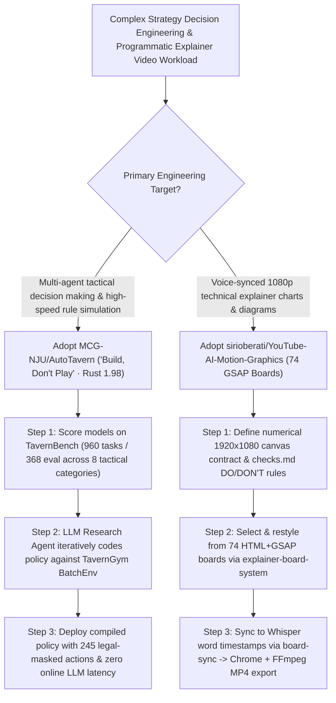

# "Build, Don't Play" Rust Strategy Gym (`MCG-NJU/AutoTavern` 960 Tasks) & 74-Board Whisper-Synced Motion Graphics (`sirioberati/YouTube-AI-Motion-Graphics`) Selection FAQ

> **Positioning**: This standalone guide is **Round 41 of the 2026-11-11 Night Shift (Cumulative Guide #86)**, written in the plain-language, first-principles, closed-form FinOps style of `ib-vs-ethernet-roce-selection-faq.md` for Strategic Decision Agent Architects and Programmatic Video Engineering Leads evaluating two high-velocity open-source repositories:
> 1. **`MCG-NJU/AutoTavern` (`276★`, Rust 1.98 + Python 3.10+, `arXiv:2610.33845v1` *"Build, Don't Play: Self-Improving LLM Research Agents Develop a Hearthstone Battlegrounds AI That Rivals Top Players"*, Nanjing University + Shanghai AI Lab, MIT)**: Combines **`TavernGym`** (a deterministic Rust 8-player simulator for patch `37.0.2.256589` with `Game`, `BattlegroundsEnv`, and batched self-play `BatchEnv` exposing `245` discrete actions, `3,227` numeric features, `124` card indices, exact legal masks, and seeded save/restore) with **`TavernBench`** (**`960` tasks / `368` eval split** across 40 scenarios and 8 tactical categories: `Combat`, `Positioning`, `Ordering`, `Targets`, `Selection`, `Strategy`, `Economy`, and `Rule execution`);
> 2. **`sirioberati/YouTube-AI-Motion-Graphics` (`191★`, HTML + GSAP + Whisper + Chrome + FFmpeg)**: Ships **74 animated `1920 × 1080` HTML + GSAP explainer boards** (`Venn`, `Timeline`, `2×2 Matrix`, `Slope Chart`, `Heatmap`, `Chart Focus`, `Scribble Fill`, `Node Graph`, `Versus Cards`, `Loop`, `Odometer`, `Magnifier Lens`, etc.), **3 composable Claude skills** (`explainer-board-brief`, `explainer-board-system`, `board-sync`), an accumulating **`checks.md` DO/DON'T visual QA gate**, and frame-exact Chrome + FFmpeg MP4 export synced to Whisper word-level timestamps.
>
> **中文版 FAQ**: [autotavern-youtube-ai-motion-graphics-strategy-gym-gsap-skills-selection-faq.md](autotavern-youtube-ai-motion-graphics-strategy-gym-gsap-skills-selection-faq.md) · **Architecture Summary SVG**: [`assets/github-ai-radar-2026-11-11-r41-autotavern-ytmotion.svg`](../../../assets/github-ai-radar-2026-11-11-r41-autotavern-ytmotion.svg)

---

## 📌 1. Executive Summary

1. **In plain English, what problems do these two repositories actually solve?**
   - **Ending Slow, Token-Heavy Online LLM Game Playing (`MCG-NJU/AutoTavern`)**: Calling a frontier LLM at every decision step inside a complex multi-agent environment is prohibitively slow, expensive, and prone to arithmetic and rule-chain hallucinations. `AutoTavern` demonstrates the **"Build, Don't Play"** paradigm: instead of playing the game online, self-improving LLM research agents write, benchmark, and refine fast policy code offline against a deterministic Rust simulator (`TavernGym` `BatchEnv`) and a 960-task tactical benchmark (`TavernBench` comparing `tavernagent`, `gpt-6-astra`, `claude-opus-5.5`, and `jev`).
   - **Ending Manual After Effects Keyframing & Unsynced AI Explainer Videos (`sirioberati/YouTube-AI-Motion-Graphics`)**: Technical explainer videos need crisp charts and diagrams that animate on the exact word spoken by the narrator—something diffusion video generators cannot do and manual After Effects timelines take days to keyframe. This repository provides **74 restylable `1920 × 1080` HTML + GSAP boards**, tags them by the spoken phrases that trigger them (`explainer-board-system`), locks them to Whisper word-level timestamps (`board-sync`), verifies every frame against an accumulating `checks.md` DO/DON'T ledger, and exports frame-accurate MP4s via headless Chrome + FFmpeg.
2. **Closed-Form FinOps Verdict (`CLAIM-20261111-R41-AUTOTAVERN-YTMOTION`)**:
   - For a 10-person Strategy Simulation & Technical Content Studio running **20 multi-agent strategic decision evaluations and producing 30 voice-synced technical explainer videos per month** (senior simulation & motion-pipeline engineer loaded rate `$90.00/hr`; commercial game IP licensing and paid video ad distribution: `not_measured`):
   - Upgrading from **Path A (Online per-step LLM decision calls + manual After Effects keyframe syncing, `$6,340.00/mo`)** to **Path C (`AutoTavern` Rust `BatchEnv` & 960-task `TavernBench` + `YouTube-AI-Motion-Graphics` 74 GSAP boards & Whisper frame-exact export, `$720.00/mo`)** saves **`$5,620.00/mo` (`-88.64%`, `$67,440.00/yr`)** and reduces simulation debugging and motion-sync labor from `50.0 hrs/mo` to `5.0 hrs/mo` (**`-90.00%`**).

---

## 🎯 2. Three Core Architectural Questions (Q1 / Q2 / Q3 Deep-Dive)

### Q1: How do `TavernGym` (Rust 1.98) and `TavernBench` (960 tasks) power the "Build, Don't Play" paradigm in `MCG-NJU/AutoTavern`?
- **First-Principles Breakdown**:
  1. **Deterministic Rust 8-Player Engine (`TavernGym`)**:
     - Implements solo Battlegrounds (`37.0.2.256589`) with `Game` (branching from any saved state), `BattlegroundsEnv` (1 learning seat vs. 7 scripted bots), and `BatchEnv` (parallel multi-game self-play), exposing **245 discrete actions with exact legal action masks**, **3,227 numeric features**, and **124 card indices** per step.
  2. **960-Task Tactical Diagnostic Suite (`TavernBench`)**:
     - Evaluates 40 scenarios across **8 categories** (`Combat`, `Positioning`, `Ordering`, `Targets`, `Selection`, `Strategy`, `Economy`, and `Rule execution`), with zero-dependency Python stdlib scoring (`python -X utf8 -m tavernbench.report`) over the `368`-task evaluation split.

### Q2: How does `sirioberati/YouTube-AI-Motion-Graphics` synchronize 74 HTML+GSAP boards to spoken audio and enforce visual QA?
- **First-Principles Breakdown**:
  1. **74 `1920 × 1080` Boards & Numerical Canvas Contract (`prompts/03`)**:
     - Defines exact canvas margins, padding, and camera cutout regions in numbers, shipping 74 starter-themed HTML/GSAP boards across diagrams (`D50Venn`, `D49Timeline`, `D51Matrix`, `D47Cycle`), charts (`C111Slope`, `C116Heatmap`, `C241ChartFocus`, `C245NodeGraph`, `C249VersusCards`, `C252Lens`), and motion primitives (`P198Odometer`, `P227ScribbleFill`).
  2. **3 Claude Skills + `checks.md` Frame Gate**:
     - `explainer-board-brief` plans content, `explainer-board-system` matches spoken words to the 74-board catalog, and `board-sync` aligns GSAP timelines to Whisper word timestamps before rendering frame-by-frame via Chrome + FFmpeg while enforcing every DO/DON'T rule in `checks.md`.

### Q3: How should AI Solution Architects apply these two patterns in enterprise engineering?
- **Enterprise Blueprint**:
  - Use **"Build, Don't Play"** (`AutoTavern`) for high-frequency enterprise optimization (routing, bidding, scheduling) by having coding agents synthesize fast Rust/Python heuristics against a deterministic simulator rather than invoking an LLM per transaction.
  - Use **`YouTube-AI-Motion-Graphics`** to turn benchmark scorecards and architecture trade-offs into voice-synced `1080p` explainer videos.

---

## 🧭 3. Mermaid Decision Tree & Workflow Pipeline

---

## 📊 4. Architectural Comparison Matrix

| Evaluation Dimension | Path A: Online LLM Play + Manual AE Keyframes | Path B: Slow Python Sim + Diffusion Video Gen | **Path C (Recommended): `AutoTavern` + `YouTube-AI-Motion-Graphics`** |
| :--- | :--- | :--- | :--- |
| **StrategyThroughput & Online Cost** | Burns LLM tokens on every turn; high latency | Single-threaded Python sim bottlenecks self-play | **Rust 1.98 `BatchEnv` + offline agent-built policy ("Build, Don't Play")** |
| **Tactical Failure Attribution** | End-of-game win rate only; opaque intermediate errors | Lacks saved-state branching and legal action masks | **960-task `TavernBench` across 8 tactical & economic categories** |
| **Explainer Chart Accuracy & Sync** | Manual After Effects keyframing (`~1.5 hrs/video`) | Hallucinated text/numbers; zero word-level sync | **74 vector HTML+GSAP boards locked to Whisper word timestamps** |
| **Visual QA & Style Consistency** | Manual review; recurring layout/overlap mistakes | Uncontrollable frame-to-frame style drift | **Accumulating `checks.md` DO/DON'T gate + deterministic Chrome+FFmpeg** |
| **Monthly TCO (20 Sims + 30 Videos)** | **`$6,340.00 / mo`** (`$1,840` tokens/render + `$4,500` labor) | **`$3,140.00 / mo`** (`$890` compute + `$2,250` labor) | **`$720.00 / mo` (Saves `$5,620.00/mo` · `-88.64%`)** |

---

## 🧪 5. Closed-Form FinOps Example & 7-Card Insights (`CLAIM-20261111-R41-AUTOTAVERN-YTMOTION`)

### 5.1 Workload & Scope Boundary
- **Workload**: A 10-person Strategy Simulation & Technical Content Studio running **20 multi-agent strategy evaluations and producing 30 voice-synced technical explainer videos per month**.
- **Rates**: Senior simulation & motion-pipeline engineer loaded rate at **`$90.00 / hr`**.
- **Explicit Scope Boundary**: Commercial game IP distribution licenses and paid video advertising spend are marked **`not_measured`**.

### 5.2 Closed-Form Monthly Cost Breakdown

| Cost Component | Path A: Online LLM Play + Manual AE Keyframes | Path B: Slow Python Sim + Unsynced AI Video | **Path C: `AutoTavern` + `YouTube-AI-Motion-Graphics` (Recommended)** |
| :--- | :--- | :--- | :--- |
| **Online LLM Turn Tokens & Video Re-Render Spend** | **`$1,840.00`** | **`$890.00`** | **`$270.00`** (Rust `BatchEnv` + local Whisper/Chrome/FFmpeg export) |
| **Simulator Debugging & Manual Audio-Sync Labor (`$90/hr`)** | `50.0 hrs × $90.00` = **`$4,500.00`** | `25.0 hrs × $90.00` = **`$2,250.00`** | `5.0 hrs × $90.00` = **`$450.00`** |
| **Total Monthly TCO** | **`$6,340.00 / mo`** | **`$3,140.00 / mo`** (`-50.47%`) | **`$720.00 / mo`** |
| **Net Savings vs. Path A** | Baseline | Saves `$3,200.00 / mo` | **Saves `$5,620.00 / mo` (`-88.64%` · `$67,440.00/yr`)** |
| **Commercial Game IP Licenses & Paid Ad Spend** | `not_measured` | `not_measured` | `not_measured` |

---

## 🛠️ 6. Production Verification Checklist

- [ ] **1. `TavernBench` Zero-Build Stdlib Leaderboard Check**: Run `python -X utf8 -m tavernbench.report --set data/eval --runs results/eval --systems tavernagent,gpt-6-astra,claude-opus-5.5,jev` inside `tavernbench/` to verify the 368-task evaluation scores.
- [ ] **2. `TavernGym` Rust 1.98 Build & Seeded Branching**: Run `pip install .` to compile the Rust 1.98 engine and verify deterministic `taverngym.Game(seed=1)` rollouts and `BatchEnv`throughput.
- [ ] **3. `YouTube-AI-Motion-Graphics` Setup & 74-Board Gallery Check**: Execute `bash skills/board-sync/setup.sh`, copy `skills/*` to `~/.claude/skills/`, run `bash tools/setup-check.sh`, and inspect `boards/index.html` in Chrome.
- [ ] **4. Numerical Canvas Contract & `checks.md` Enforcement**: Define exact `1920 × 1080` padding and camera cutout coordinates (`prompts/03`) and record every layout correction in `checks.md`.
- [ ] **5. Whisper Word-Level Sync & Frame-Exact MP4 Export**: Run `board-sync` to bind GSAP animations to Whisper word timestamps and export frame-accurate MP4 video via headless Chrome + FFmpeg.
