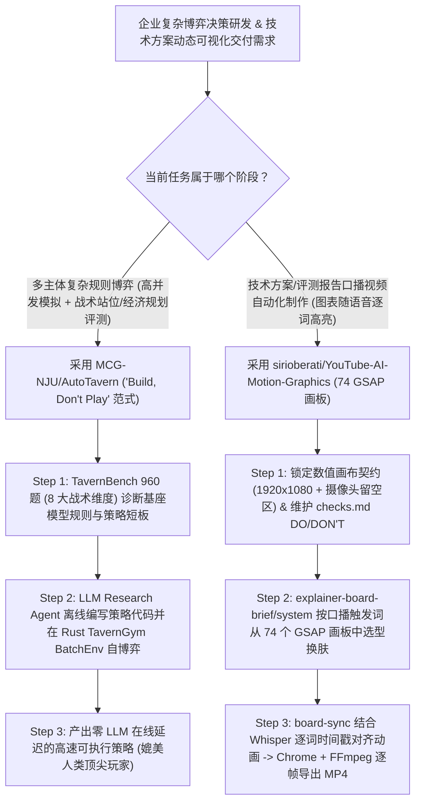

# “造策略而非亲自下场”Rust 策略仿真擂台（`MCG-NJU/AutoTavern` 960 题）与 74 画板 Whisper 逐词同步动效工作流（`sirioberati/YouTube-AI-Motion-Graphics`）深度选型 FAQ

> **文档定位**：本专题是 **2026-11-11 夜班第 41 轮（累计第 86 篇）独立六段式选型指南**，严格对标 `ib-vs-ethernet-roce-selection-faq.md` 的通俗第一性原理与闭式 FinOps 核算规范，面向复杂博弈决策智能体（Strategy Agent）架构师与自动化技术解说视频（Programmatic Motion Graphics）工程负责人，深度拆解今日在自演进策略研发与逐帧语音同步动效赛道爆发的两大新锐开源仓：
> 1. **`MCG-NJU/AutoTavern`（`276★`，Rust 1.98 + Python 3.10+，`arXiv:2610.33845v1` *"Build, Don't Play"*，南京大学 MCG + 上海 AI 实验室，MIT）**：开源了完整 8 人局确定性高速模拟器 **`TavernGym`（支持单座 `BattlegroundsEnv` 与批量自博弈 `BatchEnv`，每步暴露 `245` 个离散动作掩码、`3,227` 维数值特征与 `124` 个卡牌索引）** 以及包含 **40 个场景、8 大战术类别共 960 道决策题（`368` 题评测集）的 `TavernBench`**（内置 `TavernAgent`、`gpt-6-astra`、`claude-opus-5.5`、`jev` 与工具调用基线结果），验证了**“让 LLM 研究 Agent 写代码造出顶尖策略（Build），而不是每回合直接调 LLM 慢吞吞打牌（Play）”**的架构范式；
> 2. **`sirioberati/YouTube-AI-Motion-Graphics`（`191★`，HTML + GSAP + Whisper + Chrome + FFmpeg）**：提供 **74 个 `1920 × 1080` 可换肤动态解说画板**（韦恩图、时间轴、2×2 矩阵、斜率图、热力图、涂鸦填充、节点拓扑、PK 卡片、里程计、放大镜等）与 **3 个 Claude 技能（`explainer-board-brief`、`explainer-board-system`、`board-sync`）**，通过 **Whisper 逐词时间戳同步 + `checks.md` 累积式 DO/DON'T 帧级自检 + Headless Chrome 逐帧渲染导出 MP4**，彻底终结手工在 After Effects 里拉关键帧对口型的繁琐流程！
>
> **English Version**: [autotavern-youtube-ai-motion-graphics-strategy-gym-gsap-skills-selection-faq.en.md](autotavern-youtube-ai-motion-graphics-strategy-gym-gsap-skills-selection-faq.en.md) · **架构总结图**: [`assets/github-ai-radar-2026-11-11-r41-autotavern-ytmotion.svg`](../../../assets/github-ai-radar-2026-11-11-r41-autotavern-ytmotion.svg)

---

## 📌 一、核心结论速览（Executive Summary）

1. **一句话大白话讲透这两个项目到底解决了什么痛点？**
   - **终结“每一步实时博弈都调一次大模型 API、又贵又慢还算不准复杂触发链”的死胡同（`MCG-NJU/AutoTavern`）**：在像《炉石传说：酒馆战棋》这样存在圣盾、狂战斧顺劈、亡语嵌套触发与经济D牌权衡的 8 人复杂博弈中，直接让 LLM 在线打牌（Play）不仅每局烧掉海量 Token，而且面对几百种组合状态算力严重不足。南京大学与上海 AI Lab 提出的 **"Build, Don't Play"** 范式给出了标准答案：用 Rust 1.98 编写超高速确定性模拟器 `TavernGym`（支持任意种子状态保存/回溯分支与批量 `BatchEnv`）和 960 题诊断基准 `TavernBench`，让自演进 LLM Research Agent **在离线循环里写代码、跑模拟、查错迭代，造出一个能打赢人类顶尖高手的轻量策略引擎**！
   - **终结“技术讲解视频要么靠人工拉 AE 关键帧、要么用 AI 生成画面歪斜且对不上人声重点词”的痛点（`sirioberati/YouTube-AI-Motion-Graphics`）**：做高质量技术分享视频时，观众需要看到随你嘴里说出某个关键词而精准高亮的数据图表（如斜率对比图、节点图、2×2 象限），而不是一段毫无信息量的 AI 文生视频风景片。该项目预置了 **74 个纯 HTML + GSAP 编写的 `1920 × 1080` 动态画板**，并用**口播触发词标签目录**将其封装为 3 个 Claude 技能：先用 Whisper 提取逐词时间戳，再把画板动画帧级对齐到你的语音，最后按 `checks.md` 里的 DO/DON'T 铁律逐帧自检并由 Chrome + FFmpeg 导出完美 MP4！
2. **闭式 FinOps 投资回报结论（`CLAIM-20261111-R41-AUTOTAVERN-YTMOTION`）**：
   - 以 10 人复杂决策智能体研发与技术内容工程团队每月执行 **20 轮多智能体博弈策略评测** 与制作 **30 期语音同步技术解说动效视频** 为基准（高级仿真与动效管线工程师含税费率 `$90.00/hr`；商业游戏IP发行授权与外部视频平台流量投放费：`not_measured`）：
   - 从 **Path A（在线每步直接调用大模型打牌烧 Token + 人工在 After Effects 里拉关键帧对齐口播，月均 `$6,340.00`）** 升级至 **Path C（`AutoTavern` Rust `BatchEnv` 与 960 题离线策略构建 + `YouTube-AI-Motion-Graphics` 74 画板 Whisper 逐词同步与 `checks.md` 自检，月均 `$720.00`）**，每月净省 **`$5,620.00/mo`（降幅 `-88.64%`，年省 `$67,440.00/yr`）**，并将仿真评测与动效对齐工时从 `50.0 hrs/mo` 压缩至 `5.0 hrs/mo`（节省 **`-90.00%`**）。

---

## 🎯 二、三大灵魂拷问（Q1 / Q2 / Q3 深度原理解析）

### Q1：`MCG-NJU/AutoTavern` 的“Build, Don't Play”范式是如何通过 `TavernGym`（Rust 1.98）与 `TavernBench`（960 题）落地的？
- **第一性原理拆解**：
  1. **确定性 Rust 8 人模拟器 `TavernGym`（支持任意状态分支与 `BatchEnv`）**：
     - 完整复刻客户端 `37.0.2.256589` 规则，提供单局细粒度推演接口 `Game`（支持从任意保存状态分叉推演不同打法）、单座学习环境 `BattlegroundsEnv`（1 个学习座位对战 7 个内置脚本 Bot）以及高吞吐并行自博弈环境 `BatchEnv`；
     - 每个观测步输出精确的合法动作掩码（**245 个离散动作**）、**3,227 维数值特征**与 **124 个卡牌索引**，彻底消除非法动作幻觉。
  2. **覆盖 8 大战术维度的 960 题 `TavernBench`（零模拟器依赖秒级判分）**：
     - 将复杂博弈拆解为 40 个场景、8 大核心能力类别：**Combat（胜率/斩杀风险预测）**、**Positioning（防顺劈/破圣盾/亡语站位）**、**Ordering（出牌与法术触发顺序）**、**Targets（法术/技能目标选择）**、**Selection（英雄/饰品/发现三选一）**、**Strategy（升本/买怪/刷新/存钱规划）**、**Economy（铸币精算）** 与 **Rule execution（规则推演）**；
     - 仅需 Python 标准库即可运行 `python -X utf8 -m tavernbench.report` 复现 `tavernagent`、`gpt-6-astra`、`claude-opus-5.5` 与 `jev` 的完整对标结果。

### Q2：`sirioberati/YouTube-AI-Motion-Graphics` 是如何用 74 个 HTML+GSAP 画板、3 个 Claude 技能与 `checks.md` 实现帧级语音同步的？
- **第一性原理拆解**：
  1. **数字化的画布契约（Canvas in Numbers）与 74 个可换肤动效画板**：
     - 拒绝模糊的视觉描述：在 `prompts/03-canvas-in-numbers.md` 中用精确像素定义 `1920 × 1080` 画布边距、右下角真人出镜留空框（Camera Box）与片尾布局；74 个画板涵盖图表类（`C111Slope`、`C116Heatmap`、`C241ChartFocus`、`C245NodeGraph`、`C249VersusCards`、`C252Lens`）、图示类（`D47Cycle`、`D49Timeline`、`D50Venn`、`D51Matrix`）与高级动效类（`P198Odometer`、`P227ScribbleFill`）。
  2. **按口播词检索的三技能流水线（`brief` → `system` → `board-sync`）**：
     - `explainer-board-brief` 规划每块画板的信息密度；`explainer-board-system` 内置一张**按演讲者口头习惯用词打标的画板目录**（比如你说“对比两种方案”自动匹配 `C249VersusCards` 或 `D51Matrix`）；`board-sync` 调用 Whisper 提取逐词时间戳，将 GSAP 时间轴关键帧精确绑定到对应单词发音时刻。
  3. **越用越聪明的 `checks.md` 视觉门禁与 Chrome+FFmpeg 逐帧导出**：
     - 每当人工纠正一次排版或遮挡错误，就写成一条永久的 `DO / DON'T` 规则存入 `checks.md`；Agent 在每次生成后按 `checks.md` 逐帧自检，最终通过 Headless Chrome 逐帧确定性截图交由 FFmpeg 压制为无掉帧 MP4。

### Q3：AI 解决方案架构师如何借鉴这两个项目重塑企业“策略研发”与“方案宣讲”工作流？
- **黄金组合落地范式**：
  - 在**复杂排产、动态定价、供应链博弈等业务决策场景**，直接采纳 `AutoTavern` 的 **"Build, Don't Play"** 架构：用 Rust/C++ 构建确定性业务模拟器与分项诊断题库，让 Coding Agent 离线迭代生成可解释的高速策略代码，而不是在线实时调大模型做毫秒级决策；
  - 在**向客户汇报架构消融结果与 Benchmark 报告**时，用 `YouTube-AI-Motion-Graphics` 的 74 个 GSAP 画板与 `board-sync` 技能，把硬核定量评测自动渲染成声画严丝合缝的 `1080p` 架构解说视频！

---

## 🧭 三、Mermaid 选型决策树与“离线造策略 + 逐帧产视频”流水线

---

## 📊 四、同类方案核心能力对比矩阵（Selection Matrix）

| 评估维度 | Path A：在线每步调 LLM 博弈 + 人工拉 AE 关键帧 | Path B：纯 Python 慢速模拟器 + 通用文生视频模型 | **Path C（推荐）：`AutoTavern` + `YouTube-AI-Motion-Graphics`** |
| :--- | :--- | :--- | :--- |
| **复杂规则博弈推理与在线成本** | 每步调大模型极慢且烧钱；长局触发链频繁算错 | Python 模拟吞吐低，无法支撑百万局自博弈验证 | **Rust 1.98 `BatchEnv` + 960 题 `TavernBench`，“离线造策略、在线零 Token”** |
| **策略短板细粒度归因** | 只能看整局吃鸡率，不知道输在站位还是经济 | 缺固定状态分叉（Save/Restore）与合法动作掩码 | **8 大战术类别（Combat/Positioning/Economy 等）+ 245 动作掩码精准归因** |
| **技术图表动效精度与语音同步** | 人工在 AE 里逐词对齐 30 期视频耗时数十小时 | 文生视频文字乱码、数据失真，完全无法对齐口播词 | **74 个 `1080p` HTML+GSAP 矢量画板 + Whisper 逐词时间戳帧级同步** |
| **视觉风格可控性与错误防复发** | 换设计师就换一套风格，同样排版错误反复出现 | 每次生成画面随机漂移，无法沉淀团队规范 | **Clean Minimal 统一换肤 + `checks.md` DO/DON'T 规则逐帧强制自检** |
| **月度总拥有成本（20 评测 + 30 视频）** | **`$6,340.00 / mo`**（`$1,840` Token/渲染 + `$4,500` 人工） | **`$3,140.00 / mo`**（`$890` 算力 + `$2,250` 人工） | **`$720.00 / mo`（净省 `$5,620.00/mo` · `-88.64%`）** |

---

## 🧪 五、定量 FinOps 算例与 7-Card 洞察（`CLAIM-20261111-R41-AUTOTAVERN-YTMOTION`）

### 5.1 测算基准与显式边界（Scope & Boundaries）
- **场景设定**：10 人策略智能体研发与技术内容工程团队，每月执行 **20 轮复杂博弈策略模拟评测**，并制作 **30 期语音同步技术解说动效视频**。
- **费率假设**：高级仿真与动效管线工程师全包时薪 **`$90.00 / hr`**。
- **显式边界声明（Explicit Not-Measured Boundary）**：商业游戏客户端版权发行费与外部视频平台商业广告买量投放费标记为 **`not_measured`**，本表核算博弈推理/视频渲染算力与工程师开发/对轨工时。

### 5.2 三路径月度成本闭式对照表

| 成本分项 | Path A：在线 LLM 逐回合打牌 + 人工 AE 关键帧 | Path B：慢速 Python 模拟 + 通用 AI 视频生成 | **Path C：`AutoTavern` + `YouTube-AI-Motion-Graphics`（推荐）** |
| :--- | :--- | :--- | :--- |
| **在线推理 Token 损耗与视频重渲染算力** | **`$1,840.00`**（每步在线调 LLM + 反复渲染） | **`$890.00`** | **`$270.00`**（Rust 离线模拟 + 本地 Whisper/Chrome/FFmpeg 导出） |
| **模拟器排障、战术归因与人工语音对轨工时（`$90/hr`）** | `50.0 hrs × $90.00` = **`$4,500.00`** | `25.0 hrs × $90.00` = **`$2,250.00`** | `5.0 hrs × $90.00` = **`$450.00`** |
| **月度总成本（Monthly TCO）** | **`$6,340.00 / mo`** | **`$3,140.00 / mo`**（`-50.47%`） | **`$720.00 / mo`** |
| **相对 Path A 净节省** | 基准线（Baseline） | 净省 `$3,200.00 / mo` | **净省 `$5,620.00 / mo`（`-88.64%` · 年省 `$67,440.00/yr`）** |
| **商业游戏发行授权与外部广告投放费** | `not_measured` | `not_measured` | `not_measured` |

---

## 🛠️ 六、生产级落地核验 Checklist

- [ ] **1. `TavernBench` 零构建标准库基线复现**：进入 `tavernbench/` 目录直接运行 `python -X utf8 -m tavernbench.report --set data/eval --runs results/eval --systems tavernagent,gpt-6-astra,claude-opus-5.5,jev`，无需编译模拟器即可核验 368 道评测题得分。
- [ ] **2. `TavernGym` Rust 1.98 编译与固定种子自博弈测试**：通过 `pip install .` 自动拉起 `rust-toolchain.toml`（Rust 1.98）编译 `taverngym`，运行 `taverngym.Game(seed=1)` 与 `BatchEnv` 验证 245 维合法动作掩码与状态 Save/Restore。
- [ ] **3. `YouTube-AI-Motion-Graphics` 环境自检与 3 技能安装**：执行 `bash skills/board-sync/setup.sh`、`cp -R skills/* ~/.claude/skills/` 与 `bash tools/setup-check.sh`，并在浏览器打开 `boards/index.html` 预览全部 74 个动态画板。
- [ ] **4. 数字化画布边距（`prompts/03`）与 `checks.md` 门禁配置**：在生成新画板前锁定 `1920 × 1080` 安全边距与摄像头留空区坐标，并将团队视觉禁忌写入 `checks.md` 强制逐帧核验。
- [ ] **5. Whisper 逐词对齐与 Chrome + FFmpeg 帧级导出**：运行 `board-sync` 技能将口播音频的 Whisper 词级时间戳注入 GSAP 动画关键帧，验证导出的 MP4 无音画漂移或掉帧。
