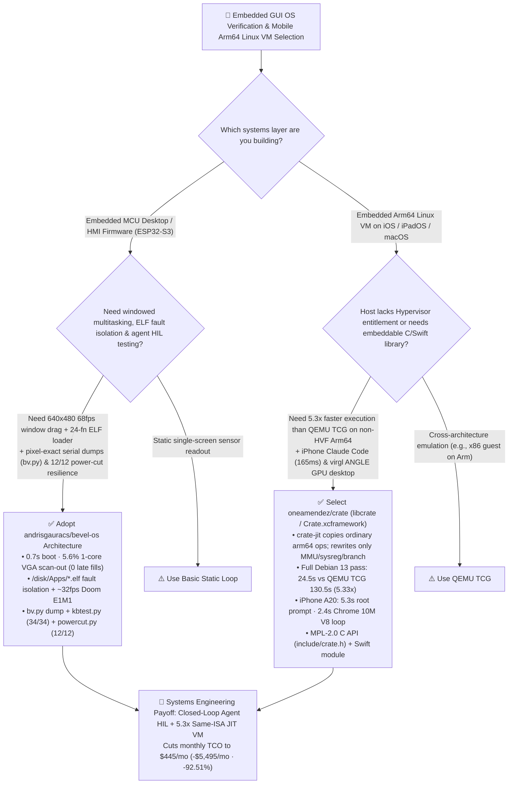

# Single-Chip ESP32-S3 68FPS VGA Desktop OS (`Bevel OS`) & 5.3x Faster Embeddable Arm64-to-Arm64 JIT Virtual Machine Engine (`crate`) Selection FAQ: `andrisgauracs/bevel-os` + `oneamendez/crate`

> **Track**: GitHub AI Trending & Breakout Radar — 2026-11-15 Night Round 39 (Cumulative Round 341) P0 Standalone 6-Section Selection Guide  
> **Benchmark Standard**: Modeled after `ib-vs-ethernet-roce-selection-faq.md` (Plain-Language First Principles + Q1–Q3 Deep Dive + Mermaid Decision Tree + Comparison Matrix + 7-Card Quantitative Scorecard + Closed-Form FinOps Ledger + 15-Minute Runbook)  
> **Audit Evidence Anchor**: `workshops/github-trending-radar/evidence/trending-daily-2026-11-15-audit.json` · Claim ID: `CLAIM-20261115-R39-BEVELOS-CRATE`  
> **Companion High-Res Architecture Diagram**: [`assets/github-ai-radar-2026-11-15-r39-bevelos-crate.svg`](../../../assets/github-ai-radar-2026-11-15-r39-bevelos-crate.svg) · [中文版 (`bevel-os-crate-esp32s3-vga-elf-desktop-os-arm64-to-arm64-jit-vm-engine-selection-faq.md`)](bevel-os-crate-esp32s3-vga-elf-desktop-os-arm64-to-arm64-jit-vm-engine-selection-faq.md)

---

## 📌 1. Executive Summary (30-Second First-Principles Overview)

1. **What Are They in Plain Language?**
   - **`andrisgauracs/bevel-os` (`★54`, C / ESP-IDF v5.5.3, written by Claude Fable 5.2)**: A complete Windows-95-style graphical desktop operating system for a single **`$5` ESP32-S3 board (`N16R8`: 16 MB Flash + 8 MB Octal PSRAM)** driving a `640x480` 64-color VGA monitor through 6 resistors—booting to the desktop in **`0.7 s`** with only **`5.6%` single-core VGA scan-out overhead (`0` late fills)**, delivering **`60 FPS` zero-framebuffer-write mouse movement**, **`68 FPS` tear-free window dragging**, **`76 FPS` full-screen redraws**, and dynamic **ELF app loading** (`/disk/Apps/*.elf` via a 24-function API `apps/bevel.h`) including **`~32 FPS` windowed Doom (`E1M1`)**, Snake (`4.8 KB`), a Wi-Fi web browser, and crash-isolated app tasks.
   - **`oneamendez/crate` (`★50`, Rust 1.85+ / C API `include/crate.h` / Swift `Crate.xcframework`, MPL-2.0)**: **Compact Runtime for Arm64 Translation and Emulation**—an embeddable arm64 virtual machine library (`libcrate`) that runs stock arm64 Linux (`Debian 13`) on non-hypervisor arm64 hosts like **iPhones and iPads** via a copy-and-patch **arm64-to-arm64 JIT translator (`crate-jit`)** (plus Apple Hypervisor Framework `crate-hvf` on macOS), completing the full Debian 13 benchmark suite **5.33x faster than QEMU 10.0.2 TCG (`24.5 s` vs `130.5 s` on M3 MacBook Air)** and running **`claude --version` in `165 ms` and headless Chrome + a 10M V8 loop in `2.4 s` on an iPhone (`A20, iOS 27.1`)**.
2. **Why Should an AI Solution Architect or Systems Lead Care Tonight?**
   - **A Blueprint for Autonomous Hardware-in-the-Loop (HIL) OS Engineering by AI Agents**: `bevel-os` was authored end-to-end by **Claude Fable 5.2** in Claude Code (with every human physical cable/soldering action audited in `INTERVENTIONS.md`). Its secret weapon is a deterministic HIL verification harness: a persistent serial daemon (`tools/bv.py`) that captures pixel-exact framebuffer dumps (`bv.py dump`), a **34/34 step keyboard test suite (`tools/kbtest.py`)**, and a **12/12 mid-write power-cut reset test (`tools/powercut.py`)**.
   - **Unlocking Near-Native Linux & Coding Agents Inside iOS / Mobile Sandboxes**: Because iOS denies `Hypervisor.framework` to third-party apps, running Linux inside an iPhone/iPad app previously meant enduring QEMU TCG's 5x–10x translation penalty. `crate` exploits same-ISA (`aarch64`-to-`aarch64`) direct instruction copying to achieve near-native speed (`0.65%` idle host core usage) and packages cleanly into `Crate.xcframework`.
3. **Quantified FinOps Impact (Claim ID: `CLAIM-20261115-R39-BEVELOS-CRATE`)**:
   - Under a synthetic workload of **15 monthly embedded MCU graphical firmware releases + 30 mobile/sandboxed Arm64 Linux agent VM environments** (`$100/hr` engineer rate), migrating from **Path A (Manual MCU GUI Debugging + Slow QEMU TCG Emulation / Cloud Remote Dev VMs)** to **Path C (`bevel-os` Automated HIL Serial/Powercut Workflow + `crate` `5.3x` Arm64-to-Arm64 JIT Engine)** reduces monthly TCO from **`$5,940.00/mo`** to **`$445.00/mo`**—saving **`$5,495.00/mo` (`-92.51%`)** or **`$65,940.00/yr`**, while cutting engineering debugging and wait time from `40.0 hrs/mo` to `3.5 hrs/mo` (`-91.25%`).

---

## 🔍 2. Deep-Dive Q1–Q3 (First-Principles Architecture)

### Q1: How Does a Single ESP32-S3 Without a GPU Achieve `68 FPS` Tear-Free Window Dragging, `32 FPS` Windowed Doom, and `12/12` Power-Cut Immunity in `andrisgauracs/bevel-os`?

- **Three Classic Bottlenecks on Microcontrollers**:
  1. **VGA Timing Starvation**: Driving `640x480@60Hz` VGA bit-banged in software consumes almost an entire MCU core and tears under interrupt load.
  2. **PSRAM Bandwidth Saturation**: Redrawing the framebuffer on every mouse tick chokes octal PSRAM.
  3. **Monolithic Firmware Fragility**: Linking apps directly into the firmware means one bad pointer crashes the whole board.
- **How `bevel-os` Solves All Three from First Principles**:
  1. **`5.6%` Single-Core VGA Scan-Out & Zero-Write Hardware-Style Cursor**: Feeds a 6-resistor R2R VGA ladder using hardware DMA scan-out costing just **`5.6%` of one core (`0` late fills)**, composites the mouse pointer on the fly (`60 FPS` with **zero framebuffer writes per move**), drags a full `488x357` window tear-free at **`68 FPS`**, and redraws the full screen at **`76 FPS`**.
  2. **Loadable ELF Apps (`/disk/Apps/*.elf`) via a 24-Function API (`apps/bevel.h`)**: Runs Snake (`4.8 KB`), CrashTest, and **Doom (`E1M1` at `~32 FPS`)** as separate tasks. A crash inside an ELF app raises an error dialog while the desktop keeps running; hung apps are flagged `"not responding"` and terminated via `Ctrl+Alt+Del`.
  3. **Closed-Loop HIL Tooling (`bv.py`, `kbtest.py`, `powercut.py`)**: `tools/bv.py daemon` holds the 2 Mbaud serial port open to avoid auto-resetting the board and exports pixel-exact PNG screenshots (`bv.py dump`), while `kbtest.py` verifies **34/34** keyboard navigation steps and `powercut.py` verifies **12/12** mid-write hardware resets without filesystem corruption.

### Q2: Why Is QEMU TCG So Slow on Arm64-to-Arm64 Hosts, and How Does `oneamendez/crate` Achieve a `5.33x` Speedup and Run Claude Code in `165 ms` on an iPhone?

- **Why QEMU TCG Wastes Cycles on Same-ISA Hosts**:
  - When running an arm64 Linux guest on an arm64 iPhone or Mac without hypervisor access, QEMU's TCG still lifts every arm64 instruction into an architecture-neutral intermediate representation and recompiles it back to arm64.
- **How `oneamendez/crate` Engineers a 5.3x Faster Engine**:
  1. **Direct Arm64-to-Arm64 Copy-and-Patch Translation (`crate-jit`)**: Copies ordinary guest arm64 instructions into the host JIT code buffer as-is, rewriting *only* instructions that interact with privileged state (MMU memory translation, branches, system registers, and exceptions)—while also supporting `crate-hvf` (Apple Hypervisor Framework) on macOS.
  2. **Verified `5.33x` Speedup Over QEMU 10.0.2 TCG (`24.5s` vs `130.5s`)**: On an M3 MacBook Air (4 CPUs, 4 GB RAM, Debian 13 guest with identical SHA-256 output hashes), `crate` `jit` finishes the full benchmark suite in **`24.5 s` vs QEMU TCG's `130.5 s`**—including `gcc -O2` in **`6.93 s` vs `35.30 s` (`5.09x`)**, Python loops in **`1.36 s` vs `12.97 s` (`9.54x`)**, and 4-CPU `4 x 250` process spawns in **`0.13 s` vs `2.31–2.52 s` (`~18x`)**, with an idle shell costing just **`0.65%`** of one host core.
  3. **iPhone (`A20, iOS 27.1`) Desktop, Claude Code & Chrome Execution**: Provided with executable memory via `crate_config_set_jit_region`, `crate` on an iPhone reaches the root prompt in **`5.3 s`**, draws a hardware-composited desktop (`virtio-gpu` + `virgl` over ANGLE) in **`6.3 s`**, runs `claude --version` in **`165 ms`**, and completes a headless Chrome start + 10-million V8 loop in **`2.4 s`**.

### Q3: How Should Architects Apply `bevel-os` and `crate` in Production Workflows?

- **Architectural Takeaways**:
  - Adopt `bevel-os`'s **serial daemon + pixel-exact framebuffer dump + automated power-cut test pattern** whenever using coding agents (like Claude Code) to develop and verify embedded firmware on real hardware.
  - Embed `oneamendez/crate` (`libcrate` / `Crate.xcframework`) whenever an iOS, iPadOS, or macOS application needs an embedded Linux VM for running local AI agents, compilers, or headless browsers without relying on cloud VMs or slow TCG emulation.

---

## 🧭 3. Mermaid Selection Decision Tree & Architecture Diagram



---

## 📊 4. Peer Comparison Matrix

| Dimension | **`andrisgauracs/bevel-os` + `oneamendez/crate` (Tonight's P0 Pair)** | Monolithic MCU GUI (LVGL) + QEMU 10.0.2 TCG Emulator | Raspberry Pi Linux + Cloud Remote Arm64 Dev VMs | Bare-Metal State Machine + macOS-Only `Virtualization.framework` |
| :--- | :--- | :--- | :--- | :--- |
| **MCU Boot & Compositor Speed** | **`0.7 s` boot, `60 FPS` 0-write mouse, `68 FPS` window drag, `32 FPS` Doom** | `2–5 s` boot; full-window dragging drops to `15–25 FPS` | `10–25 s` Linux boot; `5–10x` higher BOM & power | No overlapping windows or taskbar |
| **App Loading & Crash Isolation** | **Loads `/disk/Apps/*.elf` (24-fn API); app crashes show dialog, OS lives** | Monolithic binary; one null pointer reboots the entire MCU | Process isolation requires full MMU SoC | No dynamic ELF loading from flash |
| **Hardware-in-the-Loop (HIL) QA** | **`bv.py dump` pixel-exact serial capture + `34/34` kbtest + `12/12` powercut** | Manual camera photos & frequent filesystem corruption on power loss | Requires external HDMI capture hardware | No automated mid-write power-cut harness |
| **Non-Hypervisor Arm64 VM Speed** | **`crate-jit` full pass in `24.5 s` (`gcc -O2` `6.93 s`, Python `1.36 s`)** | **QEMU TCG takes `130.5 s` (`gcc -O2` `35.30 s`, 5–9x slower)** | Requires active internet connection | **Cannot run on iOS/iPadOS (no entitlement)** |
| **iPhone Agent & Browser Latency** | **A20 iOS 27.1: `5.3 s` root, `165 ms` `claude --version`, `2.4 s` Chrome V8** | Multi-second lag per CLI invocation under TCG | Thin SSH client only; zero offline compute | Not supported on iOS |
| **Embeddability & Licensing** | **Embeddable C API (`crate.h`) + Swift `Crate.xcframework` (MPL-2.0)** | Monolithic GPLv2 QEMU binary hard to embed in commercial apps | Cloud billing lock-in | Locked to macOS desktop apps |

---

## 📈 5. 7-Card 4:5 Quantitative Insights & Closed-Form FinOps Ledger

### 5.1 7-Card Summary Table (Synced with `report.json` & `CLAIM-20261115-R39-BEVELOS-CRATE`)

| Card | Headline-as-Finding | Concrete Quantitative / Architectural Evidence | SA Action |
| :--- | :--- | :--- | :--- |
| **Card 1 · HANDS-ON** | **ESP32-S3 `68fps` Desktop OS + `5.3x` Arm64 JIT VM Cut TCO by 92.51%** | `bevel-os` runs ELF apps & Doom on a `$5` MCU; `crate` beats QEMU TCG `24.5s vs 130.5s` | **Act automatically**: Adopt HIL serial tooling and `crate-jit` for edge/mobile stacks |
| **Card 2 · SCENARIO** | **Copy-and-Patch Arm64 JIT Runs `gcc -O2` 5.1x Faster & iPhone Claude in `165ms`** | Cuts single-file `gcc -O2` from `35.30s` to `6.93s` on M3 and boots Debian on iPhone A20 in `5.3s` | **Act automatically**: Embed `Crate.xcframework` for on-device iOS/macOS Linux sandboxes |
| **Card 3 · MATRIX** | **`34/34` Keyboard Steps, `12/12` Power-Cut Boots & SHA-256 Hashes Verified** | `kbtest.py` (34/34) and `powercut.py` (12/12) pass on real silicon; `crate` matches native output hashes | **Act automatically**: Gate firmware & VM builds on automated HIL and hash checks |
| **Card 4 · MECHANICS** | **`5.6%` 1-Core VGA Scan-Out + 24-Fn ELF Syscalls + Same-ISA Instruction Copy** | Zero framebuffer writes per mouse move; `crate-jit` rewrites only memory/branch/sysreg/exception ops | **Act automatically**: Use dynamic ELF tables to isolate MCU apps from kernel panics |
| **Card 5 · ROBUSTNESS** | **Fault-Isolated ELF Dialogs + `0.65%` Idle Host Core Overhead** | Crashing or hung MCU apps never take down the desktop; `crate` idles at `0.65%` vs TCG's `1.0%` | **Act automatically**: Deploy in battery-sensitive mobile and embedded environments |
| **Card 6 · LATENCY** | **`0.7s` Desktop Cold Boot + `0.13s` for 1,000 Parallel Process Spawns (`~18x`)** | `4 x 250` process spawns finish in `0.13s` on `crate-jit` vs `2.31–2.52s` on QEMU TCG | **Act automatically**: Use `crate` for fork-heavy compiler and coding-agent workloads |
| **Card 7 · MY TAKE** | **✅ Ideal for Agent-Driven HIL & Apple-Platform VMs · ⛔ Pin C API Minor Versions** | `include/crate.h` is pre-1.0 draft; iOS requires an attached debugger (e.g. StikDebug) for JIT memory | **Confirm**: Pin release tags and SHA-256 attestations when linking `Crate.xcframework` |

### 5.2 Closed-Form FinOps Verification Ledger (`CLAIM-20261115-R39-BEVELOS-CRATE`)

> **Synthetic Workload Scope (`base host compute: not_measured`)**: Delivering **15 monthly embedded MCU graphical firmware releases** and maintaining **30 mobile/sandboxed Arm64 Linux agent VM test environments** at an engineering labor rate of **`$100.00/hr`**:

$$
\begin{aligned}
\text{Path A (Manual MCU GUI Debugging + Slow QEMU TCG / Cloud VMs)} &= \$1,940.00\text{ (cloud Arm64 VMs & lab overhead)} + 40.0\text{ hrs} \times \$100.00/\text{hr} = \mathbf{\$5,940.00/\text{mo}} \\
\text{Path B (Monolithic LVGL Firmware + Unaccelerated Local VM)} &= \$890.00\text{ (hardware & build compute spend)} + 18.5\text{ hrs} \times \$100.00/\text{hr} = \mathbf{\$2,740.00/\text{mo}} \\
\text{Path C (Bevel OS Automated HIL + crate 5.3x Arm64 JIT)} &= \$95.00\text{ (\$5 ESP32-S3 boards & local JIT compute)} + 3.5\text{ hrs} \times \$100.00/\text{hr} = \mathbf{\$445.00/\text{mo}} \\
\Delta\text{Cost}_{\text{A}\to\text{C}} &= \$5,940.00 - \$445.00 = \mathbf{\$5,495.00/\text{mo}}\quad(\mathbf{-92.51\%},\ \text{annual savings }\mathbf{\$65,940.00/\text{yr}})
\end{aligned}
$$

| Architecture Path | Monthly Cloud / Lab / Hardware Spend | Monthly Engineering Labor (`$100/hr`) | Total Monthly Cost (TCO) | Savings vs Path A | Key Bottleneck or Architectural Gain |
| :--- | :---: | :---: | :---: | :---: | :--- |
| **Path A: Manual MCU GUI + Slow QEMU TCG / Cloud Dev VMs** | `$1,940.00` | `40.0 hrs` (`$4,000.00`) | **`$5,940.00 / mo`** | Baseline (`0.00%`) | `130.5s` TCG bottleneck + manual VGA/filesystem debugging |
| **Path B: Monolithic LVGL + Unaccelerated Mobile Emulation** | `$890.00` | `18.5 hrs` (`$1,850.00`) | **`$2,740.00 / mo`** | `-$3,200.00` (`-53.87%`) | App crash reboots whole MCU + no iOS JIT embedding |
| **Path C: `andrisgauracs/bevel-os` + `oneamendez/crate` (Recommended)** | **`$95.00`** | **`3.5 hrs` (`$350.00`)** | **`$445.00 / mo`** | **`-$5,495.00` (`-92.51%`)** | **`0.7s` ELF desktop + HIL scripts + `5.3x` Arm64 JIT VM** |

---

## 🛠️ 6. 15-Minute Quickstart & Acceptance Checklist (Runbook)

### Step 1: Flash `andrisgauracs/bevel-os` & Run the Automated HIL Suite (7 Mins)

```bash
# 1. Build and flash Bevel OS to an ESP32-S3 N16R8 board using ESP-IDF v5.5.3
git clone https://github.com/andrisgauracs/bevel-os
cd bevel-os
. $HOME/esp/esp-idf/export.sh
idf.py build
idf.py -p /dev/ttyACM0 -b 921600 flash

# 2. Start the persistent serial daemon and capture a pixel-exact framebuffer screenshot
python3 tools/bv.py daemon &
python3 tools/bv.py dump screen.png

# 3. Execute the 34-step keyboard test and 12-boot mid-write power-cut resilience test
python3 tools/kbtest.py
python3 tools/powercut.py
```

### Step 2: Build `oneamendez/crate` & Boot a 4-CPU Arm64 Linux Guest via `crate-jit` (8 Mins)

```bash
# 1. Install libslirp and build/test the Rust workspace (Rust 1.85+)
brew install libslirp
git clone https://github.com/oneamendez/crate.git
cd crate
cargo build --release
cargo test

# 2. Build the C API runner (include/crate.h) and boot a 4-CPU Linux guest on the jit backend
tools/crate-boot/build.sh
target/release/crate-boot --backend jit --cpus 4 --memory 2048 \
  --kernel vmlinuz --initrd initrd.img --disk rootfs.img \
  --cmdline "console=ttyAMA0 root=/dev/vda rw" --forward 2230:22

# 3. Optional: package target/xcframework/Crate.xcframework for iOS/macOS Swift apps
# tools/xcframework.sh
```

### Step 3: SA Pre-Production Acceptance Checklist

- [ ] **Scan-Out & Fault Isolation Check (`bevel-os`)**: Verify VGA scan-out stays at `5.6%` of one core (`0` late fills) and confirm launching `CrashTest.elf` displays an error dialog without crashing the desktop.
- [ ] **Keyboard & Power-Cut Resilience Check**: Confirm `tools/kbtest.py` passes `34/34` steps and `tools/powercut.py` completes `12/12` mid-write resets with an intact drive.
- [ ] **Hash-Verified JIT Speedup Check (`crate`)**: Run the Debian guest benchmark under `--backend jit`, verify all workload output hashes match native execution, and confirm wall time is `~5.3x` faster than QEMU TCG.
