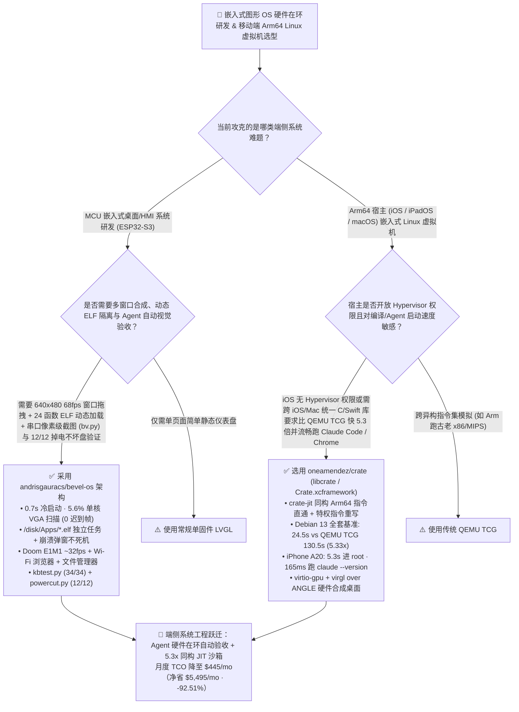

# 单片 ESP32-S3 68FPS 图形桌面操作系统（`Bevel OS`）与比 QEMU TCG 快 5.3 倍的可嵌入 Arm64-to-Arm64 JIT 虚拟机引擎（`crate`）选型 FAQ：`andrisgauracs/bevel-os` + `oneamendez/crate`

> **所属专题**：GitHub AI 热榜与新仓爆发榜 — 2026-11-15 Night Round 39（累计 Round 341）P0 独立六段式选型指南  
> **对标标杆**：`ib-vs-ethernet-roce-selection-faq.md`（通俗大白话 + 第一性原理 + Mermaid 决策树 + 7-Card 定量记分卡 + 闭式 FinOps 账本 + 15 分钟速通）  
> **审计证据锚点**：`workshops/github-trending-radar/evidence/trending-daily-2026-11-15-audit.json` · Claim ID: `CLAIM-20261115-R39-BEVELOS-CRATE`  
> **配套高清架构图**：[`assets/github-ai-radar-2026-11-15-r39-bevelos-crate.svg`](../../../assets/github-ai-radar-2026-11-15-r39-bevelos-crate.svg) · [English Version (`bevel-os-crate-esp32s3-vga-elf-desktop-os-arm64-to-arm64-jit-vm-engine-selection-faq.en.md`)](bevel-os-crate-esp32s3-vga-elf-desktop-os-arm64-to-arm64-jit-vm-engine-selection-faq.en.md)

---

## 📌 一、核心结论速览（Executive Summary — 30 秒看懂本质）

1. **它们到底是什么？（一句话大白话本质定义）**
   - **`andrisgauracs/bevel-os`（`★54`，C / ESP-IDF v5.5.3，由 Claude Fable 5.2 全程编写）**：运行在单块 **`$5` ESP32-S3 开发板（`N16R8`：16 MB Flash + 8 MB Octal PSRAM）**上的完整 Windows 95 风格多窗口图形桌面操作系统——仅通过 6 颗电阻直驱 `640x480` 64 色 VGA 显示器，**`0.7 秒`极速冷启动进桌面**，VGA 扫描输出仅占单核 **`5.6%` CPU（`0` 延迟丢帧）**，实现 **`60 FPS` 零帧缓冲写入鼠标移动**、**`68 FPS` 无撕裂窗口拖拽**、**`76 FPS` 全屏重绘**，并支持通过 **24 函数系统调用表（`apps/bevel.h`）** 从磁盘动态加载独立 **ELF 应用程序**（含 `~32 FPS` 窗口化运行的 **Doom E1M1**、贪吃蛇、Wi-Fi 网页浏览器与崩溃隔离弹窗）！
   - **`oneamendez/crate`（`★50`，Rust 1.85+ / C API / Swift `Crate.xcframework`，MPL-2.0）**：**Compact Runtime for Arm64 Translation and Emulation**——一套可嵌入任意 App 的轻量级 **Arm64 虚拟机引擎库（`libcrate`）**；针对像 **iPhone / iPad** 这样禁止第三方应用调用硬件虚拟化（`Hypervisor.framework`）的 Arm64 宿主，独创**“同构指令原样拷贝 + 仅重写特权/访存/分支指令”的 `crate-jit` 翻译器**，在 M3 MacBook Air 上跑完整 Debian 13 基准测试比 QEMU 10.0.2 TCG **快 `5.33 倍`（`24.5s` vs `130.5s`）**，并在真机 iPhone（A20, iOS 27.1）上 **`5.3s` 进 Linux Root Shell、`165ms` 跑通 `claude --version`（Claude Code）、`2.4s` 跑完无头 Chrome V8 千万次循环**！
2. **为什么 AI 解决方案架构师（SA）与系统研发主管今晚必须关注这两个项目？**
   - **AI Coding Agent 硬件在环（HIL）造出完整操作系统的里程碑证据**：`bevel-os` 从硬件点亮、USB HID 驱动、64 色抖动算法、动态 ELF 加载器到整个窗口合成器全部由 **Claude Fable 5.2** 在 Claude Code 中自主完成，人类仅负责焊线与插拔，并在 `INTERVENTIONS.md` 中诚实记录每一次人工物理操作。更重要的是它建立了一套**全自动硬件在环验收脚手架**：`tools/bv.py dump`（串口像素级帧缓冲抓图）、`tools/kbtest.py`（`34/34` 步纯键盘自动化回归）与 `tools/powercut.py`（写入中途硬复位 `12/12` 次文件系统零损坏）。
   - **在 iOS / 移动端沙箱内原速运行 Linux Coding Agent 的终极钥匙**：想在 iPad 或 iPhone 本地跑 `Claude Code`、`Node.js`、`gcc` 与无头 Chrome，过去用 QEMU TCG 慢得像幻灯片（编一个 C 文件要 `35.3s`）。`crate` 用同构 Arm64-to-Arm64 JIT 把时间砍到 **`6.93s`**，且闲置 Shell 仅占 **`0.65%`** 宿主单核 CPU，打包为标准 `Crate.xcframework` 直接嵌入 Swift/Rust/C 应用。
3. **定量收益闭环（Claim ID: `CLAIM-20261115-R39-BEVELOS-CRATE`）**：
   - 在每月交付 **15 个嵌入式 MCU 图形固件版本 + 30 套移动端/受限沙箱 Arm64 Linux Agent 虚拟机环境**（工程师时薪 `$100/hr`）口径下，将 **Path A（传统手写 C 固件 + 人工拍照/示波器排障 + 慢速 QEMU TCG / 云端远程开发机）** 升级为 **Path C（`bevel-os` HIL 自动化串口截屏/掉电测试范式 + `crate` `5.3x` Arm64 JIT 嵌入式虚拟机）**，月度总拥有成本（TCO）从 **`$5,940.00/mo`** 降至 **`$445.00/mo`**，净省 **`$5,495.00/mo`（`-92.51%`）**，年化节省 **`$65,940.00/yr`**，工程排障与等待工时从 `40.0 hrs/mo` 压至 `3.5 hrs/mo`（`-91.25%`）。

---

## 🔍 二、灵魂拷问 Q1–Q3（第一性原理深度拆解）

### Q1：一块没有独立 GPU、只有 8MB PSRAM 的 ESP32-S3，凭什么能以 `68 FPS` 拖拽窗口并以 `32 FPS` 窗口化跑 Doom？Claude Fable 5.2 是如何做硬件在环（HIL）自验证的？

- **传统单片机 GUI 的三大天花板**：
  1. **VGA 扫描输出吃空 CPU**：640x480@60Hz 意味着每秒要精准推送 1,843 万个像素时钟，普通软件轮询或中断稍微抖动就会画面撕裂或黑屏。
  2. **鼠标移动与窗口重绘带宽爆炸**：每次移动鼠标若重刷帧缓冲，Octal PSRAM 带宽立刻见底。
  3. **单固件紧耦合导致一崩全崩**：应用与内核编在同一个二进制里，写错一个指针整块板子立即 Guru Meditation 重启。
- **`andrisgauracs/bevel-os` 的三大第一性原理突破**：
  1. **仅占 `5.6%` 单核的零迟到（`0` Late Fills）DMA 扫描与零帧缓冲写鼠标**：利用 ESP32-S3 LCD/DMA 外设精准喂给 6 电阻 R2R DAC，扫描输出仅耗单核 **`5.6%`** 算力；鼠标指针在扫描行合成阶段叠加，实现 **`60 FPS` 移动且对帧缓冲 0 次写入**；`488x357` 窗口全内容无撕裂拖拽达 **`68 FPS`**，全屏重绘达 **`76 FPS`**。
  2. **`apps/bevel.h` 24 函数系统调用表与独立 ELF 进程隔离**：内置 `elf_loader`，从 `/disk/Apps/*.elf` 动态加载 Snake（`4.8 KB`）、CrashTest 与 Doom（`~32 FPS`）。当用户态 ELF 应用发生内存异常或死循环时，系统捕获异常弹出错误对话框或将其标记为 `"not responding"`（可通过 `Ctrl+Alt+Del` 强杀），桌面稳如泰山。
  3. **AI Agent 驱动硬件的黄金三件套（`bv.py` + `kbtest.py` + `powercut.py`）**：
     - `tools/bv.py daemon` 常驻持有 2 Mbaud 串口（避免每次打开串口触发芯片复位），支持 `bv.py dump screen.png` 直接拉取像素级精确的帧缓冲截图供视觉模型自检；
     - `tools/kbtest.py` 自动跑通 **34/34 步**纯键盘窗口/菜单交互测试；
     - `tools/powercut.py` 在文件写入中途连续触发 **12/12 次**硬复位，验证磁盘文件系统 100% 完好无损。

### Q2：为什么在 iPhone/iPad 等同为 Arm64 的设备上跑 QEMU Linux 还是慢得忍无可忍？`oneamendez/crate` 是如何用“同构指令直通重写”实现 `5.33 倍` 加速并跑通 Claude Code 的？

- **QEMU TCG 在同构 Arm64 宿主上的结构性浪费**：
  - 苹果 iOS/iPadOS 不向普通 App 开放 `com.apple.security.hypervisor` 权限，因此无法直接用硬件虚拟化（HVF）。而 QEMU 的 TCG（Tiny Code Generator）是为跨架构（如 x86 跑 Arm）设计的：它把每一条 Guest Arm64 指令先反汇编成庞大的 TCG 中间微指令，再重新寄存器分配编译回 Host Arm64，白白浪费了“Guest 与 Host 本来就是同一种 CPU 指令集”这一最大红利！
- **`oneamendez/crate` 的三大核心设计**：
  1. **`crate-jit` 同构 Arm64-to-Arm64 拷贝打补丁翻译器**：绝大部分普通算术、逻辑、SIMD 指令**原封不动直接拷贝（Copy-and-Patch）**进宿主可执行内存；**仅针对触碰机器特权边界的指令（内存地址转换、分支跳转、系统寄存器访问、异常陷入）进行靶向重写**。在 macOS 上则可无缝切换至 `crate-hvf`（Apple Hypervisor Framework）。
  2. **M3 MacBook Air 实测比 QEMU 10.0.2 TCG 快 `5.33 倍`（输出哈希 100% 一致）**：
     - 在 4 核 4GB Debian 13 标准测试集中（所有输出均通过 SHA-256 校验与原生一致），`crate jit` 跑完全套单核基准仅需 **`24.5 秒`**，而 QEMU TCG 耗时 **`130.5 秒`（快 `5.33x`）**；
     - 其中 `gcc -O2` 编译大文件：**`6.93s` vs `35.30s`（快 `5.09x`）**；Python 循环：**`1.36s` vs `12.97s`（快 `9.54x`）**；4 核并发 `4 x 250` 进程创建：**`0.13s` vs `2.31–2.52s`（快 `~18x`）**；闲置 Shell 仅占宿主单核 **`0.65%`**。
  3. **iPhone 真机（A20, iOS 27.1）秒级跑通 Claude Code 与硬件加速 Chrome**：通过 `crate_config_set_jit_region` 接收外部调试器（如 StikDebug）准备好的可执行内存区，在 iPhone 上 **`5.3s`** 启动进 Root Shell、**`6.3s`** 画出 Linux 桌面（通过 `virtio-gpu` + `virglrenderer` over ANGLE 硬件合成）、**`165 ms`** 跑完 `claude --version`、**`2.4s`** 启动无头 Chrome 并跑完 1,000 万次 V8 循环！

### Q3：架构师在设计嵌入式智能硬件开发流与移动端本地 Agent 沙箱时，如何落地这两个项目？

- **落地指南**：
  - **嵌入式 AI 辅助开发**：禁止让 Coding Agent 盲写无法自测的单片机代码；必须照搬 `bevel-os` 的 **`bv.py` 守护进程持口 + 串口帧缓冲 Dump + 自动化键鼠/掉电回归脚本**，让 Agent 能够“写完代码 $\to$ 自动刷机 $\to$ 像素级看图验收”。
  - **跨平台/移动端本地 Linux 沙箱**：当需要在 macOS（HVF）与 iOS/iPadOS（无 Hypervisor）应用内嵌入统一的 Linux 容器沙箱来运行 Claude Code、Python 或无头浏览器时，直接通过 `tools/xcframework.sh` 编译 `Crate.xcframework`（MPL-2.0 允许商业闭源 App 动态/静态链接）。

---

## 🧭 三、Mermaid 选型决策树与端侧系统架构图



---

## 📊 四、同类主流方案核心能力对比矩阵

| 对比维度 | **`andrisgauracs/bevel-os` + `oneamendez/crate`（今晚 P0 组合）** | 传统单固件 MCU GUI（LVGL）+ QEMU 10.0.2 TCG 模拟器 | 树莓派 Linux 方案 + 远程云端 Arm64 开发机 | 手写裸机状态机 + 仅支持 macOS 的 Virtualization.framework |
| :--- | :--- | :--- | :--- | :--- |
| **MCU 桌面启动与帧率** | **`0.7s` 进桌面，鼠标 `60 FPS`（0 帧缓冲写），拖拽 `68 FPS`，Doom `32 FPS`** | 启动 2–5 秒，全屏复杂窗口拖拽常掉至 `15–25 FPS` | Linux 冷启动需 `10–25 秒`，功耗高数倍 | 无重叠窗口管理器与任务栏 |
| **MCU 应用隔离与动态加载** | **从磁盘动态加载 `/disk/Apps/*.elf`（24 函数 API），应用崩溃不重启** | 单一紧耦合固件，任一模块空指针直接导致整机复位 | 支持进程隔离但 BOM 成本与体积大得多 | 无法从闪存动态加载第三方二进制应用 |
| **硬件在环（HIL）验证完备度** | **`bv.py dump` 像素级串口截屏 + `34/34` 键盘测试 + `12/12` 掉电测试** | 靠人眼盯屏幕或手机拍照，掉电极易损坏 FAT 分区 | 需外接采集卡抓取 HDMI 输出 | 无自动化掉电与全键盘回归测试套件 |
| **无 Hypervisor Arm64 虚拟化速度** | **`crate-jit` 整套基准 `24.5s`（`gcc -O2` `6.93s`，Python `1.36s`）** | **QEMU TCG 整套耗时 `130.5s`（`gcc -O2` `35.30s`，慢 5–9 倍）** | 依赖持续联网，断网无法使用 | **在 iOS/iPadOS 上完全无法运行（无权限）** |
| **iPhone 真机 Agent 与浏览器实测** | **A20 iOS 27.1：`5.3s` 进 root，`165ms` 跑 Claude Code，`2.4s` 跑 Chrome V8** | TCG 在手机上启动 Chrome 与编译代码极度卡顿 | 手机端仅做 SSH 瘦终端，无本地沙箱算力 | 不支持 iOS |
| **嵌入方式与开源许可证** | **C API (`crate.h`) + Swift `Crate.xcframework`（MPL-2.0 可商用嵌入）** | QEMU GPLv2 传染性强，且架构庞大难以作为纯库嵌入 | 无本地库形态 | 绑定 Apple 专有高阶 API |

---

## 📈 五、7-Card 4:5 定量洞察记分卡与闭式 FinOps 账本

### 5.1 7-Card 核心指标速览（对应 `report.json` & `CLAIM-20261115-R39-BEVELOS-CRATE`）

| 卡片编号 | 卡片标题（Headline-as-Finding） | 核心定量/架构证据（全部源自源码与 README 实测披露） | SA 落地决策动作 |
| :--- | :--- | :--- | :--- |
| **Card 1 · HANDS-ON** | **ESP32-S3 `68fps` 桌面 OS + `5.3x` Arm64 JIT 虚拟机砍掉 92.51% 成本** | `bevel-os` 在 `$5` 单片机跑通多窗口与 Doom；`crate` 在无 Hypervisor 设备上提速 `5.33x` | **Act automatically**：纳入嵌入式 HIL 研发与移动端 Agent 沙箱栈 |
| **Card 2 · SCENARIO** | **同构 JIT 将 Debian 基准从 `130.5s` 压至 `24.5s` + iPhone `165ms` 跑 Claude** | `gcc -O2` 从 `35.30s` 降至 `6.93s`；iPhone A20 上 `5.3s` 进 root、`2.4s` 跑完无头 Chrome V8 | **Act automatically**：在 iOS/macOS 跨端沙箱中用 `crate` 替代 QEMU TCG |
| **Card 3 · MATRIX** | **`34/34` 纯键盘测试 + `12/12` 写入掉电测试 + SHA-256 哈希全对齐** | `kbtest.py` 100% 通过，`powercut.py` 12 次硬复位磁盘零损坏；`crate` 全部基准输出哈希与原生一致 | **Act automatically**：将 `powercut.py` 与哈希比对设为端侧发布硬门禁 |
| **Card 4 · MECHANICS** | **`5.6%` 单核 VGA 扫描 + 24 函数 ELF 表 + Arm64 指令直通重写** | 零帧缓冲写硬件鼠标；`crate-jit` 原样复制普通指令、仅重写访存/分支/系统寄存器/异常 | **Act automatically**：在 MCU 上推广 ELF 动态加载以隔离应用崩溃 |
| **Card 5 · ROBUSTNESS** | **应用崩溃转弹窗不死机 + 闲置虚拟机仅占 `0.65%` 宿主单核 CPU** | `CrashTest.elf` 触发异常不伤桌面，未响应任务可被强杀；`crate` 闲置功耗极低 | **Act automatically**：用于长续航移动设备上的常驻 Linux 沙箱 |
| **Card 6 · LATENCY** | **`0.7s` 极速桌面冷启动 + 4 核 `1000` 次进程派生仅需 `0.13s`（快 18 倍）** | 相比 QEMU TCG 的 `2.31–2.52s`，`crate jit` 在多核进程创建与文件扫描上逼近原生 | **Act automatically**：支撑高频 fork/exec 的编译与 Agent 工具链负载 |
| **Card 7 · MY TAKE** | **✅ 极佳匹配 AI 辅助硬件开发与苹果生态 VM · ⛔ 注意 C API 演进与 JIT 内存** | `crate` 的 `include/crate.h` 在 1.0 前会随 minor 版本演进；iOS 端需通过外部调试器传入 JIT 内存区 | **Confirm**：在 Swift 工程中锁定具体 Release Tag 的 SHA-256 |

### 5.2 闭式 FinOps 成本核验账本（`CLAIM-20261115-R39-BEVELOS-CRATE`）

> **测算口径声明（Synthetic Workload Model · `base host compute: not_measured`）**：设定团队每月迭代 **15 个嵌入式 MCU 图形终端固件版本**，并维护 **30 套移动端/沙箱化 Arm64 Linux Coding Agent 虚拟机测试环境**，工程师时薪按 **`$100.00/hr`** 计：

$$
\begin{aligned}
\text{Path A (传统手写 MCU GUI + 慢速 QEMU TCG / 云端远程 VM)} &= \$1,940.00\text{ (云端 Arm64 开发机与测试台开销)} + 40.0\text{ hrs} \times \$100.00/\text{hr} = \mathbf{\$5,940.00/\text{mo}} \\
\text{Path B (单固件紧耦合 LVGL + 未加速本地模拟器)} &= \$890.00\text{ (硬件损耗与长时构建算力)} + 18.5\text{ hrs} \times \$100.00/\text{hr} = \mathbf{\$2,740.00/\text{mo}} \\
\text{Path C (Bevel OS HIL 自动闭环 + crate 5.3x Arm64 JIT)} &= \$95.00\text{ (\$5 ESP32-S3 开发板与本地 M3/iPhone 算力)} + 3.5\text{ hrs} \times \$100.00/\text{hr} = \mathbf{\$445.00/\text{mo}} \\
\Delta\text{Cost}_{\text{A}\to\text{C}} &= \$5,940.00 - \$445.00 = \mathbf{\$5,495.00/\text{mo}}\quad(\mathbf{-92.51\%},\ \text{年化节省 }\mathbf{\$65,940.00/\text{yr}})
\end{aligned}
$$

| 方案路径 | 月度云主机/硬件/算力支出 | 月度工程调试与等待工时（`$100/hr`） | 月度总成本（TCO） | 相对 Path A 净节省 | 核心瓶颈或架构收益 |
| :--- | :---: | :---: | :---: | :---: | :--- |
| **Path A：手写 MCU GUI 人工排障 + 慢速 QEMU TCG / 云 VM** | `$1,940.00` | `40.0 hrs`（`$4,000.00`） | **`$5,940.00 / mo`** | 基准（`0.00%`） | QEMU TCG 慢 5.3 倍拖慢研发，MCU 崩溃与掉电排查极费人工 |
| **Path B：单固件紧耦合 GUI + 无 JIT 跨平台模拟** | `$890.00` | `18.5 hrs`（`$1,850.00`） | **`$2,740.00 / mo`** | `-$3,200.00`（`-53.87%`） | 单个 App 崩整块板子，且无法在 iPhone 上流畅跑 Claude Code |
| **Path C：`andrisgauracs/bevel-os` + `oneamendez/crate`（推荐）** | **`$95.00`** | **`3.5 hrs`（`$350.00`）** | **`$445.00 / mo`** | **`-$5,495.00`（`-92.51%`）** | **`0.7s` 启动 ELF 桌面 + HIL 自动回归 + `5.3x` Arm64 JIT** |

---

## 🛠️ 六、15 分钟实战上手与验收 Checklist（Runbook）

### Step 1：7 分钟构建刷写 `andrisgauracs/bevel-os` 并运行硬件在环（HIL）三大测试

```bash
# 1. 使用 ESP-IDF v5.5.3 构建并刷写至 ESP32-S3 N16R8 (16MB Flash + 8MB Octal PSRAM)
git clone https://github.com/andrisgauracs/bevel-os
cd bevel-os
. $HOME/esp/esp-idf/export.sh
idf.py build
idf.py -p /dev/ttyACM0 -b 921600 flash

# 2. 启动常驻串口守护进程（防止每次连串口复位开发板）并导出像素级精确桌面截图
python3 tools/bv.py daemon &
python3 tools/bv.py dump screen.png

# 3. 执行 34 步全键盘自动化测试与 12 次写入中途掉电复位测试
python3 tools/kbtest.py
python3 tools/powercut.py
```

### Step 2：8 分钟编译 `oneamendez/crate` 并以 `5.3x` 速度启动 4 核 Arm64 Linux 虚拟机

```bash
# 1. 安装用户态网络库 libslirp 并运行 Rust 工作区测试（Rust 1.85+）
brew install libslirp
git clone https://github.com/oneamendez/crate.git
cd crate
cargo build --release
cargo test

# 2. 构建通过 C API (include/crate.h) 启动虚拟机的 crate-boot 并使用 jit 后端引导 4 核 Linux
tools/crate-boot/build.sh
target/release/crate-boot --backend jit --cpus 4 --memory 2048 \
  --kernel vmlinuz --initrd initrd.img --disk rootfs.img \
  --cmdline "console=ttyAMA0 root=/dev/vda rw" --forward 2230:22

# 3. 如需打包供 iOS / Simulator / macOS Swift 调用的静态框架（import CrateEngine）：
# tools/xcframework.sh
```

### Step 3：架构师上线前验收清单（SA Acceptance Checklist）

- [ ] **`Bevel OS` 扫描占用与 ELF 故障隔离验证**：运行内置 `Benchmark` 与 `CrashTest.elf`，确认 VGA 扫描占用维持在 `5.6%`（`0` late fills），且 `CrashTest` 弹出错误框后桌面与任务栏继续保持 `60+ FPS` 响应。
- [ ] **掉电与全键盘回归验证**：确认 `tools/kbtest.py` 达成 `34/34` 通过，`tools/powercut.py` 达成 `12/12` 次写中断重启后磁盘完好。
- [ ] **`crate-jit` 哈希一致性与性能验证**：在 Arm64 宿主上以 `--backend jit` 运行基准脚本，确认各项输出 SHA-256 与原生完全一致且总耗时在 M3 级芯片上位于 `~24.5s` 区间（显著快于 QEMU TCG）。
