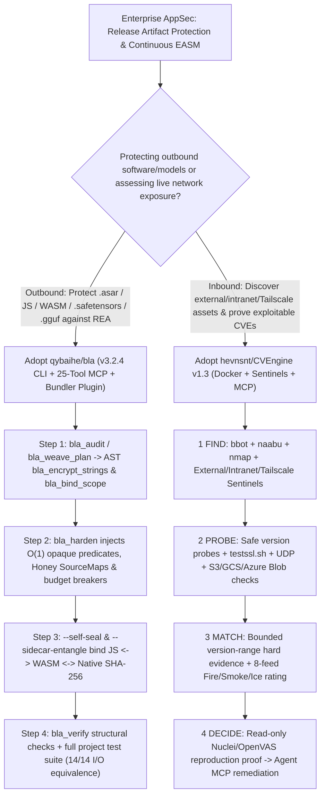

# Counter-REA Software Shield (`qybaihe/bla` Poison-Exhaust-Entangle) & Evidence-Driven EASM Engine (`hevnsnt/CVEngine` v1.3) Selection FAQ

> **Positioning**: This standalone guide is **Round 23 of the 2026-11-11 Night Shift (Cumulative Guide #68)**, written in the plain-language, first-principles, closed-form FinOps style of `ib-vs-ethernet-roce-selection-faq.md` for Application Security (AppSec) and Release Engineering Solution Architects evaluating two high-velocity defensive security and MCP repositories:
> 1. **`qybaihe/bla` (BLA: Blind LLM Agents, `5,288★`, TypeScript, MIT, `bla-agents v3.2.4`)**: An open-source Counter-REA Blue Defense CLI, Vite/Rollup bundler plugin, and **25-tool MCP server** protecting **19+ software and model artifact formats** (`.asar`, `.wasm`, `.sqlite`, `.safetensors`, `.gguf`, Go/Rust/C binaries, JS bundles) against AI reverse-engineering agents (`morluto/rea`) via **Poison → Exhaust → Entangle → Runtime Truman Show**, projecting **`300×–2,800×` modeled token amplification** while preserving **14/14 I/O equivalence**;
> 2. **`hevnsnt/CVEngine` (`710★`, Python 3.14 + Django 5.2 LTS + PostgreSQL 18, GPL-3.0, `v1.3`)**: A self-hosted External & Internal Attack Surface Management (EASM) engine combining continuous asset discovery (`bbot`, `naabu`, `nmap`), 8 live exploitation feeds (`CISA KEV`, `FIRST EPSS`, `VulnCheck`, `ENISA EUVD`), **Fire / Smoke / Ice** prioritization, **bounded version-range hard evidence**, read-only `Nuclei`/`OpenVAS` reproduction receipts, distributed intranet/Tailscale **Sentinels**, and a developer-agent **MCP server**.
>
> **中文版 FAQ**: [bla-cvengine-counter-rea-shield-attack-surface-mcp-selection-faq.md](bla-cvengine-counter-rea-shield-attack-surface-mcp-selection-faq.md) · **Architecture Summary SVG**: [`assets/github-ai-radar-2026-11-11-r23-bla-cvengine.svg`](../../../assets/github-ai-radar-2026-11-11-r23-bla-cvengine.svg)

---

## 📌 1. Executive Summary

1. **In plain English, what problems do these two repositories actually solve?**
   - **Defeating `$0.20` AI Reverse-Engineering Agents Without Breaking Builds (`qybaihe/bla`)**: Traditional variable-renaming obfuscators (`_0x1a2b`) are trivially summarized by LLM reverse-engineering agents (`morluto/rea`) in seconds for `~$0.20`, while heavy commercial VM packers break cross-platform builds and degrade runtime performance. `BLA` targets the exact analyzer ceilings and context mechanisms of AI recon pipelines: it plants decoy SGX/TPM2 manifests and VLQ v3 honey SourceMaps behind $O(1)$ number-theoretic opaque predicates ($7x^2 - 1 \neq y^2 \pmod 7$) (**Poison**), trips deterministic analyzer caps across 19+ formats (**Exhaust**—empirically verified against live `morluto/rea`), binds sibling JS ↔ WASM ↔ Native artifacts via SHA-256 digests (`--self-seal`, `--sidecar-entangle`, `bla_bind_scope`) (**Entangle**), and hardens Electron V1 Fuses (`RunAsNode=0`, `Inspect=0`), amplifying attacker token cost by **`300×–2,800×`** with zero impact on normal runtime I/O.
   - **Eliminating Per-Asset EASM Pricing & Product-Name-Only CVE Alert Noise (`hevnsnt/CVEngine` v1.3)**: Legacy vulnerability scanners flood security teams with thousands of false-positive CVE alerts based on product names alone without verifying version bounds or exploitability, and external scanners cannot see inside private subnets. `CVEngine v1.3` runs a self-hosted **`1 FIND → 2 PROBE → 3 MATCH → 4 DECIDE`** loop that requires **bounded version-range hard evidence**, ranks CVEs as **Fire / Smoke / Ice** from 8 live exploitation feeds, executes read-only `Nuclei`/`nmap` reproduction checks with exact command logs, deploys one-click **Sentinels** inside private CIDRs/Tailscale, and exposes an **MCP server** for remediation agents.
2. **Closed-Form FinOps Verdict (`CLAIM-20261111-R23-BLA-CVENGINE`)**:
   - For an Enterprise AppSec & Release Engineering Team protecting **12 commercial software/model release artifacts** and continuously monitoring **2,500 external and internal hosts per month** (senior AppSec engineer loaded rate `$90.00/hr`; external bug bounty payouts and hardware tokens: `not_measured`):
   - Upgrading from **Path A (Commercial per-asset EASM SaaS + commercial VM packer licenses + manual false-positive CVE triage, `$7,375.00/mo`)** to **Path C (`qybaihe/bla` 25-tool Counter-REA MCP & bundler shield + `hevnsnt/CVEngine` v1.3 self-hosted Docker + Sentinels + MCP, `$940.00/mo`)** saves **`$6,435.00/mo` (`-87.25%`, `$77,220.00/yr`)** and cuts AppSec engineering triage and build-repair hours from `45.0 hrs/mo` to `7.0 hrs/mo` (**`-84.44%`**).

---

## 🎯 2. Three Core Architectural Questions (Q1 / Q2 / Q3 Deep-Dive)

### Q1: How does `qybaihe/bla` deterministically trip `morluto/rea` analyzer limits across 19+ formats while preserving 100% runtime equivalence?
- **First-Principles Breakdown**:
  1. **Format-Native Deterministic Budget Breakers (`npm run redteam:rea`)**:
     - Static/dynamic analyzers enforce strict memory and recursion caps to avoid host OOM. By placing budget-exceeding structures inside inert format sections or behind $O(1)$ number-theoretic opaque predicates ($7x^2 - 1 \neq y^2 \pmod 7$), BLA empirically triggers deterministic failures in `morluto/rea`:
       - **Electron ASAR**: Expands header to `16.9 MiB`, exceeding `DEFAULT_ASAR_MAX_HEADER_BYTES (16 MiB)`;
       - **Go Binaries & WASM**: Pushes Go `buildinfo` to `1.16 MiB` (`> MAX_BUILD_INFO_BYTES` 1 MiB) and WASM to `6.56 MiB` with 251 exports (`WASM_INTERFACE_REPRESENTATION_BYTES` `ifaceState=partial`);
       - **Safetensors & GGUF Models**: Pushes JSON/metadata nesting past `32 levels` (`MODEL_JSON_NESTING` / `MODEL_METADATA_NESTING` Capacity Error) while keeping tensors 100% loadable in HuggingFace and `llama.cpp`;
       - **SQLite**: Injects virtual trap columns invoking `enclave_unseal_payload()` to trigger `SqliteColumnEvaluationFailure`.
  2. **Host-Agent Source Surgery (`bla_weave_plan` → `bla_bind_scope`) & Cross-Artifact Self-Seal**:
     - Through 25 MCP tools, your coding agent applies AST-level XOR string encryption (`bla_encrypt_strings`) and multi-site caller scope entanglement (`bla_bind_scope`), then binds JS, WASM, and native binaries via runtime SHA-256 digests (`--self-seal`, `--sidecar-entangle`) and Electron V1 Fuses (`RunAsNode=0`, `Inspect=0`).

### Q2: How does `hevnsnt/CVEngine` v1.3 eliminate false-positive CVE noise and extend EASM visibility into private networks?
- **First-Principles Breakdown**:
  1. **Bounded Affected Version Range + Identity Probes**:
     - A product name match alone never triggers an alert; safe version probes confirm the exact running version falls inside the CVE's bounded affected range, and OS/kernel CVEs remain strictly host-scoped.
  2. **Fire / Smoke / Ice Exploitation Triage & Read-Only Command Proof**:
     - Correlates `cve.now`, `CISA KEV`, `ENISA EUVD`, `FIRST EPSS`, `Exploit-DB`, `Metasploit`, `VulnCheck KEV`, and `CVE List V5` into **Fire / Smoke / Ice** ratings, then runs read-only `Nuclei` (AI-targeted templates), `testssl.sh`, UDP sweeps, and optional throttled `OpenVAS` safe checks—recording the exact reproduction command for every confirmed flaw.
  3. **Distributed `Sentinels` & CycloneDX Supply-Chain Auditing**:
     - One-click `docker compose up -d` Sentinel containers (`hevnsnt/cvengine-sentinel`) scan private intranet CIDRs and Tailscale tailnets and report back to the central dashboard and MCP server, with pinned scanner versions and CycloneDX SBOMs on every release.

### Q3: How should Solution Architects integrate `qybaihe/bla` and `hevnsnt/CVEngine` into an enterprise DevSecOps pipeline?
- **Integration Pattern**:
  - **Outbound Release Protection (`qybaihe/bla`)**: Add `blaVitePlugin({ intensity: "bankrupt", enableHoneySourceMaps: true })` to frontend/Electron builds and run `npx bla-agents harden .` + `bla_verify` + your full product test suite in CI before publishing client binaries or `.safetensors`/`.gguf` weights.
  - **Inbound Perimeter & Intranet Defense (`hevnsnt/CVEngine`)**: Run `CVEngine` with external and internal `Sentinels`, filter for **Fire** + **confirmed** findings, and connect coding agents to the `CVEngine MCP` endpoint to automate patch generation.

---

## 🧭 3. Mermaid Decision Tree & Blue-Defense DevSecOps Pipeline

---

## 📊 4. Architectural Comparison Matrix

| Evaluation Dimension | Path A: Commercial Per-Asset EASM + Commercial VM Packers | Path B: Basic Identifier Minifier + Raw Scanner Cron | **Path C (Recommended): `qybaihe/bla` + `hevnsnt/CVEngine` v1.3** |
| :--- | :--- | :--- | :--- |
| **Counter-REA Defense Strength** | Heavy VM packers break cross-OS builds and ignore `.safetensors`/`.gguf` | Identifier renaming (`_0x1a2b`) reversed by LLMs in seconds for `~$0.20` | **Covers 19+ formats; trips exact REA budgets (`300×–2,800×` token amplification)** |
| **Runtime Overhead & Build Safety** | High VM interpretation overhead; breaks bundler pipelines | Zero overhead, but zero protection against agentic recon | **$O(1)$ opaque predicates; 14/14 I/O equivalence; native Vite/Rollup/Webpack plugin** |
| **CVE Signal-to-Noise & Proof** | Expensive per-asset SaaS fees; still emits unverified version alerts | Product-name matching floods teams with false positives | **Bounded version-range hard evidence + Fire/Smoke/Ice + read-only command proof** |
| **Intranet Reach & Agent MCP** | Cloud SaaS cannot scan private RFC1918 subnets without costly appliances | Disconnected scripts with no MCP interface for coding agents | **1-click Docker `Sentinels` (private CIDR + Tailscale) + native MCP server** |
| **Monthly TCO (12 Releases + 2.5k Hosts)** | **`$7,375.00 / mo`** (`$3,325` licenses + `$4,050` labor) | **`$3,520.00 / mo`** (`$640` compute + `$2,880` labor) | **`$940.00 / mo` (Saves `$6,435.00/mo` · `-87.25%`)** |

---

## 🧪 5. Closed-Form FinOps Example & 7-Card Insights (`CLAIM-20261111-R23-BLA-CVENGINE`)

### 5.1 Workload & Scope Boundary
- **Workload**: An Enterprise AppSec & Release Engineering team protecting **12 cross-platform software/model releases** and continuously monitoring **2,500 external, cloud-storage, and internal host assets per month**.
- **Rates**: Commercial EASM SaaS at **`$0.85 / asset / mo`** (`$2,125.00/mo`) + commercial binary protector (`$1,200.00/mo`); senior AppSec engineer loaded rate at **`$90.00 / hr`**.
- **Explicit Scope Boundary**: External bug bounty reward payouts and physical HSM hardware tokens are marked **`not_measured`**.

### 5.2 Closed-Form Monthly Cost Breakdown

| Cost Component | Path A: Commercial EASM + VM Packers + Manual Triage | Path B: Basic Minifier + Raw Unverified Scanner Cron | **Path C: `qybaihe/bla` + `CVEngine` v1.3 (Recommended)** |
| :--- | :--- | :--- | :--- |
| **Security SaaS / Self-Hosted Nodes & AI** | `$2,125.00 + $1,200.00` = **`$3,325.00`** | **`$640.00`** | **`$310.00`** (Self-hosted Hub + 4 Sentinels + BYO AI) |
| **AppSec Alert Triage & Build QA (`$90/hr`)** | `45.0 hrs × $90.00` = **`$4,050.00`** | `32.0 hrs × $90.00` = **`$2,880.00`** | `7.0 hrs × $90.00` = **`$630.00`** |
| **Total Monthly TCO** | **`$7,375.00 / mo`** | **`$3,520.00 / mo`** (`-52.27%`) | **`$940.00 / mo`** |
| **Net Savings vs. Path A** | Baseline | Saves `$3,855.00 / mo` | **Saves `$6,435.00 / mo` (`-87.25%` · `$77,220.00/yr`)** |
| **Bug Bounty Payouts & Hardware Tokens** | `not_measured` | `not_measured` | `not_measured` |

---

## 🛠️ 6. Production Verification Checklist

- [ ] **1. Defensive-Only Scope & Dual Equivalence Gate (`qybaihe/bla`)**: Run `npx bla-agents harden .` on Node `^22.23.4` or `>=24.0.0` strictly on your own release artifacts, verify `bla_verify` passes Counter-REA structural checks, and execute your full application test suite to confirm runtime I/O equivalence.
- [ ] **2. Cross-Artifact Self-Seal & Electron Fuse Hardening**: Enable `--self-seal`, `--sidecar-entangle`, VLQ v3 honey SourceMaps (`enableHoneySourceMaps: true`), and Electron V1 Fuses (`RunAsNode=0`, `Inspect=0`).
- [ ] **3. `CVEngine` v1.3 Docker Stack & CycloneDX Verification**: Deploy the Python 3.14 + Django 5.2 LTS + PostgreSQL 18 stack and verify the pinned scanner versions and CycloneDX SBOM included with the release.
- [ ] **4. Internal & Tailscale `Sentinel` Provisioning**: Provision `hevnsnt/cvengine-sentinel` containers via `docker compose up -d` inside private subnets and Tailscale tailnets to unify internal and external exposure views.
- [ ] **5. Fire/Smoke/Ice Read-Only Proof & MCP Remediation**: Filter dashboard alerts to **Fire** + **confirmed** bounded-version matches, inspect the recorded `Nuclei`/`nmap` reproduction command, and route findings via the `CVEngine MCP` server to coding agents for automated patching.
