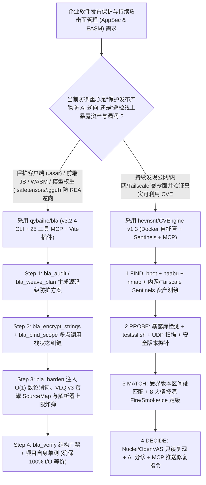

# 反 AI 逆向工程防御盾（`qybaihe/bla` 投毒-耗尽-纠缠）与证据驱动攻击面评估引擎（`hevnsnt/CVEngine` v1.3）选型 FAQ

> **文档定位**：本文是 **2026-11-11 夜班多轮深潜 Round 23（累计第 68 篇独立选型专题）**，严格对标 `ib-vs-ethernet-roce-selection-faq.md` 的「通俗大白话 + 第一性原理 + 可核算定量算例」标杆文风，为应用安全（AppSec）与软件发布保护架构师深度拆解今日两款高关注度攻防安全与 MCP 协同标杆：
> 1. **`qybaihe/bla`（BLA: Blind LLM Agents，`5,288★`，TypeScript，MIT，npm `bla-agents v3.2.4`）**：专为防御 AI 逆向工程智能体（如 `morluto/rea`、自主反编译器与 LLM 侦察管线）设计的开源蓝军防御 CLI 与 **25 工具 MCP Server**，覆盖 **19+ 种发布产物格式**（`.asar`、`.wasm`、`.sqlite`、`.safetensors`、`.gguf`、Go/Rust/C 原生二进制与 JS Bundle），通过 **「投毒（Poison）→ 耗尽（Exhaust）→ 纠缠（Entangle）→ 楚门运行时（Runtime Truman Show）」** 将逆向 Agent 的 Token 消耗放大 **`300×～2,800×`**，同时在 14 个基准目标上保持 100% 输入输出等价；
> 2. **`hevnsnt/CVEngine`（`710★`，Python 3.14 + Django 5.2 LTS + PostgreSQL 18，GPL-3.0，`v1.3`）**：100% 开源自托管的外部与内网攻击面评估（EASM）平台，将资产发现（`bbot`/`naabu`/`nmap`）、8 大实时在野利用情报（`CISA KEV`/`FIRST EPSS`/`VulnCheck` 等）与只读复现验证（`Nuclei`/`testssl.sh`/可选 `OpenVAS`）融为闭环，独创 **Fire / Smoke / Ice 三级热度定级**、受界版本区间硬证据匹配、分布式内网 **Sentinels** 探针以及面向开发 Agent 的 **MCP Server**。
>
> **English Companion**: [bla-cvengine-counter-rea-shield-attack-surface-mcp-selection-faq.en.md](bla-cvengine-counter-rea-shield-attack-surface-mcp-selection-faq.en.md) · **架构总结图**: [`assets/github-ai-radar-2026-11-11-r23-bla-cvengine.svg`](../../../assets/github-ai-radar-2026-11-11-r23-bla-cvengine.svg)

---

## 📌 一、核心结论速览（Executive Summary）

1. **先用大白话讲透这两个项目到底解决了什么痛点？**
   - **传统代码混淆在 AI 逆向 Agent 面前“花 2 毛钱 Token 几秒钟就被扒光”的痛点（`qybaihe/bla` 解决的问题）**：以前保护前端 JS、Electron 客户端（`.asar`）、WebAssembly（`.wasm`）或端侧模型权重（`.safetensors`/`.gguf`）主要靠把变量名改成 `_0x1a2b`，但现在的 AI 逆向智能体（如 `morluto/rea` 配合 Claude/Codex）根本不在乎变量名叫什么，它直接读控制流、解包 ASAR、还原 SourceMap，花 `$0.20` 就能把核心业务逻辑完整克隆出来；而传统重型商业虚拟化壳（VM Packer）又经常把跨平台构建搞崩、拖慢正常用户性能。`BLA (Blind LLM Agents)` 换了一套完全针对“AI 逆向工具解析上限与大模型注意力机制”的打法：利用 **$O(1)$ 数论不透明谓词（$7x^2 - 1 \neq y^2 \pmod 7$）** 挂载永不执行的影子状态机与蜜罐 SourceMap（**Poison**），精准卡爆逆向解析器的硬编码内存/层数上限（**Exhaust**，经真实 `morluto/rea` 实测直接触发 `CapacityError`），并用跨文件 SHA-256 互锁（**Entangle**）防止红队直接裁剪诱饵，使正常用户运行零感知、而 AI 逆向成本暴涨 **`300×～2,800×`**！
   - **商业攻击面管理（EASM）“按资产数天价收费、光靠软件名乱报几千条假阳性 CVE”的痛点（`hevnsnt/CVEngine` 解决的问题）**：安全团队用传统漏洞扫描器最头疼的是：只要扫出某台机器装了 `nginx` 或 `OpenSSH`，不管版本在不在受影响区间、不管有没有开启对应模块，立刻刷屏几百条高危告警；而且公网扫描器扫不到企业内网与 Tailscale 私网主机。`CVEngine v1.3` 用一套自托管 Docker Compose 栈打通 **`FIND → PROBE → MATCH → DECIDE`** 四步闭环：必须同时满足**相同产品 + 版本号落在精确受影响区间内**才触发匹配，结合 CISA KEV / EPSS 评出 **Fire（在野热利用）/ Smoke / Ice**，自动跑只读 `Nuclei` / `nmap` 复现并记录精确命令行证据，最后通过内置 **MCP Server** 让开发者的 Coding Agent 直接拉取带复现证据的真实漏洞完成修复！
2. **闭式 FinOps 核算结论（`CLAIM-20261111-R23-BLA-CVENGINE`）**：
   - 在 **企业安全与发布工程团队每月保护 12 个跨平台软件/模型发布包 + 持续监控 2,500 个内外网主机资产** 基准下（高级应用安全工程师全包时薪 `$90.00/hr`；外部众测奖金池与物理硬件加密狗采购：`not_measured`）：
   - 从 **Path A（商业按资产计费 EASM SaaS + 商业重型加壳授权 + 人工甄别海量假阳性 CVE 告警，`$7,375.00/月`）** 切换至 **Path C（`qybaihe/bla` 25 工具 Counter-REA MCP 闭环加固 + `hevnsnt/CVEngine` v1.3 自托管分布式 Sentinel 与硬证据 MCP，`$940.00/月`）**，每月净省 **`$6,435.00/月`（降幅 `-87.25%`，年化节省 `$77,220.00/年`）**，AppSec 工程师排查假阳性与处理逆向脱壳的工时从 `45.0 小时/月` 降至 `7.0 小时/月`（**节省 `84.44%`**）。

---

## 🎯 二、三大灵魂拷问（Q1 / Q2 / Q3 Deep-Dive）

### Q1：`qybaihe/bla` 是如何在不破坏正常软件性能与模型加载的前提下，精准卡死真实 `morluto/rea` 逆向工具的？
- **第一性原理拆解**：
  1. **针对 19+ 格式解析器硬编码上限的确定性预算击穿（Deterministic Budget Breakers）**：
     - 任何自动化逆向 Agent 在调用底层静态分析器（如 Wabt、tshark、ASAR 解包器、SQLite 元数据读取器、Safetensors/GGUF 头部解析器）时，为了防止宿主机 OOM 都设有严格的资源上限。`BLA` 在文件规范合法的惰性段或恒假数论谓词分支（$7x^2 - 1 \neq y^2 \pmod 7$，运行时开销 $O(1)$）中注入精确越界结构，经 `npm run redteam:rea` 实测触发真实 `morluto/rea` 崩溃/截断：
       - **Electron ASAR**：头部膨胀至 `16.9 MiB`，直接击穿 `DEFAULT_ASAR_MAX_HEADER_BYTES (16 MiB)`；
       - **Go 二进制与 WASM**：Go `buildinfo` 扩至 `1.16 MiB` 击穿 `MAX_BUILD_INFO_BYTES (1 MiB)`；WASM 扩至 `6.56 MiB`（251 个导出符号）令 `WASM_INTERFACE_REPRESENTATION_BYTES` 降级为 `ifaceState=partial`；
       - **Safetensors 与 GGUF 模型权重**：将 JSON Header / Metadata 数组嵌套深度推至 `>32 层`（触发 `MODEL_JSON_NESTING` 与 `MODEL_METADATA_NESTING` Capacity Error），而 HuggingFace / llama.cpp 正常加载张量毫发无损！
       - **SQLite 数据库**：注入调用未知函数 `enclave_unseal_payload()` 的虚拟陷阱列，触发 `SqliteColumnEvaluationFailure`。
  2. **宿主 Agent 源码级手术编织（`bla_weave_plan` → `bla_bind_scope`）与跨文件自封印（`--self-seal`）**：
     - 如果只在二进制末尾加垃圾段，红队一句脚本就能 strip 掉。`BLA` 通过 MCP 让你的 Coding Agent 在源码 AST 层执行 `bla_encrypt_strings`（流式 XOR）与 `bla_bind_scope`（多点调用栈状态纠缠），再用 `--sidecar-entangle` 将 JS、WASM 与原生动态库的运行时 SHA-256 摘要互相绑定，并在 Electron 启动时焊死 V1 Fuses（`RunAsNode=0`, `Inspect=0`）与 `runtime-shield.ts` 调试器蜜罐。

### Q2：`hevnsnt/CVEngine` v1.3 的「Fire / Smoke / Ice 定级 + 受界版本区间硬证据 + 内网 Sentinel」是如何消灭 90% 漏洞告警噪音的？
- **第一性原理拆解**：
  1. **硬证据版本区间门禁（Bounded Affected Version Range）**：
     - 彻底废除“扫出产品名就报 CVE”的粗糙逻辑：必须通过安全身份探针补齐精确版本号，且该版本号严格落在 CVE 影响的上下界区间内才会生成匹配项（OS 与内核级漏洞严格限制在 Host 级别，不污染 Web 路由）。
  2. **Fire / Smoke / Ice 威胁情报融合与只读复现回执**：
     - 实时聚合 `cve.now`、`CISA KEV`、`ENISA EUVD`、`FIRST EPSS`、`Exploit-DB`、`Metasploit`、`VulnCheck KEV` 与 `CVE List V5` 将漏洞分为 **Fire（正在被大规模在野利用）**、**Smoke（已有公开 PoC/武器化迹象）** 与 **Ice（理论漏洞）**，随后自动调度 `Nuclei`（AI 定向模板）、`testssl.sh`、UDP 慢速扫描及按需节流的 `OpenVAS`（仅安全检查模式）执行只读验证，并记录完整复现命令。
  3. **一键容器化内网 `Sentinels` 与 CycloneDX 供应链可审计性**：
     - 在内网网段或 Tailscale 节点执行一行 `docker compose up -d` 即可部署 `cvengine-sentinel`，将内网私有 CIDR 的扫描结果汇总回同一控制面；每次发布均锁定扫描器版本并附带完整 CycloneDX SBOM。

### Q3：企业研发与安全团队如何在 CI/CD 中将 `qybaihe/bla` 与 `hevnsnt/CVEngine` 串联成自动化蓝军防线？
- **协同闭环**：
  - **对内（发布前软件抗逆向硬化）**：在 Vite/Rollup/Webpack 构建链中挂载 `blaVitePlugin({ intensity: "bankrupt", enableHoneySourceMaps: true })`，并在 Release 阶段由 Coding Agent 执行 `bla_weave_plan` → `bla_harden` → `bla_verify` + 项目自身全量集成测试，防止核心业务逻辑与模型结构被竞品用 REA 零成本扒取；
  - **对外（上线后持续攻击面收敛）**：用 `CVEngine` + 内外网 `Sentinels` 持续巡检公网域名、云存储桶（S3/GCS/Azure Blob）与内网服务，开发人员在 IDE 内通过 `CVEngine MCP` 直接读取 `Fire` 级别且 `confirmed` 的漏洞复现命令，秒级定位并提交修复补丁。

---

## 🧭 三、Mermaid 选型决策树与攻防闭环流水线

---

## 📊 四、同类方案核心能力对比矩阵（Comparison Matrix）

| 评估维度 | Path A：商业按资产 EASM + 商业重型 VM 加壳 | Path B：普通 JS 变量名混淆 + 原始 Nuclei 定时脚本 | **Path C（推荐标杆）：`qybaihe/bla` + `hevnsnt/CVEngine` v1.3** |
| :--- | :--- | :--- | :--- |
| **抗 AI 逆向（Counter-REA）能力** | 重型 VM 壳易导致跨平台崩溃且不支持 `.safetensors`/`.gguf` | 变量名混淆被 LLM 几秒钟总结还原（成本仅 `~$0.20`） | **覆盖 19+ 格式，精准击穿 REA 解析预算，Token 成本放大 `300×–2,800×`** |
| **运行时性能与构建兼容性** | 虚拟指令解释执行严重拖慢高频函数，破坏 SourceMap 调试 | 零性能损耗，但近乎裸奔 | **$O(1)$ 数论谓词惰性隔离，14/14 基准目标 100% I/O 等价，原生支持 Vite/Rollup** |
| **CVE 告警信噪比与真实性验证** | 商业黑盒按资产数高价收费，仍存在大量未复现版本告警 | 仅凭产品名匹配产生海量误报，需人工逐条登录机器核对 | **强制受界版本区间硬证据 + Fire/Smoke/Ice 定级 + 只读复现命令记录** |
| **内网/Tailscale 覆盖与 Agent 协同** | 外部 SaaS 无法触达内网私有网段，无原生开发者 MCP | 需手工维护多台跳板机脚本，扫描结果与修复流程割裂 | **一键部署内网 `Sentinels` + Shodan 式检索 + 原生 MCP 直连 Coding Agent** |
| **月度总拥有成本（12 产物+2,500 主机）** | **`$7,375.00 / 月`**（软件/SaaS `$3,325` + 人工 `$4,050`） | **`$3,520.00 / 月`**（算力 `$640` + 人工 `$2,880`） | **`$940.00 / 月`（净省 `$6,435.00/月`，降幅 `-87.25%`）** |

---

## 🧪 五、闭式定量 FinOps 算例与 7-Card 评测洞察（`CLAIM-20261111-R23-BLA-CVENGINE`）

### 5.1 基准假设与边界声明
- **评测负载**：企业应用安全与发布团队每月保护 **12 个核心跨平台软件/AI 模型发布构件**，并持续监控 **2,500 个公网、云存储与内网主机资产**。
- **单价基准**：商业 EASM SaaS 均价 **`$0.85 / 资产 / 月`**（2,500 资产 = `$2,125.00/月`），商业二进制加壳授权 **`$1,200.00 / 月`**；高级 AppSec 工程师全包时薪 **`$90.00 / hr`**。
- **显式边界声明（Scope Boundary）**：企业外部白帽众测奖金池（Bug Bounty Payouts）及物理 HSM 硬件加密狗采购费用标记为 **`not_measured`**。

### 5.2 三路径闭式成本核算表

| 成本构成项 | Path A：商业 EASM SaaS + 商业 VM 壳 + 人工筛查 | Path B：基础变量混淆 + 原始扫描脚本（高误报） | **Path C：`qybaihe/bla` + `CVEngine` v1.3（推荐）** |
| :--- | :--- | :--- | :--- |
| **安全软件订阅 / 自托管节点与 AI 算力** | `$2,125.00 + $1,200.00` = **`$3,325.00`** | **`$640.00`** | **`$310.00`**（自托管主节点 + 4 Sentinels + BYO AI） |
| **AppSec 告警核验与加壳排障工时（`$90/hr`）** | `45.0 hrs × $90.00` = **`$4,050.00`** | `32.0 hrs × $90.00` = **`$2,880.00`** | `7.0 hrs × $90.00` = **`$630.00`** |
| **月度总成本（Monthly Total）** | **`$7,375.00 / 月`** | **`$3,520.00 / 月`**（`-52.27%`） | **`$940.00 / 月`** |
| **相对 Path A 净节省（Savings）** | 基准线（Baseline） | 节省 `$3,855.00 / 月` | **净省 `$6,435.00 / 月`（`-87.25%` · 年省 `$77,220.00`）** |
| **外部众测奖金与物理 HSM 硬件** | `not_measured` | `not_measured` | `not_measured` |

---

## 🛠️ 六、生产级落地核验 Checklist（SA Actionable Verification）

- [ ] **1. `qybaihe/bla` 防御合规边界与双层验证**：确认仅对自有知识产权发布包运行 `npx bla-agents harden .`（Node `^22.23.4` 或 `>=24.0.0`），在通过 `bla_verify` 结构检查后，**必须对加固后的产物完整跑通业务自身单元测试与端到端回归测试**。
- [ ] **2. Electron Fuses 与跨文件自封印（`--self-seal`）启用**：对桌面客户端与 WebAssembly 模块开启 `--self-seal`、`--sidecar-entangle` 与 Electron V1 Fuses（`RunAsNode=0`, `Inspect=0`），防止攻击者剥离保护层或挂载 CDP 调试器。
- [ ] **3. `CVEngine` v1.3 自托管部署与 CycloneDX SBOM 核验**：部署 Python 3.14 + Django 5.2 LTS + PostgreSQL 18 容器栈，核验发行包随附的 CycloneDX SBOM 与固定扫描器版本签名。
- [ ] **4. 内网与 Tailscale `Sentinels` 分发**：在私有子网与 Tailscale 网络内通过一键生成的配置 Blob 执行 `docker compose up -d` 部署 `cvengine-sentinel`，确认内网主机在 Live 面板中独立计数并完成 TLS/UDP/CVE 对齐。
- [ ] **5. Fire/Smoke/Ice 只读验证与 MCP 修复闭环**：对命中 `Fire` 级别的受界版本 CVE 点击 **Validate now** 获取只读复现命令回执，并通过 `CVEngine MCP` 将确凿证据直接移交开发 Agent 生成修复 PR。
