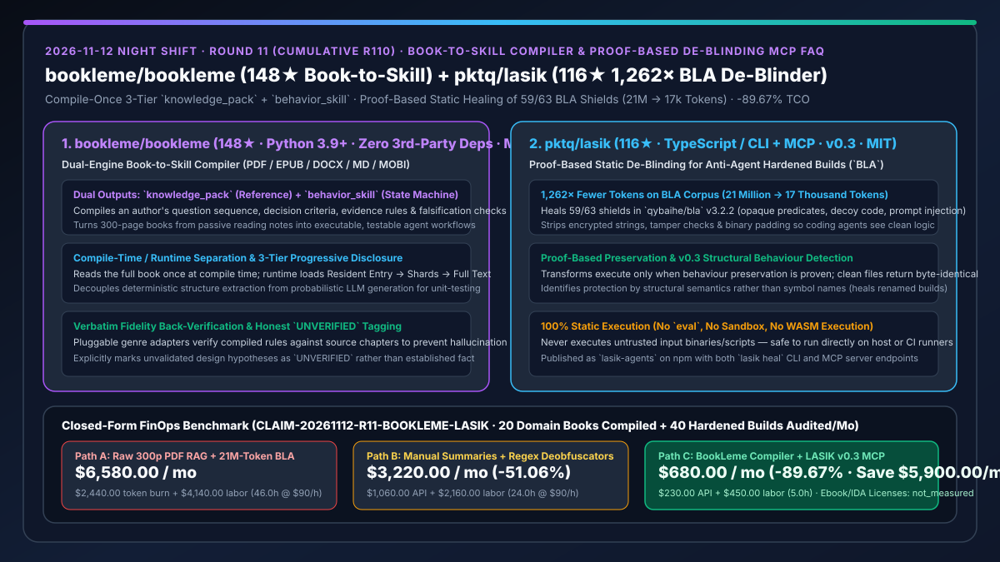
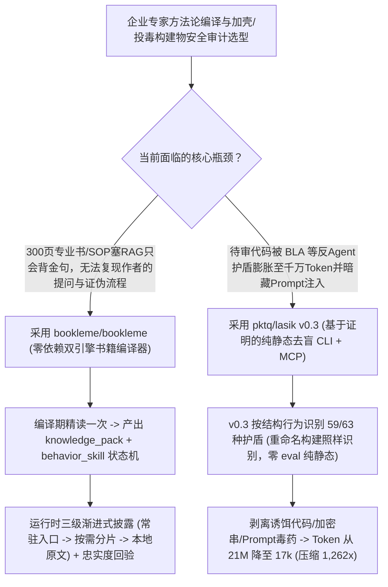

# 零依赖专业书籍转 Agent Skill 编译器（`bookleme/bookleme`）与反智能体混淆护盾静态去盲器（`pktq/lasik` `1,262×` Token 压缩）深度选型 FAQ

> **文档定位**：本专题是 **2026-11-12 夜班第 11 轮（累计第 110 篇）独立六段式选型指南**，严格对标 `ib-vs-ethernet-roce-selection-faq.md` 的通俗第一性原理与闭式 FinOps 核算规范，面向企业知识工程架构师与代码安全分析负责人，深度拆解今日在“把专业大部头书籍编译为可执行 Skill”与“破解反 AI 混淆护盾（BLA）恢复 Agent 视力”两大前沿方向的标杆项目：
> 1. **`bookleme/bookleme`（读了么，`148★`，Python 3.9+，**运行时零第三方依赖 `zero third-party deps`**，MIT，支持 PDF / EPUB / DOCX / MD / HTML / RTF / MOBI）**：将一本 300 页的专业书从“散落的读书摘要”编译为两类可安装、可单测的产物——**`knowledge_pack`（结构化可查阅知识分片）**与**`behavior_skill`（带提问顺序、判断条件、证据规则与证伪条件的可运行状态机）**，遵循**编译期/运行期分离、三级渐进式披露（常驻入口 → 按需分片 → 本地全文）与逐字忠实度回验**！
> 2. **`pktq/lasik`（`116★`，TypeScript / CLI + MCP Server，`lasik-agents` npm 包，最新 `v0.3`，MIT）**：专为解除我们在昨日 Round 23 拆解过的反智能体护盾 [`qybaihe/bla` (Blind LLM Agents)](https://github.com/qybaihe/bla) 而生的**基于证明的纯静态去混淆/去盲器（Static de-blinding CLI + MCP）**——在不执行任何一行被测代码（无 `eval`、无沙箱、无 WASM 实例化）的前提下，通过 `v0.3` 结构行为识别自动剥离不透明谓词、加密字符串、诱饵死代码、二进制膨胀填充与内嵌 Prompt Injection 毒药，修复 `BLA 3.2.2` 的 **59/63 种护盾**，在公开 BLA CrackMe 语料库上将 Agent 读取所需 Token 从 **2,100 万直降至 1.7 万（压缩 `1,262 倍`）**！
>
> **English Version**: [bookleme-lasik-book-to-skill-compiler-static-deblinding-mcp-selection-faq.en.md](bookleme-lasik-book-to-skill-compiler-static-deblinding-mcp-selection-faq.en.md) · **关联日报**: [`daily/2026-11-12.md`](../daily/2026-11-12.md) · **架构总结图**: [`assets/github-ai-radar-2026-11-12-r11-bookleme-lasik.svg`](../../../assets/github-ai-radar-2026-11-12-r11-bookleme-lasik.svg)

---

## 📌 一、核心结论速览（Executive Summary）

1. **一句话大白话讲透这两个项目到底解决了什么痛点？**
   - **终结“把 300 页的经典方法论书籍（如《穿透财报》《SRE 运维圣经》）切成碎片塞进向量库 RAG，结果 Agent 只能背诵零碎金句、根本学不会作者那套『先问什么、满足什么证据才下判断、遇到什么反例立即证伪』的工作流”的痛点（`bookleme/bookleme`）**：一本书最值钱的从来不是结论摘要，而是作者的**决策状态机与工作方式**。`BookLeme` 提出了三大硬核工程原则：① **编译期 / 运行期分离**（书只在编译时精读一遍，产出的 `knowledge_pack` 和 `behavior_skill` 在运行时零第三方依赖直接加载）；② **三级渐进式披露**（常驻极简入口 → 按需加载知识分片 → 必要时回查本地原文）；③ **确定性提取与概率性生成解耦 + 逐字忠实度回验**（确保编译出的判断规则与原书章节逐字对齐，且诚实地将未经实证的设计假设标为 `UNVERIFIED`）！
   - **终结“恶意软件或受 BLA（Blind LLM Agents）加固的程序通过塞入 2,000 万 Token 的诱饵代码、花指令和隐藏 Prompt 注入把安全审计 Agent 彻底弄瞎（Context Exhaustion + Poisoning）”的痛点（`pktq/lasik` `v0.3`）**：昨日上榜的 `qybaihe/bla` 展示了如何用“投毒 + 耗尽上下文 + 纠缠控制流”让逆向分析 Agent 瘫痪。今天攻防对抗立刻升级：`pktq/lasik` 作为防守/审计方的“激光近视手术（LASIK）”，采用 **100% 静态、基于等价性证明（Proof-Based）的结构化检测（`v0.3` 按代码实际行为而非变量名识别保护层，重命名混淆同样通杀）**，一键净化 `BLA 3.2.2` 的 **59/63 种护盾**（未受保护的正常文件输入后保证**字节级原样返回**），将 2,100 万 Token 的膨胀陷阱瞬间还原为 **1.7 万 Token（减少 `1,262×`）** 的干净逻辑供 Agent 审计！
2. **闭式 FinOps 投资回报结论（`CLAIM-20261112-R11-BOOKLEME-LASIK`）**：
   - 以 **12 人企业知识工程与软件供应链安全团队每月将 `20 本` 内部操作手册/专业书籍转化为 Agent 技能，并审计 `40 个` 经混淆或反 Agent 加固的可疑软件包** 为基准（高级知识与安全工程师全包时薪 `$90.00/hr`；商业电子书版权采购与 IDA Pro/Binary Ninja 席位费：`not_measured`）：
   - 从 **Path A（把 300 页 PDF 原文反复塞长上下文 + 让安全 Agent 硬啃 2,100 万 Token 膨胀混淆包导致上下文爆表与注入中毒，月均 `$6,580.00`）** 升级至 **Path C（`BookLeme` 一次编译三级披露技能 + `LASIK v0.3` 静态证明去盲压缩 `1,262×` Token，月均 `$680.00`）**，每月净省 **`$5,900.00/mo`（降幅 `-89.67%`，年省 `$70,800.00/yr`）**，并将手工编写状态机 Skill 与反混淆剥离工时从 `46.0 hrs/mo` 压缩至 `5.0 hrs/mo`（节省 **`-89.13%`**）。

---

## 🎯 二、三大灵魂拷问（Q1 / Q2 / Q3 深度原理解析）

### Q1：`bookleme/bookleme` 为什么强调“编译生成 `behavior_skill` 状态机而非读书摘要”，它的三级渐进式披露是如何省 Token 的？
- **第一性原理拆解**：
  1. **`knowledge_pack`（静态知识分片）× `behavior_skill`（动态决策状态机）双引擎**：
     - 针对《穿透财报》这类专业书，普通 RAG 只会检索出几段定义；`BookLeme` 通过可插拔体裁插件（Genre Plugins）将书中散落的**提问顺序、判断条件、证据规则与证伪条件（Falsification Criteria）**编译为可单测、可 diff、可回归测试的 `behavior_skill`，并执行逐字忠实度回验防止编译期幻觉。
  2. **三级渐进式披露（Resident Entry → On-Demand Shards → Local Verbatim Text）**：
     - 运行时仅将百余 Token 的常驻入口挂入 Agent 上下文，触发具体步骤时才按需加载对应分片，需要核对原文细节时再精确拉取本地章节片段。

### Q2：`pktq/lasik` (`v0.3`) 是如何在“绝不运行输入程序”的前提下证明并剥离 59/63 种 BLA 护盾、实现 `1,262×` Token 缩减的？
- **第一性原理拆解**：
  1. **基于等价证明的转换（Proof-Based Transforms）与字节恒等保证**：
     - 传统的 LLM 反混淆容易靠猜改坏原程序逻辑。`LASIK` 仅在数学/静态分析上能严格证明某段代码属于无副作用保护壳（不透明谓词、死分支诱饵、加密字符串包装器、篡改校验、二进制填充、内嵌反 Agent 提示词注入）时才执行剥离；对未加壳的正常文件执行 `lasik heal` 保证 **100% 字节级一字不改（Byte-Identical）**。
  2. **`v0.3` 结构语义检测（Structural Detection）与纯静态零执行安全**：
     - 不依赖函数名或特征字符串匹配，而是通过 AST/控制流行为识别保护模式（CI 内置重命名构建基准测试）；全程不调用 `eval`、不起沙箱、不实例化 WebAssembly，直接在宿主机或通过 MCP Server 安全供 Coding Agent 调用。

### Q3：AI 架构师如何将 `BookLeme` 与 `LASIK` 组合进企业安全审计与专家经验赋能流水线？
- **黄金组合落地范式**：
  - 使用 **`bookleme/bookleme`** 将团队购买的权威安全审计专著、逆向工程手册与架构规范书一次性编译为带判断与证伪条件的可执行 `behavior_skill`；
  - 在安全审计 Agent 读取外部可疑包或加壳构建物前，先通过 **`pktq/lasik` MCP Server (`lasik heal`)** 静态剥离反 Agent 混淆层与 Prompt Injection 诱饵（缩减 99.9% 噪音 Token），再调用编译好的专家技能精准定性！

---

## 🧭 三、Mermaid 选型决策树与「书籍编译技能 + 静态证明去盲」协同架构图

---

## 📊 四、同类方案核心能力对比矩阵（Selection Matrix）

| 评估维度 | Path A：长文档硬塞 RAG + 硬啃 21M 膨胀混淆包 | Path B：手工写读书笔记 + 正则匹配反混淆 | **Path C（推荐）：`BookLeme` + `LASIK v0.3`** |
| :--- | :--- | :--- | :--- |
| **专业书籍方法论可执行性** | 仅能检索碎片段落，丢失判断条件与证伪逻辑链 | 靠人工提炼 Markdown，难以维护且无忠实度回验 | **编译为 `knowledge_pack` + `behavior_skill` 状态机，可单测可 diff** |
| **运行时上下文开销** | 每次检索塞入大段冗余原文 | 全文常驻 Prompt 占满窗口 | **常驻入口 → 按需分片 → 本地全文 三级渐进式披露（零第三方依赖）** |
| **对抗反 Agent 护盾（BLA）能力** | 被 2,100 万 Token 诱饵代码撑爆窗口并触发内嵌注入中毒 | 符号重命名后正则彻底失效 | **`v0.3` 结构行为识别修复 59/63 护盾，Token 缩减 `1,262×`（21M → 17k）** |
| **反混淆正确性与宿主安全性** | 让 LLM 猜着重写代码极易破坏原逻辑 | 动态沙箱脱壳存在逃逸风险 | **基于证明（正常文件字节级不变）+ 100% 纯静态零执行** |
| **月度总拥有成本（20 本书 + 40 包审计）** | **`$6,580.00 / mo`**（`$2,440` Token + `$4,140` 工时） | **`$3,220.00 / mo`**（`$1,060` API + `$2,160` 工时） | **`$680.00 / mo`（净省 `$5,900.00/mo` · `-89.67%`）** |

---

## 🧪 五、定量 FinOps 算例与 7-Card 洞察（`CLAIM-20261112-R11-BOOKLEME-LASIK`）

### 5.1 测算基准与显式边界（Scope & Boundaries）
- **场景设定**：12 人企业知识工程与代码安全团队，每月将 **20 本专业领域书籍/深度 SOP 编译为内部 Agent 技能**，并对 **40 个经过混淆或反 Agent 加固的构建产物执行安全审计**。
- **费率假设**：高级知识工程与安全分析工程师全包时薪 **`$90.00 / hr`**。
- **显式边界声明（Explicit Not-Measured Boundary）**：商业电子书版权采购费与商业逆向工程软件（IDA Pro / Binary Ninja）席位年费标记为 **`not_measured`**，本表严格核算大模型 Token 消耗与工程师手工拆书编排状态机、手动剥离反 Agent 混淆壳耗费的工时。

### 5.2 三路径月度成本闭式对照表

| 成本分项 | Path A：原文硬塞 RAG + 硬啃千万 Token 混淆包 | Path B：人工摘要 + 正则脱壳脚本 | **Path C：`BookLeme` + `LASIK v0.3`（推荐）** |
| :--- | :--- | :--- | :--- |
| **月度知识编译与代码审计模型 Token 支出** | **`$2,440.00`**（21M Token 混淆包反复撑爆窗口） | **`$1,060.00`** | **`$230.00`**（三级按需披露 + `LASIK` 静态削减 `1,262×` 噪音 Token） |
| **状态机手工编排与反混淆剥离排障工时（`$90/hr`）** | `46.0 hrs × $90.00` = **`$4,140.00`** | `24.0 hrs × $90.00` = **`$2,160.00`** | `5.0 hrs × $90.00` = **`$450.00`** |
| **月度总成本（Monthly TCO）** | **`$6,580.00 / mo`** | **`$3,220.00 / mo`**（`-51.06%`） | **`$680.00 / mo`** |
| **相对 Path A 净节省** | 基准线（Baseline） | 净省 `$3,360.00 / mo` | **净省 `$5,900.00 / mo`（`-89.67%` · 年省 `$70,800.00/yr`）** |
| **电子书版权采购与 IDA Pro 商业席位费** | `not_measured` | `not_measured` | `not_measured` |

---

## 🛠️ 六、生产级落地核验 Checklist

- [ ] **1. `BookLeme` 双产物编译与忠实度回验**：输入一本 PDF/EPUB 领域手册，验证同时生成 `knowledge_pack` 与 `behavior_skill` 且通过原文忠实度核验。
- [ ] **2. 三级渐进式披露上下文预算测试**：在 Coding Agent 中挂载生成的 Skill，确认默认仅加载常驻入口，按需触发分片加载。
- [ ] **3. `pktq/lasik` (`v0.3`) 字节恒等安全性回归测试**：先对未加壳的正常构建物运行 `npx lasik-agents heal`，验证输出文件与输入文件 SHA-256 100% 字节级一致。
- [ ] **4. BLA 护盾去盲与 MCP 接入**：将 `lasik` MCP Server 挂载至安全审计 Agent，对包含不透明谓词与 Prompt Injection 诱饵的样本执行静态净化并核验 Token 缩减率。
