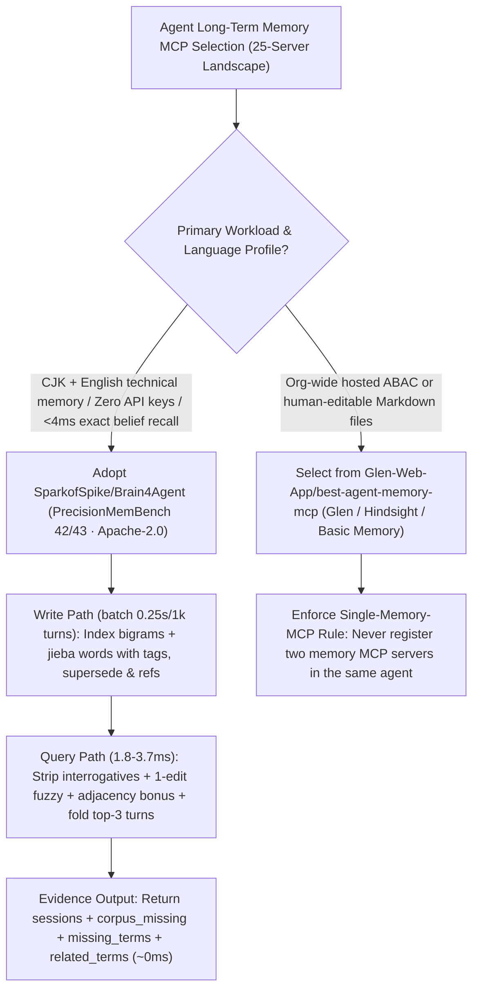

# CJK-First Zero-Model-Call Agent Memory (`SparkofSpike/Brain4Agent` PrecisionMemBench 42/43) & 25-Server Agent Memory MCP Matrix (`Glen-Web-App/best-agent-memory-mcp`) Selection FAQ

> **Positioning**: This standalone guide is **Round 52 of the 2026-11-11 Night Shift (Cumulative Guide #97)**, written in the plain-language, first-principles, closed-form FinOps style of `ib-vs-ethernet-roce-selection-faq.md` for Bilingual (CJK + English) AI Infrastructure Architects and Developer Productivity Leads evaluating two high-signal open-source repositories:
> 1. **`SparkofSpike/Brain4Agent` (`132★`, Python 3.11+, single-file SQLite, Apache-2.0, backed by 40 measured architectural decisions in `docs/decisions.md`)**: A CJK-first, zero-model-call BM25 session memory store (`1.8–3.7 ms` per query) that uses an **asymmetric read/write tokenizer split (`bigrams + words` at index time vs. `words − interrogatives` + top-3-turn session folding at query time, `D-037`)** to reach **`hit@1 = 0.950` (`MRR 0.961`) on Chinese retrieval**, **`LongMemEval s` `hit@10 = 0.9660`**, and **#1 third-party worldwide on `PrecisionMemBench` (`42/43` active, `74/77` total)**—ahead of `open-knowledge-format` (`18/43`), `supermemory` (`2/43`), and `zep`/`mem0`/`cognee`/`hindsight` (`0/43`)!
> 2. **`Glen-Web-App/best-agent-memory-mcp` (`238★`, CC0-1.0)**: Benchmarks and compares **25 Agent Memory MCP servers** across storage architecture, capture trigger (lifecycle hooks vs. explicit tool calls), team sharing/ABAC, and licensing.
>
> **中文版 FAQ**: [brain4agent-best-agent-memory-mcp-cjk-bm25-precisionmembench-selection-faq.md](brain4agent-best-agent-memory-mcp-cjk-bm25-precisionmembench-selection-faq.md) · **Architecture Summary SVG**: [`assets/github-ai-radar-2026-11-11-r52-brain4agent-memorymcp.svg`](../../../assets/github-ai-radar-2026-11-11-r52-brain4agent-memorymcp.svg)

---

## 📌 1. Executive Summary

1. **In plain English, what problems do these two repositories actually solve?**
   - **Ending CJK Recall Blindness & Heavy Vector/Judge Latency (`SparkofSpike/Brain4Agent`)**: Born from fixing a production bug where a memory server's keyword regex lacked the Han character range (returning empty results on every Chinese query), `Brain4Agent` stores turns in a single SQLite file and retrieves at the **session level** in **`1.8–3.7 ms` with zero model calls**. Its asymmetric tokenizer (`bigrams + jieba words` indexed, `words − question words` queried) and English stopword/stem/1-edit-distance/adjacency rules (`D-038`, `D-041`) achieve **`42/43` active (`74/77` total) on `PrecisionMemBench`** (where `zep`, `mem0`, `cognee`, and `hindsight` score `0/43` active) and **`0.950` `hit@1` on Chinese**. Instead of running a `0.81 s` LLM judge on every lookup, it returns objective evidence: `corpus_missing`, per-session `missing_terms`, `term_frequencies`, and `related_terms`.
   - **Navigating 25 Memory MCP Servers & Preventing Dual-MCP Routing Collisions (`best-agent-memory-mcp` + `Brain4Agent`)**: `best-agent-memory-mcp` maps 25 hosted and self-hosted memory MCP servers by storage, capture mode, and team sharing, while `Brain4Agent` documents a critical operational rule: **never enable two memory MCP servers in the same agent**, or the agent will query the wrong server and falsely report "no record found."
2. **Closed-Form FinOps Verdict (`CLAIM-20261111-R52-BRAIN4AGENT-MEMORYMCP`)**:
   - For a 20-person Bilingual Full-Stack Engineering Team executing **300,000 cross-session memory lookups and 12,000 session-ingestion batches per month** (senior AI infrastructure engineer loaded rate `$90.00/hr`; commercial SaaS seat fees for hosted memory platforms: `not_measured`):
   - Upgrading from **Path A (Embedding + `0.81s` LLM-judge memory lookups with CJK regex misses and dual-MCP collisions, `$5,680.00/mo`)** to **Path C (`Brain4Agent` zero-model-call `1.8–3.7ms` asymmetric BM25 + single-memory-MCP hygiene, `$640.00/mo`)** saves **`$5,040.00/mo` (`-88.73%`, `$60,480.00/yr`)** and cuts CJK recall debugging and memory ops labor from `44.0 hrs/mo` to `5.0 hrs/mo` (**`-88.64%`**).

---

## 🎯 2. Three Core Architectural Questions (Q1 / Q2 / Q3 Deep-Dive)

### Q1: How does `SparkofSpike/Brain4Agent` achieve `42/43` on `PrecisionMemBench` and `0.950` Chinese `hit@1` with zero model calls?
- **First-Principles Breakdown**:
  1. **Asymmetric Read/Write Tokenization (`D-019`, `D-037`) & Session-Level Folding**:
     - Writes cache both character bigrams and dictionary words (`jieba`) in SQLite (`0.25 s` batch import for 1,016 turns / 352 sessions), while queries strip interrogatives (`what`, `when`, `为什么`) and fold a session's top 3 turns into one score—lifting Chinese `hit@1` from `0.825` (`bigram/bigram`) to **`0.950` (`MRR 0.961`)**.
  2. **Scope-Aware Result Sizing, Whole-Word Matching & 1-Edit Fuzzy Recovery (`D-038`, `D-041`)**:
     - Sizes results from query entity names within visible scope (`tags`), enforces whole-word matching (`pipe` no longer false-matches `pipeline`), recovers 1-edit-distance typos (`typscript → typescript`), and rewards adjacent query pairs (`pottery class`)—reaching **`42/43` active (`74/77` total) on `PrecisionMemBench`** and **`0.9660` `hit@10` on `LongMemEval s`**.
  3. **Evidence Over Verdicts (`corpus_missing`) & Honest Dense-Corpus Boundaries (`D-020`)**:
     - Returns `corpus_missing`, `missing_terms`, `term_frequencies`, and `related_terms` in single-digit milliseconds, and candidly documents that `+300` dense near-duplicate same-topic sessions require write-time `tags`, `supersede(old, new)` (`3/3` on PMB), and `refs` (`4/4` on PMB).

### Q2: How should teams choose among the 25 servers in `Glen-Web-App/best-agent-memory-mcp`?
- **Selection Matrix**:
  - **CJK + English single-file SQLite (`<4 ms`, zero API keys, highest `PrecisionMemBench` `42/43`)**: `SparkofSpike/Brain4Agent`.
  - **Bitemporal 6-variable cognitive decay & Neo4j graph**: `gh9ko8y/graphmemory` (covered in Round 46).
  - **Org-wide hosted ABAC / team spaces**: `Glen`, `Supermemory`, or `Hindsight`.
  - **Human-editable local Markdown notes**: `Basic Memory`.
  - **Automatic 6-hook capture in Claude Code**: `claude-mem` or `mcp-memory-service`.

### Q3: Why must you never load two memory MCP servers in the same agent?
- **Operational Postmortem**:
  - When two generic memory MCP servers are active simultaneously, the LLM non-deterministically routes `recall` to the unpopulated server and concludes the fact does not exist. Enforce a strict **one-memory-MCP-per-agent** policy.

---

## 🧭 3. Mermaid Decision Tree & CJK Memory Pipeline

---

## 📊 4. Architectural Comparison Matrix

| Evaluation Dimension | Path A: Vector/Graph + LLM Judge (`Zep`/`Mem0`/`Cognee`) | Path B: Symmetric SQLite FTS (`bigram/bigram`) | **Path C (Recommended): `Brain4Agent [precise]` + Single MCP** |
| :--- | :--- | :--- | :--- |
| **`PrecisionMemBench` Active / Total** | `zep`/`mem0`/`cognee`/`hindsight`: **`0/43` active** (`9–11/77` total) | Substring & stopword bleed degrades precision | **`42/43` active (`97.67%`) · `74/77` total (`96.10%`) #1 third-party** |
| **Chinese (CJK) Retrieval `hit@1`** | Regex Han-range bugs or coarse embeddings miss code terms | `0.825` (`bigram/bigram`) / `0.875` (`jieba/jieba`) | **`0.950` `hit@1` (`MRR 0.961`, `hit@5 1.000`) via asymmetric split** |
| **Query Latency & Model Dependencies** | `0.8s–2.0s` per lookup (Embedding + LLM Judge API) | `<5 ms`, but blind to missing corpus vocabulary | **`1.8–3.7 ms`, `0` model calls, `0` VRAM, single SQLite file** |
| **Abstention & Query Expansion Signals** | Returns noisy cosine matches or adds `0.81s` judge latency | Raw BM25 score only | **Reports `corpus_missing`, `missing_terms` & `related_terms` at `~0ms`** |
| **Monthly TCO (300k Lookups/Mo)** | **`$5,680.00 / mo`** (`$1,720` API + `$3,960` labor) | **`$2,800.00 / mo`** (`$820` retries + `$1,980` labor) | **`$640.00 / mo` (Saves `$5,040.00/mo` · `-88.73%`)** |

---

## 🧪 5. Closed-Form FinOps Example & 7-Card Insights (`CLAIM-20261111-R52-BRAIN4AGENT-MEMORYMCP`)

### 5.1 Workload & Scope Boundary
- **Workload**: A 20-person Bilingual Full-Stack Engineering Team executing **300,000 cross-session memory lookups and 12,000 session-ingestion batches per month**.
- **Rates**: Senior AI infrastructure engineer loaded rate at **`$90.00 / hr`**.
- **Explicit Scope Boundary**: Commercial SaaS seat subscriptions for hosted memory platforms are marked **`not_measured`**.

### 5.2 Closed-Form Monthly Cost Breakdown

| Cost Component | Path A: Vector/Judge Memory + CJK Regex Bugs | Path B: Symmetric FTS Without Query Folding | **Path C: `Brain4Agent` + Single MCP Rule (Recommended)** |
| :--- | :--- | :--- | :--- |
| **Embedding/Judge API Spend & Missed-Recall Retry Tokens** | **`$1,720.00`** | **`$820.00`** | **`$190.00`** (`0` model calls in core retrieval path) |
| **CJK Recall Debugging, Supersession & MCP Ops (`$90/hr`)** | `44.0 hrs × $90.00` = **`$3,960.00`** | `22.0 hrs × $90.00` = **`$1,980.00`** | `5.0 hrs × $90.00` = **`$450.00`** |
| **Total Monthly TCO** | **`$5,680.00 / mo`** | **`$2,800.00 / mo`** (`-50.70%`) | **`$640.00 / mo`** |
| **Net Savings vs. Path A** | Baseline | Saves `$2,880.00 / mo` | **Saves `$5,040.00 / mo` (`-88.73%` · `$60,480.00/yr`)** |
| **Commercial Hosted Memory SaaS Seat Subscriptions** | `not_measured` | `not_measured` | `not_measured` |

---

## 🛠️ 6. Production Verification Checklist

- [ ] **1. Install `Brain4Agent[precise]` & Set `PYTHONUTF8=1` on Windows**: Run `pip install "Brain4Agent[precise]"` (`jieba` 20 MB static dictionary) and set `PYTHONUTF8=1` when passing non-ASCII CLI arguments on Windows.
- [ ] **2. Run the Offline Reproducibility Benchmarks**: Execute `python -m bench.zh.e2e` (`hit@1 0.9500`), `python -m bench.pmb.run` (`pass 74/77`, `active 42/43`), and `python -m bench.locomo.run` (`hit@1 0.6826`).
- [ ] **3. Enforce the Single-Memory-MCP Rule**: Audit `.mcp.json` across Claude Code, Codex, and Cursor to ensure only one memory MCP server is enabled per agent.
- [ ] **4. Tag Scope & Call `supersede(old, new)` at Write Time (`D-020`)**: Supply `tags`, `superseded_by`, and `refs` when recording decisions and run `duplicates_of` (SimHash) to prevent dense same-topic degradation.
- [ ] **5. Inspect `corpus_missing` & `related_terms` Before Retrying Queries**: Use `b4a_recall`'s `corpus_missing` and `related_terms` fields to refine two-word queries instead of invoking slow external LLM judges.
