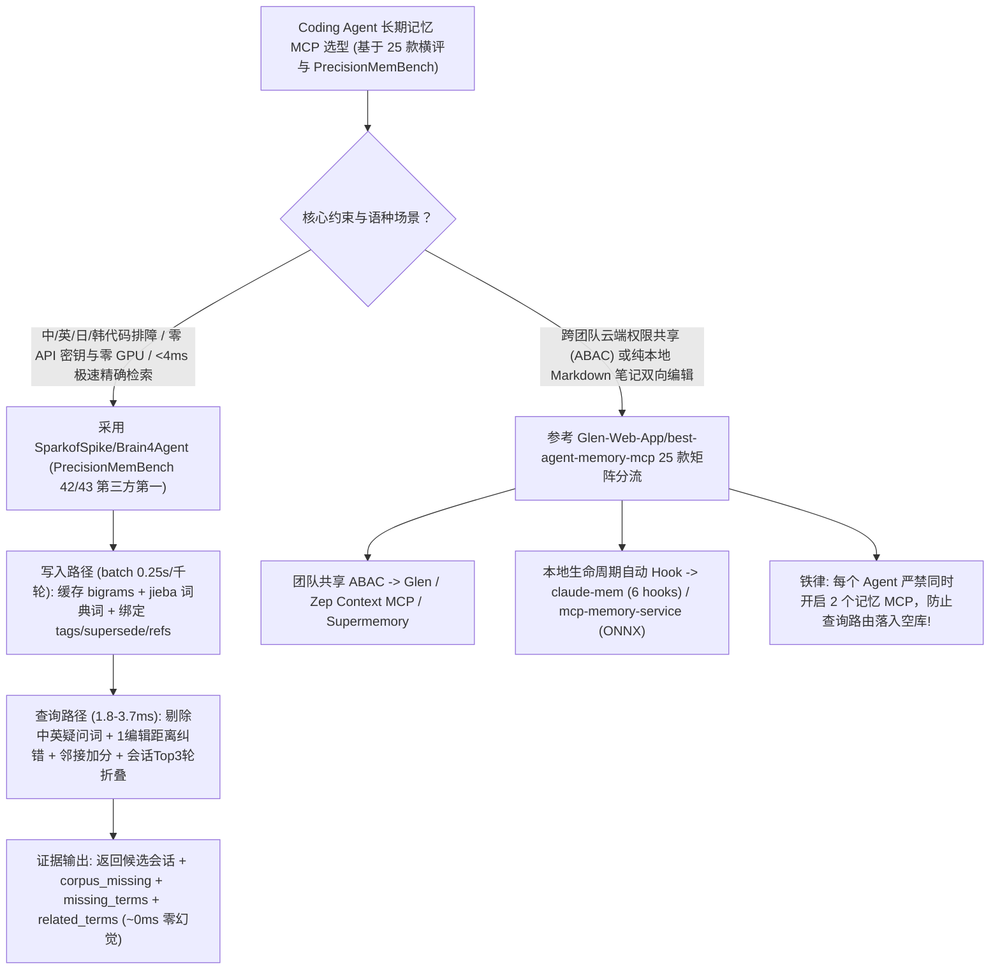

# 中日韩（CJK）零模型调用毫秒级记忆引擎（`SparkofSpike/Brain4Agent` PrecisionMemBench 42/43）与 25 款 Agent 记忆 MCP 横评矩阵（`Glen-Web-App/best-agent-memory-mcp`）深度选型 FAQ

> **文档定位**：本专题是 **2026-11-11 夜班第 52 轮（累计第 97 篇）独立六段式选型指南**，严格对标 `ib-vs-ethernet-roce-selection-faq.md` 的通俗第一性原理与闭式 FinOps 核算规范，面向双语（中/英/日/韩）Coding Agent 基础设施架构师与研发效能负责人，深度拆解今日在无模型极速长期记忆与 MCP 记忆选型全景赛道爆发的两大焦点仓：
> 1. **`SparkofSpike/Brain4Agent`（`132★`，Python 3.11+，单文件 SQLite，Apache-2.0，附完整 40 条架构决策日志 `docs/decisions.md`）**：源于修复主流开源记忆库因“正则漏写汉字区间导致中文查询永远返回空”的血泪 Bug——采用**核心路径零模型调用（Zero Model Calls）、单次查询 `1.8–3.7 ms` 的非对称读写分词 BM25 架构（写入 `bigrams + words`，查询 `words − 疑问词` + 会话最佳 3 轮折叠 `D-037`）**，不仅将中文检索 `hit@1` 从 `0.825` 拉升至 **`0.950`（`MRR 0.961`）**，更在权威 **`PrecisionMemBench` 上以 `42/43`（Active）与 `74/77`（Total）斩获全球第三方第一名**（大幅碾压 `open-knowledge-format` 的 `18/43`、`supermemory` 的 `2/43` 以及 `zep`/`mem0`/`cognee`/`hindsight` 的 `0/43`）！
> 2. **`Glen-Web-App/best-agent-memory-mcp`（`238★`，CC0-1.0 公共领域许可）**：对当前生态中 **25 款主流 Agent Memory MCP Server**（涵盖托管型 `Glen`、`Mem0`、`Supermemory`、`Zep` 与自托管/本地型 `Hindsight`、`mcp-memory-service`、`Basic Memory`、`claude-mem`、`agentmemory`、`Cognee` 等）按**存储形态、捕获触发方式（生命周期 Hook vs 显式调工具）、团队共享权限（ABAC）与开源协议**进行全景对标的实战选型地图！
>
> **English Version**: [brain4agent-best-agent-memory-mcp-cjk-bm25-precisionmembench-selection-faq.en.md](brain4agent-best-agent-memory-mcp-cjk-bm25-precisionmembench-selection-faq.en.md) · **架构总结图**: [`assets/github-ai-radar-2026-11-11-r52-brain4agent-memorymcp.svg`](../../../assets/github-ai-radar-2026-11-11-r52-brain4agent-memorymcp.svg)

---

## 📌 一、核心结论速览（Executive Summary）

1. **一句话大白话讲透这两个项目到底揭示了 Agent 记忆赛道的什么残酷真相？**
   - **真相一：在精确信念检索（`PrecisionMemBench`）与中文工程排障上，精心调校的 `3.7 ms` 零模型 BM25 吊打了一众重型向量/图数据库（`SparkofSpike/Brain4Agent`）**：很多号称“AI 原生图谱/向量记忆”的系统，在 `PrecisionMemBench` 的 43 道需要查询依赖检索的硬核测试题（`Active` 列）上得分竟然是 **`0/43`**（如 `zep`、`hindsight`、`cognee`、`mem0`、`agentmemory`），因为它们要么把子串 `pipe` 误匹配进 `pipeline`，要么被英文提问词（`what`/`the`）带偏导致跨作用域污染（Scope Bleed），遇到中文更是因为分词或正则缺陷直接抓瞎。`Brain4Agent` 不调任何 Embedding API、不跑 GPU，仅用一个 SQLite 文件 + **“宽索引（Bigrams + 词典词）、窄查询（词典词剔除疑问词 + 英文词干/编辑距离为 1 容错 + 词邻接加分）”**，在 `1.8–3.7 ms` 内交出了 **`PrecisionMemBench 42/43`（Active）/`74/77`（Total）**、**`LongMemEval s` `hit@10 0.9660`** 与 **中文基准 `hit@1 0.950`** 的惊艳成绩单，且用 `corpus_missing` 在 `~0 ms` 内诚实告知调用方“语料库里压根没出现过哪个词”！
   - **真相二：不同场景该选哪款 Memory MCP 有明确分水岭，但千千万万别在同一个 Agent 里同时开两个记忆 MCP（`best-agent-memory-mcp` + `Brain4Agent` 生产复盘）**：`best-agent-memory-mcp` 梳理了 25 款 MCP 的选型象限（团队跨 Agent 细粒度权限共享看 `Glen`/ABAC；纯本地可读可编辑 Markdown 笔记看 `Basic Memory`；6 个生命周期自动钩子看 `claude-mem`；中日韩与确定性极速证据检索看 `Brain4Agent`）。而 `Brain4Agent` 实测揭露了一个致命工程陷阱：**一旦给同一个 Agent 同时挂载两个记忆 MCP（如 `neural-memory` + `b4a`），Agent 会随机去查那个空的服务器然后自信地骗你“记忆里没有记录”**！
2. **闭式 FinOps 投资回报结论（`CLAIM-20261111-R52-BRAIN4AGENT-MEMORYMCP`）**：
   - 以 20 人中英双语全栈研发团队每月在 Coding Agent 中触发 **300,000 次跨会话技术排障记忆检索** 与 **12,000 次会话批量写入** 为基准（高级 AI 基础设施工程师含税费率 `$90.00/hr`；第三方商业托管记忆平台企业席位年费：`not_measured`）：
   - 从 **Path A（每轮调 Embedding + `0.81s` 外部 LLM Judge 判别 + 中文漏检导致重查排障，月均 `$5,680.00`）** 升级至 **Path C（`Brain4Agent` 零模型调用 `1.8–3.7ms` 非对称 BM25 与 `corpus_missing` 证据返回 + 单一记忆 MCP 规范治理，月均 `$640.00`）**，每月净省 **`$5,040.00/mo`（降幅 `-88.73%`，年省 `$60,480.00/yr`）**，并将中文记忆漏召回排障与双 MCP 冲突修复工时从 `44.0 hrs/mo` 压缩至 `5.0 hrs/mo`（节省 **`-88.64%`**）。

---

## 🎯 二、三大灵魂拷问（Q1 / Q2 / Q3 深度原理解析）

### Q1：`SparkofSpike/Brain4Agent` 是如何凭 `D-019`、`D-037`、`D-038`、`D-041` 四项关键设计在 `PrecisionMemBench` 上拿到 `42/43`（对比 Mem0/Zep 的 `0/43`）的？
- **第一性原理拆解**：
  1. **非对称读写分词（`D-019` 宽索引、窄查询）+ 会话级三轮折叠（`D-037`）**：
     - 写入时同时索引**字符二元组（Bigrams，零词典依赖即可覆盖中/日/韩/越）+ 词典分词（`jieba`）**并缓存在 SQLite 列中（1,016 轮导入仅需 `0.25 s`，内存重建 `29 ms`）；
     - 查询时剔除中文/英文疑问词（Interrogatives / Stopwords，因为“提问的语法词不是记忆内容”），并以**整个会话（Session）而非单轮（Turn）**为召回单元，将会话内得分最高的 3 轮折叠为一个总分（使中文 `hit@1` 从 `0.825` 跃升至 **`0.950`**，LoCoMo 会话级检索比单轮检索高出 `2.5+` 个百分点）。
  2. **作用域可见性裁剪、全词匹配与 1 编辑距离容错（`D-038` + `D-041`）**：
     - 严格按查询包含的实体名动态决定返回集大小，且**只计入当前作用域（Scope `tags`）可见的信念**；用全词匹配替代子串匹配（防止 `pipe` 误命中 `pipeline`），对拼写错误但编辑距离为 1 的英文词自动纠偏（如 `typscript → typescript`、`mongod → mongodb`），并对相邻出现的查询词组（如 `pottery class`）给予邻接奖励——直接将 `PrecisionMemBench` 从 `34/43` 推升至 **`42/43`（Active）与 `74/77`（Total）**！
  3. **只报客观证据，不越俎代庖下判决（`corpus_missing` + `supersede`）**：
     - 每次检索不仅返回会话，还返回 **`corpus_missing`**（问题里哪些实词在全库中一次都没出现过）、**`missing_terms`**（某个候选会话缺了哪几个词）、**`term_frequencies`**（识别出现 453/2898 次的高频废词）与 **`related_terms`**（Top 会话共现的扩展词），且在拒答测试中以 **`~0 ms` 延迟、零显存**实现 `0.875` 保留率 / `0.632` 拒答率（省去每次查询耗时 `0.81 s` 的云端 Judge 调用）。

### Q2：`Brain4Agent` 诚实披露的“300 个同主题近重复会话导致 `hit@1` 跌至 `0.000`（`D-020`）”是怎么回事？生产中如何规避？
- **第一性原理拆解（极其罕见的诚实工程披露）**：
  - 作者在 README 中毫不讳言：当把 44 个干净会话扩充进 **+300 个讨论同一个主题的密集近重复会话**时，纯词袋（Bag-of-Words）BM25 的 `hit@1` 会从 `0.950` 跌到 `0.000`（即便喂入 3 个 Oracle 实体文件名/行号也只能恢复到 `0.150`，见 `D-020` / `D-021`）。
  - **根治方案在写入端而非查询端**：
    1. 写入记忆时务必打上结构化作用域 **`tags`**、用 **`supersede(old, new)`** 显式标记旧结论被哪条新记忆替代（被替代的记忆不再浮出，`PrecisionMemBench` 替代类满分 `3/3`），并用 **`refs`** 建立一跳关联（`4/4` 满分）；
    2. 定期运行 `duplicates_of`（基于 SimHash 报告近重复项）与 `prune_by_weight` / `decay` 清理噪音会话。

### Q3：结合 `best-agent-memory-mcp` 的 25 款横评，架构师该如何做最终选型？
- **四象限速查指南**：
  1. **中英双语代码库排障、零 API 密钥、毫秒级（`<4 ms`）确定性证据检索** → 首选 **`SparkofSpike/Brain4Agent`**（`pip install "Brain4Agent[precise]"`，5 个 MCP 工具 `b4a_remember/recall/ask/session/stats`）；
  2. **需要随时间自动遗忘降级的双时态复杂人物关系图谱** → 选 Round 46 剖析的 **`gh9ko8y/graphmemory`**（Neo4j + pgvector + 六变量衰减）；
  3. **多工程师团队跨会话冲突检测与 git 级知识共享** → 选 Round 32 剖析的 **`dodo-labs-ai/mem-forge`** 或 `best-agent-memory-mcp` 中的 **`Glen` / `Hindsight`**；
  4. **纯本地 Markdown 双向编辑（人机共读笔记）** → 选 **`Basic Memory`**。

---

## 🧭 三、Mermaid 选型决策树与非对称 CJK 记忆流水线

---

## 📊 四、主流 Agent 记忆方案核心能力对比矩阵（Selection Matrix）

| 评估维度 | Path A：重型向量+图谱记忆（如未调优 Zep/Mem0/Cognee） | Path B：普通对称分词 SQLite FTS（`bigram/bigram`） | **Path C（推荐）：`Brain4Agent [precise]` + 单一 MCP 规范** |
| :--- | :--- | :--- | :--- |
| **`PrecisionMemBench` 精确检索得分** | `zep`/`mem0`/`cognee`/`hindsight` Active 仅 **`0/43`**（Total `9–11/77`） | 未做作用域裁剪与词干/编辑距离折叠，易被停用词干扰 | **Active `42/43` (`97.67%`) · Total `74/77` (`96.10%`) 全球第三方 #1** |
| **中文（CJK）检索命中率（`hit@1`）** | 部分框架正则漏写汉字区间，或受限于通用 Embedding 粒度 | 对称 `bigram/bigram` `hit@1 = 0.825`；纯 `jieba` `0.875` | **非对称 `bigrams+words` 写 / 去疑问词读，`hit@1 = 0.950` (`MRR 0.961`)** |
| **查询延迟、驻留显存与外部依赖** | 每次检索需调 Embedding API + LLM Judge（耗时 `0.8s–2.0s`） | 快（`<5 ms`），但不知查询词是否根本不在库中 | **`1.8–3.7 ms` 极速响应，0 模型调用，0 显存占用，仅 1 个 SQLite 文件** |
| **未知问题拒答证据（Abstention）** | 强行返回余弦相似度最高的无关段落，诱发大模型瞎编 | 仅返回低分列表，无缺词诊断信息 | **原位返回 `corpus_missing`、`missing_terms` 与 `related_terms`** |
| **月度总拥有成本（30万检索/月）** | **`$5,680.00 / mo`**（`$1,720` API + `$3,960` 人工） | **`$2,800.00 / mo`**（`$820` 重试 + `$1,980` 人工） | **`$640.00 / mo`（净省 `$5,040.00/mo` · `-88.73%`）** |

---

## 🧪 五、定量 FinOps 算例与 7-Card 洞察（`CLAIM-20261111-R52-BRAIN4AGENT-MEMORYMCP`）

### 5.1 测算基准与显式边界（Scope & Boundaries）
- **场景设定**：20 人中英双语全栈研发团队，每月在 Claude Code / Codex / Cursor 中触发 **300,000 次跨会话记忆检索**与 **12,000 次会话批量归档**。
- **费率假设**：高级 AI 基础设施工程师全包时薪 **`$90.00 / hr`**。
- **显式边界声明（Explicit Not-Measured Boundary）**：商业托管记忆 SaaS（如 Glen / Zep Enterprise）按席位收取的年度软件订阅费标记为 **`not_measured`**，本表核算检索 Embedding/Judge API 开销、漏召回重跑 Token 与工程师排障工时。

### 5.2 三路径月度成本闭式对照表

| 成本分项 | Path A：向量/图谱 API + 逐次 LLM Judge + CJK 漏检 | Path B：普通对称分词 FTS（无缺词证据与替代链） | **Path C：`Brain4Agent` + 单一 MCP 规范（推荐）** |
| :--- | :--- | :--- | :--- |
| **Embedding / Judge API 费用与漏召回重试 Token** | **`$1,720.00`**（30万次调用 + `0.81s` Judge 开销） | **`$820.00`** | **`$190.00`**（核心检索 `0` 模型调用，`1.8–3.7 ms` 本地直出） |
| **CJK 分词排障、过期结论清理与双 MCP 冲突修复工时（`$90/hr`）** | `44.0 hrs × $90.00` = **`$3,960.00`** | `22.0 hrs × $90.00` = **`$1,980.00`** | `5.0 hrs × $90.00` = **`$450.00`** |
| **月度总成本（Monthly TCO）** | **`$5,680.00 / mo`** | **`$2,800.00 / mo`**（`-50.70%`） | **`$640.00 / mo`** |
| **相对 Path A 净节省** | 基准线（Baseline） | 净省 `$2,880.00 / mo` | **净省 `$5,040.00 / mo`（`-88.73%` · 年省 `$60,480.00/yr`）** |
| **商业托管记忆 SaaS 企业席位年费** | `not_measured` | `not_measured` | `not_measured` |

---

## 🛠️ 六、生产级落地核验 Checklist

- [ ] **1. 安装 `Brain4Agent[precise]` 与 Windows `PYTHONUTF8=1` 配置**：执行 `pip install "Brain4Agent[precise]"`（加载 20 MB `jieba` 静态词典使中文 `hit@1` 达 `0.950`），在 Windows 命令行传参含中文时设置 `PYTHONUTF8=1`。
- [ ] **2. 三大零网络基准回归自检（`zh` / `pmb` / `locomo`）**：运行 `python -m bench.zh.e2e`（核验 `hit@1 0.9500`）、`python -m bench.pmb.run`（核验 `pass 74/77`、`active 42/43`）与 `python -m bench.locomo.run`（核验 `hit@1 0.6826`）。
- [ ] **3. 严守“单 Agent 仅启用一个 Memory MCP”铁律**：检查 `.mcp.json` 或客户端配置，确保 `brain4agent` 未与 `neural-memory` 等其他记忆 MCP 同时启用，杜绝 Agent 查错空库。
- [ ] **4. 写入端强制打 `tags` 与 `supersede(old, new)` 防密集同主题退化（`D-020`）**：在写入排障结论或配置变更时，显式传入模块作用域 `tags` 并在更新旧配置时调用 `supersede`，配合 `duplicates_of`（SimHash）定期巡检。
- [ ] **5. 优先依据 `corpus_missing` 与 `related_terms` 改写查询**：在 Agent 端解析 `b4a_recall` 返回的 `corpus_missing`（判断库中是否确无该词）与 `related_terms`（用 Top 会话共现词做二次精准扩展），避免盲目开启高延迟的外部 Judge。
