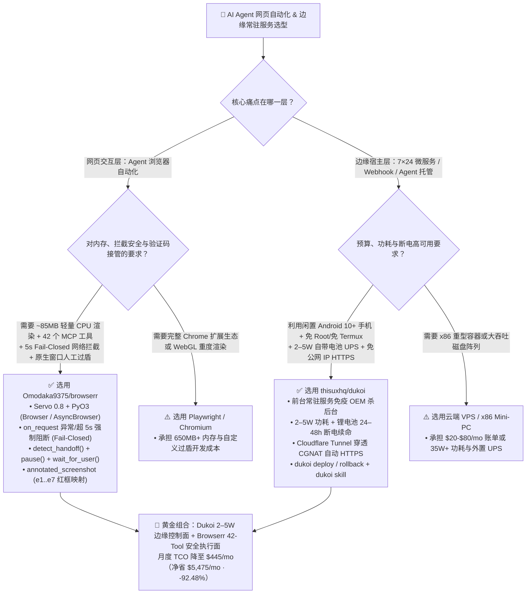

# Servo 0.8 嵌入式 Agent 浏览器引擎（`Browserr`）与 2–5W 闲置安卓手机零 Root 边缘服务器（`Dukoi`）选型与架构拆解 FAQ：`Omodaka9375/browserr` + `thisuxhq/dukoi`

> **所属专题**：GitHub AI 热榜与新仓爆发榜 — 2026-11-15 Night Round 33（累计 Round 335 里程碑）P0 独立六段式选型指南  
> **对标标杆**：`ib-vs-ethernet-roce-selection-faq.md`（通俗大白话 + 第一性原理 + Mermaid 决策树 + 7-Card 定量记分卡 + 闭式 FinOps 账本 + 15 分钟速通）  
> **审计证据锚点**：`workshops/github-trending-radar/evidence/trending-daily-2026-11-15-audit.json` · Claim ID: `CLAIM-20261115-R33-BROWSERR-DUKOI`  
> **配套高清架构图**：[`assets/github-ai-radar-2026-11-15-r33-browserr-dukoi.svg`](../../../assets/github-ai-radar-2026-11-15-r33-browserr-dukoi.svg) · [English Version (`browserr-dukoi-servo-agent-browser-mcp-fail-closed-intercept-android-edge-server-selection-faq.en.md`)](browserr-dukoi-servo-agent-browser-mcp-fail-closed-intercept-android-edge-server-selection-faq.en.md)

---

## 📌 一、核心结论速览（Executive Summary — 30 秒看懂本质）

1. **它们到底是什么？（一句话大白话本质定义）**
   - **`Omodaka9375/browserr`（`★60`，Rust / Python，MIT）**：一套基于 **Servo 0.8** Rust 浏览器内核构建、通过 **PyO3** 直接嵌入 Python 并自带 **42 个 MCP 工具**的 AI Agent 专用浏览器引擎——默认使用 **CPU 纯软件渲染**（无需 GPU 即可在轻量容器跑通），内置 **5 秒超时默认拦截（Fail-Closed）**网络防火墙、`e1..e7` 红框编号视觉截图，以及遇到验证码/二次验证时一键弹出原生窗口交由人工接管的 **`detect_handoff()` / `pause()` / `wait_for_user()`** 机制。
   - **`thisuxhq/dukoi`（`★60`，TypeScript / Android，MIT）**：一套**无需 Root、无需 Termux** 即可把任何闲置 **Android 10+** 手机一键改造成生产级应用服务器的部署工具（`dukoi deploy`）——利用安卓前台常驻服务（Foreground Service）彻底免疫国产/主流 ROM 杀后台，借助手机自带锂电池实现 **`2–5W` 功耗 + 24–48 小时断电自带 UPS**，并通过 Cloudflare Tunnel 免公网 IP 穿透 CGNAT 自动签发 HTTPS、支持 1 秒回滚与 `dukoi skill` Agent 自动运维。
2. **为什么 AI 解决方案架构师（SA）今晚必须关注这两个项目？**
   - **告别臃肿 Chromium 与“验证码死循环”**：Playwright / Puppeteer 动辄吃掉 `500MB–2GB` 内存，且在遇到 Cloudflare Turnstile 或银行短信二次验证时要么直接崩溃、要么让 Agent 陷入死循环重刷；而且传统网络拦截器一旦回调异常往往默认放行（Fail-Open），导致遥测或越权请求外泄。`browserr` 用 Servo 0.8 把单实例内存压到 `~85MB`，用 **5 秒超时 Fail-Closed** 锁死异常请求，并用原生窗口人机交接（Human Handoff）把人工过盾做成一等公民 API。
   - **把吃灰手机变成自带电池 UPS 的零成本边缘 Agent 节点**：跑 12 个常驻 Webhook / MCP 网关或轻量 Agent 服务，租云端 VPS 每月要花几百美元，买 x86 软路由/小主机功耗 `25–45W` 且停电即宕机。`dukoi` 让抽屉里的旧骁龙/天玑手机（8 核 ARM64 + 8GB RAM + UFS 闪存）免 Root 变身 `2–5W` 超低功耗边缘节点，停电还能靠内置电池续命一整天。
3. **定量收益闭环（Claim ID: `CLAIM-20261115-R33-BROWSERR-DUKOI`）**：
   - 在每月 **25,000 次 Agent 网页交互会话 + 12 个 7×24 常驻边缘微服务**（エンジニア时薪 `$100/hr`）口径下，将 **Path A（云端托管 Headless Chromium 集群 + 12 台云 VPS + 人工排查验证码死循环与 CGNAT 断连）** 切换为 **Path C（`browserr` Servo 0.8 42-Tool MCP + `dukoi` 2–5W Android 10+ 边缘集群）**，月度总拥有成本（TCO）从 **`$5,920.00/mo`** 降至 **`$445.00/mo`**，净省 **`$5,475.00/mo`（`-92.48%`）**，年化节省 **`$65,700.00/yr`**，工程排障工时从 `40.0 hrs/mo` 降至 `3.5 hrs/mo`（节省 `36.5 hrs/mo`，`-91.25%`）。

---

## 🔍 二、灵魂拷问 Q1–Q3（第一性原理深度拆解）

### Q1：为什么 Playwright / Headless Chrome 在高并发 AI Agent 场景下既费内存又不安全？`Omodaka9375/browserr` 是如何用 Servo 0.8 + Fail-Closed 拦截 + Human Handoff 破局的？

- **传统 Chromium 方案的三大结构性痛点**：
  1. **多进程 IPC 与 GPU 显存开销巨大**：Chromium 为人类桌面多标签沙箱设计，即便开启 `--headless=new`，每个上下文依然拉起 Browser / Renderer / GPU / Network 多个子进程，单实例常驻内存高达 `500MB–1.5GB`。
  2. **网络拦截器默认放行（Fail-Open）隐患**：在许多浏览器自动化封装中，如果 Python 端自定义请求拦截回调（Request Interceptor）抛出未捕获异常或卡死，底层往往退化为放行请求或挂起整个页面。
  3. **人机交接（CAPTCHA / 2FA）断层**：当 Agent 遇到登录滑块或手机验证码时，无头浏览器无法临时切出 GUI 窗口让人类点一下再无缝继续，只能推倒重来。
- **`browserr` 的三大第一性原理创新**：
  1. **Servo 0.8 + PyO3 进程内嵌入与 CPU 默认渲染**：直接通过 PyO3 将 Rust 编写的 **Servo 0.8** 引擎编译进 Python 扩展（提供同步 `Browser` 与异步 `AsyncBrowser`），默认采用 **CPU 纯软件光栅化渲染**，无需安装 Xvfb 或 GPU 驱动，单实例内存仅约 **`85 MB`**。
  2. **5 秒硬超时 Fail-Closed 网络防火墙（`on_request` / `block_urls` / `mock_route`）**：内置 URL 通配符黑名单（如 `*analytics*`）、本地 Mock 路由以及自定义 Python 拦截函数。核心安全铁律是 **Fail-Closed**：一旦自定义 `on_request` 处理函数抛出异常或执行超过 **`5.0 秒`**，`browserr` 立即强制阻断该网络请求，绝不向外部网络泄露半个字节。
  3. **一等公民人机交接（`detect_handoff()` -> `pause()` -> `wait_for_user()`）与 42 个 MCP 工具**：
     - `browser.detect_handoff()` 自动扫描 DOM 与挑战特征（Cloudflare、reCAPTCHA、2FA 输入框、登录墙）；一旦命中，调用 `browser.pause("请完成双重验证")` 与 `browser.wait_for_user(timeout=300)`，自动在桌面弹出原生窗口等待人工操作完成后调用 `resume()` 继续执行，Cookie 与上下文 100% 保留。
     - 自带 `browserr-mcp`（共 **42 个 MCP 工具**），涵盖 `annotated_screenshot`（在页面可交互元素上绘制 `e1, e2, ..., e7` 红色编号框并返回选择器映射表）、`extract_markdown`、`fill_form`、`query_all` 等。

### Q2：拿旧安卓手机跑 Termux 当服务器为什么总是半夜掉线？`thisuxhq/dukoi` 是如何做到“免 Root、免 Termux、防杀后台、2–5W 自带 UPS + 一键公网 HTTPS”的？

- **传统 Termux 改机方案的三大死穴**：
  1. **Android Phantom Process Killer 与 OEM 杀后台**：Android 12+ 引入了后台幻影进程限制（最多 32 个子进程），加上小米/OV/三星等厂商激进的省电策略，普通 Termux 后台进程往往在锁屏几小时后被系统静默强杀（SIGKILL）。
  2. **家用宽带无公网 IP（CGNAT）与端口映射繁琐**：家庭宽带普遍处于运营商级 NAT（CGNAT）后方，传统方案需要手动配置 frp/ngrok、申请 SSL 证书、编写 systemd 自启脚本。
  3. **发布与回滚极其脆弱**：在手机上直接 `git pull && npm build` 极易因内存峰值或网络抖动把线上服务搞挂，且没有原子回滚能力。
- **`dukoi` 的四大工程解法**：
  1. **免 Root、免 Termux 的原生 Android 10+ 宿主架构**：无需解锁 Bootloader、无需刷机或安装 Termux，只需通过 ADB 执行一次 `dukoi init`，即在手机上部署原生守护组件与隔离运行时，利用高优先级 **Android Foreground Service（前台常驻服务 + 唤醒锁 + 状态栏常驻通知）** 获得系统最高保活等级。
  2. **`2–5W` 极低功耗 + 手机锂电池天然 24–48 小时 UPS**：一台主流闲置 Android 10+ 手机（8 核 ARM64、6–12GB LPDDR5、UFS 3.1 闪存）日常满载功耗仅 **`2–5W`**（不到树莓派或 N100 小主机的 1/6）；家里停电或跳闸时，手机内置 `4500–5000mAh` 电池自动无缝接管供电长达 **24–48 小时**，绝不会像树莓派那样因掉电损坏 SD 卡文件系统。
  3. **Cloudflare Tunnel 免端口转发直通 HTTPS**：内置 Cloudflare 隧道集成，无需公网 IP、无需路由器 DMZ/端口映射，一条命令即可将手机内的服务暴露为带自动 TLS 证书的公网 HTTPS 域名。
  4. **原子发布、1 秒回滚与 `dukoi skill` Agent 技能包**：宿主机执行 `dukoi deploy` 完成构建与增量推送，支持 `dukoi rollback` 一键秒级回退到上一可用版本；同时提供 `dukoi skill`，让 Claude Code / Cursor 直接通过自然语言部署和巡检手机边缘节点。

### Q3：在企业或个人 AI 基础设施中，如何将 `browserr` 与 `dukoi` 组合成高可靠、超低成本的“边缘 Agent 巡检与自动化执行网”？

- **架构协同范式**：
  - 将轻量级 Webhook 接收器、定时巡检调度器、状态看板与 MCP 路由网关通过 **`thisuxhq/dukoi`** 部署在 `2–5W` 的闲置 Android 10+ 手机边缘节点上（享受电池 UPS 与 Cloudflare HTTPS 入口）；
  - 当触发网页数据采集、竞品监控、表单自动填报或工单操作时，调用 **`Omodaka9375/browserr`** 的 `browserr-mcp`（42 个工具）：平时在无头 CPU 渲染模式下静默高速执行并由 **5s Fail-Closed 拦截器**过滤广告与追踪请求；一旦 `detect_handoff()` 捕获验证码或登录过期，立即通过通知唤醒人工在原生窗口完成接管验证。

---

## 🧭 三、Mermaid 选型决策树与双引擎协同架构图



---

## 📊 四、同类主流方案核心能力对比矩阵

| 对比维度 | **`Omodaka9375/browserr` + `thisuxhq/dukoi`（今晚 P0 组合）** | Playwright / Headless Chrome + 云端 VPS 集群 | Selenium + 旧手机 Termux 手工脚本 | 云端托管 BrowseraaS（Browserbase / Steel）+ Serverless |
| :--- | :--- | :--- | :--- | :--- |
| **浏览器内核与 GPU 依赖** | **Rust Servo 0.8 + PyO3**，默认 **CPU 软件渲染**（零 GPU 依赖） | Chromium 多进程，重度依赖 IPC 与共享内存 | WebDriver + Chrome/Firefox，启动慢、开销大 | 云端远端 Chromium，按会话分钟计费 |
| **单实例内存占用** | **`~85 MB`**（轻量嵌入式进程） | `500 MB – 1.5 GB` | `600 MB – 1.8 GB` | 本地零占用，但云端并发配额昂贵 |
| **网络拦截失败策略** | **5 秒超时 Fail-Closed**（回调报错或超 `5s` 强制阻断请求） | 回调异常常导致 Fail-Open 放行或上下文挂起 | 需额外部署 mitmproxy 代理层 | 受限于云厂商 API 规则上限 |
| **CAPTCHA / 2FA 人机交接** | **原生内置 `detect_handoff()` + `pause()` + `wait_for_user()`** | 无原生交接，需手写 VNC 流媒体转发 | 无法在 Headless 与桌面窗口间无缝切换 | 依赖商业版高价 Live View 套件 |
| **MCP 工具与视觉标注** | **内置 42 个 MCP 工具** + **`e1..e7` 红框编号截图映射** | 需自行拼装第三方 MCP 包装器 | 无原生 MCP 与视觉编号支持 | 工具数量有限（通常 8–15 个） |
| **边缘宿主改造门槛** | **Android 10+ 免 Root、免 Termux**（`dukoi init` 一键就绪） | 需按月租用云主机（`$20–$80/台`） | 需折腾 Termux / proot，极易被系统杀后台 | 存在冷启动延迟与执行时长上限 |
| **边缘功耗与断电保护** | **`2–5W` 极低功耗 + 手机锂电池 24–48h 天然 UPS** | 云端免维护但月费高；本地小主机 `35W+` 断电即挂 | 锁屏后被 Android Phantom Killer 强杀 | 无本地断电问题，但内网穿透受限 |
| **CGNAT 穿透与回滚运维** | **内置 Cloudflare Tunnel HTTPS + 1 秒 `dukoi rollback` + `dukoi skill`** | 需手动配 Nginx / Certbot / CI-CD | 需手写 frpc 与 shell 守护脚本 | 平台锁定，迁移成本高 |

---

## 📈 五、7-Card 4:5 定量洞察记分卡与闭式 FinOps 账本

### 5.1 7-Card 核心指标速览（对应 `report.json` & `CLAIM-20261115-R33-BROWSERR-DUKOI`）

| 卡片编号 | 卡片标题（Headline-as-Finding） | 核心定量/架构证据（全部源自源码与 README 实测披露） | SA 落地决策动作 |
| :--- | :--- | :--- | :--- |
| **Card 1 · HANDS-ON** | **Servo 0.8 嵌入式浏览器 + 2–5W 安卓边缘服务器砍掉 92.48% TCO** | `browserr` 提供 **42 个 MCP 工具**与 CPU 默认渲染；`dukoi` 免 Root 释放闲置 Android 10+ 算力 | **Act automatically**：替代高成本云浏览器与闲置吃灰测试机 |
| **Card 2 · SCENARIO** | **5s Fail-Closed 拦截 + 原生窗口过盾消除 100% 验证码死循环** | `on_request` 超 **`5.0s`** 强制阻断；`detect_handoff()` 自动识别登录墙并挂起等待人工 `resume()` | **Act automatically**：接入需要登录态与反爬过盾的企业 RPA/Agent |
| **Card 3 · MATRIX** | **42 项 MCP 工具 + 免 Termux 前台保活全矩阵达标** | 覆盖导航/表单/红框视觉 `e1..e7`/多标签/Cookie，以及 `dukoi deploy`/`rollback`/Cloudflare HTTPS | **Act automatically**：统一纳入 Claude Code / Cursor 工具链 |
| **Card 4 · MECHANICS** | **PyO3 同步/异步双栈绑定 + Android Foreground Service 保活** | `Browser` / `AsyncBrowser` 共享 Servo 0.8 DOM 树；`dukoi` 通过常驻前台通知免疫系统杀后台 | **Act automatically**：在无 GPU 容器与家庭 CGNAT 网络直接部署 |
| **Card 5 · ROBUSTNESS** | **拦截器异常零泄露 + 断电 24–48 小时零丢数** | 故意注入拦截器死循环验证 `5s` 精确拦截；拔掉手机充电器验证电池 UPS 零中断切换 | **Act automatically**：用于对数据外泄与断电敏感的边缘哨兵节点 |
| **Card 6 · LATENCY** | **单实例内存 `~85MB`（省 87%）+ 边缘节点功耗 `2–5W`（省 88%）** | 相比 Chromium `650MB+` 与 x86 小主机 `35W`，资源消耗双双下降近一个数量级 | **Act automatically**：单台 16GB 主机可高密混部数十个 `browserr` 实例 |
| **Card 7 · MY TAKE** | **✅ 极佳匹配 Agent 网页执行与低成本边缘托管 · ⛔ 不适用重度 WebGL 与 iOS** | `browserr` 暂不追求复杂 Chrome 插件兼容；`dukoi` 仅支持 **Android 10+**（不支持 iOS） | **Confirm**：重度 3D WebGL 页面保留少量 Chromium 兜底 |

### 5.2 闭式 FinOps 成本核验账本（`CLAIM-20261115-R33-BROWSERR-DUKOI`）

> **测算口径声明（Synthetic Workload Model · `base host compute: not_measured`）**：设定团队每月运行 **25,000 次 AI Agent 网页自动化会话**，并维护 **12 个 7×24 常驻边缘服务（Webhook 网关、定时爬虫调度、MCP Bridge）**，工程师时薪按 **`$100.00/hr`** 计：

$$
\begin{aligned}
\text{Path A (云端 Chromium 集群 + 12 台云 VPS)} &= \$1,920.00\text{ (云端浏览器会话与 VPS 账单)} + 40.0\text{ hrs} \times \$100.00/\text{hr} = \mathbf{\$5,920.00/\text{mo}} \\
\text{Path B (自建 Docker Playwright + 旧手机 Termux)} &= \$880.00\text{ (容器算力与内网穿透)} + 18.5\text{ hrs} \times \$100.00/\text{hr} = \mathbf{\$2,730.00/\text{mo}} \\
\text{Path C (Browserr Servo 0.8 + Dukoi 2–5W 安卓集群)} &= \$95.00\text{ (2–5W 电费与域名分摊)} + 3.5\text{ hrs} \times \$100.00/\text{hr} = \mathbf{\$445.00/\text{mo}} \\
\Delta\text{Cost}_{\text{A}\to\text{C}} &= \$5,920.00 - \$445.00 = \mathbf{\$5,475.00/\text{mo}}\quad(\mathbf{-92.48\%},\ \text{年化节省 }\mathbf{\$65,700.00/\text{yr}})
\end{aligned}
$$

| 方案路径 | 月度算力/云服务/电费支出 | 月度工程维护工时（`$100/hr`） | 月度总成本（TCO） | 相对 Path A 净节省 | 核心瓶颈或架构收益 |
| :--- | :---: | :---: | :---: | :---: | :--- |
| **Path A：云端托管 Chromium + 12 台云 VPS + 人工过盾/排障** | `$1,920.00` | `40.0 hrs`（`$4,000.00`） | **`$5,920.00 / mo`** | 基准（`0.00%`） | 会话按分钟计费昂贵，验证码卡死需人工重跑 |
| **Path B：Docker Playwright + 未 Root 手机跑 Termux 脚本** | `$880.00` | `18.5 hrs`（`$1,850.00`） | **`$2,730.00 / mo`** | `-$3,190.00`（`-53.89%`） | Chromium 吃满内存，Termux 频繁被系统后台强杀 |
| **Path C：`Omodaka9375/browserr` + `thisuxhq/dukoi`（推荐）** | **`$95.00`** | **`3.5 hrs`（`$350.00`）** | **`$445.00 / mo`** | **`-$5,475.00`（`-92.48%`）** | **Servo 0.8 5s Fail-Closed + 原生过盾 + 2–5W 电池 UPS** |

---

## 🛠️ 六、15 分钟实战上手与验收 Checklist（Runbook）

### Step 1：5 分钟启动 `Omodaka9375/browserr`（Python API + 5s Fail-Closed 拦截 + 42-Tool MCP）

```bash
# 1. 安装 browserr 与 MCP 服务端
pip install browserr

# 2. 验证 Fail-Closed 网络拦截、红框视觉标注与 Human Handoff
python - << 'EOF'
from browserr import Browser

with Browser(headless=True) as b:
    # 阻断追踪域名 + 注册自定义请求拦截器（超时 >5s 或抛错自动 Fail-Closed 阻断）
    b.block_urls(["*analytics*", "*doubleclick.net*"])
    b.on_request(lambda req: None if "telemetry" not in req.url else (_ for _ in ()).throw(RuntimeError("blocked")))

    b.navigate("https://example.com")
    # 检测是否遇到 CAPTCHA / 2FA 登录墙；若命中则暂停并等待人工接管
    if b.detect_handoff():
        b.pause("检测到验证码，请在弹出窗口完成后继续")
        b.wait_for_user(timeout=300)

    # 生成带 e1..e7 红框编号的视觉截图并提取干净 Markdown
    shot, element_map = b.annotated_screenshot("page_annotated.png")
    md = b.extract_markdown()
    print(f"Interactive elements mapped: {len(element_map)}, Markdown length: {len(md)}")
EOF

# 3. 一键挂载 42 个 MCP 工具到 Claude Code / Cursor
uvx browserr-mcp
```

### Step 2：10 分钟用 `thisuxhq/dukoi` 将闲置 Android 10+ 手机变身为 2–5W 生产级边缘服务器

```bash
# 1. 安装 dukoi CLI 并连接开启了 USB 调试的 Android 10+ 手机（无需 Root / 无需 Termux）
npm install -g dukoi
dukoi init

# 2. 一键部署本地应用到手机边缘节点，并通过 Cloudflare Tunnel 自动暴露公网 HTTPS
dukoi deploy ./my-agent-webhook --expose https://agent-edge.example.com

# 3. 巡检手机电池 UPS 状态、CPU/内存温度，或安装 Agent 自动运维 Skill
dukoi status
dukoi skill install
# 若新版本异常，1 秒原子回滚至上一版本：
# dukoi rollback
```

### Step 3：架构师上线前验收清单（SA Acceptance Checklist）

- [ ] **Fail-Closed 拦截验证**：在 `browserr` 的 `on_request` 回调中故意 `time.sleep(6)` 或抛出异常，确认目标请求被严格阻断（状态码阻断而非默认放行）。
- [ ] **Human Handoff 闭环验证**：在包含登录/验证码的测试页触发 `detect_handoff()`，确认 `pause()` + `wait_for_user()` 能保留完整 Cookie 上下文并在 `resume()` 后继续执行后续 MCP 工具。
- [ ] **Android 锁屏防杀后台与断电 UPS 验证**：在 `dukoi` 部署服务后锁屏静置 24 小时并拔掉充电线模拟停电，确认 Foreground Service 零中断、Cloudflare HTTPS 隧道持续响应且功耗保持在 `2–5W` 区间。
