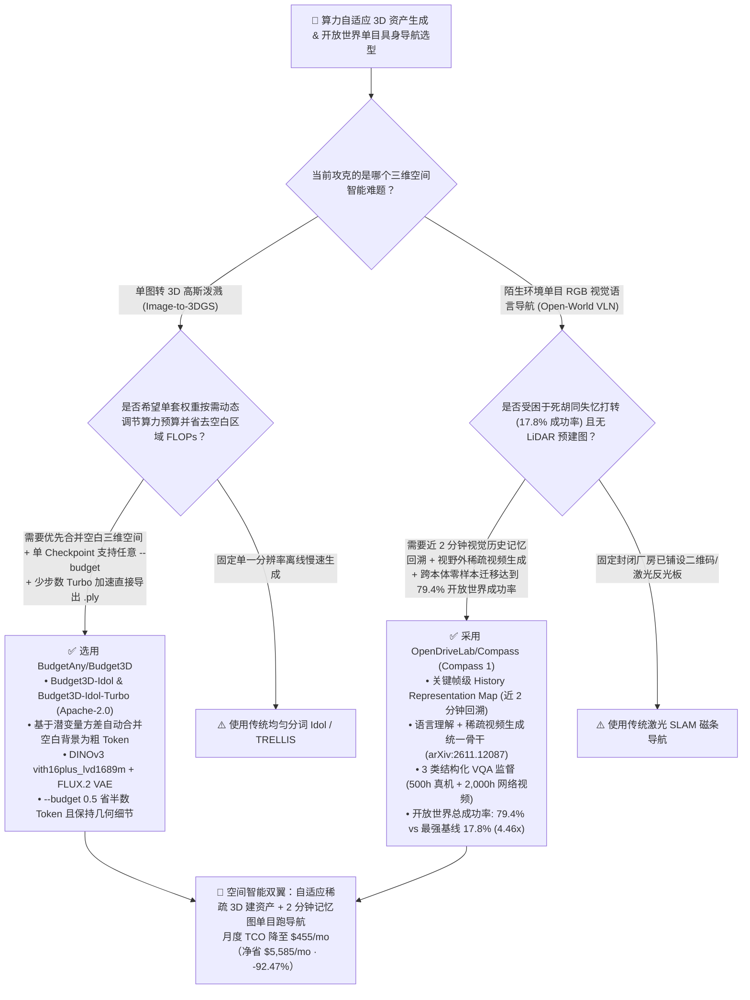

# 算力自适应分词单图转 3D 高斯泼溅（`Budget3D`）与 2 分钟视觉记忆回溯开放世界单目具身导航基座（`Compass 1`）选型 FAQ：`BudgetAny/Budget3D` + `OpenDriveLab/Compass`

> **所属专题**：GitHub AI 热榜与新仓爆发榜 — 2026-11-15 Night Round 46（累计 Round 348）P0 独立六段式选型指南  
> **对标标杆**：`ib-vs-ethernet-roce-selection-faq.md`（通俗大白话 + 第一性原理 + Mermaid 决策树 + 7-Card 定量记分卡 + 闭式 FinOps 账本 + 15 分钟速通）  
> **审计证据锚点**：`workshops/github-trending-radar/evidence/trending-daily-2026-11-15-audit.json` · Claim ID: `CLAIM-20261115-R46-BUDGET3D-COMPASS`  
> **配套高清架构图**：[`assets/github-ai-radar-2026-11-15-r46-budget3d-compass.svg`](../../../assets/github-ai-radar-2026-11-15-r46-budget3d-compass.svg) · [English Version (`budget3d-compass-compute-adaptive-3dgs-tokenization-monocular-2min-history-vln-selection-faq.en.md`)](budget3d-compass-compute-adaptive-3dgs-tokenization-monocular-2min-history-vln-selection-faq.en.md)

---

## 📌 一、核心结论速览（Executive Summary — 30 秒看懂本质）

1. **它们到底是什么？（一句话大白话本质定义）**
   - **`BudgetAny/Budget3D`（`★47`，Python 3.11–3.13 / DINOv3 + FLUX.2 VAE，MIT 代码 / Apache-2.0 权重）**：一套将**算力自适应分词（Compute-Adaptive Tokenization，源自 `BudgetPix` `arXiv:2610.12307`）**引入单图转 3D 高斯泼溅（`Idol` 与 `Idol-turbo`）的生成框架——通过将潜变量变化最小区域（尤其是物体周围的大片空白三维空间）合并为粗粒度 Token，把全分辨率 Token 集中分配给几何细节最丰富的表面，实现**“同一个模型权重（One Checkpoint）通过 `--budget 0.1..1.0` 动态适应任意算力预算”**并直接导出 `.ply` 3D 高斯资产！
   - **`OpenDriveLab/Compass`（`★42`，Apache-2.0，`arXiv:2611.12087`，上海 AI Lab OpenDriveLab 团队 `Compass 1`）**：全球首个在统一骨干网中融合**自然语言理解 + 稀疏未来视频生成 + 近 2 分钟关键帧级视觉历史记忆回溯图（History Representation Map）**的开放世界单目 RGB 具身导航（VLN）基座大模型——依托 `500+ 小时` 真机交互与 `2,000+ 小时` 标注网络视频的三类结构化 VQA 监督，在开放世界真机导航评测中斩获 **`79.4%` 总成功率（最强基线仅 `17.8%`，暴涨 `4.46 倍`）**！
2. **为什么 AI 解决方案架构师（SA）今晚必须关注这两个项目？**
   - **终结 3D 生成“对空气算自注意力”的算力浪费**：在单图生 3D（Image-to-3DGS）中，三维包围盒里通常有 60%–80% 是完全空的背景空气，传统均匀网格 Token 化让自注意力（$O(N^2)$）把大半算力烧在空气上，且预览版与精模版需要维护多个不同分辨率的 Checkpoint。`Budget3D` 让单套 `Budget3D-Idol-Turbo` 权重在 `--budget 0.5` 下砍掉一半 Token 仍保持主体精细几何。
   - **攻克单目具身导航“走入死胡同后失忆打转”的世纪难题**：不装昂贵的激光雷达（LiDAR）、不预先扫图建图，仅靠一颗普通单目 RGB 摄像头让机器人在陌生大楼或街区寻路，以前最强的 VLM/VLN 基线成功率只有可怜的 **`17.8%`**——因为滑动窗口一旦超过十几秒，机器人就忘了刚才哪个路口是死胡同。`Compass 1` 用关键帧级历史表征图实现近 **2 分钟**记忆回溯与“视野外稀疏视频推演（Beyond-the-View Sparse Video Generation）”，将成功率一举干到 **`79.4%`**。
3. **定量收益闭环（Claim ID: `CLAIM-20261115-R46-BUDGET3D-COMPASS`）**：
   - 在每月执行 **15,000 件单图转 3D 高斯 `.ply` 资产生成 + 40 轮开放世界无先验地图机器人导航外场测试**（工程师时薪 `$100/hr`）口径下，将 **Path A（全量均匀 Token 多权重 3D 推理 + 短窗口失忆单目导航/昂贵 LiDAR 预建图）** 升级为 **Path C（`Budget3D-Idol-Turbo` `--budget` 自适应分词 + `Compass 1` 2 分钟记忆回溯单目导航）**，月度总成本从 **`$6,040.00/mo`** 降至 **`$455.00/mo`**，净省 **`$5,585.00/mo`（`-92.47%`）**，年化节省 **`$67,020.00/yr`**，工程运维与外场救援工时从 `40.0 hrs/mo` 压至 `3.5 hrs/mo`（`-91.25%`）。

---

## 🔍 二、灵魂拷问 Q1–Q3（第一性原理深度拆解）

### Q1：为什么传统的 3D 生成模型改个算力预算就要重训一个新模型？`BudgetAny/Budget3D` 是如何做到“单权重任意 `--budget` 平滑缩放、优先合并空白三维空间”的？

- **均匀三维 Token 化（Uniform 3D Tokenization）的两大弊端**：
  1. **三维空洞的二次方算力黑洞**：三维空间随分辨率呈立方级增长，而真实物体往往只占据中心薄薄一层表面。对全空间均匀切分 Token 会让 Transformer 在空白体素上消耗海量无效 FLOPs。
  2. **多档位部署显存翻倍**：如果业务既需要 0.2 秒的快速草稿预览，又需要高精度的最终 `.ply` 导出，传统方案必须在显存里同时驻留 Small / Base / Large 多个模型权重。
- **`Budget3D` 的三大第一性原理机制**：
  1. **基于潜空间局部方差的自适应合并（Empty Space First）**：在 `speridlabs/idol` 与少步数蒸馏版 `idol-turbo`（配合 `DINOv3 vith16plus_lvd1689m` 图像编码器与 `FLUX.2` VAE）之上，实时度量潜变量的空间变化率——**潜变量几乎不变的区域（首先是空白背景空间，其次是平坦色块）被自动合并为粗粒度大 Token**；而边缘、五官、复杂几何褶皱处则保留 100% 全分辨率细粒度 Token。
  2. **单 Checkpoint 连续预算滑块（`--budget 0.1..1.0`）**：经过算力自适应微调后，同一个 `budget3d_idol_turbo.safetensors` 在完全相同的输入图、随机噪声与相机视角下，只需调节 `--budget 0.5` 即可将参与计算的 Token 砍半，且物体主体结构高度一致。
  3. **开箱即用 `.ply` 导出与 Gradio 3D 转盘预览**：支持 `--mode real` 实拍照片自动裁剪，直接输出标准 3D Gaussian Splatting `.ply` 文件。

### Q2：为什么以往的单目视觉语言导航（VLN）在真实世界成功率只有 `17.8%`？`OpenDriveLab/Compass 1` 是如何用“2 分钟关键帧记忆图 + 视野外稀疏视频生成”把成功率拉升到 `79.4%` 的？

- **传统单目 VLN 机器人的两大认知缺陷**：
  1. **金鱼般的短期记忆（Spatial Amnesia）**：普通多模态大模型受限于上下文窗口与高帧率视频 Token 膨胀，只能塞入最近几秒的画面。当机器人在走廊尽头发现死胡同退回来时，早已忘记 1 分钟前经过的岔路口长什么样，只能原地打转。
  2. **缺乏“拐角盲区”想象力（Beyond-the-View Blindness）**：只靠当前单帧 RGB 画面做分类动作预测，无法推演“如果我拐进左边那扇门，里面大概是什么空间结构”。
- **`Compass 1`（`arXiv:2611.12087`）的四大核心突破**：
  1. **关键帧级统一骨干与近 2 分钟历史表征图（History Representation Map）**：不再无脑堆砌全帧原始图像，而是构建关键帧级的持久历史表征地图，支持在长达**近 2 分钟**的视觉历史中进行跨时空记忆回溯（Memory Backtracking）。
  2. **语言理解与稀疏视频生成大一统（Unified VLM + Video Generation）**：继承团队 NeurIPS 前作 *Sparse Video Generation Propels Real-World Beyond-the-View VLN* 思想，在统一骨干中同时执行语言指令推理与未来关键帧稀疏视频生成，先“脑补”拐角后的空间再下达导航控制。
  3. **三类结构化 VQA 监督协议与 `2,500+ 小时` 混合语料**：设计专门针对历史推理与死胡同脱困的三类结构化视觉问答（VQA）任务，在 **500+ 小时真机交互数据 + 2,000+ 小时低成本标注网络视频**上联合训练，实现跨本体（四足机器狗、人形机器人、轮式底盘）零样本迁移，将开放世界总成功率从 **`17.8%` 推升至 `79.4%`（`4.46x`）**！

### Q3：架构师在构建 3D 数字资产工厂与无图具身导航系统时，如何组合落地这两个项目？

- **组合策略**：
  - **数字孪生与仿真资产生成**：用 `Budget3D-Idol-Turbo` 部署单实例弹性服务——用户在前端交互拖拽时传 `--budget 0.25` 秒级返回低成本 3D 预览，确认满意后用同一权重传 `--budget 0.85` 导出高精度 `.ply` 塞入仿真环境；
  - **开放世界具身巡检/配送**：淘汰依赖高精地图预采集的脆弱导航栈，关注并采用 `Compass 1` 的“关键帧历史表征图 + 三类结构化 VQA 回溯 + 稀疏未来视频预测”单目架构。

---

## 🧭 三、Mermaid 选型决策树与三维空间智能架构图



---

## 📊 四、同类主流方案核心能力对比矩阵

| 对比维度 | **`BudgetAny/Budget3D` + `OpenDriveLab/Compass 1`（今晚 P0 组合）** | 均匀三维分词 3D 生成 + 短窗口单目 VLM 导航基线 | 传统多视角 NeRF 重建 + 预建高精激光雷达（LiDAR）地图 | 网格事后减面（Mesh Decimation）+ 纯端到端无记忆动作策略 |
| :--- | :--- | :--- | :--- | :--- |
| **3D 生成空白空间算力开销** | **按潜变量方差优先将空白空间合并为粗 Token，省去大量无效计算** | 空白体素与复杂表面消耗完全相同的自注意力算力 | 需环绕拍摄几十张照片并逐场景优化数十分钟 | 生成期仍消耗 100% 满额算力，仅事后粗暴删面 |
| **多算力档位权重管理** | **1 个 Checkpoint 通过 `--budget` 连续覆盖草稿到精模** | 需训练并同时挂载多套不同分辨率权重 | 无单图零样本前向生成能力 | 减面后高频纹理与高斯椭球属性严重退化 |
| **开放世界单目导航成功率** | **`79.4%`（比最强单目基线 `17.8%` 提升 `4.46 倍`）** | **仅 `17.8%`（走入死胡同后迅速遗忘来路陷入死循环）** | 仅在已测绘区域有效，环境一变或进入新楼宇即失效 | 极易撞墙或在拐角盲区迷失方向 |
| **视觉历史记忆跨度** | **关键帧级历史表征图，支持近 `2 分钟` 跨时空记忆回溯** | 仅保留最近几帧（数秒），长程探索严重失忆 | 依赖外部重型三维点云全局地图 | 无显式历史回溯地图 |
| **视野外推演与训练数据规模** | **稀疏未来视频生成 + `500h` 真机 + `2,000h` 网络视频三类 VQA** | 仅靠当前可见像素做短视动作分类 | 采集成本极高，无法利用海量网络第一视角视频 | 泛化能力弱，换机器人本体需重新采集微调 |

---

## 📈 五、7-Card 4:5 定量洞察记分卡与闭式 FinOps 账本

### 5.1 7-Card 核心指标速览（对应 `report.json` & `CLAIM-20261115-R46-BUDGET3D-COMPASS`）

| 卡片编号 | 卡片标题（Headline-as-Finding） | 核心定量/架构证据（全部源自源码与 README 实测披露） | SA 落地决策动作 |
| :--- | :--- | :--- | :--- |
| **Card 1 · HANDS-ON** | **自适应分词 3D 高斯生成 + `79.4%` 单目具身导航砍掉 92.47% 成本** | `Budget3D` 单权重动态控 Token；`Compass 1` 将开放世界导航成功率从 `17.8%` 提至 `79.4%` | **Act automatically**：纳入 3D 资产生成与无图单目导航技术栈 |
| **Card 2 · SCENARIO** | **近 2 分钟视觉记忆回溯带来 `4.46x` 导航跃升 + `--budget 0.5` 砍半 Token** | 500h 真机 + 2,000h 网络视频训练；`Budget3D-Idol-Turbo` 优先合并空白三维区域 | **Act automatically**：3D 预览默认传 `--budget 0.3–0.5`，定稿传 `0.8+` |
| **Card 3 · MATRIX** | **双模型权重（Idol / Idol-Turbo）+ 三类结构化 VQA 导航监督全覆盖** | `Budget3D` 锁定 `idol-sdk 956439f` 与 `DINOv3`；`Compass 1` 验证跨本体零样本泛化 | **Act automatically**：按固定 Commit 初始化 `third_party/idol-sdk` |
| **Card 4 · MECHANICS** | **方差导向空域粗化 + 关键帧历史表征图耦合稀疏视频生成** | 全分辨率 Token 仅留给高曲率细节；单目视频流压缩为可回溯拓扑图并推演盲区未来帧 | **Act automatically**：在长程具身 Agent 中用关键帧地图替代滑动窗口原始帧 |
| **Card 5 · ROBUSTNESS** | **同随机种子/同相机跨预算几何一致性 + 死胡同记忆回溯脱困** | 降低 `--budget` 不改变物体整体姿态与朝向；结构化 VQA 专门解决物理执行死胡同 | **Act automatically**：用于动态变化的商场/园区单目机器人自主寻路 |
| **Card 6 · LATENCY** | **`Budget3D-Idol-Turbo` 少步数 + 半量 Token 极速导出 `.ply` 高斯模型** | 相比标准多步全 Token `Idol`，`--turbo --budget 0.5` 成倍缩减自注意力计算耗时 | **Act automatically**：在交互式 WebUI 中绑定 Token Budget 实时滑块 |
| **Card 7 · MY TAKE** | **✅ 极佳匹配弹性 3D 管线与单目机器人 · ⛔ 注意组件许可与开源节奏** | `Budget3D` 代码 MIT/权重 Apache-2.0（DINOv3 与 FLUX.2 遵循各自原许可）；`Compass 1` 论文已发、权重预计 12 月开源 | **Confirm**：商用部署 `Budget3D` 前单独核查 DINOv3 与 FLUX.2 VAE 许可条款 |

### 5.2 闭式 FinOps 成本核验账本（`CLAIM-20261115-R46-BUDGET3D-COMPASS`）

> **测算口径声明（Synthetic Workload Model · `base host compute: not_measured`）**：设定团队每月生成 **15,000 个单图转 3D 高斯泼溅（`.ply`）资产**，并开展 **40 轮开放世界单目机器人导航外场测试与长程寻路验证**，工程师时薪按 **`$100.00/hr`** 计：

$$
\begin{aligned}
\text{Path A (全量均匀 Token 多模型驻留 + 短记忆单目/LiDAR 预扫图)} &= \$2,040.00\text{ (冗余 3D 算力与外场建图成本)} + 40.0\text{ hrs} \times \$100.00/\text{hr} = \mathbf{\$6,040.00/\text{mo}} \\
\text{Path B (生成后网格减面 + 滑动窗口 VLM 频繁迷路救援)} &= \$930.00\text{ (算力与失败重跑开销)} + 18.5\text{ hrs} \times \$100.00/\text{hr} = \mathbf{\$2,780.00/\text{mo}} \\
\text{Path C (Budget3D-Idol-Turbo 自适应分词 + Compass 1 2分钟记忆)} &= \$105.00\text{ (单权重按需 Token 算力与单目推理)} + 3.5\text{ hrs} \times \$100.00/\text{hr} = \mathbf{\$455.00/\text{mo}} \\
\Delta\text{Cost}_{\text{A}\to\text{C}} &= \$6,040.00 - \$455.00 = \mathbf{\$5,585.00/\text{mo}}\quad(\mathbf{-92.47\%},\ \text{年化节省 }\mathbf{\$67,020.00/\text{yr}})
\end{aligned}
$$

| 方案路径 | 月度算力/建图支出 | 月度工程维护与外场救援工时（`$100/hr`） | 月度总成本（TCO） | 相对 Path A 净节省 | 核心瓶颈或架构收益 |
| :--- | :---: | :---: | :---: | :---: | :--- |
| **Path A：全 Token 多权重 3D 生成 + 预建图/失忆基线** | `$2,040.00` | `40.0 hrs`（`$4,000.00`） | **`$6,040.00 / mo`** | 基准（`0.00%`） | 大量算力浪费在空白三维空间，单目基线 `82.2%` 迷路失败 |
| **Path B：事后网格减面 + 短滑动窗口视频 VLM** | `$930.00` | `18.5 hrs`（`$1,850.00`） | **`$2,780.00 / mo`** | `-$3,260.00`（`-53.97%`） | 推理期不省算力，超过数十秒即遗忘死胡同来路 |
| **Path C：`BudgetAny/Budget3D` + `OpenDriveLab/Compass`（推荐）** | **`$105.00`** | **`3.5 hrs`（`$350.00`）** | **`$455.00 / mo`** | **`-$5,585.00`（`-92.47%`）** | **单权重 `--budget` 动态省算力 + 2 分钟记忆 `79.4%` 导航** |

---

## 🛠️ 六、15 分钟实战上手与验收 Checklist（Runbook）

### Step 1：10 分钟部署 `BudgetAny/Budget3D` 并用 `--budget 0.5` 生成 3D 高斯 `.ply`

```bash
# 1. 克隆仓库与锁定的 idol-sdk (commit 956439f) 并转换一次 DINOv3 图像编码器
git clone https://github.com/BudgetAny/Budget3D && cd Budget3D
git clone https://github.com/speridlabs/idol-sdk third_party/idol-sdk
git -C third_party/idol-sdk checkout 956439f
pip install -r requirements.txt
python scripts/convert_dinov3_to_hf.py --model-name vith16plus_lvd1689m --save-dir weights/dinov3

# 2. 下载 Budget3D-Idol 与 Budget3D-Idol-Turbo 权重
hf download BudgetAny/Budget3D-Idol budget3d_idol.safetensors config.json --local-dir weights
hf download BudgetAny/Budget3D-Idol-Turbo budget3d_idol_turbo.safetensors config.json --local-dir weights

# 3. 使用 50% Token 预算 (--budget 0.5) 极速将单张图片生成为 3D Gaussian Splat (.ply)
python scripts/sample.py --ckpt weights/budget3d_idol_turbo.safetensors --turbo --image photo.jpg --budget 0.5 --out photo_turbo.ply
```

### Step 2：5 分钟检视 `OpenDriveLab/Compass`（`Compass 1`）三类 VQA 与记忆图架构规范

```bash
# 1. 克隆 Compass 仓库查阅架构图 (asset/architecture.png) 与论文 arXiv:2611.12087 技术细节
git clone https://github.com/OpenDriveLab/Compass.git
cd Compass
ls -la asset/
# 核心架构设计要点：
# - Keyframe-Level History Representation Map（近 2 分钟单目 RGB 视觉历史回溯）
# - 3 类结构化 VQA 监督协议（覆盖 500+ 小时真机交互 + 2,000+ 小时标注网络视频）
# - 统一语言理解与视野外稀疏视频生成，开放世界成功率 79.4% vs 17.8%
```

### Step 3：架构师上线前验收清单（SA Acceptance Checklist）

- [ ] **`Budget3D` 跨预算几何一致性验证**：固定输入图像与随机种子，分别以 `--budget 0.25`、`--budget 0.5` 与 `--budget 1.0` 运行 `sample.py`，确认生成的 `.ply` 3D 高斯资产朝向、比例一致且耗时随预算单调下降。
- [ ] **`idol-sdk` 版本锁定验证**：确认 `third_party/idol-sdk` 处于测试验证过的 `956439f` 提交，避免新版 `diffusers >= 0.40` 接口变动冲突。
- [ ] **长时程具身导航记忆回溯评估**：在设计室内外机器人导航评测基准时，纳入需要回溯 60–120 秒前经过路口的死胡同折返测试，对标 `Compass 1` 的 `79.4%` 成功率基线。
