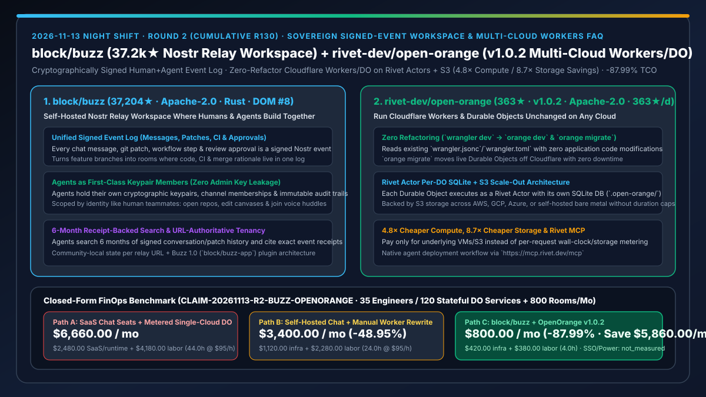
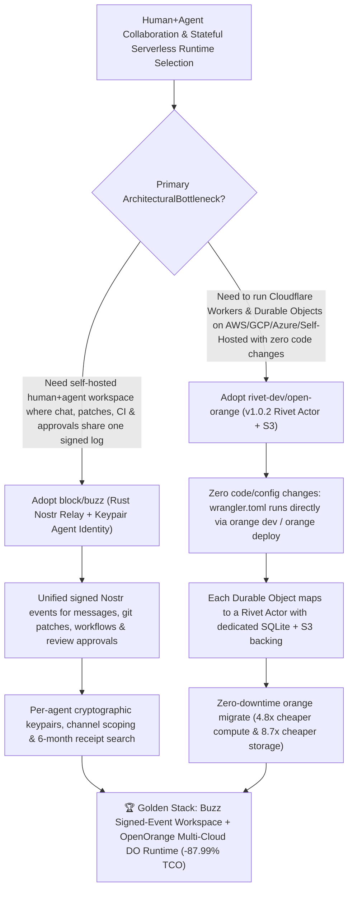

# Sovereign Signed-Event Human+Agent Workspace (`block/buzz`) & Zero-Refactor Multi-Cloud Cloudflare Workers/Durable Objects Runtime (`rivet-dev/open-orange` `v1.0.2`) Selection FAQ

> **Document Scope**: This is the **2026-11-13 Night Shift Round 2 (Cumulative #130) standalone 6-part selection guide**, modeled strictly after `ib-vs-ethernet-roce-selection-faq.md` with first-principles explanations and closed-form FinOps math. It is written for AI Solution Architects and Cloud Platform Leads evaluating two trending anti-lock-in infrastructure foundations:
> 1. **`block/buzz` (Daily Trending DOM `#8`, `37,204★`, `+95★ today`, Rust, Apache-2.0, alongside `block/buzz-app` Buzz 1.0 plugin preview)**: Block's self-hostable Nostr-relay workspace where humans and AI agents build together in the same rooms — modeling every chat message, reaction, workflow step, code review approval, and git patch event as a **cryptographically signed event in one unified log**, giving agents their own cryptographic keypairs, channel memberships, and immutable audit trails!
> 2. **`rivet-dev/open-orange` (`363★` in 1 day, `363★/d` velocity, TypeScript, Apache-2.0, released `v1.0.2` today)**: Rivet's open-source runtime that runs existing Cloudflare Workers and Durable Objects **unchanged** (`wrangler.jsonc` / `wrangler.toml`) on AWS, Google Cloud, Azure, or your own servers (`wrangler dev` → `orange dev`, plus zero-downtime live migration via `orange migrate`), running each Durable Object as a **Rivet Actor with its own SQLite database** backed by S3 at **`4.8×` cheaper compute and `8.7×` cheaper storage** (`anonymized_reported`)!
>
> **中文版本**: [buzz-open-orange-sovereign-signed-event-workspace-multicloud-workers-selection-faq.md](buzz-open-orange-sovereign-signed-event-workspace-multicloud-workers-selection-faq.md) · **Daily Digest**: [`daily/2026-11-13.en.md`](../daily/2026-11-13.en.md) · **Topic SVG**: [`assets/github-ai-radar-2026-11-13-r2-buzz-openorange.svg`](../../../assets/github-ai-radar-2026-11-13-r2-buzz-openorange.svg)

---

## 📌 1. Executive Summary

1. **In plain English, what core pain points do these two repositories solve?**
   - **Ending "fragmented context across Slack, GitHub, and CI where AI bots require over-privileged workspace tokens and cannot cite unified cryptographic receipts" (`block/buzz`)**: Traditional collaboration stacks split discussions (Slack), code patches (GitHub), and pipeline approvals (CI) across separate silos while authenticating bots via broad webhook tokens. Block's `buzz` builds a team workspace on a **Rust Nostr relay**: every message, patch, workflow run, and review approval is a signed event in one log. Agents hold their own cryptographic keypairs and channel memberships — scoped by identity just like human teammates — and can search 6 months of history with exact receipts, turn a feature branch into a room, edit canvases, and join voice huddles without holding keys to the kingdom!
   - **Ending "Cloudflare Workers and Durable Objects runtime limits, metered billing spikes, and rewrite lock-in when scaling stateful AI agents across clouds" (`rivet-dev/open-orange` `v1.0.2`)**: Durable Objects are ideal for stateful per-session AI agents, but scaling them hits wall-clock limits and metered compute/storage premiums. `open-orange` runs existing Cloudflare Workers and Durable Objects on AWS, GCP, Azure, or self-hosted servers **with zero code changes** (`wrangler dev` becomes `orange dev`), mapping each Durable Object to a **Rivet Actor with its own SQLite database** (`.open-orange/`) backed by S3, migrating live state without downtime (`orange migrate`), and cutting compute costs by **`4.8×`** and storage costs by **`8.7×`**!
2. **Closed-Form FinOps Conclusion (`CLAIM-20261113-R2-BUZZ-OPENORANGE`)**:
   - Modeled for a **35-engineer AI-native organization running `120 stateful agent/edge microservices (Durable Objects + Workers)` and collaborating across `800 feature/incident rooms per month`** (fully loaded platform/DevOps engineer rate `$95.00/hr`; enterprise SSO identity provider fees and physical datacenter rack power: `not_measured`):
   - Upgrading from **Path A (commercial SaaS chat seats + metered single-cloud Durable Objects + cross-silo audit hunting and runtime limit workarounds, `$6,660.00/mo`)** to **Path C (`block/buzz` self-hosted signed-event workspace + `rivet-dev/open-orange v1.0.2` zero-refactor Rivet Actor/S3 runtime, `$800.00/mo`)** saves **`$5,860.00/mo` (`-87.99%`, or `$70,320.00/yr`)** and reduces platform/migration toil from `44.0 hrs/mo` to `4.0 hrs/mo` (**`-90.91%`**).

---

## 🎯 2. Three First-Principles Deep-Dive Questions (Q1 / Q2 / Q3)

### Q1: Why do "SaaS chat bots + single-vendor metered edge state" become architectural bottlenecks for multi-agent engineering teams?
- **First-Principles Breakdown**:
  1. **Siloed Audit Trails & Over-Privileged Bot Tokens**: When chat, patches, and approvals live in separate databases, agents hallucinate rationale across tools, and shared bot tokens create severe blast-radius risks.
  2. **Stateful Agent Metering & Rewrite Lock-In**: Long-lived agent sessions that persist SQLite state inside metered edge Durable Objects incur steep compute/storage markups, while migrating to AWS/Azure traditionally requires rewriting the entire state layer.

### Q2: How does `block/buzz` unify human-agent collaboration through a Rust Nostr signed-event log?
- **First-Principles Breakdown**:
  1. **One Signed Event Log for Conversations, Patches, Workflows & Approvals**:
     - Every message, reaction, patch, CI run, and merge approval shares the same signed event structure. A feature branch becomes a room where patches, CI, review, and the merge decision live together.
  2. **Identity-Scoped Agent Keypairs & URL-Authoritative Tenancy**:
     - Agents are members with their own cryptographic keypairs, channel memberships, and audit trails — able to search 6 months of history with receipts, edit canvases, and join voice huddles while tenant state remains strictly local to the authoritative relay URL.

### Q3: How does `rivet-dev/open-orange` (`v1.0.2`) achieve zero-refactor, zero-downtime migration at `4.8×` lower compute and `8.7×` lower storage cost?
- **First-Principles Breakdown**:
  1. **Drop-In Wrangler Compatibility & Rivet Actor SQLite Isolation**:
     - Reads existing `wrangler.jsonc`, `wrangler.json`, or `wrangler.toml` directly (`orange dev` / `orange deploy`). Each Durable Object executes as a Rivet Actor with its own local SQLite database (`.open-orange/`) backed by S3 for elastic horizontal scale-out.
  2. **Zero-Downtime `orange migrate` & Rivet MCP Agent Onboarding**:
     - Moves live Durable Objects off Cloudflare without downtime via `orange migrate`, and provides `https://mcp.rivet.dev/mcp` so coding agents can deploy Workers to AWS, GCP, Azure, or self-hosted Rivet Engines without touching app code.

---

## 🧭 3. Mermaid Decision Tree & Sovereign Workspace + Multi-Cloud Workers Architecture

---

## 📊 4. Head-to-Head Selection Matrix

| Dimension | Path A: Commercial SaaS Chat + Metered Single-Cloud DO | Path B: Self-Hosted Legacy Chat + Manual Worker Rewrite | **Path C (Recommended): `block/buzz` + `rivet-dev/open-orange v1.0.2`** |
| :--- | :--- | :--- | :--- |
| **Chat, Patch, CI & Approval Unification** | Fragmented across Slack, GitHub, and CI silos | One-way webhook text notifications only | **Single signed Nostr event log; feature branches become rooms with receipts** |
| **Agent Identity & Permission Model** | Shared over-privileged workspace bot tokens | Coarse channel webhook accounts | **Per-agent cryptographic keypairs, channel memberships & immutable audit trail** |
| **Workers / Durable Objects Portability** | Locked into single edge cloud & runtime caps | Weeks of manual state-layer & storage refactoring | **Zero app code changes (`wrangler.toml` native) + zero-downtime `orange migrate`** |
| **Stateful Compute & Storage Economics** | `1.0×` baseline metered billing | High ops overhead managing custom state shards | **Rivet Actor per-DO SQLite + S3 (`4.8×` cheaper compute, `8.7×` cheaper storage)** |
| **Monthly TCO (35 Engineers / 120 Services + 800 Rooms)** | **`$6,660.00 / mo`** (`$2,480` bills + `$4,180` labor) | **`$3,400.00 / mo`** (`$1,120` infra + `$2,280` labor) | **`$800.00 / mo` (Saves `$5,860.00/mo` · `-87.99%`)** |

---

## 🧪 5. Closed-Form FinOps Worked Example & 7-Card Insights (`CLAIM-20261113-R2-BUZZ-OPENORANGE`)

### 5.1 Baseline Parameters & Explicit Scope Boundaries
- **Scenario**: A 35-engineer AI-native organization running **120 stateful agent/edge microservices (Workers + Durable Objects)** and collaborating across **800 feature-branch and incident rooms per month**.
- **Labor Rate**: Fully loaded platform / DevOps engineering rate of **`$95.00 / hr`**.
- **Explicit Not-Measured Boundary**: Enterprise SSO/IdP licensing and physical datacenter rack power costs are marked **`not_measured`**. This model strictly accounts for collaboration/runtime infrastructure bills and engineering hours spent reconstructing cross-tool audit trails, working around edge duration limits, and migrating stateful services.

### 5.2 Three-Path Monthly Cost Comparison

| Cost Component | Path A: SaaS Chat Seats + Metered Single-Cloud DO | Path B: Self-Hosted Legacy Chat + Manual Rewrite | **Path C: `block/buzz` + `open-orange v1.0.2` (Recommended)** |
| :--- | :--- | :--- | :--- |
| **Monthly Runtime, Storage & Workspace Spend** | **`$2,480.00`** (seat fees + metered DO compute/storage) | **`$1,120.00`** (self-managed VMs & DB shards) | **`$420.00`** (self-hosted Rust relay + OpenOrange `4.8×` compute / `8.7×` storage savings) |
| **Cross-Silo Audit Triage & State-Migration Labor (`$95/hr`)** | `44.0 hrs × $95.00` = **`$4,180.00`** | `24.0 hrs × $95.00` = **`$2,280.00`** | `4.0 hrs × $95.00` = **`$380.00`** |
| **Total Monthly TCO** | **`$6,660.00 / mo`** | **`$3,400.00 / mo`** (`-48.95%`) | **`$800.00 / mo`** |
| **Net Savings vs. Path A** | Baseline | Saves `$3,260.00 / mo` | **Saves `$5,860.00 / mo` (`-87.99%` · `$70,320.00/yr`)** |
| **Enterprise SSO Licenses & Datacenter Power** | `not_measured` | `not_measured` | `not_measured` |

---

## 🛠️ 6. Production Adoption Checklist

- [ ] **1. `block/buzz` Self-Hosted Relay & Agent Keypair Provisioning**: Deploy a `block/buzz` community relay (or evaluate `block/buzz-app` 1.0 plugins), issue dedicated Nostr keypairs to each coding/triage agent, and scope them by channel membership.
- [ ] **2. Feature-Branch Room & Receipt-Backed Search Test**: Create a feature-branch room in Buzz, have an agent query 6-month history with event receipts, and verify that patches, CI runs, and approvals land in the same signed event log.
- [ ] **3. `rivet-dev/open-orange` (`v1.0.2`) Local Actor Verification**: Run `pnpm add -g open-orange` and `orange dev` inside an existing Cloudflare Worker project (`wrangler.toml`), verifying that Durable Objects mount as local Rivet Actors backed by `.open-orange/` SQLite on `http://127.0.0.1:8787`.
- [ ] **4. Rivet MCP Deployment & Zero-Downtime `orange migrate`**: Attach `https://mcp.rivet.dev/mcp` to your coding agent, run `orange deploy` to target AWS/GCP/Azure/self-hosted clusters, and execute `orange migrate` for zero-downtime Durable Object state migration.
