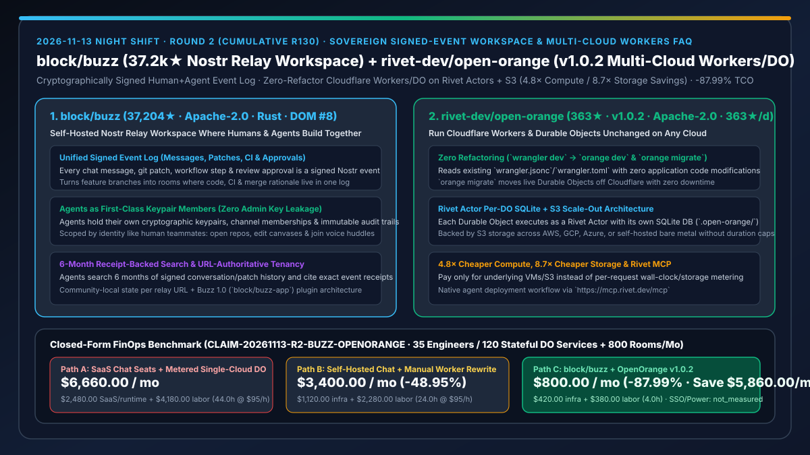
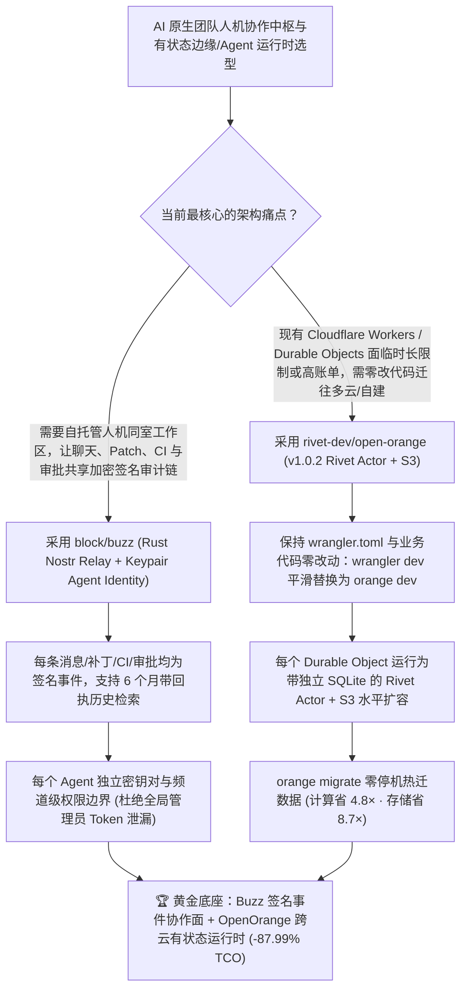

# 主权签名事件流人机同室工作区（`block/buzz`）与零改代码跨云运行 Cloudflare Workers/Durable Objects 引擎（`rivet-dev/open-orange` `v1.0.2`）深度选型 FAQ

> **文档定位**：本专题是 **2026-11-13 夜班第 2 轮（累计第 130 篇）独立六段式选型指南**，严格对标 `ib-vs-ethernet-roce-selection-faq.md` 的通俗第一性原理与闭式 FinOps 核算规范，面向云原生架构师与 AI Solution Architect，深度拆解今日在 GitHub Daily Trending 主日榜与新仓爆发榜联袂突围的两大去锁死基础设施底座：
> 1. **`block/buzz`（主日榜 DOM `#8`，`37,204★`，今日新增 `+95★ today`，Rust，Apache-2.0，同步推进 `block/buzz-app` Buzz 1.0 插件预览）**：金融科技巨头 Block（Square / CashApp 母公司）开源的**基于自托管 Nostr Relay 的“人类与 AI 智能体同室构建”主权协作工作区**——把每一条聊天消息、表情反应、工作流步骤、代码审查批准（Review Approval）与 Git 补丁事件统一建模为**同一条加密签名事件日志（Signed Event Log）**，让 Agent 拥有独立的密钥对（Keypair）、频道成员身份与不可篡改审计链，像真正的人类队友一样检索 6 个月带回执（Receipts）的历史、把特性分支变成协作房间、编辑画布并进入语音讨论（Voice Huddles）！
> 2. **`rivet-dev/open-orange`（1 天新建即获 `363★`，生命周期日均 `363★/d`，TypeScript，Apache-2.0，今日发布 `v1.0.2`）**：Rivet 开源的**零代码改动将 Cloudflare Workers 与 Durable Objects 迁移至 AWS、Google Cloud、Azure 或自建服务器的开源运行时**——直接读取原项目的 `wrangler.jsonc` / `wrangler.toml`（`wrangler dev` 变 `orange dev`，`orange migrate` 零停机热迁数据），将每个 Durable Object 运行为带独立本地 SQLite 数据库（`.open-orange/`）的 **Rivet Actor** 并以 S3 对象存储兜底水平扩容，彻底解除长连接/执行时长限制，实现**计算成本降低 `4.8×`、存储成本降低 `8.7×`**（`anonymized_reported`）！
>
> **English Version**: [buzz-open-orange-sovereign-signed-event-workspace-multicloud-workers-selection-faq.en.md](buzz-open-orange-sovereign-signed-event-workspace-multicloud-workers-selection-faq.en.md) · **关联日报**: [`daily/2026-11-13.md`](../daily/2026-11-13.md) · **专题架构图**: [`assets/github-ai-radar-2026-11-13-r2-buzz-openorange.svg`](../../../assets/github-ai-radar-2026-11-13-r2-buzz-openorange.svg)

---

## 📌 一、核心结论速览（Executive Summary）

1. **一句话大白话讲透这两个项目到底解决了什么痛点？**
   - **终结“人机协作时聊天在 Slack、补丁在 GitHub、流水线在 CI，Agent 只能靠高权限管理员 Token 当个外挂传话筒，出了事既查不到完整上下文也不敢放权”的痛点（`block/buzz`）**：传统团队协作工具把“人聊的话”和“代码/CI/审批事件”割裂在不同 SaaS 孤岛里，给 Agent 接入时往往只能塞一个权限过大的全局 Bot Token。Block 开源的 `buzz` 用几十个高性能 Rust Crates 把底层做成一个 **Nostr 签名事件中继（Relay）**——无论是人类还是 Agent，每个人/进程都有自己的加密公私钥对（Keypair）；每一次发消息、提 Patch、跑 Workflow、点 Approve 全是同一种带数字签名的事件！你可以直接把一个 Feature Branch 变成一个房间，Agent 按频道成员身份隔离权限，搜索过去 6 个月的历史并甩出精确的事件回执（Receipts），而不是靠幻觉瞎猜。
   - **终结“用 Cloudflare Workers + Durable Objects 写有状态 AI Agent 极爽，但一上规模就被执行时长限制、高昂按次/按存储计费与单一云厂商锁死卡脖子”的痛点（`rivet-dev/open-orange` `v1.0.2`）**：Durable Objects（DO）非常适合做每个 Agent 会话或多人房间的一对一有状态沙盒，但一旦业务跑起长程 Agent 循环或高频状态读写，账单和运行时限额就会暴涨，而要迁回 AWS/Azure 往往意味着重写整套状态层。`open-orange` 让你**一行应用代码不改、连 `wrangler.toml` 都不用动**，直接用 `orange dev` / `orange deploy` 把每个 Durable Object 映射为带独立 SQLite 的 **Rivet Actor**（底层持久化走标准 S3），并提供 `orange migrate` 零停机在线迁出数据，计算成本直降 **`4.8×`**、存储成本直降 **`8.7×`**！
2. **闭式 FinOps 投资回报结论（`CLAIM-20261113-R2-BUZZ-OPENORANGE`）**：
   - 以 **35 人规模的 AI 原生研发组织每月运行 `120 个有状态 Agent/边缘微服务（Durable Objects + Workers）` 并协同处理 `800 个特性发布与故障排障房间`** 为基准（平台工程/DevOps 全包时薪 `$95.00/hr`；企业级统一 SSO 身份源年费与自有机房机柜电费：`not_measured`）：
   - 从 **Path A（商业 SaaS 聊天席位/Bot 限流附加费 + 单一云厂商按次/按时长计费 Durable Objects + 跨系统拼凑审计日志与超时改造，月均 `$6,660.00`）** 升级至 **Path C（`block/buzz` 自托管签名事件流人机工作区 + `rivet-dev/open-orange v1.0.2` 零改代码跨云 Rivet Actor/S3 运行时，月均 `$800.00`）**，每月净省 **`$5,860.00/mo`（降幅 `-87.99%`，年省 `$70,320.00/yr`）**，并将跨工具上下文翻找与有状态服务迁云改造工时从 `44.0 hrs/mo` 压缩至 `4.0 hrs/mo`（节省 **`-90.91%`**）。

---

## 🎯 二、三大灵魂拷问（Q1 / Q2 / Q3 深度原理解析）

### Q1：为什么在多 Agent 与人类工程师深度协同阶段，“传统聊天软件外挂 Webhook Bot + 单一边缘云锁死状态机”会迅速沦为架构债？
- **第一性原理拆解**：
  1. **上下文碎片化与 Bot 过度授权风险**：在传统协作栈里，一段代码为什么合入，讨论在聊天框、Diff 在代码仓、构建日志在 CI。Agent 要回答“上个月为什么改了这个超时参数”，必须跨 3 套异构 API 捞数据；更危险的是，传统 Bot 往往共用一个全局 Webhook Token，一旦被提示词注入就拥有越权操作全仓的隐患。
  2. **有状态 Agent 的“长连接时长墙”与存储溢价**：AI Agent 会话动辄持续数十分钟并频繁读写 SQLite 状态，受限于传统 Serverless 边缘节点的 CPU/墙钟时长上限与高昂的托管存储单价，团队被迫在“高额账单”与“推倒重写状态层”之间二选一。

### Q2：`block/buzz` 是如何用 Rust + Nostr 签名事件流重构“人机同权、权限按密钥隔离”的研发工作区的？
- **第一性原理拆解**：
  1. **万物皆签名事件（One Signed Event Log for Chat, Code, CI & Approvals）**：
     - 在 `buzz` 中，聊天消息、表情响应、代码补丁（Patch）、工作流执行步骤与合并审批具有完全统一的事件结构与加密签名。一个特性分支本身就是一个房间（Room），让“为什么写这段代码”的讨论、CI 验证与最终合入决定永久沉淀在同一条不可篡改的日志流里。
  2. **Agent 即成员（Keypair-Scoped Identity）与 URL 权威多租户边界**：
     - 每个 Agent 拥有独立的密钥对（Keypair）与频道成员关系，按身份（而非粗粒度全局开关）授予最小权限；支持通过单一 Relay URL 严格隔离社区租户状态，且 Agent 可直接操作画布（Canvases）、编排子智能体或加入语音讨论（Voice Huddles）。

### Q3：`rivet-dev/open-orange` (`v1.0.2`) 是如何做到“零代码重构、零停机迁移”并把计算/存储成本砍掉 `4.8×` / `8.7×` 的？
- **第一性原理拆解**：
  1. **Wrangler 原生兼容层 + Rivet Actor 独立 SQLite 映射**：
     - 直接解析现有的 `wrangler.jsonc`、`wrangler.json` 或 `wrangler.toml`，将 `env.COUNTER` 等 Durable Object 绑定无缝映射为运行在 Rivet Engine 上的 **Rivet Actor**，每个 Actor 独占本地 `.open-orange/` 下的 SQLite 实例，后端持久化直连标准 S3。
  2. **`orange migrate` 零停机热迁与 Rivet MCP 智能体自动化部署**：
     - 提供 `orange migrate` 在不中断线上服务的前提下将 Durable Objects 状态从 Cloudflare 热迁至 AWS/GCP/Azure 或自有主机；同时内置 `https://mcp.rivet.dev/mcp`，Coding Agent 一条指令即可在不触碰业务源码的前提下完成跨云构建与发布。

---

## 🧭 三、Mermaid 选型决策树与「主权人机协作层 + 跨云无锁状态运行时」架构图

---

## 📊 四、同类方案核心能力对比矩阵（Selection Matrix）

| 评估维度 | Path A：商业 SaaS 聊天 + 单一云托管 Durable Objects | Path B：自建传统 IM (Matrix/Mattermost) + 手工改写 Docker 状态服务 | **Path C（推荐）：`block/buzz` + `rivet-dev/open-orange v1.0.2`** |
| :--- | :--- | :--- | :--- |
| **聊天、代码补丁与审批统一性** | 割裂在 Slack、GitHub、CI 三个异构孤岛 | 仅能收单向 Webhook 文本通知 | **同一条 Nostr 加密签名事件日志，分支即房间，检索自带事件回执** |
| **Agent 身份与权限隔离模型** | 共享高危 Workspace Bot Token | 粗粒度频道 Bot 账号 | **每个 Agent 拥有独立公私钥对（Keypair）与细粒度房间成员关系** |
| **Workers / Durable Objects 跨云迁移成本** | 锁死单一边缘云，按请求/时长阶梯计费 | 需重写全部 DO 状态机与存储接口（数周工期） | **零业务代码改动，直接复用 `wrangler.toml` + `orange migrate` 零停机热迁** |
| **有状态 Actor 计算与存储单价** | 基准 `1.0×`（受运行时限制与高额存储计费约束） | 需自行维护分布式锁与数据库分片 | **Rivet Actor 独立 SQLite + S3 后端，计算省 `4.8×`、存储省 `8.7×`** |
| **月度总拥有成本（35 人 / 120 服务 + 800 房间）** | **`$6,660.00 / mo`**（`$2,480` 账单 + `$4,180` 工时） | **`$3,400.00 / mo`**（`$1,120` 设施 + `$2,280` 改造工时） | **`$800.00 / mo`（净省 `$5,860.00/mo` · `-87.99%`）** |

---

## 🧪 五、定量 FinOps 算例与 7-Card 洞察（`CLAIM-20261113-R2-BUZZ-OPENORANGE`）

### 5.1 测算基准与显式边界（Scope & Boundaries）
- **场景设定**：35 人规模的 AI 原生研发组织，线上运行 **120 个基于 Workers / Durable Objects 的有状态 Agent 与边缘协同服务**，每月围绕 **800 个特性分支与线上排障房间** 开展人机联合研发。
- **费率假设**：平台工程与 DevOps 架构师全包时薪 **`$95.00 / hr`**。
- **显式边界声明（Explicit Not-Measured Boundary）**：企业级统一身份认证（SSO/Okta）年费与线下物理机房机柜电力成本标记为 **`not_measured`**，本表严格核算协作/边缘运行时云账单以及工程师花在“跨工具翻找审计证据、规避边缘运行时超限、重构有状态服务”上的损耗工时。

### 5.2 三路径月度成本闭式对照表

| 成本分项 | Path A：商业 SaaS 聊天席位 + 单一云计量 DO | Path B：自建传统 IM + 手工重写有状态服务 | **Path C：`block/buzz` + `open-orange v1.0.2`（推荐）** |
| :--- | :--- | :--- | :--- |
| **月度云运行时、存储与协作平台净支出** | **`$2,480.00`**（按席位收费 + DO 高频读写/存储溢价） | **`$1,120.00`**（自管 VM 与数据库集群开销） | **`$420.00`**（自托管 Rust Relay + OpenOrange 计算省 4.8× / 存储省 8.7×） |
| **跨系统上下文取证与状态层迁移/维护工时（`$95/hr`）** | `44.0 hrs × $95.00` = **`$4,180.00`** | `24.0 hrs × $95.00` = **`$2,280.00`** | `4.0 hrs × $95.00` = **`$380.00`** |
| **月度总成本（Monthly TCO）** | **`$6,660.00 / mo`** | **`$3,400.00 / mo`**（`-48.95%`） | **`$800.00 / mo`** |
| **相对 Path A 净节省** | 基准线（Baseline） | 净省 `$3,260.00 / mo` | **净省 `$5,860.00 / mo`（`-87.99%` · 年省 `$70,320.00/yr`）** |
| **企业级 SSO 许可与物理机柜电力账单** | `not_measured` | `not_measured` | `not_measured` |

---

## 🛠️ 六、生产级落地核验 Checklist

- [ ] **1. `block/buzz` 自托管 Relay 部署与 Agent 密钥对签发**：拉取 `block/buzz`（或体验 `block/buzz-app` 1.0 插件架构），启动单域名社区 Relay，为团队 Coding Agent 签发独立 Nostr Keypair 并只授予目标项目频道成员权限。
- [ ] **2. “分支即房间”签名事件审计演练**：在 Buzz 频道内由 Agent 检索过去历史讨论并附带事件回执（Receipts），发起代码 Patch 与工作流运行，验证消息、CI 状态与 Review 批准均记录在同一签名日志中。
- [ ] **3. `rivet-dev/open-orange` (`v1.0.2`) 零改动本地验证**：在现有含 `wrangler.toml` / `wrangler.jsonc` 的 Cloudflare Worker 项目中执行 `pnpm add -g open-orange` 并运行 `orange dev`，确认 Durable Objects 在 `4.6s` 内作为本地 Rivet Actor（`.open-orange/` SQLite）正常响应 `http://127.0.0.1:8787`。
- [ ] **4. Rivet MCP 接入与 `orange migrate` 零停机跨云切换**：在 Coding Agent 中挂载 `https://mcp.rivet.dev/mcp`，执行 `orange deploy` 部署至目标 AWS/Azure/自建集群，并通过 `orange migrate` 完成线上 Durable Object 状态零停机热迁核验。
