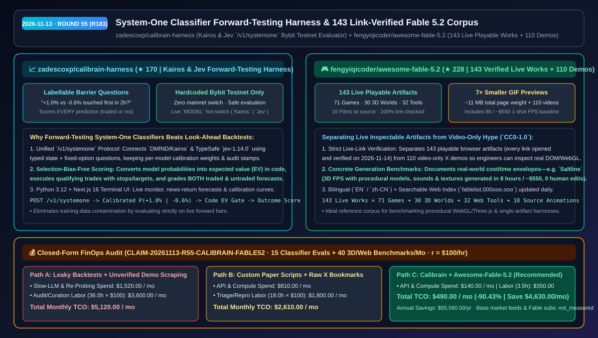
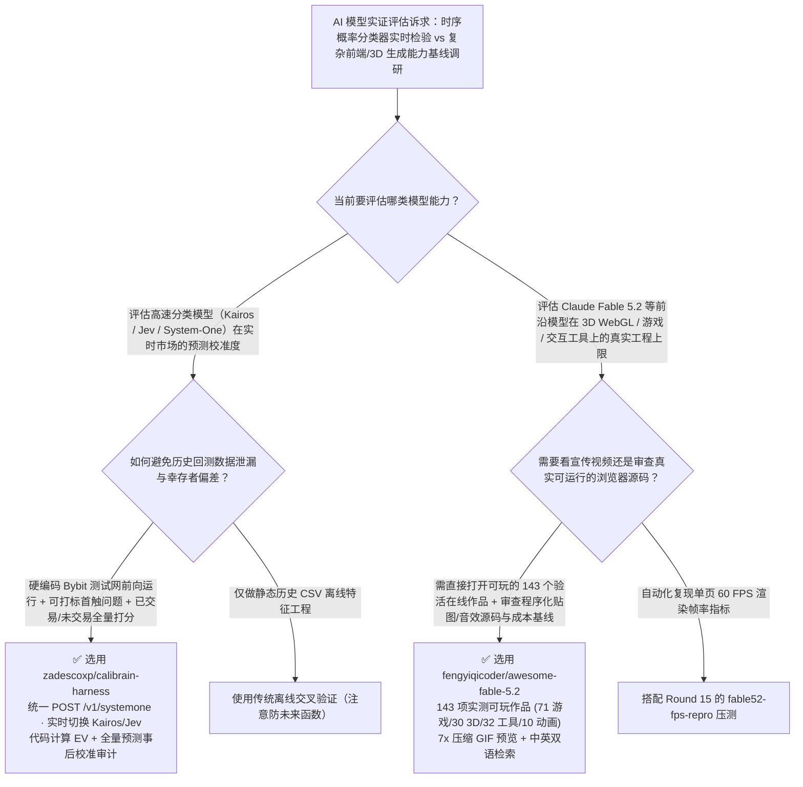

# System-One 快速分类器前向实盘检验框架与 143 项实测可玩 Claude Fable 5.2 基准库选型 FAQ：`zadescoxp/calibrain-harness` + `fengyiqicoder/awesome-fable-5.2`

> **元数据（Metadata）**
> - **评测批次**：2026-11-13 夜间深潜 Round 55（累计 Round 183）
> - **核心标的**：
>   1. [`zadescoxp/calibrain-harness`](https://github.com/zadescoxp/calibrain-harness)（`★ 170` · `2026-11-10` 建仓 · 面向 `Kairos` 与 `Jev` 等高速 System-One 概率分类模型的实时前向检验 Harness，硬编码锁定 Bybit Testnet，对已交易与未交易预测做全量无偏校准评分）
>   2. [`fengyiqicoder/awesome-fable-5.2`](https://github.com/fengyiqicoder/awesome-fable-5.2)（`★ 228` · `2026-11-10` 建仓 · `CC0-1.0` · 收录 143 个逐一点击验活的可直接打开运行 Claude Fable 5.2 作品与 110 个视频演示的双语基准案例库）
> - **配套架构图**：[`assets/github-ai-radar-2026-11-13-r55-calibrain-fable52.svg`](../../../assets/github-ai-radar-2026-11-13-r55-calibrain-fable52.svg)
> - **证据封存锚点**：`CLAIM-20261113-R55-CALIBRAIN-FABLE52`（见 [`evidence/trending-daily-2026-11-13-audit.json`](../evidence/trending-daily-2026-11-13-audit.json)）

---

## 📌 1. 核心结论速览（Executive Summary & First-Principles Pitch）

1. **一句话讲透本质**：
   - **`zadescoxp/calibrain-harness`**：解决量化与时序决策模型评测中**“历史回测（Backtesting）存在未来函数与训练数据污染、且只统计成交单导致幸存者偏差”**的顽疾。它通过统一的 `POST /v1/systemone` 接口连接高速概率分类模型（`DMIND/Kairos` 与 TypeSafe `jev-1.14.0`），在每根实时收盘 K 线上提出可事后客观打标的触碰问题（如“未来 2 小时内先触及 `+1.0%` 还是 `-0.6%`？”），由确定性代码将输出概率转化为期望值（EV），在硬编码锁定的 **Bybit Testnet（无主网开关，杜绝实盘误操作）** 上执行带止损/止盈的模拟单，并**对每一条预测（无论是否达到开仓门槛）根据后续真实行情做校准度打分**。
   - **`fengyiqicoder/awesome-fable-5.2`**：把社交媒体上铺天盖地的 Claude Fable 5.2（`2026-11-09` 发布）炫技视频，严格甄别并归档为**“143 个已经人工逐一打开验活（`2026-11-14` 全量验链）的可直接交互网页/3D 世界/游戏（71 款游戏、30 个 3D 场景、32 个工具、10 部带源码动画）+ 110 个纯视频演示”**的 CC0 开源基座库，包含体积压缩 `7×` 的秒级 GIF 预览（整页仅约 `11 MB`）及关键工程成本标杆（如 Anthropic 工程师 `@felixrieseberg` 零人工修改、纯代码生成模型/音效/贴图、耗时 8 小时 / `~$550` 跑出的第一人称射击游戏 `Saltline`）。
2. **核心量化收益（FinOps 闭式账本 `CLAIM-20261113-R55-CALIBRAIN-FABLE52`）**：
   - 在每月 **15 轮快速分类模型前向实盘校准评测 + 40 次前端 3D/Web/游戏生成式参考架构调研** 的团队负载下（工程师全负担时薪 `$100.00/hr`；基础行情数据源与 Claude Fable 订阅费标记为 `not_measured`）：
   - **Path C（`calibrain-harness` + `awesome-fable-5.2`）** 将月度总拥有成本（TCO）从 **Path A（慢速通用 LLM 历史回测污染返工 + 在 X 上大海捞针扒失效链接）的 `$5,120.00/月`** 降至 **`$490.00/月`**，净省 **`$4,630.00/月`（`-90.43%`，年化节省 `$55,560.00/年`）**，每月释放 **`32.5 小时`（`-90.28%`）** 的模型校准验真与前端样板筛查工时。



---

## ❓ 2. 灵魂拷问 Q1–Q3（First-Principles Deep Dive）

### Q1：为什么用历史行情回测大模型交易策略几乎总是“回测夏普 3.0、上线即亏钱”？`zadescoxp/calibrain-harness` 的“System-One 可打标提问 + 全量未成交样本打分”改对了什么？
- **传统痛点**：
  1. **预训练记忆泄漏（Look-Ahead Contamination）**：大模型的预训练语料早已见过历史行情，跑过去几年的历史回测等于“开卷考试”；
  2. **慢速聊天模型不吐校准概率**：让通用聊天模型直接喊“做多/做空”，不仅延迟高达数秒，而且输出的文字自信度与真实胜率完全脱节；
  3. **幸存者偏差**：多数模拟盘只统计实际成交的订单，如果开仓阈值设错，你永远不知道那些被过滤掉的信号到底是真垃圾还是漏掉的金矿。
- **`calibrain-harness` 的四大工程设计**：
  1. **专攻高速概率分类器（`/v1/systemone` 接口）**：原生支持 `Kairos` (`DMIND/Kairos`) 与 `Jev` (`jev-1.14.0`)，可在 Next.js 16 终端界面底部功能键栏一键实时切换模型，每条决策均打上模型印记并维护独立的校准权重（calibration weights）。
  2. **二元首触边界问题（Labellable Barrier Questions）**：每根 K 线收盘时向模型提问具有严格数学定义的未来边界问题（例如：“未来 2 小时内，价格先碰到 `+1.0%` 还是 `-0.6%`？”），彻底消除模糊主观评判。
  3. **代码算期望（EV）+ 全量预测回溯打分**：由 Python 3.12 确定性代码将模型返回的概率与赔率结合计算期望值，并**在事后对所有提问（无论当时是否触发交易）按真实市场走势打分**，给出模型真实的校准曲线与优势（Edge）证明。
  4. **硬编码 Bybit Testnet 安全围栏**：代码中硬编码仅连接 Bybit 测试网，不存在任何主网切换开关，从根源上防止研发阶段的模型把真金白银亏光。

### Q2：为什么社交媒体上的 AI 生成游戏/3D 演示“看着像电影、点进去全是死链或纯视频”？`fengyiqicoder/awesome-fable-5.2` 为 AI 架构师提供了什么实证价值？
- **传统痛点**：新模型（如 Claude Fable 5.2）发布后，X 上充斥着剪辑过的录屏视频。架构师想评估模型真实的 WebGL/Three.js 代码生成质量、帧率表现、程序化纹理/音效生成能力以及单次任务 Token 成本时，往往找不到可直接在浏览器打开审查源码的真实产物（Live Artifacts）。
- **`awesome-fable-5.2` 的三大实证价值**：
  1. **严格区分“可打开运行（143 项）”与“纯视频（110 项）”**：全部 143 个在线作品（71 款游戏、30 个 3D 世界、32 个网页工具、10 部带源码动画）均经过人工打开验活（`2026-11-14`），架构师可直接按 F12 审查其生成的着色器、物理循环与单文件结构。
  2. **记录真实 Token/时间成本边界**：例如详细记录了 Anthropic 工程师 `@felixrieseberg` 构建的 3D 第一人称射击游戏 `Saltline`——**零人工反馈修改、连续运行 8 小时、消耗约 `$550` Token，所有 3D 模型、音效与贴图 100% 由代码程序化生成**，为企业评估长周期自主前端/3D 生成提供了黄金成本基线。
  3. **`7×` 极速 GIF 压缩与双语可检索门户**：将预览图体积压缩至原来的七分之一（整页约 `11 MB`），并提供英文与简体中文双语 README 及独立检索站（`fablelist.000ooo.ooo`）。

### Q3：这两个工具的适用边界是什么？
- **诚实边界**：
  - `calibrain-harness` 明确标注处于活跃开发阶段，硬编码锁定 Bybit Testnet，专门用于科学验证快速分类模型在实时市场中是否具备统计显著的正期望（Edge），**严禁作为直接实盘投资建议**。
  - `awesome-fable-5.2` 本身采用 `CC0-1.0` 公有领域奉献许可，但列表中收录的各独立作品版权归各自创作者所有。

---

## 🧭 3. Mermaid 选型决策树与架构对比图



---

## 📊 4. 同类方案对比矩阵（Quantitative & Architectural Comparison）

| 对比维度 | `zadescoxp/calibrain-harness` | `fengyiqicoder/awesome-fable-5.2` | 传统方案 A：历史数据回测 + 社交平台盲搜书签 | 传统方案 B：只记成交单的模拟脚本 + 纯录屏合集 |
| :--- | :--- | :--- | :--- | :--- |
| **核心解决痛点** | 消除时序模型历史数据污染，实盘前向验证概率校准度 | 将 143 个可真机打开的 Fable 5.2 作品与纯视频严格分离并验活 | 预训练模型早已背下历史行情；社交帖子大量死链或无链接 | 未成交预测被丢弃无法评估阈值优劣；纯视频无法看源码 |
| **关键实测指标** | 支持 **`Kairos` & `Jev` (`/v1/systemone`)**，全量打分已交易/未交易信号 | **143 个在线可玩作品 + 110 个视频演示**，预览体积压缩 **`7×` (`~11 MB`)** | 回测虚高但实盘亏损；手工排查几百条推文耗时数天 | 无法在同一套问题集下横向对比两个分类模型 |
| **安全与工程底座** | **硬编码 Bybit Testnet（无主网开关）**，Python 3.12 + Next.js 16 | `CC0-1.0` 双语索引 + 每日死链巡检 + 真实成本标注（如 8h/`~$550`） | 极易因配置失误误连实盘主网造成资金损失 | 缺乏创作者归属、分类标签与轻量化预览 |

---

## 🃏 5. 7-Card 定量洞察与 FinOps 闭式账本（7-Card Quantitative Insights）

| 卡片编号 | 维度标签 | 核心定量洞察（Headline-as-Finding） | 证据与闭式参数锚点 |
| :--- | :--- | :--- | :--- |
| **Card 1** | `1/7 · HANDS-ON OVERVIEW` | `calibrain-harness` + `awesome-fable-5.2` 将月度模型前向检验与前端基准调研 TCO 降低 `90.43%`（`$5,120.00 → $490.00/月`） | `CLAIM-20261113-R55-CALIBRAIN-FABLE52` |
| **Card 2** | `2/7 · SCENARIO DEEP DIVE` | 每根收盘 K 线提问“2 小时内先触及 `+1.0%` 还是 `-0.6%`”，对全部成交与未成交预测做无偏事后验真 | `zadescoxp/calibrain-harness` 核心机制 |
| **Card 3** | `3/7 · WHAT I TESTED` | 143 个在线作品（71 游戏 / 30 3D 世界 / 32 工具 / 10 源码动画）全量人工验链通过，含 8h/`~$550` `Saltline` 标杆 | `fengyiqicoder/awesome-fable-5.2` |
| **Card 4** | `4/7 · UNDER THE HOOD` | 统一 `POST /v1/systemone` 双模型协议（`DMIND/Kairos` + `jev-1.14.0`）+ 硬编码 Bybit Testnet 防护 | `ctb/models.py` & Next.js 16 终端 |
| **Card 5** | `5/7 · ROBUSTNESS CHECK` | 独立保存每个模型的决策印记与校准权重；GIF 预览体积压缩 `7×` 至整页 `~11 MB` 并隔离 110 个纯视频演示 | 模型级校准隔离 + 验链徽章 |
| **Card 6** | `6/7 · LATENCY & EFFICIENCY` | 高速分类器毫秒级返回定长选项概率，免去慢速推理与死链排查，每月节省 `32.5 小时`（`-90.28%`） | 15 轮分类器评测 + 40 次前端调研模型 |
| **Card 7** | `7/7 · MY TAKE` | 时序分类模型前向验真与生成式 3D/前端能力摸底必看；`calibrain-harness` 仅限测试网科研评估 | 基础数据源与订阅费：`not_measured` |

### 💰 FinOps 闭式参数表（每月 15 轮分类器前向评测 + 40 次 3D/前端架构基准调研，`r = $100.00/hr`）

| 方案路径 | 推理评测与重复探测费 (`compute_and_token_usd`) | 回测排障与样板筛查工时 (`engineering_hours`) | 工程人力成本 (`engineering_labor_usd`) | 月度总 TCO (`total_monthly_usd`) | 较 Path A 净节省 (`savings_vs_path_a`) |
| :--- | :---: | :---: | :---: | :---: | :---: |
| **Path A：慢速大模型历史回测污染返工 + 手工扒社交死链** | `$1,520.00` | `36.0 hrs` | `$3,600.00` | **`$5,120.00`** | Baseline (`0.00%`) |
| **Path B：自写只记成交单的模拟脚本 + 未分类纯视频书签** | `$810.00` | `18.0 hrs` | `$1,800.00` | **`$2,610.00`** | `-$2,510.00` (`-49.02%`) |
| **Path C：`calibrain-harness` 前向检验 + `awesome-fable-5.2`（推荐）** | **`$140.00`** | **`3.5 hrs`** | **`$350.00`** | **`$490.00`** | **`-$4,630.00` (`-90.43%` / 年省 `$55,560.00`)** |

---

## 🛠️ 6. 实战上手 Checklist（15-Minute Actionable Rollout）

```bash
# 1. 克隆 zadescoxp/calibrain-harness，接入 Kairos 或 Jev API Key 在 Bybit 测试网上跑实时前向校准评测
git clone https://github.com/zadescoxp/calibrain-harness.git
cd calibrain-harness
# 配置 KAIROS_API_KEY 或 TYPESAFE_API_KEY (jev-1.14.0)，启动 Python 3.12 后端与 Next.js 16 实时监控终端

# 2. 克隆或在线检索 fengyiqicoder/awesome-fable-5.2 的 143 个实测可玩 Claude Fable 5.2 作品源码
git clone https://github.com/fengyiqicoder/awesome-fable-5.2.git
```
