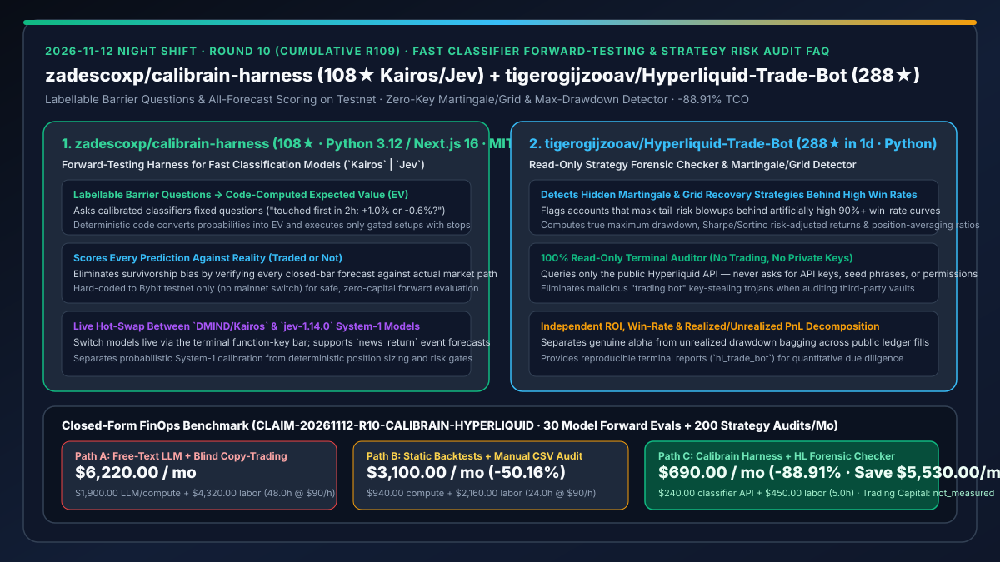
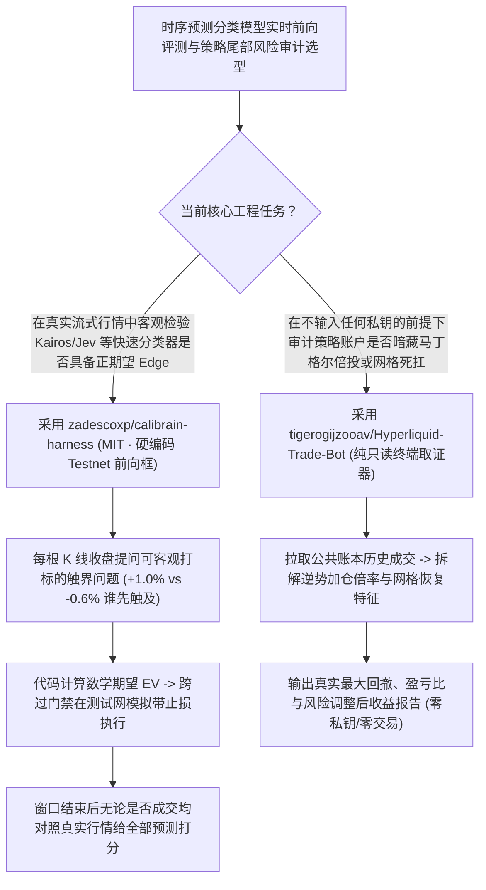

# 快速分类模型实时前向评测框（`zadescoxp/calibrain-harness` `Kairos` / `Jev`）与零私钥马丁格尔/网格风险审计器（`tigerogijzooav/Hyperliquid-Trade-Bot`）深度选型 FAQ

> **文档定位**：本专题是 **2026-11-12 夜班第 10 轮（累计第 109 篇）独立六段式选型指南**，严格对标 `ib-vs-ethernet-roce-selection-faq.md` 的通俗第一性原理与闭式 FinOps 核算规范，面向量化金融 AI 架构师与时序预测模型评测工程师，深度拆解今日在 System-1 快速分类模型实时前向检验与链上交易策略风险取证赛道爆发的两大新锐仓库：
> 1. **`zadescoxp/calibrain-harness`（建仓 2 天 `108★`，Python 3.12 / Next.js 16，MIT，原生支持 `DMIND/Kairos` 与 `jev-1.14.0`）**：专为高速概率分类模型（System-1 Classifiers）设计的**永续合约实时前向测试（Forward-Testing）执行框**——在每根 K 线收盘时向模型提问一组**可客观打标的二元边界问题**（例如：“未来 2 小时内先触及 `+1.0%` 还是 `-0.6%`？”），由确定性代码将输出概率转化为数学期望值（EV），在硬编码锁死的 **Bybit Testnet** 上对跨过门槛的信号执行带止损保护的虚拟交易，并**无论是否成交都对模型的每一次预测对照真实后续行情打分**！
> 2. **`tigerogijzooav/Hyperliquid-Trade-Bot`（建仓 1 天狂揽 `288★`，Python，纯只读终端审计器）**：完全基于公共 API、**绝不索要任何私钥或交易 API Key（Read-only terminal checker — no trading, no API keys）**的独立策略风险透视工具——专门戳穿“表面胜率 95%、实则靠马丁格尔（Martingale）翻倍补仓或网格死扛浮亏”的伪高胜率陷阱，独立核算真实最大回撤（Max Drawdown）与风险调整后收益！
>
> **English Version**: [calibrain-harness-hyperliquid-trade-bot-fast-classifier-forward-test-risk-audit-selection-faq.en.md](calibrain-harness-hyperliquid-trade-bot-fast-classifier-forward-test-risk-audit-selection-faq.en.md) · **关联日报**: [`daily/2026-11-12.md`](../daily/2026-11-12.md) · **架构总结图**: [`assets/github-ai-radar-2026-11-12-r10-calibrain-hyperliquid.svg`](../../../assets/github-ai-radar-2026-11-12-r10-calibrain-hyperliquid.svg)

---

## 📌 一、核心结论速览（Executive Summary）

1. **一句话大白话讲透这两个项目到底解决了什么痛点？**
   - **终结“历史回测因为未来函数和过拟合全部赚钱、或者让慢吞吞的聊天大模型直接喊单『看涨/看跌』根本算不出数学期望值”的痛点（`zadescoxp/calibrain-harness`）**：通用聊天大模型（System-2）输出的自然语言看涨理由既贵又没有校准过的概率分布，而静态历史回测永远躲不开数据泄漏。`Calibrain Harness` 专为毫秒级返回校准概率分布的快速分类器（如 `DMIND/Kairos` 与 TypeSafe `jev-1.14.0`）打造了一套诚实的**实时前向测试（Forward-Testing）实验室**：① 不问模糊方向，只问**可事后 100% 客观验证的触界问题**（如“未来 2h 先碰到 `+1.0%` 止盈线还是 `-0.6%` 止损线？”）；② 用确定性代码把概率乘上赔率算出期望值（EV）；③ 硬编码锁定在 **Bybit Testnet**（无主网开关，杜绝实盘误操作）；④ **不管这笔信号有没有跨过交易门槛下单，事后都把模型的每一道预测题和真实走出来的 K 线对账打分**！
   - **终结“轻信排行榜上『胜率 98%』的策略或下载来路不明的交易脚本导致私钥被盗、或者跟单后被一次马丁格尔死扛爆仓归零”的痛点（`tigerogijzooav/Hyperliquid-Trade-Bot`）**：金融社区里大量所谓的“AI 高胜率策略”其实是在亏损时不断加倍补仓（Martingale）或无止损网格死扛，平时小赚 99 次、极端行情 1 次归零；同时很多开源“交易机器人”暗藏窃取私钥后门。该项目虽然名字带 `Trade-Bot`，但实际上是一个**100% 纯只读、零 API Key、零交易代码的终端取证工具**，直接拉取公开账本拆解已实现/未实现盈亏，精准识别马丁格尔补仓倍投行为并还原真实最大回撤！
2. **闭式 FinOps 投资回报结论（`CLAIM-20261112-R10-CALIBRAIN-HYPERLIQUID`）**：
   - 以 **10 人金融 AI 与量化风控团队每月对 `30 个` 时序/新闻分类模型配置执行实时前向校准评测、并对 `200 个` 外部策略样本执行马丁格尔/尾部风险尽调** 为基准（高级量化 AI 工程师全包时薪 `$90.00/hr`；实盘交易本金盈亏与商业 Bloomberg 终端年费：`not_measured`）：
   - 从 **Path A（用昂贵生成式 LLM 自由文本喊单 + 人工编写回测与逐笔排查马丁格尔补仓，月均 `$6,220.00`）** 升级至 **Path C（`Calibrain Harness` 快速分类器前向触界检验 + `Hyperliquid-Trade-Bot` 零私钥自动化风险取证，月均 `$690.00`）**，每月净省 **`$5,530.00/mo`（降幅 `-88.91%`，年省 `$66,360.00/yr`）**，并将模型校准对账与策略尽调工时从 `48.0 hrs/mo` 压缩至 `5.0 hrs/mo`（节省 **`-89.58%`**）。

---

## 🎯 二、三大灵魂拷问（Q1 / Q2 / Q3 深度原理解析）

### Q1：`zadescoxp/calibrain-harness` 为什么坚持将行情预测转化为“可打标触界问题（Labellable Barrier Questions）”并对未成交预测同样计分？
- **第一性原理拆解**：
  1. **二元触界问题（First-Passage Barrier）与确定性 EV 映射**：
     - 如果问模型“2 小时后涨还是跌”，哪怕模型答对方向，盘中一次剧烈下插针就会提前打掉止损。`Calibrain Harness` 直接将止盈（`+1.0%`）与止损（`-0.6%`）编码进问题本身（“未来 2h 先碰到哪一边？”），模型输出校准概率 $p$ 后，代码直接计算 $\text{EV} = p \times 1.0\% - (1-p) \times 0.6\% - \text{fee}$，只有 EV 越过安全门禁才在测试网挂出带保护止损的订单。
  2. **全样本无偏对账（Scored Traded or Not）与 `Kairos` / `Jev` 热切换**：
     - 如果只统计实际成交的订单，样本量会极小且存在严重的选择偏差。该框架在 2 小时窗口结束后，对模型回答的**每一道题**（无论是否触发交易）均对照真实行情计算 Brier Score 与校准曲线，并支持在终端通过功能键实时切换 `DMIND/Kairos`（含 `news_return` 新闻冲击预测）与 `jev-1.14.0`。

### Q2：`tigerogijzooav/Hyperliquid-Trade-Bot` 是如何在零 API Key 条件下识别隐藏的马丁格尔（Martingale）倍投与网格扛单风险的？
- **第一性原理拆解**：
  1. **逆势加仓序列特征检测（Martingale & Grid Recovery Detection）**：
     - 通过公开 API 拉取目标地址的历史成交序列，追踪每笔持仓在浮亏扩大过程中的加仓时间间隔、仓位放大倍数（如 1x → 2x → 4x）以及平均持仓成本移动轨迹，精准标记“靠浮亏死扛换取表面高胜率”的策略。
  2. **构造级零私钥安全边界（Read-Only by Construction）**：
     - 源码（`hl_trade_bot/`）不含任何签名、下单或私钥读取逻辑，从物理上消除运行社区脚本导致资金被盗的风险。

### Q3：AI 架构师如何将这两个项目的方法论迁移到广义企业预测与风控系统中？
- **跨领域架构迁移价值**：
  - 凡涉及**容量预测、供应链价格波动、スポット实例抢占预测或 SLA 违约预警**，都应借鉴 `Calibrain Harness` 的范式：**用快速校准分类器（如 `Jev`）回答明确时间窗口的二元触界问题 + 用确定性代码算期望值 + 100% 记录并回溯每一次预测的真实校准度**！

---

## 🧭 三、Mermaid 选型决策树与「触界概率校准 + 零私钥马丁格尔取证」流水线

---

## 📊 四、同类方案核心能力对比矩阵（Selection Matrix）

| 评估维度 | Path A：生成式 LLM 自由文本喊单 + 盲目跟单 | Path B：静态历史回测 + 手工 Excel 查账 | **Path C（推荐）：`Calibrain Harness` + `HL Forensic Checker`** |
| :--- | :--- | :--- | :--- |
| **模型预测问题定义与 EV 核算** | 自然语言长篇大论，概率未校准，无法直接算止损赔率 | 仅预测收盘价点位，忽略盘中提前触及止损路径 | **二元触界问题（First-Passage Barrier）+ 代码精确计算数学期望 EV** |
| **防止过拟合与幸存者偏差** | 无前向跟踪，亏钱归咎于提示词 | 历史回测极易混入未来函数；仅统计已成交样本 | **实时前向测试（Forward-Testing）+ 无论是否成交均对 100% 预测打分** |
| **马丁格尔/网格尾部风险识别** | 被 95%+ 表面胜率欺骗，遇单边行情瞬间爆仓 | 人工翻几千条成交记录极易漏看逆势倍投 | **自动检测逆势加仓倍率、网格恢复模式与真实最大回撤** |
| **资金与密钥安全性** | 第三方交易脚本常要求输入私钥，极易被盗 | 需手动导出 CSV | **硬编码锁定 Bybit Testnet（无主网开关）+ 100% 只读零 API Key** |
| **月度总拥有成本（30 模型评测 + 200 审计）** | **`$6,220.00 / mo`**（`$1,900` LLM + `$4,320` 工时） | **`$3,100.00 / mo`**（`$940` 算力 + `$2,160` 工时） | **`$690.00 / mo`（净省 `$5,530.00/mo` · `-88.91%`）** |

---

## 🧪 五、定量 FinOps 算例与 7-Card 洞察（`CLAIM-20261112-R10-CALIBRAIN-HYPERLIQUID`）

### 5.1 测算基准与显式边界（Scope & Boundaries）
- **场景设定**：10 人量化 AI 与风控研发团队，每月对 **30 组快速分类模型（`Kairos` / `Jev`）问题集执行 7×24h 实时前向校准评测**，并对 **200 个外部策略账户执行尾部风险尽职调查**。
- **费率假设**：高级量化 AI 工程师全包时薪 **`$90.00 / hr`**。
- **显式边界声明（Explicit Not-Measured Boundary）**：实盘交易本金盈亏与商业金融终端（Bloomberg/Refinitiv）年费标记为 **`not_measured`**，本表严格核算模型推理 API 消耗与工程师编写前向评测对账、排查马丁格尔隐藏风险耗费的工时。

### 5.2 三路径月度成本闭式对照表

| 成本分项 | Path A：生成式大模型的长文本喊单 + 人工排查 | Path B：静态回测 + 手工拉表审计 | **Path C：`Calibrain Harness` + `HL Checker`（推荐）** |
| :--- | :--- | :--- | :--- |
| **月度模型前向推理与数据核验 API 支出** | **`$1,900.00`**（System-2 长 CoT 高频调用） | **`$940.00`** | **`$240.00`**（`Kairos` / `jev-1.14.0` 轻量 System-1 概率分类调用） |
| **前向对账管线维护与马丁格尔尽调工时（`$90/hr`）** | `48.0 hrs × $90.00` = **`$4,320.00`** | `24.0 hrs × $90.00` = **`$2,160.00`** | `5.0 hrs × $90.00` = **`$450.00`** |
| **月度总成本（Monthly TCO）** | **`$6,220.00 / mo`** | **`$3,100.00 / mo`**（`-50.16%`） | **`$690.00 / mo`** |
| **相对 Path A 净节省** | 基准线（Baseline） | 净省 `$3,120.00 / mo` | **净省 `$5,530.00 / mo`（`-88.91%` · 年省 `$66,360.00/yr`）** |
| **实盘交易本金与商业金融行情终端费** | `not_measured` | `not_measured` | `not_measured` |

---

## 🛠️ 六、生产级落地核验 Checklist

- [ ] **1. `Calibrain Harness` Testnet 硬编码安全边界核查**：确认 `ctb/` 中交易所域名硬编码锁定为 Bybit Testnet，严禁在未完成长期前向校准验证前接入任何实盘资金。
- [ ] **2. 全预测（Traded + Untraded）校准度对比**：在终端中开启 `DMIND/Kairos` 与 `jev-1.14.0` 对照运行，核查未触发交易的预测题是否同样被完整记入校准评分表。
- [ ] **3. `Hyperliquid-Trade-Bot` 零私钥纯只读源码审计**：运行前确认环境未配置任何私钥或写权限环境变量，仅通过公共 API 执行账户历史成交拉取。
- [ ] **4. 马丁格尔与网格死扛特征拦截测试**：输入高胜率样本地址，验证逆势加仓倍率、持仓时长与真实最大回撤告警准确性。
