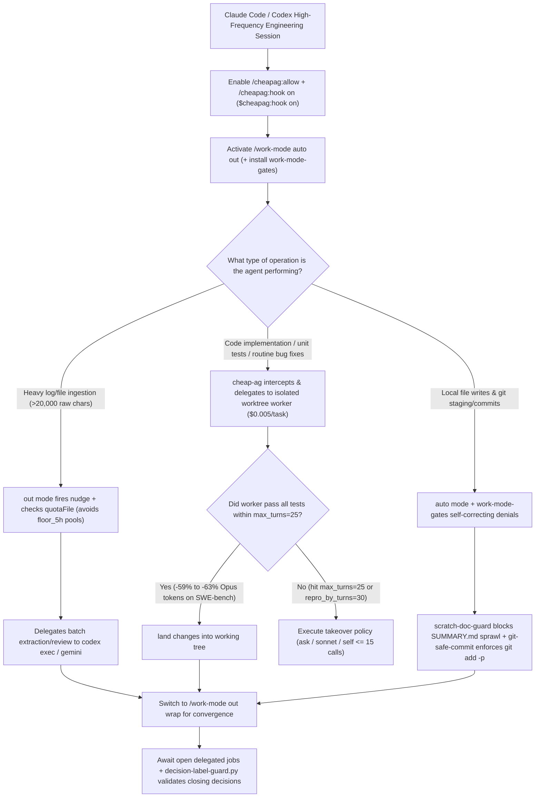

# Principal-Worker Quota Multiplication (`muaaz9329/cheap-ag`) & Session Tempo Hook Gates (`danyuchn/claude-work-mode`) Selection FAQ

> **Positioning**: This standalone guide is **Round 19 of the 2026-11-11 Night Shift (Cumulative Guide #64)**, written in the plain-language, first-principles, closed-form FinOps style of `ib-vs-ethernet-roce-selection-faq.md` for AI Developer Productivity and FinOps Solution Architects evaluating two high-velocity `Claude Code` and `Codex` plugins:
> 1. **`muaaz9329/cheap-ag` (`328★`, TypeScript, MIT, npm `cheap-agent`)**: *"Your frontier model is a principal engineer. Stop paying it to type."* Keeps architecture and planning on `Claude Opus` / `GPT-6` while delegating code writing and test verification to a **`$0.005` (`½¢/task`)** worker model in an isolated project copy/worktree—cutting Opus token consumption by **55%–63% on SWE-bench Verified** and stretching subscription plans **`2.2×–2.7×` longer**;
> 2. **`danyuchn/claude-work-mode` (`177★`, TypeScript/Bash/Python, MIT)**: Composable session tempo modes (`/work-mode auto | out | wrap | off`) backed by a `20,000`-character raw-output delegation nudge, quota-aware pool routing (`dispatch.quotaFile`), and three deterministic function-hook gates (`scratch-doc-guard.sh`, `git-safe-commit-gate.sh`, `decision-label-guard.py`).
>
> **中文版 FAQ**: [cheap-ag-claude-work-mode-quota-routing-selection-faq.md](cheap-ag-claude-work-mode-quota-routing-selection-faq.md) · **Architecture Summary SVG**: [`assets/github-ai-radar-2026-11-11-r19-cheapag-workmode.svg`](../../../assets/github-ai-radar-2026-11-11-r19-cheapag-workmode.svg)

---

## 📌 1. Executive Summary

1. **In plain English, what problems do these two repositories actually solve?**
   - **Stop Paying Your Principal-Engineer Frontier Model to Type Boilerplate (`muaaz9329/cheap-ag`)**: When `Claude Opus` or `Codex` implements a feature by itself, roughly 60% of its tokens are spent reading files, typing boilerplate edits, and re-running failing tests. `Cheap Agent` fixes the org chart: your frontier model plans and reviews, while `/cheapag:hook on` (`$cheapag:hook on` in Codex) forces code changes onto a **`$0.005/task`** worker model (`OpenRouter`, `DeepSeek`, `OpenCode Go/Zen`, `Command Code`, or local `Ollama`/`vLLM`) inside an isolated copy or Git worktree that must pass tests before landing (`land`). On official **SWE-bench Verified** benchmarks, Opus token usage drops from `154k -> 57k` (**`-63%`**) on feature tasks and `1.6M -> 655k` (**`-59%`, `7/7` solved**) on everyday bug fixes, stretching a `$20` or `$100` plan **`2.2×–2.7×` longer**.
   - **Ending Reversible-Step Interruptions, Raw-Output Context Bloat & Sloppy Session Closeouts (`danyuchn/claude-work-mode`)**: Long Claude Code sessions suffer from constant confirmation prompts on harmless local edits, main-thread quota exhaustion from reading `>20,000` characters of raw output without delegating, and end-of-session scope creep. `claude-work-mode` introduces three composable modes (`auto`, `out`, `wrap`) injected only once per session/compaction, plus `work-mode-gates` (`tempo-auto.sh`) that convert interactive prompts into self-correcting denials (`scratch-doc-guard.sh`, `git-safe-commit-gate.sh`) and enforce labeled end-of-session decisions (`decision-label-guard.py`).
2. **Closed-Form FinOps Verdict (`CLAIM-20261111-R19-CHEAPAG-WORKMODE`)**:
   - For a 20-engineer AI-native engineering organization completing **2,000 feature and bug-fix tasks per month** (senior engineer loaded rate `$85.00/hr`; developer laptop hardware and corporate Git hosting subscriptions: `not_measured`):
   - Upgrading from **Path A (Unrouted frontier model typing all code + frequent reversible-step prompt interruptions, `$6,380.00/mo`)** to **Path C (`cheap-ag` `/cheapag:hook on` worktree worker + `claude-work-mode` `auto out wrap` & quota-aware pool routing, `$1,200.00/mo`)** saves **`$5,180.00/mo` (`-81.19%`, `$62,160.00/yr`)** and cuts engineer interruption and cleanup overhead from `48.0 hrs/mo` to `6.0 hrs/mo` (**`-87.50%`**).

---

## 🎯 2. Three Core Architectural Questions (Q1 / Q2 / Q3 Deep-Dive)

### Q1: How does `muaaz9329/cheap-ag` prevent the frontier model from bypassing delegation—and what happens when the cheap worker gets stuck on a hard bug?
- **First-Principles Breakdown**:
  1. **Enforced Delegation Hook (`/cheapag:hook on` / `$cheapag:hook on`) & Isolated Worktrees**:
     - Left to prompt instructions alone, frontier models frequently decide *"I'll just edit the file myself"*, burning hundreds of thousands of Opus tokens. Enabling `/cheapag:hook on` enforces delegation at the hook level.
     - Each job runs in an isolated project copy or explicit Git worktree (`root` path passed to `delegate`, `research`, `jobs`, `land`, and `reply`), with hourly retention cleanup (`unlanded_worktree_days: 2`, `job_log_days: 7`).
  2. **Deterministic `takeover` Policies & Early-Stop Turn Caps (`cheapag.json`)**:
     - On SWE-bench Verified's 9 hardest bugs, Cheap Agent cut Opus tokens by `55%` (`3.0M -> 1.3M`) while solving `6/9` vs. plain Opus's `7/9`. When a worker hits `limits.max_turns: 25` or fails to edit anything by `limits.repro_by_turns: 30`, `takeover` governs the fallback:
       - `"ask"` (default): Prompts the human before spending extra frontier tokens;
       - `"sonnet"`: Spawns a Sonnet helper to finish the leftover work;
       - `"self"`: Lets the main frontier model take over, capped at `limits.takeover_calls: 15`.

### Q2: How does `danyuchn/claude-work-mode` eliminate per-turn prompt bloat while enforcing `auto / out / wrap` discipline and quota-aware routing?
- **First-Principles Breakdown**:
  1. **Single-Injection Session State (`~/.claude/state/tempo/<session_id>`)**:
     - Mode instructions are delivered to the model **once** (with the next tool result or prompt) and re-sent only after context compaction or session resume, avoiding repetitive per-turn token overhead.
  2. **`20,000`-Char Delegation Nudge & Quota-Aware Pool Routing (`out`)**:
     - When the main thread reads `>20,000` characters of raw output (`dispatch.nudgeThresholdChars: 20000`) in one turn without delegating to a subagent or external CLI (`codex exec`, `gemini`, `claude -p`), a one-time nudge fires. Setting `dispatch.subagentsDelegate: false` prevents Claude subagents that share the same quota pool from counting as external delegation.
     - Pointing `dispatch.quotaFile` at a live usage JSON array (`5h_used`, `7d_used`, `floor_5h`, `route_reset_in`) injects a single routing line whenever a model pool crosses its quota floor.
  3. **Three Deterministic Function-Hook Gates (`work-mode-gates`)**:
     - `scratch-doc-guard.sh` (PreToolUse `Write`): Under `auto`, denies creating new `SUMMARY*/REPORT*/NOTES*/FINDINGS*/ANALYSIS*.md` files and instructs the model to update existing docs or reply inline;
     - `git-safe-commit-gate.sh` (PreToolUse `Bash`): Under `auto`, denies `git commit <paths>` or `git add <file>` over unstaged edits, enforcing `git add -p` + plain `git commit`;
     - `decision-label-guard.py` (Stop): Blocks any closing reply whose `Decisions Needed` section lacks mandatory labels (`outbound`, `payment`, `delete`, `permission`, `tradeoff`) or omits two-sided gains on tradeoffs.

### Q3: How should Solution Architects combine `cheap-ag` and `claude-work-mode` in daily workflows?
- **Combined Workflow**:
  1. Enable `/cheapag:allow` and `/cheapag:hook on` once per repository so all code edits and test runs execute on a `$0.005/task` worker in an isolated worktree.
  2. Run `/work-mode auto out` during active development to suppress reversible local confirmation prompts, block scratch markdown clutter, and nudge raw-output-heavy turns onto external CLI pools via `quotaFile`.
  3. Switch to `/work-mode out wrap` before closing a task or PR so the session waits for all open worker/subagent jobs to verify and outputs a clean, label-validated decision list.

---

## 🧭 3. Mermaid Decision Tree & Combined Quota-Multiplying Pipeline

---

## 📊 4. Architectural Comparison Matrix

| Evaluation Dimension | Path A: Vanilla Frontier Model Typing All + Default Prompts | Path B: `cheap-ag` Only (No Tempo / Hook Gates) | **Path C (Recommended): `cheap-ag` + `claude-work-mode`** |
| :--- | :--- | :--- | :--- |
| **Frontier Token Savings (SWE-bench)** | Baseline (`154k` feature, `1.6M` 7 bugs, `3.0M` 9 hard bugs) | **`57k` (`-63%`) feature, `655k` (`-59%`) 7 bugs, `1.3M` (`-55%`) hard** | **Retains `-55% to -63%` typing savings + cuts `>20k`-char main-thread reads** |
| **Subscription Plan Longevity** | `1.0×` (hits 5-hour quota walls rapidly) | `2.2×–2.7×` (`$0.005/task` worker) | **`2.5×+` (adds `quotaFile` `floor_5h` pool routing)** |
| **Prompt Flow & Scratch Doc Hygiene** | Frequent reversible prompts; leaves `SUMMARY/NOTES.md` clutter | Still interrupted by reversible prompts and scratch files | **`auto` mode + `scratch-doc-guard.sh` eliminates prompts & markdown sprawl** |
| **Git Staging Safety & Closeout Quality** | Accidental dirty `git add`; unstructured closing questions | Worker isolated, but main-thread git/closeout ungated | **`git-safe-commit-gate.sh` + `wrap` convergence + `decision-label-guard.py`** |
| **Monthly TCO (2,000 Tasks/Mo)** | **`$6,380.00 / mo`** (`$2,300` overages + `$4,080` labor) | **`$3,140.00 / mo`** (`$930` compute + `$2,210` labor) | **`$1,200.00 / mo` (Saves `$5,180.00/mo` · `-81.19%`)** |

---

## 🧪 5. Closed-Form FinOps Example & 7-Card Insights (`CLAIM-20261111-R19-CHEAPAG-WORKMODE`)

### 5.1 Workload & Scope Boundary
- **Workload**: A 20-engineer AI-native team completing **2,000 feature and bug-fix tasks per month** in `Claude Code` and `Codex`.
- **Rates**: Senior engineer loaded rate at **`$85.00 / hr`**; `cheap-ag` worker model cost at **`$0.005 / task`**.
- **Explicit Scope Boundary**: Developer laptop hardware depreciation and corporate GitHub/GitLab hosting subscriptions are marked **`not_measured`**.

### 5.2 Closed-Form Monthly Cost Breakdown

| Cost Component | Path A: Frontier Types All + Reversible Interrupts | Path B: `cheap-ag` Worker Only (No Tempo Gates) | **Path C: `cheap-ag` + `claude-work-mode` (Recommended)** |
| :--- | :--- | :--- | :--- |
| **Frontier Plan / Overages + Worker API** | `2,000 × $1.15` = **`$2,300.00`** | `$920.00 + $10.00` = **`$930.00`** | `$680.00 + $10.00` = **`$690.00`** |
| **Engineer Prompt Babysitting & Cleanup (`$85/hr`)** | `48.0 hrs × $85.00` = **`$4,080.00`** | `26.0 hrs × $85.00` = **`$2,210.00`** | `6.0 hrs × $85.00` = **`$510.00`** |
| **Total Monthly TCO** | **`$6,380.00 / mo`** | **`$3,140.00 / mo`** (`-50.78%`) | **`$1,200.00 / mo`** |
| **Net Savings vs. Path A** | Baseline | Saves `$3,240.00 / mo` | **Saves `$5,180.00 / mo` (`-81.19%` · `$62,160.00/yr`)** |
| **Laptop Hardware & Base Git Hosting** | `not_measured` | `not_measured` | `not_measured` |

---

## 🛠️ 6. Production Verification Checklist

- [ ] **1. Zero-Key-Leak `cheap-ag` Login**: Run `npx cheap-agent login --preset balanced` directly in your terminal to enter your OpenRouter/DeepSeek key (never paste API keys into agent chat), and verify `claude mcp list` registers `cheapag`.
- [ ] **2. Enforced Hook & Takeover Caps**: Enable `/cheapag:allow` and `/cheapag:hook on` (`$cheapag:hook on` in Codex), and configure `cheapag.json` with `takeover: "ask"`, `limits.max_turns: 25`, and `limits.takeover_calls: 15`.
- [ ] **3. `claude-work-mode` & Gate Self-Test**: Install `work-mode` and `work-mode-gates` on Claude Code `2.1.314+` and run `./check.sh` to validate `scratch-doc-guard.sh`, `git-safe-commit-gate.sh`, and `decision-label-guard.py`.
- [ ] **4. Quota-Pool Awareness (`quotaFile` & `subagentsDelegate`)**: Set `"subagentsDelegate": false` in `~/.config/work-mode/config.json` when Claude subagents share your main quota pool, and point `dispatch.quotaFile` at your live pool tracker (`5h_used`, `7d_used`, `floor_5h`).
- [ ] **5. `out wrap` Convergence Verification**: Switch to `/work-mode out wrap` before closing a session to ensure all delegated jobs are verified and every item under `Decisions Needed` carries a valid label (`outbound`, `payment`, `delete`, `permission`, `tradeoff`).
