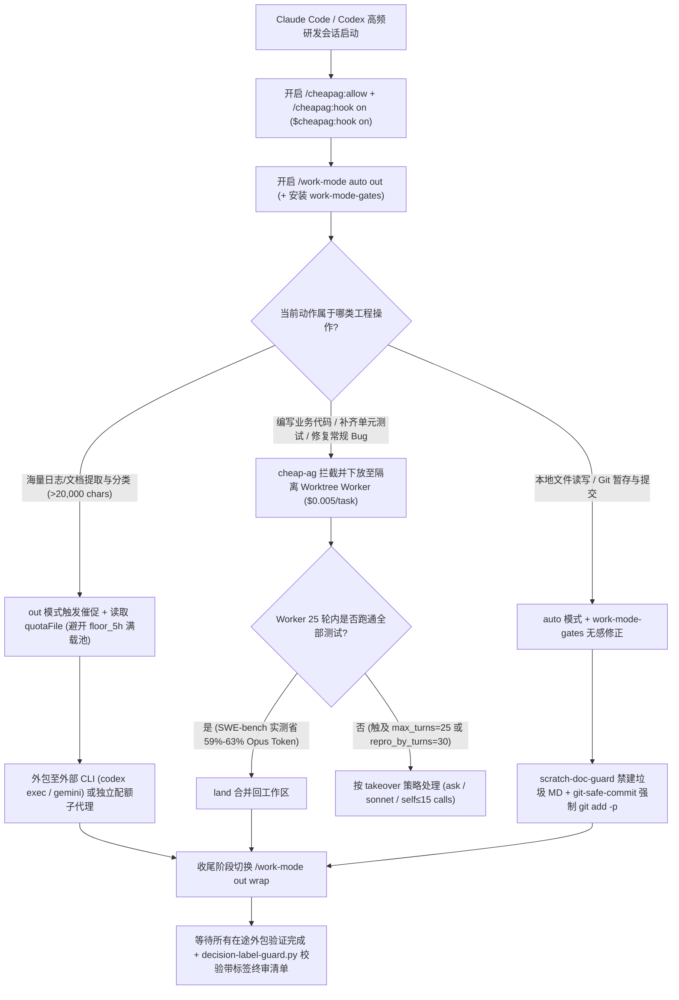

# 旗舰模型主从拆解节流（`muaaz9329/cheap-ag`）与会话节拍门禁状态机（`danyuchn/claude-work-mode`）选型 FAQ

> **文档定位**：本文是 **2026-11-11 夜班多轮深潜 Round 19（累计第 64 篇独立选型专题）**，严格对标 `ib-vs-ethernet-roce-selection-faq.md` 的「通俗大白话 + 第一性原理 + 可核算定量算例」标杆文风，为 AI 研发效能与 Coding Agent 成本架构师深度拆解今日两款针对 `Claude Code` 与 `Codex` 的高流速增效插件：
> 1. **`muaaz9329/cheap-ag`（`328★`，TypeScript，MIT，npm `cheap-agent`）**：“你的旗舰模型是首席工程师，别再付钱让它敲键盘打字”——通过将规划决策留在 `Claude Opus` / `GPT-6`，而将代码编写与测试验证强制下放给隔离工作树中仅需 **`$0.005`（半美分/任务）** 的廉价/本地模型，在 **SWE-bench Verified** 实测中节省 **55%～63% 的 Opus Token**，让包月额度耐用度提升 **`2.2×～2.7×`**；
> 2. **`danyuchn/claude-work-mode`（`177★`，TypeScript/Bash/Python，MIT）**：通过一条斜杠命令切换会话节拍模式（`auto` 免打扰自动推进、`out` 超 `20,000` 字符催促外包与配额感知池路由、`wrap` 收敛禁开新分支），并配套三大确定性函数级 Hook 门禁（`scratch-doc-guard.sh`、`git-safe-commit-gate.sh`、`decision-label-guard.py`）。
>
> **English Companion**: [cheap-ag-claude-work-mode-quota-routing-selection-faq.en.md](cheap-ag-claude-work-mode-quota-routing-selection-faq.en.md) · **架构总结图**: [`assets/github-ai-radar-2026-11-11-r19-cheapag-workmode.svg`](../../../assets/github-ai-radar-2026-11-11-r19-cheapag-workmode.svg)

---

## 📌 一、核心结论速览（Executive Summary）

1. **先用大白话讲透这两个项目到底解决了什么痛点？**
   - **旗舰模型包月额度“半天就被打字和跑单测烧光”的痛点（`muaaz9329/cheap-ag` 解决的问题）**：当你用 `Claude Opus` 或 `Codex` 开发功能时，最昂贵的旗舰模型有超过 60% 的 Token 都花在了读样板文件、敲重复代码、反复跑测试改拼写错误上——就像雇了一位年薪百万的首席架构师去手敲 CSV 导出脚本。`Cheap Agent` 重新梳理了“组织架构”：旗舰模型只负责看全局、定方案和验收；真正敲代码和跑测试的苦力活，通过 `/cheapag:hook on`（或 Codex 的 `$cheapag:hook on`）强制交给独立项目副本/Git Worktree 里的廉价模型（DeepSeek / OpenRouter / 本地 Ollama，单次任务仅需 **半美分 `$0.005`**），且 Worker 必须跑通测试才能合并（`land`）。在官方 **SWE-bench Verified** 基准上，开发同一功能 Opus Token 从 `154k` 降至 `57k`（**直降 `63%`**），7 个日常 Bug 修复从 `1.6M` 降至 `655k`（**直降 `59%`，解决率同为 `7/7`**），把 `$20/$100` 订阅用出 **`2.2×～2.7×`** 的容量！
   - **长会话“频繁弹窗打断、主线程狂读生日志爆上下文、收尾留烂尾分支与糊涂账”的痛点（`danyuchn/claude-work-mode` 解决的问题）**：跑 Claude Code 时最烦三件事：① 改个本地文件或跑个测试也停下来问你“行不行”；② 主线程一口气生吞几万字日志不肯派子智能体，瞬间吃光 5 小时配额；③ 快下班想收尾时它还在开新坑，列出的待拍板事项连正反利弊都没写清楚。`claude-work-mode` 提供可自由组合的三种会话模式（`/work-mode auto out wrap`）与三大 Hook 守卫：在 `auto` 模式下用 `tempo_deny` 将原本会弹窗的提示转化为“直接告诉模型该怎么做（如禁止乱建 `SUMMARY.md`、强制 `git add -p`）”，把真正危险的硬性阻断（外发消息、付款、删库、改权限）集中留到会话末尾一次性汇报，并用 `decision-label-guard.py` 强制校验每条待决策项必须带有明确分类标签与得失权衡（`tradeoff`）！
2. **闭式 FinOps 核算结论（`CLAIM-20261111-R19-CHEAPAG-WORKMODE`）**：
   - 在 **20 人 AI 原生研发团队每月完成 2,000 个功能开发与 Bug 修复任务**基准下（高级工程师全包时薪 `$85.00/hr`；开发者办公电脑硬件与企业 Git 托管底座费用：`not_measured`）：
   - 从 **Path A（旗舰模型包办全部敲代码 + 主线程生吞日志爆额度 + 频繁可逆操作打断与手工清理，`$6,380.00/月`）** 升级至 **Path C（`cheap-ag` 强制主从拆解 + `claude-work-mode` `auto/out/wrap` 节拍状态机与配额感知路由，`$1,200.00/月`）**，每月净省 **`$5,180.00/月`（降幅 `-81.19%`，年化节省 `$62,160.00/年`）**，工程师被打断及烂尾清理工时从 `48.0 小时/月` 降至 `6.0 小时/月`（**节省 `87.50%`**）。

---

## 🎯 二、三大灵魂拷问（Q1 / Q2 / Q3 Deep-Dive）

### Q1：`muaaz9329/cheap-ag` 是如何防止旗舰模型“偷懒自己直接改代码”，并在廉价模型卡壳时优雅兜底的？
- **第一性原理拆解**：
  1. **强制委托钩子（`/cheapag:hook on` & `$cheapag:hook on`）与工作树隔离**：
     - 很多时候即使你在提示词里让 Opus 调用子工具，它还是会觉得“我自己顺手改了更快”，从而白白烧掉几十万旗舰 Token。开启 `/cheapag:hook on` 后，系统在工具拦截层强制要求旗舰模型必须将代码修改委派给 `cheapag` Worker；
     - Worker 在项目独立副本或指定的 Git Worktree（在 `delegate`、`research`、`jobs`、`land`、`reply` 中传入 `root` 绝对路径）中运行，默认自动清理超过 `2 天` 未合并的工作树（`unlanded_worktree_days: 2`）和超过 `7 天` 的任务日志（`job_log_days: 7`），绝不污染主会话工作区。
  2. **三档接管策略（`takeover`）与无产出早停阈值（`repro_by_turns`）**：
     - 在 SWE-bench Verified 最难的 9 个 Bug 上，纯 Opus 解出 `7/9`，而 `Cheap Agent` 解出 `6/9`（省下 `55%` Opus Token，从 `3.0M` 降至 `1.3M`）。为了应对廉价模型搞不定的硬骨头，`cheapag.json` 提供三档 `takeover` 策略：
       - `"ask"`（默认）：Worker 达到 `limits.max_turns: 25` 或早停线 `limits.repro_by_turns: 30` 仍未搞定时，先询问用户，绝不擅自烧钱；
       - `"sonnet"`：自动拉起 Sonnet 助手接盘收尾；
       - `"self"`：由主线程旗舰模型亲自接手，但严格限制最多执行 **15 次工具调用（`limits.takeover_calls: 15`）**，防止失控暴走。

### Q2：`danyuchn/claude-work-mode` 的 `auto / out / wrap` 是如何做到“零每轮提示词膨胀”并实现跨模型池配额感知路由的？
- **第一性原理拆解**：
  1. **单次注入 + 压缩后重注入（Zero Per-Turn Prompt Bloat）**：
     - 许多插件在每次对话 Turn 都塞入几百字系统规则，反而浪费 Token。`claude-work-mode` 将当前会话状态写入 `~/.claude/state/tempo/<session_id>`，模式说明仅在切换后的**下一个工具返回或提示中注入 1 次**，此后仅在触发上下文压缩（Compaction）或会话恢复（Resume）时重新注入。
  2. **`out` 模式的 `20,000` 字符催促阈值与配额感知池路由（Quota-Aware Pool Routing）**：
     - 当主线程单轮累计读取超过 `20,000` 字符原始输出（`dispatch.nudgeThresholdChars: 20000`）却未调用 `codex exec`、`gemini` 或 `claude -p` 外包时，立即触发一次性提醒；若 Claude 子智能体共用同一个你正想节省的配额池，可设 `dispatch.subagentsDelegate: false`，将其读取量一并计入主线程催促水位！
     - 通过配置 `dispatch.quotaFile`（如记录 `[{"pool":"codex","5h_used":97,"route":"floor_5h","route_reset_in":"0h45m"}]`），`out` 模式仅在配额表发生变化时向模型精准播报哪个模型池已触及 5 小时/7 天水位底线，动态引导模型避开即将耗尽的池子。
  3. **`tempo_deny` 将弹窗询问转化为无感自治指令（`work-mode-gates`）**：
     - 在 `auto` 模式下，`scratch-doc-guard.sh` 直接拒绝创建多余的 `SUMMARY*/REPORT*/NOTES*.md` 并指示模型更新现有文档或直接在回复中作答；`git-safe-commit-gate.sh` 拦截带路径的危险 `git commit` 或覆盖未暂存修改的 `git add`，引导改用 `git add -p`；`decision-label-guard.py` 则在 `Stop` 事件拦截任何未标注 `[outbound]` / `[payment]` / `[delete]` / `[permission]` / `[tradeoff]` 的待定决策。

### Q3：架构师在日常使用 Claude Code 与 Codex 时，如何把 `cheap-ag` 与 `claude-work-mode` 组合成最强省钱提效流水线？
- **黄金组合打法**：
  1. 进入项目先执行一次 `/cheapag:allow` 与 `/cheapag:hook on`，把代码敲击与单测循环钉死在 `$0.005/任务` 的 DeepSeek / OpenRouter Worker 上；
  2. 开启 `/work-mode auto out`：让主线程跳过一切可逆本地步骤的确认弹窗，同时一旦主线程读日志超过 `20k` 字符就自动外包给廉价子进程，并根据 `quotaFile` 避开 `5h_used > 90%` 的高负载池；
  3. 临近功能收尾或准备提交 PR 时，切换 `/work-mode out wrap`：禁止再开新分支，等待所有在途 Worker 与外包任务验证完毕，最后由 `decision-label-guard.py` 吐出一份标签齐全、得失清晰的终审决策清单。

---

## 🧭 三、Mermaid 选型决策树与主从节流+节拍门禁流水线

---

## 📊 四、同类方案核心能力对比矩阵（Comparison Matrix）

| 评估维度 | Path A：原生旗舰模型全包 + 默认交互模式 | Path B：仅安装 `cheap-ag`（无节拍与门禁） | **Path C（推荐标杆）：`cheap-ag` + `claude-work-mode` 组合** |
| :--- | :--- | :--- | :--- |
| **旗舰 Token 消耗（SWE-bench 实测）** | 基准线（新功能 `154k`，7 Bug `1.6M`，9 难 Bug `3.0M`） | **新功能 `57k` (`-63%`)，7 Bug `655k` (`-59%`)，9 难 Bug `1.3M` (`-55%`)** | **保持 `-55%～-63%` 代码敲击节省 + 额外消除主线程 `>20k` 字符日志吞吐** |
| **订阅额度续航倍数** | `1.0×`（重度开发几小时即触发 5h 限流） | `2.2×～2.7×`（Worker 仅耗 `$0.005/任务`） | **`2.5×+`（结合 `quotaFile` 自动绕开 `floor_5h` 满载模型池）** |
| **可逆步骤免打扰与垃圾文档治理** | 频繁弹窗中断心流；到处遗留 `SUMMARY/NOTES.md` | 仍受主线程确认弹窗与临时 MD 文件泛滥困扰 | **`auto` 模式零可逆打断 + `scratch-doc-guard.sh` 拦截冗余文档** |
| **Git 暂存安全与收尾决策质量** | 易把未暂存脏改动一并提交；收尾待办无轻重缓急 | Worker 在独立副本运行，但主线程收尾仍缺乏强门禁 | **`git-safe-commit-gate.sh` + `wrap` 收敛 + `decision-label-guard.py` 强制标签** |
| **月度总拥有成本（2,000 任务/月）** | **`$6,380.00 / 月`**（额度溢出 `$2,300` + 人工 `$4,080`） | **`$3,140.00 / 月`**（算力 `$930` + 人工 `$2,210`） | **`$1,200.00 / 月`（净省 `$5,180.00/月`，降幅 `-81.19%`）** |

---

## 🧪 五、闭式定量 FinOps 算例与 7-Card 评测洞察（`CLAIM-20261111-R19-CHEAPAG-WORKMODE`）

### 5.1 基准假设与边界声明
- **评测负载**：20 人 AI 原生研发团队每月使用 `Claude Code` 与 `Codex` 完成 **2,000 个功能迭代与 Bug 修复任务**。
- **单价基准**：高级工程师全包时薪 **`$85.00 / hr`**；`cheap-ag` 廉价 Worker 模型均价 **`$0.005 / task`**。
- **显式边界声明（Scope Boundary）**：开发者本地笔记本电脑硬件折旧与企业 GitHub/GitLab 仓库基础托管费标记为 **`not_measured`**。

### 5.2 三路径闭式成本核算表

| 成本构成项 | Path A：旗舰模型全包打字 + 频繁弹窗打断 | Path B：仅用 `cheap-ag` 主从拆解（无节拍门禁） | **Path C：`cheap-ag` + `claude-work-mode`（推荐）** |
| :--- | :--- | :--- | :--- |
| **旗舰订阅/API 溢出与 Worker 账单** | `2,000 × $1.15` = **`$2,300.00`** | `$920.00 + $10.00` = **`$930.00`** | `$680.00 + $10.00` = **`$690.00`** |
| **工程师打断看管与收尾清理（`$85/hr`）** | `48.0 hrs × $85.00` = **`$4,080.00`** | `26.0 hrs × $85.00` = **`$2,210.00`** | `6.0 hrs × $85.00` = **`$510.00`** |
| **月度总成本（Monthly Total）** | **`$6,380.00 / 月`** | **`$3,140.00 / 月`**（`-50.78%`） | **`$1,200.00 / 月`** |
| **相对 Path A 净节省（Savings）** | 基准线（Baseline） | 节省 `$3,240.00 / 月` | **净省 `$5,180.00 / 月`（`-81.19%` · 年省 `$62,160.00`）** |
| **办公笔记本与 Git 基础托管费** | `not_measured` | `not_measured` | `not_measured` |

---

## 🛠️ 六、生产级落地核验 Checklist（SA Actionable Verification）

- [ ] **1. `cheap-ag` 终端零密钥泄露初始化**：运行 `npx cheap-agent login --preset balanced` 并在本地终端自行输入 OpenRouter / DeepSeek API Key（切勿在聊天框直接粘贴密钥），核验 `claude mcp list` 已显示 `cheapag`。
- [ ] **2. 强制委托钩子与兜底上限配置**：在项目内开启 `/cheapag:allow` 与 `/cheapag:hook on`（Codex 为 `$cheapag:hook on`），并在 `cheapag.json` 中核验 `takeover: "ask"`、`limits.max_turns: 25` 与 `limits.takeover_calls: 15`（Windows 下若遇崩溃需留意清理残留 `opencode.exe`）。
- [ ] **3. `claude-work-mode` 与三大 Hook 守卫安装**：在 Claude Code `2.1.314+` 中安装 `work-mode` 与 `work-mode-gates`，执行 `./check.sh` 确认 `scratch-doc-guard.sh`、`git-safe-commit-gate.sh` 与 `decision-label-guard.py` 自检全绿。
- [ ] **4. 共享配额池防内耗与 `quotaFile` 联动**：当 Claude 子代理与主线程消耗同一付费池时，在 `~/.config/work-mode/config.json` 中设置 `"subagentsDelegate": false`，并挂载外部 `quotaFile` 监控 `5h_used` / `7d_used` 水位。
- [ ] **5. `out wrap` 组合收敛验收**：在任务收尾阶段开启 `/work-mode out wrap`，验证主线程等待所有已派发子任务核验完成后再关闭，且最终输出中的每条 `Decisions Needed` 均具备合法前缀标签与双向得失说明。
