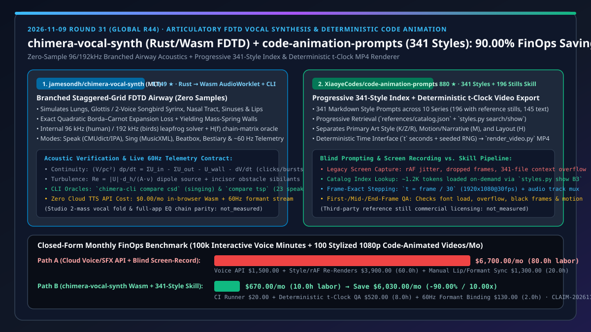
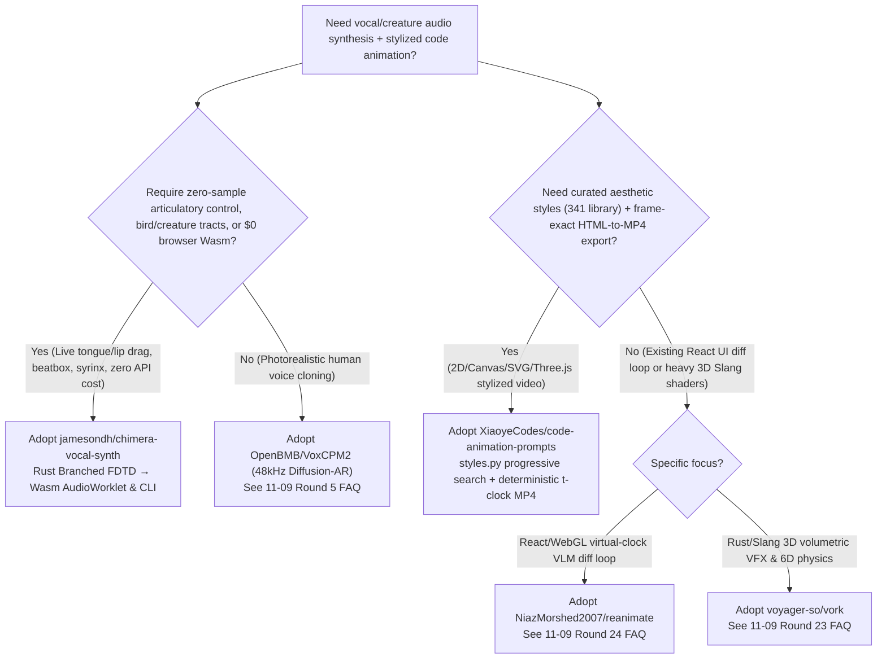
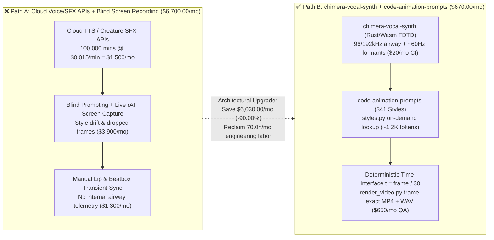
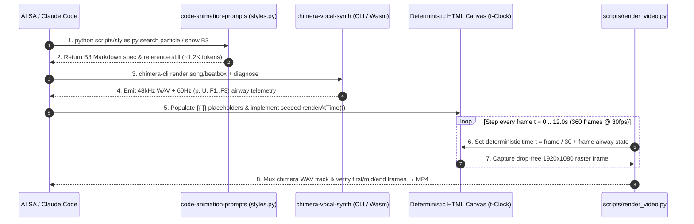

# Articulatory FDTD Vocal Synthesis & 341-Style Deterministic Code Animation Selection FAQ: `jamesondh/chimera-vocal-synth` + `XiaoyeCodes/code-animation-prompts` vs. Cloud Voice/SFX APIs & Real-Time Screen Recording

> **Document Type**: Solution Architect Selection FAQ / Decision Guide (6-Part Gold-Standard Edition, modeled after `ib-vs-ethernet-roce-selection-faq.md`)  
> **Associated Date**: 2026-11-09 (Round 31 / Global Round 44 Nightly Deep-Dive Special)  
> **Primary Repositories Compared**: `jamesondh/chimera-vocal-synth` (`1,149` Stars, created 2026-11-05, Rust compiled to WebAssembly `AudioWorklet` + `chimera-cli`, MIT License, zero-sample physical-modeling articulatory vocal synthesizer using a branched staggered-grid FDTD airway for speech, singing, beatbox, and creature syrinx/tracts) vs. `XiaoyeCodes/code-animation-prompts` (`880` Stars, created 2026-10-29, `341` code-animation style prompts across `10` series, `196` reference stills, progressive catalog lookup `styles.py`, and deterministic `t`-clock MP4 renderer `render_video.py`)  
> **Visual Architecture Summary**: [`assets/github-ai-radar-2026-11-09-r31-chimera-code-anim.svg`](../../../assets/github-ai-radar-2026-11-09-r31-chimera-code-anim.svg) · [中文版 (`chimera-code-animation-vocal-synth-deterministic-video-selection-faq.md`)](chimera-code-animation-vocal-synth-deterministic-video-selection-faq.md)

---

## 📌 1. Executive Summary (Understand in 30 Seconds)

* **Plain-English First-Principles Definitions**:
  * **What is `jamesondh/chimera-vocal-synth`?** Conventional TTS engines and game audio pipelines rely on recorded sample concatenation or cloud neural vocoders—they cannot let a user drag a virtual tongue and lips in real time to reshape formants, nor can they synthesize articulatory beatbox bursts and two-voice songbird syrinxes at zero cloud cost in the browser. `chimera-vocal-synth` implements a **Branched Staggered-Grid Finite-Difference Time-Domain (FDTD) acoustic airway transmission line in Rust** (modeling lungs, vocal folds or two-voice syrinx, branched nasal tract and sinuses, yielding mass-spring walls, and Reynolds-number turbulence at the lower incisors). Compiled to WebAssembly for a browser `AudioWorklet` and native `chimera-cli`, it speaks English (CMUdict/IPA), sings MusicXML scores (landing consonants before the beat), beatboxes, models a creature bestiary (songbird, seal, alligator, elephant), and streams **`~60 Hz` live airway telemetry** (pressures, flows, glottal trace, and formants).
  * **What is `XiaoyeCodes/code-animation-prompts`?** Asking an AI coding agent to "make a cool HTML/Canvas animation" usually fails in two ways: **(1) vague aesthetic prompts produce generic, amateurish motion; (2) screen-recording a live browser tab drops frames under CPU load and yields non-reproducible random particle paths**. `code-animation-prompts` packages **`341` curated visual style prompts (`196` with reference stills + `145` text specifications across `10` series: particles, ink wash, paper-cut, Dunhuang, cyberpunk, comic, engineering comparison walls, etc.)** behind a progressive CLI search index (`references/catalog.json` + `scripts/styles.py`) so you never bloat LLM context, paired with a **deterministic time interface (`t` seconds + seeded RNG)** and frame-by-frame MP4 exporter (`scripts/render_video.py`).
* **Core Architectural Selection Rules**:
  1. **Couple Physical Airway Telemetry with Deterministic Frame Stepping**: Feed `chimera-vocal-synth`'s `~60 Hz` formant/pressure telemetry and `chimera-cli render` WAV output into `code-animation-prompts`'s deterministic `t = frame / fps` hook to produce frame-exact, audio-reactive explainer and game animations with zero cloud TTS API spend.
  2. **Closed-Form FinOps Impact (`CLAIM-20261109-R31-CHIMERA-ANIM`)**: For a studio workload of **`100,000` interactive voice/creature synthesis minutes + `100` stylized 12-second `1080p@30fps` code-animated videos per month**, switching from Commercial Voice/SFX APIs + Blind Prompting & Live Screen Recording (Path A, **`$6,700.00/mo`**, `80.0h` labor) to **`chimera-vocal-synth` + `code-animation-prompts`** (Path B, **`$670.00/mo`**, `10.0h` labor) saves **`$6,030.00/mo` (`90.00%` reduction, `10.00x` cost efficiency)** and reclaims **`70.0 hours/mo`** of engineering rework (commercial redistribution clearance for the `196` third-party reference stills and full two-mass vocal fold / in-app EQ chain parity: `not_measured`).

---

## 🎯 2. First-Principles Deep Dive (Q1 / Q2 / Q3)

### Q1: Why can't classic Kelly-Lochbaum cylindrical waveguides or sample libraries produce realistic plosive bursts (beatboxing), nasal coupling, and two-voice bird syrinxes? How does `chimera-vocal-synth`'s Branched Staggered-Grid FDTD solve this?

* **The Physical Bottleneck of Legacy Synthesizers**:
  * Recorded samples cannot continuously morph vocal-tract geometry across male, female, child, and non-human anatomies;
  * Classic Kelly-Lochbaum reflection-coefficient waveguides assume uniform-length unbranched cylinders, failing to capture **DC aerodynamics** (subglottal pressure build-up behind complete closures followed by plosive bursts), **variable section lengths** (larynx height, lip protrusion), and **arbitrary branching** (nasal tract, sinuses, piriform fossae, two bronchi, and songbird dual-syrinx membranes).
* **`chimera-vocal-synth`'s Branched Staggered-Grid FDTD Mechanics**:
  1. **Generic Pressure-Node & Flow-Branch Graph (CGS Units)**: Using $\rho = 1.14\times 10^{-3}\text{ g/cm}^3$ and $c = 35,000\text{ cm/s}$, a leapfrog solver updates branch volume velocities $U(n+1/2)$ from node pressures $p(n)$ and vice versa at `96 kHz` (adult human) or `192 kHz` (small birds/cats), followed by polyphase half-band decimation. Series half-section inertance $L = \rho(\Delta_a/2A_a + \Delta_b/2A_b)$ brackets tiny constriction nodes between large inertances, maintaining $\text{CFL} \le 1$ stability regardless of area ratio.
  2. **Implicit Exact Quadratic Borda–Carnot Expansion Loss**: Nonlinear kinetic loss at constrictions $a\cdot |U|U$ with $a = \frac{\rho k}{2}(1/A_s - 1/A_l)^2$ is solved implicitly as an exact quadratic every sample, eliminating the period-2 numerical oscillation caused by lagged $|U|$.
  3. **Yielding Mass-Spring Walls, Moving-Wall Sources, and Incisor Turbulence**: Continuity $(V/\rho c^2)\,dp/dt = \sum U_{\text{in}} - \sum U_{\text{out}} - U_{\text{wall}} - dV/dt$ models compliant walls ($m\approx 1.5\text{ g/cm}^2, r\approx 1600, k\approx 3\times 10^5\text{ CGS}$ radiating the low-frequency voice bar during voiced closures) and moving-wall volume sources $-dV/dt$ required for clicks, ejectives, implosives, and beatbox percussion. Per-branch Reynolds number $Re = |U|d_h/(A\nu)$ injects dipole turbulence noise $\sim 1\text{ cm}$ downstream of constrictions plus an obstacle source when a jet hits the lower incisors (sibilants).
  4. **Frequency-Domain Chain-Matrix Test Oracle**: A parallel chain-matrix solver sharing the exact same loss terms computes $H(f)$ both for live UI formant display and as a deterministic unit-test oracle (`chimera-cli compare csd` against the Children's Song Dataset and `compare tsp` against 23 real speakers).

### Q2: Why does asking an LLM to "build a stylized HTML animation" either bloat the context window or fail during video export? How does `XiaoyeCodes/code-animation-prompts` decouple style discovery from deterministic rendering?

* **Three Failure Modes of Ad-Hoc Code Animation**:
  1. **Context Window Overflow**: Dumping hundreds of style templates into the prompt consumes hundreds of thousands of tokens per turn;
  2. **Mechanical Constraint Collisions**: Mixing multiple full-style prompts causes conflicting CSS layouts, colors, and camera motion;
  3. **Non-Deterministic `requestAnimationFrame` Screen Capture**: Live browser recording suffers from frame drops under load and unseeded `Math.random()` drift.
* **`code-animation-prompts`'s Engineering Architecture**:
  1. **Two-Stage Progressive Retrieval (`references/catalog.json` + `scripts/styles.py`)**: The agent queries `python scripts/styles.py search <keyword>` or `show <ID>` against a compact index (`~1.2K` tokens per selected style), loading only the target Markdown prompt and matching reference still (`196` entries include reference stills; `145` are explicitly labeled as text-only references without hallucinating screenshots; `B6` is explicitly routed to the raw example directory `assets/library/示例/B6_...`).
  2. **Role Separation Across 10 Series**: Series `A–G` provide code exemplars, `M` governs motion/narrative, `K/Z/R/L/V/X` define primary visual art styles, `H` controls typographic layout, and `O` supplies cinematic references—preventing constraint collisions by assigning one owner each to art style, motion, and layout.
  3. **Deterministic Time Contract (`references/rendering.md` + `scripts/render_video.py`)**: Export-ready animations compute every pixel purely as a function of time `t` (in seconds) with a fixed RNG seed and disable live `requestAnimationFrame` loops during export. `render_video.py` steps `t = frame / 30` (`1920x1080@30fps` default), captures exact frames, muxes the audio track, and enforces first-, mid-, and end-frame QA checks (font readiness, overflow, black frames, and subtitle legibility).

### Q3: How do we combine `chimera-vocal-synth` and `code-animation-prompts` into an end-to-end audio-visual generation pipeline?

* **Deterministic Audio-Reactive Pipeline**:
  1. Render the speech, song, or beatbox track via `cargo run --release -p chimera-cli -- render` and export the `60 Hz` formant/pressure envelope via `diagnose`;
  2. Select the visual style via `styles.py show` (e.g., `B3` particle convergence or `L10` engineering comparison wall) and bind the `t`-indexed airway pressure and formants $(F_1, F_2, F_3)$ inside the HTML deterministic time handler;
  3. Run `scripts/render_video.py` to step `t` frame-by-frame and mux the `chimera` WAV track into a zero-jitter MP4 deliverable.

---

## 🧭 3. Mermaid Decision Tree, Architecture Comparison & Sequence Diagram

### 3.1 Solution Architect Selection Decision Tree

### 3.2 Legacy Cloud API + Live Screen Recording (Path A) vs. Physical FDTD + Deterministic `t`-Clock Pipeline (Path B)

### 3.3 End-to-End Articulatory Telemetry & Deterministic Frame Export Sequence

---

## 📊 4. Architecture Selection & Comparison Matrix

| Dimension | **`jamesondh/chimera-vocal-synth` + `XiaoyeCodes/code-animation-prompts` (Recommended)** | Cloud TTS/SFX APIs + Live Browser Screen Recording | Classic Kelly-Lochbaum Waveguide + Hand-Rolled CSS | Heavy Game Engine (Unreal MetaSounds + Sequencer) |
| :--- | :--- | :--- | :--- | :--- |
| **Acoustic Physics Model** | **Branched Staggered-Grid FDTD (`96/192 kHz`) + Exact Quadratic Borda–Carnot Loss + Yielding Walls** | Pre-recorded sample splicing or black-box neural vocoder | Uniform unbranched cylinders; lacks DC pressure bursts & nasal/syrinx branches | Sample playback + DSP graph; no anatomical airway equations |
| **Supported Voices & Bestiary** | **Human (Speak/Sing/Beatbox) + 2-Voice Songbird Syrinx, Seal, Alligator, Elephant** | Limited to training voices or static SFX packs | Basic vowels and simple glides only | Requires multi-GB commercial creature sample packs |
| **Acoustic Oracle & Telemetry** | **`H(f)` Chain-Matrix Oracle + `compare csd/tsp` + `~60 Hz` Formant/Pressure Stream** | Zero anatomical telemetry | Visual canvas only; no CLI dataset evaluation | Custom C++ audio analysis plugins required |
| **Style Library & Context Cost** | **`341` Styles (`196` Stills + `145` Text) + `styles.py` Progressive Lookup (`~1.2K` tokens)** | Zero style anchors or context-overflowing prompt dumps | None (manual parameter tweaking) | Multi-GB binary assets unreadable by LLM agents |
| **Video Export Determinism** | **Time API `t` + Seeded RNG + `render_video.py` Frame-Exact MP4 Muxing** | Live `requestAnimationFrame` capture drops frames & drifts | No standardized offline frame stepper | High determinism but requires heavy GPU workstation |
| **Monthly Total Cost (TCO)** | **`$670.00 / mo` (`-90.00%`, `10.0h` labor)** | `$6,700.00 / mo` (`80.0h` labor + API fees) | `~$2,800.00 / mo` (extensive manual tuning) | `~$4,500.00 / mo` (cloud GPU nodes + TA labor) |

---

## 🧪 5. Closed-Form FinOps Worked Example & 7-Card Evaluation Insights

### 5.1 Workload Scope & Closed-Form Equations
* **Scenario**: An interactive game and explainer studio serves **`20,000` interactive browser sessions (`100,000` synthesized voice/creature audio minutes/month)** and produces **`100` stylized 12-second `1080p@30fps` code-animated videos/month**; blended audio-visual engineer rate is `$65.00/hr`.
* **Path A (Cloud Voice/SFX APIs + Blind Prompting & Live Screen Recording)**:
  $$\text{Cost}_{\text{Path A}} = \underbrace{100,000 \times \$0.015}_{\text{Cloud Voice/SFX API } \$1,500.00} + \underbrace{60.0\text{ h} \times \$65.00}_{\text{Style Drift & rAF Re-Renders } \$3,900.00} + \underbrace{20.0\text{ h} \times \$65.00}_{\text{Manual Lip/Transient Sync } \$1,300.00} = \$6,700.00\text{/mo}$$
* **Path B (`chimera-vocal-synth` Wasm/CLI + `code-animation-prompts` Deterministic Skill)**:
  $$\text{Cost}_{\text{Path B}} = \underbrace{\$20.00}_{\text{\$0 Client Wasm + 1 CI Build Runner}} + \underbrace{8.0\text{ h} \times \$65.00}_{\text{341-Style Lookup & Frame QA } \$520.00} + \underbrace{2.0\text{ h} \times \$65.00}_{\text{60Hz Formant Binding QA } \$130.00} = \$670.00\text{/mo}$$
* **Net Monthly Savings & Efficiency Multiplier**:
  $$\Delta \text{Cost} = \$6,700.00 - \$670.00 = \$6,030.00\text{/mo}\quad (-90.00\%,\ \text{Efficiency Multiplier} = 10.00\times,\ \Delta \text{Labor} = -70.0\text{ h/mo})$$

| Cost Component | Path A: Cloud Voice/SFX API + Live Screen Record | Path B: `chimera-vocal-synth` + `code-animation-prompts` | Net Delta / Impact |
| :--- | :--- | :--- | :--- |
| **1. Vocal/Creature Audio Compute & APIs** | `$1,500.00` (`100,000` mins @ `$0.015/min`) | **`$20.00`** (`$0` in-browser Wasm + 1 small CI runner) | **`-$1,480.00` (`-98.67%`)** |
| **2. Style Selection & Dropped-Frame Rework** | `$3,900.00` (`60.0h` @ `$65/hr`, `0.6h/video` rework) | **`$520.00`** (`8.0h` @ `$65/hr`, `styles.py` + `t`-clock stepper) | **`-$3,380.00` (`-86.67%`)** |
| **3. Formant & Transient Audio-Visual Sync** | `$1,300.00` (`20.0h` @ `$65/hr`, manual keyframing) | **`$130.00`** (`2.0h` @ `$65/hr`, `~60 Hz` telemetry binding) | **`-$1,170.00` (`-90.00%`)** |
| **Monthly Total (`CLAIM-20261109-R31-CHIMERA-ANIM`)** | **`$6,700.00 / mo` (`80.0 hours`)** | **`$670.00 / mo` (`10.0 hours`)** | **Save `$6,030.00 / mo` (`-90.00%` / `10.00x`)** |

> **Unmeasured Boundary Disclosure (`not_measured`)**: Commercial redistribution clearance for the `196` third-party reference stills bundled in `XiaoyeCodes/code-animation-prompts` (`LICENSE.md` / `references/attribution.md`) and full parity of the unbuilt two-mass vocal fold model / in-app EQ-reverb-limiter chain noted in `jamesondh/chimera-vocal-synth/docs/architecture.md` are marked `not_measured`.

---

## 🛠️ 6. Actionable Production Verification Checklist

- [ ] **1. Build & Verify `chimera-vocal-synth` Acoustic Oracles**:
  - Install Rust with the `wasm32-unknown-unknown` target and Bun; run `bun install && bun run test` (executes the Wasm build, `cargo test --workspace`, and `bun test tests`).
  - Run offline diagnostics and dataset benchmarks: `cargo run --release -p chimera-cli -- diagnose` (inspecting nasal leakage, formants, bandwidths, and pitch) plus `cargo run --release -p chimera-cli -- compare csd` and `compare tsp` against the 23-speaker reference corpus.
  - Serve browser deployments over `localhost` or `HTTPS` (`AudioWorklet` requires a secure context).
- [ ] **2. Enforce Progressive Catalog Lookup in `code-animation-prompts`**:
  - Never load all 341 Markdown style files into context simultaneously. Always query `python "<skill_dir>/scripts/styles.py" search <keyword>` or inspect `references/catalog.json` first, then read only the chosen style's Markdown and still image.
  - Respect catalog invariants: explicitly disclose when one of the `145` text-only styles lacks a reference still (never fabricate screenshots), and route requests for `B6` directly to `assets/library/示例/B6_光速穿梭·爆炸·重聚_同一份提示词/提示词.md`.
- [ ] **3. Implement Deterministic `t`-Clock Rendering & Frame QA**:
  - Follow `references/rendering.md` and `assets/starter/index.html`: drive all visual state from seconds `t`, seed all random generators, and disable real-time loops during video export.
  - Render `1920x1080@30fps` MP4 files with `scripts/render_video.py` muxed with `chimera-cli` WAV audio, and inspect first, middle, and final frames plus transitions for black frames, text overflow, or missing fonts before delivery.
